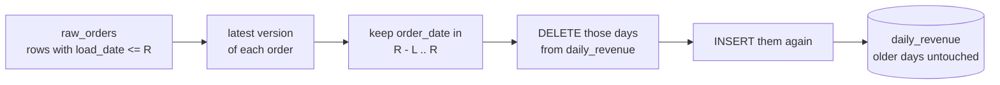

# Incremental models and backfills

Can yesterday's numbers be fixed without rebuilding three years of data?

## Before you start

- **Level 2** (intermediate). About 2 hours.
- **Builds on:** [08-01 Warehouse layers](../01-warehouse-layers/) (raw is never edited, "latest load wins", rebuilds from raw), [08-02 dbt from scratch](../02-dbt-from-scratch/) (models, `config(materialized=...)`) and [01-05 Dates and the date spine](../../01-sql/05-dates-and-the-date-spine/) (date arithmetic in SQLite).
- **You need:** Python 3.9 or later. Nothing to install. The warehouse is SQLite.

## The problem

Priya, who runs finance at Brightcart (the fictional online grocery from [08-06](../06-git-for-analysts/)), is closing October and her September revenue, counted from the payment system with refunds taken off, is 188,483.88. The `daily_revenue` table in the warehouse says 206,459.60. That table is **incremental**: to save time, the nightly job does not rebuild three years of history, it only rewrites the last 3 days. Priya wants to know which figure is right, why they differ, and whether the warehouse can be corrected before Friday without a full rebuild of everything. You have the raw order feed for September and October 2026 as it landed: 1,124 rows for 1,032 orders.

## In plain words

Think of a bank statement that arrives every evening. Most of today's card payments are on it. A few appear a day or two later, because the shop was slow to send them. And now and then a refund for something you bought last week turns up, dated today but belonging to last week's spending. If you only ever look at today's line, last week's total is wrong forever. If you re-add the whole year every evening, you are right but it takes all night. The sensible habit is to re-add the last week or two every evening, and once in a while go back further when you know something old changed.

The terms:

- An **incremental model** is a table that each run updates only partly, instead of being thrown away and rebuilt. The opposite is a **full rebuild** (in dbt, `materialized='table'`, or `dbt run --full-refresh`).
- A **late row** is a row that lands after the night it belongs to. Here an order placed on 3 September can land on 4 or 5 September, and a refund for it can land a week later. **Lateness** is `load_date - order_date` in days.
- The **lookback** (or lookback window) is how many days back each nightly run rewrites. A run on day R with lookback L rewrites every day from R - L to R, both included: L + 1 days.
- A **partition** here is one day of the table. Rewriting a day means deleting its row and inserting it again from raw. Doing that for a whole window in one go is the **delete and insert** pattern (dbt calls the strategy `delete+insert` or `insert_overwrite`).
- A **backfill** is a one-off run that rewrites a chosen range of old days with everything that has landed so far.
- A table is **stale** on a day when it differs from what a full rebuild would give today.

## What you will build from scratch

- `build_days`: rewrite any range of days from the raw rows that had landed by a given date. Everything else is built on it.
- `full_rebuild`, `incremental_run` and `backfill`: the three ways a team runs the model.
- `required_lookback`: the shortest lookback that would have caught every row in the feed.
- `stale_days`: the days where two versions of the table disagree, so you know exactly what to backfill.

The data in `data/raw_orders.csv` is synthetic, made by `make_data.py` with a fixed seed. The real table holds three years of history; this extract holds the two months that matter for the close.

## The idea

Every night the job sees only what has landed so far, picks the latest version of each order, and rewrites a window of days:



A day D is final once nothing can land for it any more. If the longest lateness in the feed is M days, a row for day D lands by D + M at the latest, and the run on that night rewrites D only if its window reaches back that far:

    the run on night D + M covers D   exactly when   L >= M

So a lookback of at least M days makes the nightly incremental table equal to a full rebuild. With a shorter lookback, any row that lands more than L days late is never seen: the window has already moved past its day. Nothing errors; the old day just keeps its old number.

**Why recompute whole days, not add new rows.** A refund is a new version of an old order, not a new order. If a run only adds the rows that landed tonight to the day totals, the refunded order is still counted as delivered from its first version, and counted again as an order. Recomputing the whole day from the latest version of every order is what makes a rerun safe: running the same night twice gives the same table. That property is called **idempotent**.

**The fix for the past is a backfill**, not a full rebuild: rewrite only the stale days, from the first to the last, with everything that has landed by today. Its cost is the size of that range, not the size of the history.

## Walk through

Run each block in Python from this folder (type `python3`, then paste), in order: later blocks use names from earlier ones. `exercise.py` gives the helpers `load_raw`, `shift`, `table_rows` and the table definition `CREATE`; the blocks write the model inline.

Step 1. Load the feed and follow one refunded order.

```python
import sqlite3
import exercise as ex

con = ex.load_raw(sqlite3.connect(":memory:"))
print(con.execute("SELECT COUNT(*), COUNT(DISTINCT order_id), MIN(order_date), MAX(load_date) FROM raw_orders").fetchone())
for row in con.execute("SELECT * FROM raw_orders WHERE order_id = (SELECT MIN(order_id) FROM raw_orders WHERE status = 'refunded') ORDER BY load_date"):
    print(row)
```

```text
(1124, 1032, '2026-09-01', '2026-10-31')
('2026-09-03', 50044, '2026-09-03', 'delivered', '716.20')
('2026-09-09', 50044, '2026-09-03', 'refunded', '716.20')
```

Order 50044 was placed and delivered on 3 September, and landed that night. Its refund landed on 9 September, as a second row for the same order. The latest row wins, so 716.20 is not revenue. But it belongs to 3 September, six days before it arrived.

Step 2. How late do rows land?

```python
lateness = con.execute("""
    SELECT CAST(julianday(load_date) - julianday(order_date) AS INTEGER) AS days_late, COUNT(*)
    FROM raw_orders GROUP BY days_late ORDER BY days_late""").fetchall()
print(lateness)
```

```text
[(0, 840), (1, 164), (2, 45), (3, 9), (4, 7), (5, 10), (6, 10), (7, 11), (8, 11), (9, 13), (10, 3), (11, 1)]
```

`julianday` turns a date into a day number, so subtracting two gives days. 840 rows land the same night, 209 land 1 or 2 days late, and a long tail lands 3 to 11 days late. In PostgreSQL you would write `load_date - order_date`, in BigQuery `DATE_DIFF(load_date, order_date, DAY)`, in Snowflake `DATEDIFF('day', order_date, load_date)`.

Step 3. The model for any range of days, and a full rebuild as of 31 October.

```python
DAYS_SQL = """
WITH visible AS (
  SELECT *, ROW_NUMBER() OVER (PARTITION BY order_id ORDER BY load_date DESC) AS rn
  FROM raw_orders WHERE load_date <= :as_of
)
SELECT order_date, COUNT(*), SUM(status = 'delivered'),
       ROUND(COALESCE(SUM(CASE WHEN status = 'delivered' THEN CAST(amount AS REAL) END), 0), 2)
FROM visible WHERE rn = 1 AND order_date BETWEEN :lo AND :hi
GROUP BY order_date"""

def rewrite(db, lo, hi, as_of):
    db.execute(ex.CREATE)
    db.execute("DELETE FROM daily_revenue WHERE order_date BETWEEN ? AND ?", (lo, hi))
    return db.execute("INSERT INTO daily_revenue " + DAYS_SQL, {"lo": lo, "hi": hi, "as_of": as_of}).rowcount

full = ex.load_raw(sqlite3.connect(":memory:"))
print(rewrite(full, "0000-01-01", "9999-12-31", "2026-10-31"))
print(full.execute("SELECT SUBSTR(order_date, 1, 7), SUM(orders), ROUND(SUM(revenue), 2) FROM daily_revenue GROUP BY 1").fetchall())
```

```text
61
[('2026-09', 491, 188483.88), ('2026-10', 541, 211109.1)]
```

- `load_date <= :as_of` is the time machine: it shows only what had landed by that date, so the same SQL can replay any night.
- `ROW_NUMBER() ... ORDER BY load_date DESC` with `rn = 1` keeps the latest version of each order. The window filter on `order_date` comes after, so a late refund replaces its order's first row rather than adding to it.
- `rewrite` deletes the range, then inserts it again. With a range from year 0 to year 9999 it is a full rebuild: 61 day rows. September is 188,483.88, Priya's figure exactly.

Step 4. Replay two months of nightly runs with a 3-day lookback.

```python
def nightly(lookback):
    db = ex.load_raw(sqlite3.connect(":memory:"))
    rewrite(db, "0000-01-01", "9999-12-31", "2026-09-01")
    run = "2026-09-02"
    while run <= "2026-10-31":
        rewrite(db, ex.shift(run, -lookback), run, run)
        run = ex.shift(run, 1)
    return db

inc = nightly(3)
print(inc.execute("SELECT SUBSTR(order_date, 1, 7), SUM(orders), ROUND(SUM(revenue), 2) FROM daily_revenue GROUP BY 1").fetchall())
a, b = ex.table_rows(inc), ex.table_rows(full)
stale = sorted(d for d in b if a.get(d) != b[d])
print(len(stale), stale[0], stale[-1])
print(a["2026-09-03"], b["2026-09-03"])
```

```text
[('2026-09', 491, 206459.6), ('2026-10', 541, 222372.29)]
41 2026-09-03 2026-10-26
(15, 15, 6991.42) (15, 14, 6275.22)
```

The replay starts from a full build as of 1 September, then runs every night with `as_of` equal to the run date, exactly what the job saw. Same orders (491 in September), but September revenue is 206,459.60: the warehouse's number, reproduced. 41 of 61 days are stale. On 3 September the incremental table still counts 15 delivered orders; the full rebuild counts 14, because order 50044's refund landed on the 9th, when the window was 6 to 9 September.

Step 5. What the window missed, and the lookback that would catch everything.

```python
print(con.execute("SELECT MAX(julianday(load_date) - julianday(order_date)) FROM raw_orders").fetchone())
print(con.execute("""SELECT status, COUNT(*) FROM raw_orders
                     WHERE julianday(load_date) - julianday(order_date) > 3 GROUP BY status""").fetchall())
```

```text
(11.0,)
[('refunded', 66)]
```

Every row that lands more than 3 days late is a refund: 66 of them. Slow payment exports (1 or 2 days) were always inside the window, which is why the 3-day lookback looked fine when it was chosen. The longest lateness is 11 days, so a lookback of 11 would have caught every row.

Step 6. Backfill the stale range, and check the longer lookback.

```python
print(rewrite(inc, stale[0], stale[-1], "2026-10-31"))
print(ex.table_rows(inc) == ex.table_rows(full))
print(ex.table_rows(nightly(11)) == ex.table_rows(full))
```

```text
54
True
True
```

The backfill rewrites 54 days, 3 September to 26 October, with everything landed by 31 October, and the table now equals the full rebuild exactly. Replaying the nightly job with an 11-day lookback gives the full rebuild too, with no backfill. That answers the question: yes, the past can be fixed by rewriting only the stale days.

Step 7. What each night reads.

```python
window = con.execute("SELECT COUNT(*) FROM raw_orders WHERE order_date BETWEEN '2026-10-20' AND '2026-10-31' AND load_date <= '2026-10-31'").fetchone()[0]
print(con.execute("SELECT COUNT(*) FROM raw_orders").fetchone()[0], window)
```

```text
1124 210
```

A full rebuild reads every raw row: 1,124 here, for 61 days. The run on 31 October with an 11-day lookback needs only the 12 days from 20 to 31 October: 210 rows. On three years of history (about 1,096 days) the window is still 12 days, so a night reads roughly 12 / 1,096 of the history. In a warehouse that stores raw by date, a filter on the date skips everything else; [08-05](../05-cloud-warehouse-cost/) shows how that turns into money.

**The real tool.** In dbt the same model is one SQL file. `is_incremental()` is true on a normal run and false on `--full-refresh`, and `{{ this }}` is the table being built:

```sql
{{ config(materialized='incremental', incremental_strategy='delete+insert', unique_key='order_date') }}
SELECT order_date, COUNT(*) AS orders, ...
FROM latest_orders

WHERE order_date >= (SELECT MAX(order_date) FROM {{ this }}) - INTERVAL '11 days'

GROUP BY order_date
```

A backfill is usually the same model run with variables for the range, for example `dbt run --select daily_revenue --vars '{start: 2026-09-03, end: 2026-10-26}'`, with the WHERE clause reading `var('start')` and `var('end')`. The exact syntax depends on the warehouse and the project; this block is reference only and nothing in the lesson runs it.

## Common mistakes

**1. Adding tonight's rows to the day totals (the trap).** The most natural incremental job takes the rows that landed tonight and adds them to their days. It never rereads anything old, so it looks cheap and safe:

```python
app = ex.load_raw(sqlite3.connect(":memory:"))
app.execute(ex.CREATE)
run = "2026-09-01"
while run <= "2026-10-31":
    app.execute("""INSERT INTO daily_revenue
        SELECT order_date, COUNT(*), SUM(status = 'delivered'),
               ROUND(COALESCE(SUM(CASE WHEN status = 'delivered' THEN CAST(amount AS REAL) END), 0), 2)
        FROM raw_orders WHERE load_date = ? GROUP BY order_date
        ON CONFLICT(order_date) DO UPDATE SET orders = orders + excluded.orders,
            delivered_orders = delivered_orders + excluded.delivered_orders,
            revenue = ROUND(revenue + excluded.revenue, 2)""", (run,))
    run = ex.shift(run, 1)
print(app.execute("SELECT SUM(orders), ROUND(SUM(revenue), 2) FROM daily_revenue").fetchone())
print(full.execute("SELECT SUM(orders), ROUND(SUM(revenue), 2) FROM daily_revenue").fetchone())
```

```text
(1124, 439004.18)
(1032, 399592.98)
```

It counts 1,124 orders, because each refund row is counted as one more order, and its revenue never loses a refunded order, because the delivered version was already added. It also catches every late row, so it looks more complete than the lookback job. A row is a new version of an order, not a new order: recompute the day from the latest versions. (`ON CONFLICT ... DO UPDATE` is SQLite's and PostgreSQL's upsert; Snowflake and BigQuery use `MERGE`.)

**2. Choosing the lookback from the typical delay.**

```python
rows = [r[0] for r in con.execute("SELECT julianday(load_date) - julianday(order_date) FROM raw_orders ORDER BY 1")]
print(rows[int(0.95 * len(rows))], rows[int(0.99 * len(rows))], rows[-1])
```

```text
5.0 9.0 11.0
```

95% of rows land within 5 days and 99% within 9, but every row that lands later changes a number. The lookback must cover the longest delay you accept, often set by a business rule (refunds are allowed for 14 days), and anything later still needs a backfill. Measure the delay again after any change upstream: the next feed may be later than this one.

**3. Backfilling with the old as-of date.** A backfill that replays the stale days "as they were run" reproduces the old error:

```python
again = nightly(3)
rewrite(again, stale[0], stale[-1], "2026-10-01")
print(len([d for d in b if ex.table_rows(again).get(d) != b[d]]))
```

```text
32
```

Using what had landed by 1 October fixes only the September days whose refunds had arrived by then; 32 days are still stale. A backfill reads everything that has landed by today.

**4. Inserting without deleting.** If the run inserts the window without deleting it first, a rerun of the same night either fails on the primary key or, on a table without one, doubles the window. Delete and insert in the same run (in one transaction on a real warehouse), so a rerun is harmless.

## Your turn

Open `exercise.py`. The helpers and the `CREATE` statement are done. Write the six functions marked TODO: `build_days`, `full_rebuild`, `incremental_run`, `backfill`, `required_lookback` and `stale_days`. Write `build_days` first; the other three runners are one line each on top of it.

```
python3 test_lesson.py
```

Run it from this folder. The test replays two months of nightly runs with a 3-day lookback and with the required lookback, on the committed feed and on a second feed from `make_data.build(seed=2027)` with a different longest delay. It checks every day against a full rebuild computed in plain Python, then backfills the stale range and checks again. Hand-made feeds check an empty feed, a row exactly `lookback_days` late (caught) and one day later (missed), a day with only a cancelled order (revenue 0, not NULL), a refund outside every window, a rerun of the same night, and a one-day backfill that leaves the other days alone.

Stretch: refunds at Brightcart are allowed for 14 days. Add a weekly job to your own copy that backfills the last 30 days every Sunday, replay it with a 3-day nightly lookback, and count how many days are stale on each day of the replay. What is the worst number Priya could have seen?

## Check yourself

1. The nightly job uses a 3-day lookback. A refund lands 5 days after its order. What happens to that day's revenue, and does anything error?
2. Why must an incremental run recompute whole days from raw instead of adding tonight's rows?
3. You find 41 stale days spread across two months. Do you need a full rebuild?
4. After raising the lookback to 11 days, can the table still go stale?

<details>
<summary>Answers</summary>

1. The refund is never applied: by the time it lands, the window has moved past its day, so the day keeps counting the order as delivered and revenue stays too high. Nothing errors, which is why it went unnoticed.
2. A late row can be a new version of an old order, such as a refund. Adding it to the totals counts the order twice and never removes the first version. Recomputing the day from the latest version of each order is correct and idempotent: running the same night twice gives the same table.
3. No. Backfill from the first stale day to the last, with everything landed by today. That rewrites 54 days, not three years, and the result equals a full rebuild. A full rebuild is only needed when the model's logic changes for all history.
4. Yes, if a row ever lands more than 11 days late: a slower export, a refund policy change, a loader outage. Keep measuring the longest delay, and schedule a periodic backfill (or full refresh) to catch what any window misses.

</details>

## What to tell the stakeholder

> Priya, your September figure is right: 188,483.88. The warehouse said 206,459.60 because its nightly job only rewrote the last 3 days, and 66 refunds landed 4 to 11 days after their orders, too late to be applied. I have rewritten 3 September to 26 October from the raw data, without touching older history, and the warehouse now matches a full rebuild exactly; the nightly job now looks back 11 days.

The caveat: October is 211,109.10 as of 31 October, but refunds for late October orders can still land in November, so October will go down a little until about 11 November. If a refund ever lands more than 11 days late it will be missed again, so I suggest a weekly backfill of the last 30 days as a safety net.

## In real job postings

Incremental models are what most dbt projects run every night. In the Real Analyst Jobs data drop of 25 October 2026 ([data/job-market/2026-10](../../../data/job-market/2026-10/)), 157 of the 2,056 US analyst postings that list a tool (7.6%) ask for dbt, and 43 of 413 in the UK (10.4%). Browse them at [SQL data analyst jobs](https://realanalystjobs.com/jobs/sql-data-analyst-jobs).

## Next

[08-05 Query cost in a cloud warehouse](../05-cloud-warehouse-cost/): why reading the whole history costs money, and how partitions let a query read only the days it needs.
