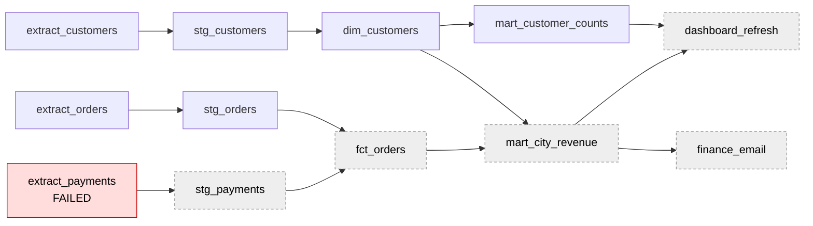

# Orchestration: a tiny DAG runner

What happens at 6 am when the 5 am job failed?

## Before you start

- **Level 3** (advanced). About 2 hours.
- **Builds on:** [08-02 dbt from scratch](../02-dbt-from-scratch/) (a DAG of models, topological order, cycle detection), [08-03 Incremental models and backfills](../03-incremental-models-and-backfills/) (delete and insert by day, idempotent runs) and [08-01 Warehouse layers](../01-warehouse-layers/) (raw, staging and marts).
- **You need:** Python 3.9 or later. Nothing to install. No scheduler is needed: you write the parts of one that decide what runs, in about 60 lines.

## The problem

Brightcart, the fictional online grocery from [08-01](../01-warehouse-layers/), runs its nightly pipeline at 05:00: twelve jobs that extract orders, payments and customers, build the staging and mart tables, refresh the dashboard and send Priya in finance her revenue email. On Wednesday 14 October 2026 the email did not arrive at 06:00, and the dashboard still showed Tuesday. Rohan, the head of data, wants three answers before the 10:00 stand-up: what failed and what it blocked, how to fix the morning without running the whole night again or counting any order twice, and what to change so the next failure costs less. You have the job list, the log of every failed attempt for the first 14 nights of October, and the orders the extract loads.

The files are synthetic, generated by `make_data.py` with a fixed seed. `data/jobs.csv` has the 12 jobs (`job`, `depends_on`, `minutes`, `retries`). `data/failures.csv` has 8 failed attempts (`run_date`, `job`, `attempt`); any attempt not listed succeeded. `data/orders.csv` has 829 orders (`order_date`, `order_id`, `amount`), one day per night.

## In plain words

Think of making breakfast for a family before school. The rice must cook before the lemon rice, the tea before the flask, and the lunch boxes need the lemon rice. If the gas runs out while the rice is cooking, you do not pack empty lunch boxes and pretend they are full; you still make the tea, which never needed rice, and you tell everyone lunch is late. When the gas comes back you cook the rice and pack the boxes, you do not make the tea again. And if a box was half filled when the gas went out, you empty it before refilling, or someone gets one and a half lunches.

The terms:

- An **orchestrator** (or scheduler) starts jobs at a set time, in an order that respects their dependencies. Airflow, Dagster and Prefect are common ones, and cron is the bare-bones version that only knows times (reference only: check your tool's docs for its exact behaviour and names).
- A **DAG** (directed acyclic graph) lists each job and the jobs it must wait for, its **upstream** jobs. The jobs that wait for it, directly or further down, are its **downstream** jobs.
- An **attempt** is one try at running a job. A **retry** is another attempt after a failure. **Backoff** is waiting longer before each retry (here 5 minutes, then 10), because a source that is down for a moment is often back a little later.
- **upstream_failed** is the status of a job that was never started because something it depends on did not succeed. It is not the job's own failure.
- A **rerun** runs the DAG again later for the same night, skipping the jobs that already succeeded.
- A job is **idempotent** when running it twice gives the same result as running it once. A load is **atomic** when it either completes or leaves no trace, never half of the rows.
- **Freshness** is how old the newest data in a table or dashboard is.

## What you will build from scratch

- `downstream(dag, job)`: everything a failure blocks.
- `run_dag(dag, jobs, outcome, start, done)`: one night, one job at a time, with retries, backoff, skipping and reruns.
- `finished_at(log, job)` and `last_success(history, job)`: when a job finished, and how fresh its output is.
- `load_partition(con, table, day, rows)`: a load that is safe to retry.

The helpers `read_jobs`, `read_failures`, `read_orders`, `outcome_for`, `topo_order` (from 08-02) and `clock` are given.

## The idea

The nightly DAG, with the job that failed on 14 October and everything below it:



**The rules of one night.** Take the jobs in topological order (08-02), one at a time, from 05:00:

    if the job is in done (a rerun):           status success, do not run it
    elif any upstream job is not success:      status upstream_failed, do not run it
    else: for attempt = 1 .. 1 + retries:
              run it for its minutes
              if it worked: status success, stop
              if attempts are left: wait 5 x 2^(attempt - 1) minutes
          if no attempt worked: status failed

Two consequences matter. A failure blocks exactly its downstream jobs, and nothing else: `extract_customers` and the customer mart never needed payments, so they still run and stay fresh. And a job below a failure must not run on yesterday's input, because its output would carry today's date and yesterday's numbers, which is worse than no output: nobody can see it is wrong.

**Reruns need idempotent jobs.** A rerun, or a retry, runs some job a second time. If the first attempt wrote half its rows before it crashed, an `INSERT` that only appends leaves those rows in place and adds a full set on top. The safe pattern is the one from 08-03, made atomic:

    BEGIN
      DELETE FROM raw_orders WHERE day = :day
      INSERT the day's rows
    COMMIT        (or ROLLBACK if anything fails, which leaves the day as it was)

In Python's `sqlite3`, `with con:` does exactly that: it commits when the block ends normally and rolls back if an exception escapes it. Other warehouses spell it `MERGE`, `INSERT OVERWRITE` of a partition, or a transaction around `DELETE` and `INSERT` (reference only: check your warehouse's docs).

## Walk through

Run each block from this folder with `python3`. They import the reference solution; try the exercise first if you prefer.

Step 1. The DAG in the order it runs, and what a payments failure blocks.

```python
import sys
sys.path.insert(0, "solution")
from solution import read_jobs, topo_order, downstream

dag, jobs = read_jobs()
for job in topo_order(dag):
    print("%-21s %2d min  retries %d  after: %s" % (job, jobs[job]["minutes"], jobs[job]["retries"], ", ".join(sorted(dag[job])) or "-"))
print("below extract_payments:", ", ".join(sorted(downstream(dag, "extract_payments"))))
```

`read_jobs` returns `dag` (each job and the set of jobs it waits for) and `jobs` (minutes and retries). `topo_order` is Kahn's algorithm from 08-02, with ties broken alphabetically.

```
extract_customers      2 min  retries 2  after: -
extract_orders         7 min  retries 2  after: -
extract_payments       5 min  retries 2  after: -
stg_customers          1 min  retries 1  after: extract_customers
dim_customers          2 min  retries 1  after: stg_customers
mart_customer_counts   1 min  retries 1  after: dim_customers
stg_orders             3 min  retries 1  after: extract_orders
stg_payments           4 min  retries 1  after: extract_payments
fct_orders             6 min  retries 1  after: stg_orders, stg_payments
mart_city_revenue      3 min  retries 1  after: dim_customers, fct_orders
dashboard_refresh      4 min  retries 2  after: mart_city_revenue, mart_customer_counts
finance_email          1 min  retries 0  after: mart_city_revenue
below extract_payments: dashboard_refresh, fct_orders, finance_email, mart_city_revenue, stg_payments
```

Five of the twelve jobs sit below `extract_payments`, including both things people look at in the morning.

Step 2. A night where a retry saved the day: 10 October.

```python
import sys
sys.path.insert(0, "solution")
from solution import read_jobs, read_failures, outcome_for, run_dag, clock

dag, jobs = read_jobs()
failures = read_failures()
status, log = run_dag(dag, jobs, outcome_for(failures, "2026-10-10"))
for job, attempt, start, end, result in log[:5]:
    print("%s-%s  %-18s attempt %d  %s" % (clock(start), clock(end), job, attempt, result))
print("...", len(log), "attempts, all successful:", all(s == "success" for s in status.values()))
```

`outcome_for` turns the failure log into a function that says whether a given attempt of a given job worked that night. `run_dag` returns each job's status and a log of every attempt with its start and end minute.

```
05:00-05:02  extract_customers  attempt 1  ok
05:02-05:09  extract_orders     attempt 1  fail
05:14-05:21  extract_orders     attempt 2  ok
05:21-05:26  extract_payments   attempt 1  ok
05:26-05:27  stg_customers      attempt 1  ok
... 13 attempts, all successful: True
```

`extract_orders` failed once, waited 5 minutes and worked. Nobody needed to wake up; the email went out at 05:51 instead of 05:39 (Step 5).

Step 3. The night of 14 October.

```python
import sys
sys.path.insert(0, "solution")
from solution import read_jobs, read_failures, outcome_for, run_dag, clock

dag, jobs = read_jobs()
status, log = run_dag(dag, jobs, outcome_for(read_failures(), "2026-10-14"))
for job, attempt, start, end, result in log:
    print("%s-%s  %-21s attempt %d  %s" % (clock(start), clock(end), job, attempt, result))
for job in sorted(status):
    if status[job] != "success":
        print("%-21s %s" % (job, status[job]))
```

```
05:00-05:02  extract_customers     attempt 1  ok
05:02-05:09  extract_orders        attempt 1  fail
05:14-05:21  extract_orders        attempt 2  ok
05:21-05:26  extract_payments      attempt 1  fail
05:31-05:36  extract_payments      attempt 2  fail
05:46-05:51  extract_payments      attempt 3  fail
05:51-05:52  stg_customers         attempt 1  ok
05:52-05:54  dim_customers         attempt 1  ok
05:54-05:55  mart_customer_counts  attempt 1  ok
05:55-05:58  stg_orders            attempt 1  ok
dashboard_refresh     upstream_failed
extract_payments      failed
fct_orders            upstream_failed
finance_email         upstream_failed
mart_city_revenue     upstream_failed
stg_payments          upstream_failed
```

This is what 6 am looks like. The payments source was down; three attempts and 15 minutes of backoff did not help. The runner finished everything that did not need payments by 05:58, and did not start the five jobs below the failure. So the dashboard still shows Tuesday 13 October, and the email was not sent, which is the correct behaviour: a stale email that looks fresh would be worse.

Step 4. The payments source is back at 09:00. Rerun, passing the jobs that already succeeded as done.

```python
import sys
sys.path.insert(0, "solution")
from solution import read_jobs, read_failures, outcome_for, run_dag, clock

dag, jobs = read_jobs()
status, _ = run_dag(dag, jobs, outcome_for(read_failures(), "2026-10-14"))
done = {j for j, s in status.items() if s == "success"}
status, log = run_dag(dag, jobs, lambda job, attempt: True, start=9 * 60, done=done)
for job, attempt, start, end, result in log:
    print("%s-%s  %-21s attempt %d  %s" % (clock(start), clock(end), job, attempt, result))
print("all successful:", all(s == "success" for s in status.values()), " jobs not rerun:", len(done))
```

```
09:00-09:05  extract_payments      attempt 1  ok
09:05-09:09  stg_payments          attempt 1  ok
09:09-09:15  fct_orders            attempt 1  ok
09:15-09:18  mart_city_revenue     attempt 1  ok
09:18-09:22  dashboard_refresh     attempt 1  ok
09:22-09:23  finance_email         attempt 1  ok
all successful: True  jobs not rerun: 6
```

Exactly the failed job and its downstream run, in 23 minutes; the six that succeeded at 05:00 are not touched. Because every load replaces its day, rerunning even all twelve would give the same tables, only slower. That is the point of idempotence: a rerun is always safe, so the only question is how much to rerun.

Step 5. Two weeks of nights. Running `python3 solution/solution.py` prints:

```
2026-10-01  attempts 12  finance_email 05:39  not successful: -
2026-10-02  attempts 12  finance_email 05:39  not successful: -
2026-10-03  attempts 13  finance_email 05:46  not successful: -
2026-10-04  attempts 12  finance_email 05:39  not successful: -
2026-10-05  attempts 12  finance_email 05:39  not successful: -
2026-10-06  attempts 12  finance_email 05:39  not successful: -
2026-10-07  attempts 12  finance_email 05:39  not successful: -
2026-10-08  attempts 12  finance_email 05:39  not successful: -
2026-10-09  attempts 13  finance_email 05:49  not successful: -
2026-10-10  attempts 13  finance_email 05:51  not successful: -
2026-10-11  attempts 12  finance_email 05:39  not successful: -
2026-10-12  attempts 13  finance_email 05:48  not successful: -
2026-10-13  attempts 12  finance_email 05:39  not successful: -
2026-10-14  attempts 10  finance_email not sent  not successful: dashboard_refresh, extract_payments, fct_orders, finance_email, mart_city_revenue, stg_payments
dashboard data as of: 2026-10-13
```

Four nights had a passing failure that a single retry fixed, and each cost 7 to 12 minutes. On the 14th, retries could not fix a source that was down for hours. A clean night ends at 05:39, so the 06:00 email has 21 minutes of slack. If `extract_payments` had worked only on its third attempt, its two extra runs and 15 minutes of waiting would have added 25 minutes, and the email would have missed 06:00 even though nothing failed in the end.

## Common mistakes

**1. Retrying a load that only appends (the trap).** A retry is only safe if the job is idempotent. Here the orders load for 14 October crashes halfway through, is retried, and then the whole night is rerun at 09:00:

```python
import sqlite3
import sys
sys.path.insert(0, "solution")
from solution import read_orders, load_partition

orders = read_orders()["2026-10-14"]

def append_load(con, day, rows):
    for order_id, amount in rows:
        con.execute("INSERT INTO raw_orders VALUES (?, ?, ?)", (day, order_id, amount))
    con.commit()

def half_then_crash(rows):
    for i, row in enumerate(rows):
        if i == len(rows) // 2:
            raise IOError("connection reset")
        yield row

for name in ("append", "load_partition"):
    con = sqlite3.connect(":memory:")
    con.execute("CREATE TABLE raw_orders (day TEXT, order_id TEXT, amount REAL)")
    load = (lambda c, d, r: append_load(c, d, r)) if name == "append" else (lambda c, d, r: load_partition(c, "raw_orders", d, r))
    try:
        load(con, "2026-10-14", half_then_crash(orders))
    except IOError:
        pass
    load(con, "2026-10-14", orders)
    load(con, "2026-10-14", orders)
    n, total = con.execute("SELECT COUNT(*), ROUND(SUM(amount), 2) FROM raw_orders").fetchone()
    print("%-15s rows %3d  revenue %10.2f" % (name, n, total))
print("%-15s rows %3d  revenue %10.2f" % ("true", len(orders), round(sum(a for _, a in orders), 2)))
```

`half_then_crash` hands over the first 30 rows and then raises, like a network drop in the middle of a download.

```
append          rows 150  revenue  193940.82
load_partition  rows  60  revenue   75712.46
true            rows  60  revenue   75712.46
```

The appending load keeps the 30 rows from the crash (the `INSERT`s before the crash are committed by the next call's `commit`), then adds 60 for the retry and 60 for the rerun: 150 rows and revenue 2.6 times too high, with no error anywhere. The delete-and-insert load in one transaction gives the true 60 rows however many times it runs.

**2. Running downstream jobs anyway.** "The email must go at 06:00, so send it with whatever is there" sends Tuesday's revenue under Wednesday's date. A skipped job with a clear status is honest; a successful job on stale input is a silent error. If a deadline matters, send a short "data delayed" note instead.

**3. Rerunning everything from scratch.** It is safe only if every job is idempotent, and it costs the full night again (and in a cloud warehouse, money, see 08-05). Rerun the failed jobs and their downstream; that is what `done` is for.

**4. Treating retries as a fix for every failure.** Retries help when a source blips for a minute. When it is down for hours, they only delay the failure: on the 14th, 15 minutes of backoff pushed the alert from 05:26 to 05:51. Make the last failure page a person, and size retries to the slack before the deadline.

**5. Calling an upstream_failed job "failed".** Counting six failures on the 14th sends six people looking for six bugs. There was one failure; five jobs were correctly skipped.

## Your turn

Open `exercise.py` and write `downstream`, `run_dag`, `finished_at`, `last_success` and `load_partition`. The rules are in The idea; the docstrings give the exact return shapes. Then run, from this folder:

    python3 test_lesson.py

The tests replay every night of the committed data and of a second dataset against statuses and timings computed independently, check the 14 October failure and the 09:00 rerun, and load every night twice. Small cases cover a diamond-shaped DAG where one branch fails, backoff over two retries, a job with no retries, a rerun with done jobs, a cycle, an empty history, a load run twice, a load that crashes halfway, and an empty day. To see the reference solution pass: `CHECK_SOLUTION=1 python3 test_lesson.py`.

Stretch: real schedulers run independent jobs at the same time. Change `run_dag` so up to two jobs run in parallel (start each ready job as soon as a slot is free). When would 14 October's customer mart have been ready, and does the clean-night email time change?

## Check yourself

1. At 06:00, the payments extract has failed. Which jobs should not have run, and which should have?
2. What makes a job safe to retry or rerun?
3. Why is `upstream_failed` a different status from `failed`?
4. Retries with backoff are set to 2, waiting 5 then 10 minutes. When is that a bad setting?

<details>
<summary>Answers</summary>

1. Everything downstream of it (staging payments, the fact table, the revenue mart, the dashboard refresh and the finance email) should not run. Everything that does not depend on it (the orders and customers branches, the customer mart) should, so that their tables stay fresh.
2. Idempotence: running it twice gives the same result as once. For a load, that means replacing the day's partition (delete and insert, merge, or overwrite) inside one transaction, not appending.
3. `failed` means the job itself broke and needs a fix. `upstream_failed` means it never started because something it needs did not succeed; it needs no fix of its own and should run when its upstream does. Mixing them hides the one real failure among the skipped jobs.
4. When the slack before the deadline is shorter than the retry budget (a failure is only reported after it), or when failures are not passing (a source down for hours), where retries only delay the alert. Long jobs also multiply the cost: three attempts of a 40-minute job is two hours.

</details>

## What to tell the stakeholder

To Rohan: "One job failed this morning: the payments extract, because the payments source was down for all three attempts between 05:21 and 05:51. The runner correctly skipped the five jobs below it (staging, the order fact table, the revenue mart, the dashboard refresh and Priya's email), so nothing was published with Tuesday's numbers under Wednesday's date; the customer tables are fresh. I reran only those six jobs at 09:00 and they finished at 09:23, and because each load replaces its day, nothing was counted twice. I recommend two changes: run the payments extract first and alert a person on its final failure, which would have warned us at 05:30 instead of 05:51, and send Priya a 'data delayed' note automatically when the email is skipped. This is two weeks of history, and the timings assume one job at a time."

## In real job postings

Orchestration usually sits next to dbt in a job description. In the Real Analyst Jobs data drop of 25 October 2026 ([data/job-market/2026-10](../../../data/job-market/2026-10/)), 157 of the 2,056 US analyst postings that list a tool (7.6%) ask for dbt, and 43 of 413 in the UK (10.4%); the drop does not count schedulers such as Airflow separately. Browse [SQL data analyst jobs](https://realanalystjobs.com/jobs/sql-data-analyst-jobs).

## Next

[08-05 Query cost in a cloud warehouse](../05-cloud-warehouse-cost/): why reading the whole history costs money, and how partitions let a query read only the days it needs.
