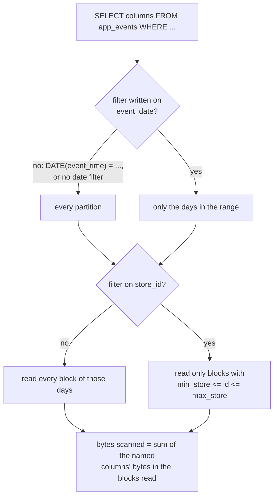

# Query cost in a cloud warehouse

Why did one dashboard cost 400 dollars, and how do partitions fix it?

## Before you start

- **Level 2** (intermediate). About 2 hours.
- **Builds on:** [08-01 Warehouse layers](../01-warehouse-layers/) (marts that dashboards read), [08-03 Incremental models and backfills](../03-incremental-models-and-backfills/) (rewriting only the days that changed) and [01-01 GROUP BY from raw rows](../../01-sql/01-group-by-from-raw-rows/) (reading a SELECT and its WHERE clause).
- **You need:** Python 3.9 or later. Nothing to install, no cloud account. The warehouse is a small model in Python, and every price in this lesson comes from a **fictional rate card**: 5.00 dollars per TiB scanned, with a minimum of 10 MiB per query. It is not any real warehouse's price. Look up your own warehouse's pricing page before you quote a cost.

## The problem

Brightcart, the fictional online grocery from earlier lessons, keeps its app event log in a cloud warehouse that bills by the amount of data each query reads. The October bill has one line that stands out: the "Store live ops" dashboard cost 422.56 dollars, while the finance and marketing dashboards cost under 1 dollar each. Ananya, who manages the data budget, points out that the events table is already partitioned by day and clustered by store, "so how can one dashboard cost that much?" She wants the cause and a fix before the November budget review. You have the table's storage metadata (736 blocks over 92 days) and the October query log for its six dashboard tiles.

## In plain words

Think of a library that charges you for every page you photocopy, not for the books you take home. The archive of newspapers is shelved by date, one shelf per day. If you ask for "the sports pages from 31 October", the librarian walks to one shelf and copies a few pages. If you ask for "every page of every paper, and I will find the 31 October ones myself", the librarian copies the whole archive, and you pay for all of it, even if you then throw away everything but one page. And if you ask for "the 100 most recent pages", but do not say which shelf, the librarian still has to look at every page to find the most recent ones.

A cloud warehouse that bills by data read works like that library:

- **Bytes scanned** is the amount of data a query reads from storage. With this kind of billing, it is what you pay for, whatever the query returns.
- **Columnar storage** stores each column of a table separately, so a query reads only the columns it names. `SELECT *` names all of them.
- A **block** is a chunk of rows that the warehouse stores together. For each block it keeps **metadata**: small facts such as the smallest and largest value of a column in that block.
- A **partition** is a part of the table that holds one value of the **partition column**, here one day of `event_date`. **Partition pruning** means skipping every partition that the WHERE clause rules out. It only works when the filter is written on the partition column itself.
- **Clustering** sorts the rows inside each partition by another column, here `store_id`, so each block covers a narrow range of stores. A filter on that column then lets the warehouse skip blocks whose range cannot contain the value. That is **block pruning**.
- **TiB** (tebibyte) is 2^40 bytes, **GiB** 2^30, **MiB** 2^20.

## What you will build from scratch

- `block_survives`: decide, from a block's metadata alone, whether a query must read it, for a table that is not partitioned, partitioned, or partitioned and clustered.
- `bytes_scanned`: add up the bytes of the columns a query names, in the blocks it cannot skip.
- `run_cost`: turn bytes into dollars on the fictional rate card, with its per-query minimum.
- `dashboard_costs`: the month's bill per dashboard, from the query log.

The data in `data/` is synthetic, made by `make_data.py` with a fixed seed. `blocks.csv` describes how the table `app_events` is stored; `queries.csv` is the October query log, one row per dashboard tile.

## The idea

The warehouse decides which blocks to read before it reads anything, using only the WHERE clause and each block's metadata. Every block that survives is read, but only for the columns the query names:



So the cost of one run is:

    bytes scanned = sum over blocks read, of sum over columns named, of bytes(block, column)
    cost of a run = max(bytes scanned, 10 MiB) / 2^40 x 5.00 dollars
    cost of a tile in a month = cost of a run x runs that month

Three things decide the bill, and only one of them is the table's design:

1. **Which columns** the query names. A wide column (a JSON payload) can be most of the table.
2. **Which partitions and blocks** it can skip. That needs a partitioned and clustered table **and** a WHERE clause that the warehouse can use on the metadata: the partition column compared with constants, not wrapped in a function or replaced by another column.
3. **How often** it runs. A dashboard that refreshes every two hours runs 372 times in October.

`LIMIT` is not on the list. It is applied after the rows are read, so it cuts what you see, not what you pay for.

## Walk through

Run each block in Python from this folder (type `python3`, then paste), in order: later blocks use names from earlier ones. `exercise.py` gives the loaders and the rate card; the blocks write the cost model inline.

Step 1. How big is the table, and which columns hold the bytes?

```python
import exercise as ex

blocks = ex.read_blocks()
total = {}
for b in blocks:
    for col, n in b["bytes"].items():
        total[col] = total.get(col, 0) + n
size = sum(total.values())
print(len(blocks), blocks[0]["event_date"], blocks[-1]["event_date"], round(size / ex.TIB, 4), "TiB")
for col in sorted(total, key=total.get, reverse=True):
    print(col.ljust(11), "%6.2f%%" % (100 * total[col] / size))
```

```text
736 2026-08-01 2026-10-31 0.2097 TiB
payload      95.93%
event_type    0.75%
user_id       0.67%
event_id      0.67%
amount        0.66%
event_time    0.66%
store_id      0.33%
event_date    0.33%
```

92 days, 8 blocks a day. The `payload` column, a JSON copy of each whole event, is 96% of the table. Any query that reads it pays for almost the whole table; a query that reads three small columns pays for about 2% of it.

Step 2. The query log.

```python
queries = ex.read_queries()
for q in queries:
    print(q["query_id"], q["dashboard"].ljust(15), q["tile"].ljust(27), q["runs"], q["prunable"], q["store_id"])
print(queries[0]["sql"])
```

```text
q1 Store live ops  Orders today by store       372 False None
q2 Store live ops  Latest 100 events           31 False None
q3 Store live ops  Store 17 basket sizes       372 True 17
q4 Weekly finance  Revenue last 7 days         31 True None
q5 Marketing       Active users last 30 days   124 True None
q6 Marketing       Store 5 visitors by day     62 True 5
SELECT * FROM app_events WHERE DATE(event_time) = '2026-10-31'
```

The log has already been read for you: `columns` lists what each query reads, `date_from` and `date_to` the dates its WHERE clause allows, `prunable` whether that date filter is written on `event_date` itself, and `runs` how many times it ran in October. The "Store live ops" tiles refresh every two hours (12 times a day, 372 runs in October), except the "Latest 100 events" tile, which runs once a day. To keep the model simple, every run is costed against the table as it stood on 31 October.

The last line is the first tile's SQL. Two problems are visible in one line: `SELECT *`, and a date filter on `event_time`, which is not the partition column.

Step 3. Cost the first tile by hand.

```python
def cost(scanned):
    return max(scanned, ex.MIN_BILLED_BYTES) / ex.TIB * ex.PRICE_PER_TIB

q1 = queries[0]
scan_all = sum(b["bytes"][c] for b in blocks for c in q1["columns"])
print(scan_all, round(scan_all / 2 ** 30, 1), "GiB")
print(round(cost(scan_all), 4), "dollars a run,", round(cost(scan_all) * q1["runs"], 2), "dollars in October")
```

```text
230520668447 214.7 GiB
1.0483 dollars a run, 389.96 dollars in October
```

Because the warehouse cannot prune on `DATE(event_time)`, every block is read, and because of `SELECT *`, every column: the whole 214.7 GiB table, to show one day. About 1.05 dollars a run is easy to miss. 372 runs make 389.96 dollars, most of the 422.56.

Step 4. Pruning, on the one tile that is written well.

```python
def reads(b, q, layout):
    if layout != "none" and q["prunable"]:
        if q["date_from"] and b["event_date"] < q["date_from"]:
            return False
        if q["date_to"] and b["event_date"] > q["date_to"]:
            return False
    if layout == "clustered" and q["store_id"] is not None:
        if not b["min_store"] <= q["store_id"] <= b["max_store"]:
            return False
    return True

q3 = queries[2]
print(q3["sql"])
for layout in ("none", "partitioned", "clustered"):
    kept = [b for b in blocks if reads(b, q3, layout)]
    scanned = sum(b["bytes"][c] for b in kept for c in q3["columns"])
    print(layout.ljust(11), len(kept), "blocks", round(scanned / 2 ** 30, 2), "GiB", round(cost(scanned) * q3["runs"], 2), "dollars")
```

```text
SELECT store_id, event_type, amount FROM app_events WHERE event_date BETWEEN '2026-10-25' AND '2026-10-31' AND store_id = 17
none        736 blocks 3.75 GiB 6.81 dollars
partitioned 56 blocks 0.33 GiB 0.6 dollars
clustered   10 blocks 0.06 GiB 0.1 dollars
```

`reads` is the whole pruning logic: dates first (only when the filter is on `event_date`), then the store range (only on a clustered table). Dates are compared as `YYYY-MM-DD` text, which sorts the same way as the dates. This tile names three small columns, so even with no pruning it costs 6.81 dollars. Partitions cut 736 blocks to the 7 days' 56, and clustering to 10: 0.10 dollars for the month.

Step 5. Why store 17 needs 10 blocks, not 7.

```python
print([(b["block_id"], b["min_store"], b["max_store"]) for b in blocks if b["event_date"] == "2026-10-31"])
```

```text
[(1, 1, 5), (2, 5, 6), (3, 6, 23), (4, 23, 29), (5, 29, 31), (6, 31, 32), (7, 32, 37), (8, 37, 40)]
```

Inside a day the rows are sorted by `store_id` and cut into 8 blocks, so each block holds a range of stores. Neighbouring blocks share their boundary store (store 5 is in blocks 1 and 2). On 31 October store 17 is only in block 3; on three of the seven days it sits on a boundary and two blocks are read. Metadata can only say "store 17 might be in here", never "only these rows".

Step 6. Fix the two expensive tiles.

```python
fixed = dict(q1, columns=["store_id", "event_type", "amount"], prunable=True,
             sql="SELECT store_id, event_type, amount FROM app_events WHERE event_date = '2026-10-31'")
scanned = sum(b["bytes"][c] for b in blocks if reads(b, fixed, "clustered") for c in fixed["columns"])
print(round(scanned / 2 ** 20, 1), "MiB", round(cost(scanned) * fixed["runs"], 2), "dollars in October")

q2 = queries[1]
print(q2["sql"])
fixed2 = dict(q2, columns=["event_time", "store_id", "event_type", "amount"], date_from="2026-10-31", date_to="2026-10-31", prunable=True)
print(round(cost(sum(b["bytes"][c] for b in blocks if reads(b, fixed2, "clustered") for c in fixed2["columns"])) * fixed2["runs"], 2))
```

```text
48.2 MiB 0.09 dollars in October
SELECT * FROM app_events ORDER BY event_time DESC LIMIT 100
0.01
```

The first tile now names the three columns the chart uses and filters on `event_date`: one partition, three columns, 48.2 MiB a run, 0.09 dollars for the month instead of 389.96. The "latest 100 events" tile gets a filter `WHERE event_date = '2026-10-31'` (in the dashboard tool, "today") and names its four columns: 0.01 dollars instead of 32.50. The rows the charts show are the same.

Step 7. The dashboard before and after.

```python
def dashboard_total(qs):
    return round(sum(cost(sum(b["bytes"][c] for b in blocks if reads(b, q, "clustered") for c in q["columns"])) * q["runs"]
                     for q in qs if q["dashboard"] == "Store live ops"), 2)

print(dashboard_total(queries), dashboard_total([fixed, fixed2, q3]))
```

```text
422.56 0.2
```

422.56 dollars for October, on a table that was already partitioned and clustered, becomes 0.20 dollars. The partitions were never the problem; the queries could not use them. That is the answer to Ananya's question.

**The real tools.** Warehouses differ in how they bill. Some bill on demand by bytes scanned, as this lesson does; others bill for the time a compute cluster runs, where a query that scans less still finishes sooner and costs less. Most show the bytes a query will read before you run it (a "dry run" or the query profile). In BigQuery a day-partitioned, store-clustered table is declared like this (reference only, nothing in the lesson runs it):

```sql
CREATE TABLE analytics.app_events
PARTITION BY event_date
CLUSTER BY store_id
AS SELECT * FROM raw.app_events;
```

Snowflake divides tables into micro-partitions automatically and uses `CLUSTER BY` as a hint for how to keep them sorted. The pruning logic you write here, "skip what the metadata rules out", is the same idea in both.

## Common mistakes

**1. Trusting the table's partitions to protect every query (the trap).** The table is partitioned and clustered, so the first tile "must" be cheap. Cost it under each layout:

```python
for layout in ("none", "partitioned", "clustered"):
    s = sum(b["bytes"][c] for b in blocks if reads(b, q1, layout) for c in q1["columns"])
    print(layout.ljust(11), round(cost(s) * q1["runs"], 2))
```

```text
none        389.96
partitioned 389.96
clustered   389.96
```

Identical. `DATE(event_time) = '2026-10-31'` means the same day as `event_date = '2026-10-31'`, but the warehouse prunes on the partition column's metadata, and this filter is on another column. The same happens with `SUBSTR(event_date, 1, 7) = '2026-10'`, often a date taken from a join to a calendar table, or a dashboard date filter mapped to the wrong field. Always filter the partition column directly, against constants, and check the bytes estimate before you publish.

**2. Adding LIMIT to make a query cheap.** The "Latest 100 events" tile returns 100 rows and costs 32.50 dollars a month: 31 full scans of all 214.7 GiB. To find the latest 100 rows the warehouse must look at every row's `event_time`, and `SELECT *` reads every column while it does. `LIMIT` cuts the output, not the scan. The cheap version in step 6 tells the warehouse which partition the rows are in.

**3. Keeping `SELECT *` once the filter is right.** With a proper `event_date` filter but still `SELECT *`, the first tile reads one day of every column:

```python
star = dict(q1, prunable=True)
s = sum(b["bytes"][c] for b in blocks if reads(b, star, "clustered") for c in star["columns"])
print(round(s / 2 ** 30, 2), "GiB", round(cost(s) * star["runs"], 2), "dollars")
```

```text
2.77 GiB 5.04 dollars
```

5.04 dollars instead of 0.09, because the `payload` column is 96% of every block. Name the columns the chart uses.

**4. Expecting a tiny query to be free, or a cheap query to stay cheap.** The rate card bills at least 10 MiB per query, so a query that scans 2 MiB pays for 10. That rarely matters alone, but a tile that refreshes every minute pays the minimum 44,640 times a month. And a query that is cheap today may scan a growing range: q6, "store 5 since 1 August", reads more partitions every day. Prefer a rolling window ("the last 30 days") to a fixed start date.

## Your turn

Open `exercise.py`. The loaders and the fictional rate card are done. Write the four functions marked TODO: `block_survives`, `bytes_scanned`, `run_cost` and `dashboard_costs`.

```
python3 test_lesson.py
```

Run it from this folder. The test costs every query in the log under all three layouts, on the committed data and on a second table and log from `make_data.build(seed=2027)` with other block sizes, store ranges and run counts. Hand-made blocks check: no blocks at all, a date range with no partitions (still billed the minimum), a store on a shared block boundary, an open-ended date range, a filter that cannot prune, a store filter on a table that is only partitioned, an unknown layout, and a tile that never ran.

Stretch: write `cheapest_layout(blocks, queries)`, which reports, for each query, how much of its cost partitioning saves and how much clustering saves on top. Which tile in the log gains the most from clustering, and why does "Active users last 30 days" gain nothing from it?

## Check yourself

1. A query on a day-partitioned table filters `WHERE DATE(event_time) = '2026-10-31'`. Why can it still read the whole table, and how do you rewrite it?
2. A colleague adds `LIMIT 10` to an expensive exploratory query to save money. Does it?
3. When does clustering by `store_id` reduce the bytes a query scans, and when does it not?
4. The fixed first tile costs 0.09 dollars for October. Name two things that could make that number grow without anyone editing the query.

<details>
<summary>Answers</summary>

1. The warehouse skips partitions by comparing the WHERE clause with each partition's `event_date`. A filter on another column, or on a function of the partition column, gives it nothing to compare, so every partition is read. Write `WHERE event_date = '2026-10-31'` (or a range on `event_date`), and keep the `event_time` condition too if you need it.
2. No, not when the warehouse bills by bytes scanned: `LIMIT` is applied after the rows are read. Restrict the partitions and the columns instead.
3. Only when the query filters on `store_id` (an equality or a narrow range), and only for blocks whose store range excludes the value. With no store filter, or when every block spans all stores (no clustering), nothing is skipped. Store values on block boundaries mean a few extra blocks are read.
4. More runs (a shorter refresh interval, or more viewers on a tool that runs a query per viewer), and more data per partition as the business grows. A price change on the rate card would also change it, and so would someone switching the tile back to `SELECT *`.

</details>

## What to tell the stakeholder

> Ananya, the Store live ops dashboard cost 422.56 dollars in October because two of its tiles read the whole events table on every refresh: one filters on the event time instead of the event date, so the day partitions are never used, and both select every column, including the event payload that is 96% of the table. Rewriting those two tiles to filter on the event date and read only the columns they chart brings the same dashboard to about 0.20 dollars a month, with the same numbers on screen.

The caveat: these figures use the lesson's fictional rate card (5.00 dollars per TiB, 10 MiB minimum) and cost every run against the table as it stood on 31 October, so the real bill will differ; the ratio, roughly 2,000 times cheaper, is what to take to the budget review. Nothing stops the next new tile from making the same mistake, so a check of bytes scanned before a dashboard is published is worth adding.

## In real job postings

The data drop does not track cloud warehouses by name, but SQL, the language every one of these queries is written in, is the most requested tool. In the Real Analyst Jobs data drop of 25 October 2026 ([data/job-market/2026-10](../../../data/job-market/2026-10/)), 1,477 of the 2,056 US analyst postings that list a tool (71.8%) ask for SQL, and 286 of 413 in the UK (69.2%). Browse them at [SQL data analyst jobs](https://realanalystjobs.com/jobs/sql-data-analyst-jobs).

## Next

[08-06 Git for analysts](../06-git-for-analysts/): who changed the revenue query, and can we undo it?
