# Git for analysts

Who changed the revenue query, and can we undo it?

## Before you start

- **Level 1** (beginner). About 2 hours.
- **Builds on:** [00-01 Run your first lesson](../../00-start-here/01-run-your-first-lesson/) (running a test), [00-06 Python for spreadsheet people](../../00-start-here/06-python-for-spreadsheet-people/) (reading a CSV, lists, dictionaries and loops) and [01-01 GROUP BY from raw rows](../../01-sql/01-group-by-from-raw-rows/) (the kind of query that lives in the history here).
- **You need:** Python 3.9 or later. Nothing to install. Git is **not** needed for the exercise or the test. If you have git, step 7 replays the same history into a real repository in a throwaway folder, and an optional test checks your answers against real git.

## The problem

You are the analyst at Brightcart, the online grocery. Priya, who runs finance, closes October on Monday and has found that the dashboard's October revenue, 12,935.70, does not match finance's own figure, which counts delivered orders net of discounts. The revenue query lives in a shared folder of SQL files that four people edit, and every edit is saved as a commit. Priya wants to know who changed the number, when, and whether it can be put right today without losing anyone else's work. You have the recorded history (7 commits by Asha, Leena, Ravi and Omar) and 384 orders from September and October 2026.

## In plain words

Think of a shared recipe book in a restaurant kitchen. Every time a cook changes a recipe, they do not cross things out. They write the whole new version on a fresh page, sign it, date it, and write one line saying why: "less salt, customers complained". The pages are never torn out.

That book is what **git** keeps for a folder of files:

- A **commit** is one of those pages: a snapshot of the files, with an **author**, a time, a **message** saying why, and a pointer to the commit before it, its **parent**. Each commit has an id, a string of hexadecimal digits such as `eb27082`.
- The **history** (or **log**) is the chain of commits, from the newest one, called **HEAD**, back to the first.
- A **diff** shows what changed between two versions of a file: lines that start with `-` were removed and lines that start with `+` were added.
- **Blame** goes through a file line by line and says which commit last changed each line, and who made it.
- A **revert** is a new commit that undoes the change of one earlier commit and keeps everything after it. Nothing is deleted from the history: the mistake and its fix are both on the record.
- A **repository** (repo) is a folder whose history git keeps.

## What you will build from scratch

- `log`: the history from HEAD back to the first commit, by following parent pointers.
- `file_at`: any file as it was at any commit, including commits that did not touch it.
- `blame`: for each line of the query, the commit and author that last changed it.
- `revenue_by_commit` and `commits_that_changed`: run every version of the query on the same orders and find the commits that moved the number.
- `revert`: undo one commit's change to the query while keeping every later change, and refuse when that is not safe.

The history and the orders in `data/` are synthetic, written by `make_data.py` with a fixed seed in the same shape git records: `commits.csv` has one row per commit, and `file_versions.csv` has the full text of every file each commit created or changed.

## The idea

A history is a chain. Each commit points to its parent, and only some commits touch `revenue.sql`:

```mermaid
flowchart RL
  G["fff30f3 Ravi<br/>comment only<br/>12,935.70"] --> F["bbe6b52 Omar<br/>net of discounts<br/>12,935.70"]
  F --> E["37f14eb Asha<br/>README.md<br/>13,399.98"]
  E --> D["39261e4 Ravi<br/>orders_by_month.sql<br/>13,399.98"]
  D --> C["eb27082 Leena<br/>counts refunded orders<br/>13,399.98"]
  C --> B["1eb3650 Asha<br/>orders_by_month.sql<br/>12,025.18"]
  B --> A["6f6c592 Asha<br/>creates revenue.sql<br/>12,025.18"]
  R["new revert commit<br/>undoes eb27082 only<br/>11,624.76"] -.-> G
  classDef bad fill:#fecaca,stroke:#991b1b,color:#000
  classDef good fill:#bbf7d0,stroke:#166534,color:#000
  class C bad
  class R good
```



Each box shows the October revenue that commit's version of the query returns. Three ideas answer Priya's three questions.

**1. Which commit changed the number?** Do not guess from the code. Run every version of the query on the same orders and compare each number with the one before:

```
for each commit c, oldest first:
    revenue(c) = run the version of revenue.sql at c on the orders
    c changed the number  if  revenue(c) differs from revenue(parent of c)
```

This is what `git bisect` automates in a big history: it tests the version halfway between a good commit and a bad one, then halves again, so even 1,000 commits take about 10 tests.

**2. Who changed which line?** Blame follows each line forward through the history. A diff between two versions splits the lines into runs that stayed the same and runs that changed. A line that stayed the same keeps the commit it came from; a line that changed or appeared is credited to the commit that made it.

**3. How do you undo it?** Take the bad commit's own diff (its parent's version against its version) and apply it backwards to the file as it is today:

```
revert(bad) on HEAD = HEAD's file, with each line bad wrote put back to what it replaced
```

If a later commit changed those same lines again, there is no safe automatic answer, and git stops with a **conflict** for a person to decide. Going back to the old file instead is not the same thing: it also throws away every good change made since.

## Walk through

Run each block in Python from this folder (type `python3`, then paste), in order, because later blocks use names from earlier ones. Or save them one after another in a file and run it. The blocks use only the helpers already written for you at the top of `exercise.py`.

Step 1. Load the history and read it.

```python
from exercise import load_history, load_orders, run_revenue, diff_opcodes

commits, versions = load_history()
for c in commits:
    touched = sorted(path for (cid, path) in versions if cid == c["commit_id"])
    print(c["commit_id"], c["committed_at"][:10], c["author"].ljust(5), c["message"], touched)
```

```text
6f6c592 2026-09-13 Asha  Add the monthly revenue query ['revenue.sql']
1eb3650 2026-09-19 Asha  Add orders per month for operations ['orders_by_month.sql']
eb27082 2026-09-22 Leena Count refunded orders as revenue too ['revenue.sql']
39261e4 2026-09-25 Ravi  Operations counts only orders that were not cancelled ['orders_by_month.sql']
37f14eb 2026-10-01 Asha  Add a README for the query folder ['README.md']
bbe6b52 2026-10-03 Omar  Revenue is net of discounts, as finance defines it ['revenue.sql']
fff30f3 2026-10-09 Ravi  Say who owns the revenue query ['revenue.sql']
```

`commits` is a list of dictionaries, oldest first. `versions` is a dictionary whose keys are pairs `(commit_id, path)` and whose values are the full text of that file at that commit. A commit only has entries for the files it created or changed, so three commits here have nothing for `revenue.sql`.

Step 2. Follow the parent pointers.

```python
by_id = {c["commit_id"]: c for c in commits}
head = commits[-1]["commit_id"]
cid = head
while cid is not None:
    print(cid, "<- parent of the one above" if cid != head else "<- HEAD")
    cid = by_id[cid]["parent_id"]
```

```text
fff30f3 <- HEAD
bbe6b52 <- parent of the one above
37f14eb <- parent of the one above
39261e4 <- parent of the one above
eb27082 <- parent of the one above
1eb3650 <- parent of the one above
6f6c592 <- parent of the one above
```

`by_id` lets you look a commit up by its id. The first commit has `parent_id` None, which ends the loop. This walk, newest first, is what `git log` prints.

Step 3. A file at a commit that did not touch it. Ravi's commit `39261e4` only changed `orders_by_month.sql`. Its `revenue.sql` is whatever its nearest ancestor saved:

```python
def nearest_version(commit_id, path):
    while commit_id is not None:
        if (commit_id, path) in versions:
            return commit_id
        commit_id = by_id[commit_id]["parent_id"]
    return None

print(nearest_version("39261e4", "revenue.sql"))
print(nearest_version("6f6c592", "README.md"))
print(versions[("eb27082", "revenue.sql")], end="")
```

```text
eb27082
None
-- Monthly revenue for the finance dashboard.
-- One row per calendar month.
SELECT
  strftime('%Y-%m', order_date) AS month,
  ROUND(SUM(amount), 2) AS revenue
FROM orders
WHERE is_test = 0
  AND status IN ('delivered', 'refunded')
GROUP BY month
ORDER BY month;
```

`39261e4` gets `revenue.sql` from `eb27082`. `README.md` did not exist at the first commit, so there is no version: None, not an empty file.

Step 4. Run every version of the query on the same orders.

```python
orders = load_orders()
current, before = None, None
for c in commits:
    current = versions.get((c["commit_id"], "revenue.sql"), current)
    value = run_revenue(current, orders, "2026-10")
    line = "%s %-5s %9s" % (c["commit_id"], c["author"], value)
    if value != before:
        line += "  <- the number changed"
    print(line)
    before = value
```

```text
6f6c592 Asha   12025.18  <- the number changed
1eb3650 Asha   12025.18
eb27082 Leena  13399.98  <- the number changed
39261e4 Ravi   13399.98
37f14eb Asha   13399.98
bbe6b52 Omar    12935.7  <- the number changed
fff30f3 Ravi    12935.7
```

Because the history is in order, the loop can carry the latest version forward: `versions.get(key, current)` returns the new version if this commit saved one, and keeps the old one if not. `run_revenue` loads the orders into an in-memory SQLite table, runs that version's SQL and returns the October value. Three commits moved the number: the one that created the query, Leena's `eb27082` (up by 1,374.80) and Omar's `bbe6b52` (down by 464.28). The other four did not.

Step 5. Look at the diff of the commit that moved it.

```python
import difflib

before_lines = versions[("6f6c592", "revenue.sql")].splitlines()   # the file at eb27082's parent
after_lines = versions[("eb27082", "revenue.sql")].splitlines()
for line in difflib.unified_diff(before_lines, after_lines, "revenue.sql before eb27082",
                                 "revenue.sql at eb27082", lineterm="", n=1):
    print(line)
print()
for op in diff_opcodes(before_lines, after_lines):
    print(op)
```

```text
--- revenue.sql before eb27082
+++ revenue.sql at eb27082
@@ -7,3 +7,3 @@
 WHERE is_test = 0
-  AND status = 'delivered'
+  AND status IN ('delivered', 'refunded')
 GROUP BY month

('equal', 0, 7, 0, 7)
('replace', 7, 8, 7, 8)
('equal', 8, 10, 8, 10)
```

The first print is a **unified diff**, the format `git diff` and `git show` use. `@@ -7,3 +7,3 @@` means: from line 7, 3 lines of the old file became 3 lines of the new one. A space at the start is an unchanged line kept for context, `-` was removed, `+` was added. One line changed: refunded orders started to count as revenue.

The second print is the same comparison as **opcodes** from Python's `difflib`, the form you will use in code. `('replace', 7, 8, 7, 8)` means old lines 7 up to (not including) 8 became new lines 7 up to 8, counting from 0. For blame, the `equal` runs keep their origin and the `replace` run is credited to `eb27082`. For a revert, the `replace` run is the one to swap back.

Step 6. Undo only that line, and check the result against finance's definition in plain Python.

```python
head_lines = versions[("fff30f3", "revenue.sql")].splitlines()   # revenue.sql at HEAD
bad_line, good_line = after_lines[7], before_lines[7]
reverted = [good_line if line == bad_line else line for line in head_lines]
print("\n".join(reverted))
print()
print("HEAD     ", run_revenue("\n".join(head_lines), orders, "2026-10"))
print("reverted ", run_revenue("\n".join(reverted), orders, "2026-10"))
right = sum(o["amount"] - o["discount"] for o in orders
            if o["status"] == "delivered" and o["is_test"] == 0 and o["order_date"].startswith("2026-10"))
print("finance  ", round(right, 2))
```

```text
-- Monthly revenue for the finance dashboard. Owner: analytics.
-- One row per calendar month.
SELECT
  strftime('%Y-%m', order_date) AS month,
  ROUND(SUM(amount - discount), 2) AS revenue
FROM orders
WHERE is_test = 0
  AND status = 'delivered'
GROUP BY month
ORDER BY month;

HEAD      12935.7
reverted  11624.76
finance   11624.76
```

The reverted query keeps Ravi's comment on line 1 and Omar's discount fix on line 5, and puts back only the status line. It now gives 11,624.76, the same as a plain Python sum of delivered, non-test October orders net of discount. Swapping a line found by its text is safe only if that line appears exactly once at HEAD and nobody has edited it since; your `revert` must check both, and raise `RevertConflict` if not.

Step 7 (optional, needs git). Replay the history into a real repository in a new folder outside the course. `replay_in_git.py` refuses to write into an existing folder or anywhere inside this course.

```bash
python3 replay_in_git.py /tmp/brightcart-sql
cd /tmp/brightcart-sql
git log --oneline -- revenue.sql
git blame revenue.sql
```

```text
replayed 7 commits into /tmp/brightcart-sql
  recorded 6f6c592 is git commit d75015a
  recorded 1eb3650 is git commit ead355a
  recorded eb27082 is git commit 0d7d31a
  recorded 39261e4 is git commit ba9c9fd
  recorded 37f14eb is git commit a8d72b4
  recorded bbe6b52 is git commit 7be6f75
  recorded fff30f3 is git commit aef772e
aef772e Say who owns the revenue query
7be6f75 Revenue is net of discounts, as finance defines it
0d7d31a Count refunded orders as revenue too
d75015a Add the monthly revenue query
aef772e3 (Ravi  2026-10-09 05:40:00 +0000  1) -- Monthly revenue for the finance dashboard. Owner: analytics.
^d75015a (Asha  2026-09-13 17:10:00 +0000  2) -- One row per calendar month.
^d75015a (Asha  2026-09-13 17:10:00 +0000  3) SELECT
^d75015a (Asha  2026-09-13 17:10:00 +0000  4)   strftime('%Y-%m', order_date) AS month,
7be6f753 (Omar  2026-10-03 20:38:00 +0000  5)   ROUND(SUM(amount - discount), 2) AS revenue
^d75015a (Asha  2026-09-13 17:10:00 +0000  6) FROM orders
^d75015a (Asha  2026-09-13 17:10:00 +0000  7) WHERE is_test = 0
0d7d31a7 (Leena 2026-09-22 03:14:00 +0000  8)   AND status IN ('delivered', 'refunded')
^d75015a (Asha  2026-09-13 17:10:00 +0000  9) GROUP BY month
^d75015a (Asha  2026-09-13 17:10:00 +0000 10) ORDER BY month;
```

The commits get new ids (git computes them from the content, the author and the time), and the script prints which is which. `git log -- revenue.sql` lists only the commits that touched that file. `git blame` shows, for each line, the commit, author, date and line number; a `^` marks the first commit. Line 8 is Leena's, line 5 is Omar's, line 1 is Ravi's. Now look at the bad commit and revert it:

```bash
git show 0d7d31a
git revert --no-edit 0d7d31a
git show HEAD --format=%s
```

```text
commit 0d7d31a763f75991a4a0a179d6dbb4cf24f1882e
Author: Leena <leena@brightcart.example>
Date:   Tue Sep 22 03:14:00 2026 +0000

    Count refunded orders as revenue too

diff --git a/revenue.sql b/revenue.sql
index 09afbeb..9402a67 100644
--- a/revenue.sql
+++ b/revenue.sql
@@ -5,6 +5,6 @@ SELECT
   ROUND(SUM(amount), 2) AS revenue
 FROM orders
 WHERE is_test = 0
-  AND status = 'delivered'
+  AND status IN ('delivered', 'refunded')
 GROUP BY month
 ORDER BY month;
Auto-merging revenue.sql
[main 1609a07] Revert "Count refunded orders as revenue too"
 Date: Sat Oct 31 03:31:40 2026 +0000
 1 file changed, 1 insertion(+), 1 deletion(-)
Revert "Count refunded orders as revenue too"

diff --git a/revenue.sql b/revenue.sql
index 7a3b372..f95ebbd 100644
--- a/revenue.sql
+++ b/revenue.sql
@@ -5,6 +5,6 @@ SELECT
   ROUND(SUM(amount - discount), 2) AS revenue
 FROM orders
 WHERE is_test = 0
-  AND status IN ('delivered', 'refunded')
+  AND status = 'delivered'
 GROUP BY month
 ORDER BY month;
```

`git show` prints a commit's message and diff. `git revert` made a new commit on top; the line starting `[main` carries its id and the line starting ` Date:` your clock, so both will differ on your machine. The last diff is the exact reverse of Leena's, applied to today's file, which is what your `revert` function returns. When you are done, delete `/tmp/brightcart-sql`.

**On real teams.** The queries usually live in a repository on a hosting service such as GitHub or GitLab. Nobody commits straight to the main version: you make a **branch** (your own line of commits), push it, and open a **pull request**, where a colleague reads the diff before it is merged. dbt projects work this way, so a revenue model's history is a git history like this one. `git log -p -- file` shows every change to one file with its diff, and `git bisect` finds the first bad commit by halving.

## Common mistakes

**1. Restoring the old file instead of reverting the commit (the trap).** "Just put back the version from before Leena's change" sounds like an undo. In git it is `git checkout 1eb3650 -- revenue.sql`, or copying the old text from a chat message. Here is what it gives:

```python
restored = versions[("6f6c592", "revenue.sql")]   # the file as it was before eb27082
print("restored", run_revenue(restored, orders, "2026-10"))
print("reverted", run_revenue("\n".join(reverted), orders, "2026-10"))
```

```text
restored 12025.18
reverted 11624.76
```

The restored file drops refunded orders again, but it also throws away Omar's later fix, so revenue is no longer net of discounts. It comes out 400.42 too high, and it looks like a fix because it moved in the right direction. It also loses Ravi's comment. A revert undoes one commit and keeps everything after it.

**2. Blaming whoever touched the file last.** `git log -1 -- revenue.sql` names Ravi's `fff30f3`, "Say who owns the revenue query". It changed a comment, and the number did not move (step 4). The last person to edit a file is rarely the person who changed the number. Run the versions, or blame the line that matters.

**3. Diffing the first version against the last.** It shows every change at once:

```python
first = versions[("6f6c592", "revenue.sql")].splitlines()
for line in difflib.unified_diff(first, head_lines, "first version", "HEAD", lineterm="", n=0):
    print(line)
```

```text
--- first version
+++ HEAD
@@ -1 +1 @@
--- Monthly revenue for the finance dashboard.
+-- Monthly revenue for the finance dashboard. Owner: analytics.
@@ -5 +5 @@
-  ROUND(SUM(amount), 2) AS revenue
+  ROUND(SUM(amount - discount), 2) AS revenue
@@ -8 +8 @@
-  AND status = 'delivered'
+  AND status IN ('delivered', 'refunded')
```

Three changed lines, by three people, two of which moved the number in opposite directions. From this diff alone you cannot tell which change is wrong, who made it, or that one of them (net of discounts) must be kept. Compare each commit with its parent instead.

**4. Rewriting history that others share.** `git reset --hard 1eb3650` followed by `git push --force` makes the shared history look as if the last five commits never happened. It deletes Omar's and Ravi's work for everyone, and anyone who already pulled it now has a history that disagrees with the server. On a shared branch, revert. Reset only commits that nobody else has seen.

**5. Mixing two changes in one commit.** Had Leena also reformatted the whole file in `eb27082`, the revert would undo the formatting too, and blame would credit her with every line. Keep one reason per commit, and say it in the message. The README of this folder says exactly that.

## Your turn

Open `exercise.py` and fill in the six functions that still raise NotImplementedError: `log`, `file_at`, `blame`, `revenue_by_commit`, `commits_that_changed` and `revert`. The helpers at the top (`load_history`, `load_orders`, `run_revenue`, `diff_opcodes`, `find_block` and the `RevertConflict` exception) are done for you.

```
python3 test_lesson.py
```

Run it from this folder. The test builds its own answers without difflib, by replaying the history forwards and matching lines with a longest common subsequence table, and it checks that your reverted query gives finance's number from a plain Python sum. It also runs your functions on a second history made with a different seed (other authors, ids, order and bad edit), and on tiny hand-made histories: a single commit, a file created later, a line changed and changed back, an empty result list, a revert that must conflict, and reverts of a pure insertion and a pure deletion. If git is installed, two more tests replay both histories into a temporary folder and compare your log, blame and revert with real git; without git they are skipped.

Stretch: write `bisect(commits, versions, head, path, orders, month, good_value)` that finds the first commit whose number differs from `good_value` by testing the middle commit of the remaining range each time. How many runs does it need for these 7 commits, and for 1,000?

## Check yourself

1. What is the difference between a revert and restoring an old version of the file?
2. `git blame` says Ravi last changed line 1 of the query. Does that mean Ravi changed the revenue number?
3. Why can a revert conflict, and what should happen when it does?
4. Why is `git push --force` after a reset dangerous on a shared branch, when a revert is not?

<details>
<summary>Answers</summary>

1. A revert applies the reverse of one commit's diff to today's file, so every later change stays. Restoring an old version replaces the whole file, so every change made after that version is lost too. Here that dropped the discount fix and left revenue 400.42 too high.
2. No. Blame only says who last edited each line. Ravi changed a comment. To find who changed the number, run each version on the same data and see where it moved, then blame the line that commit changed.
3. A later commit edited the same lines the bad commit wrote, so there is no single right way to undo it. Git stops and asks a person to edit the file; your function raises `RevertConflict`. Never guess: read both changes and decide what the line should say.
4. A reset plus force push removes commits from the shared history, including other people's work, and leaves everyone who already has them out of step. A revert only adds a new commit, so the history stays true and everyone can simply pull it.

</details>

## What to tell the stakeholder

> Priya, October revenue on the dashboard is 12,935.70 because a change on 22 September (commit eb27082, "Count refunded orders as revenue too") added refunded orders to the revenue query. A later change by Omar, making revenue net of discounts, was correct and is kept. With only the 22 September change undone, October revenue is 11,624.76, which matches your definition: delivered orders, no test orders, net of discounts.

The caveat: the change had a reason in its message, so check with Leena whether someone needed a number that includes refunds, and if so give it its own column rather than changing revenue. The fix is a new commit, so it can itself be undone if the definition changes.

## In real job postings

The data drop does not track git itself, but it tracks dbt, whose SQL models live in a git repository and change through reviewed commits like these. In the Real Analyst Jobs data drop of 25 October 2026 ([data/job-market/2026-10](../../../data/job-market/2026-10/)), 157 of the 2,056 US analyst postings that list a tool (7.6%) ask for dbt, and 43 of 413 in the UK (10.4%). Browse them at [SQL data analyst jobs](https://realanalystjobs.com/jobs/sql-data-analyst-jobs).

## Next

This is the last lesson in Phase 08 so far. Back to the [Phase 08 overview](../README.md).
