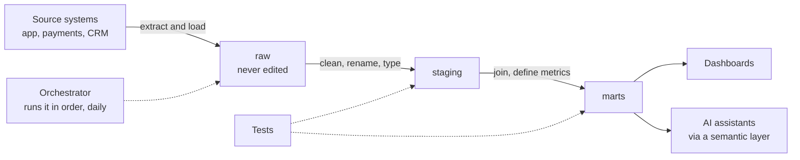

# 08 Modern data stack

Where does the data in your dashboard come from, and what has happened to it on the way? This phase follows a number from the source system to the chart: loading, transforming, testing, scheduling and versioning. You rebuild each idea in Python and SQLite, and see the real tools (Snowflake, BigQuery, dbt, Airflow, Git) as reference blocks next to the code you wrote.

## Analyst or engineer: who does what

You do not need to become a data engineer. You do need to understand the pipeline well enough to trust it, debug it, and ask for the right fix.

| Topic | An analyst should be able to | A data engineer builds |
|---|---|---|
| Warehouse layers | Read raw, staging and mart tables; know which to query and why raw is never edited | The ingestion and the layer design |
| Transformation (dbt) | Write and test a model, read the dependency graph, fix a failing test | The project structure, CI and deployment |
| Incremental loads | Explain why yesterday's number changed after a backfill | The incremental strategy and backfill jobs |
| Orchestration | Read a DAG, tell when a job failed and what it blocked | The scheduler, retries and alerting |
| Warehouse cost | Write queries that scan less data | Partitioning, clustering and budgets |
| Git | Commit a query, read a diff, review a change | Branching strategy and CI |

That is ELT: Extract, Load, then Transform inside the warehouse. The older ETL pattern transformed the data before loading it. Lesson 01 shows why most teams switched.

## Why this phase exists

In the Real Analyst Jobs data from 29 October 2026, Snowflake appears in 8.7% of entry-level analyst postings and 20.3% of senior ones, and dbt in 2.8% and 11.0%. The warehouse layer is what you add as you become more senior. The evidence is in [2026-2027-ANALYTICS-SKILLS.md](../../2026-2027-ANALYTICS-SKILLS.md).

## Lessons

1. [Warehouse layers: raw, staging and marts](01-warehouse-layers/). Why do we never edit raw data, and where should a metric be computed?
2. [dbt from scratch](02-dbt-from-scratch/). In what order must these six models build, and what do their tests prove?
3. [Incremental models and backfills](03-incremental-models-and-backfills/). Can yesterday's numbers be fixed without rebuilding three years of data?
4. [Orchestration: a tiny DAG runner](04-orchestration-dag-runner/). What happens at 6 am when the 5 am job failed?
5. [Query cost in a cloud warehouse](05-cloud-warehouse-cost/). Why did one dashboard cost 400 dollars, and how do partitions fix it?
6. [Git for analysts](06-git-for-analysts/). Who changed the revenue query, and can we undo it?

Every lesson runs offline: dbt's dependency order is rebuilt with Python's `graphlib`, the warehouse is SQLite, and the Git lesson's test skips if Git is not installed.

Before this phase, finish [01 SQL](../01-sql) Level 1 and 2 and [05 Python](../05-python-for-analysts) Level 1.
