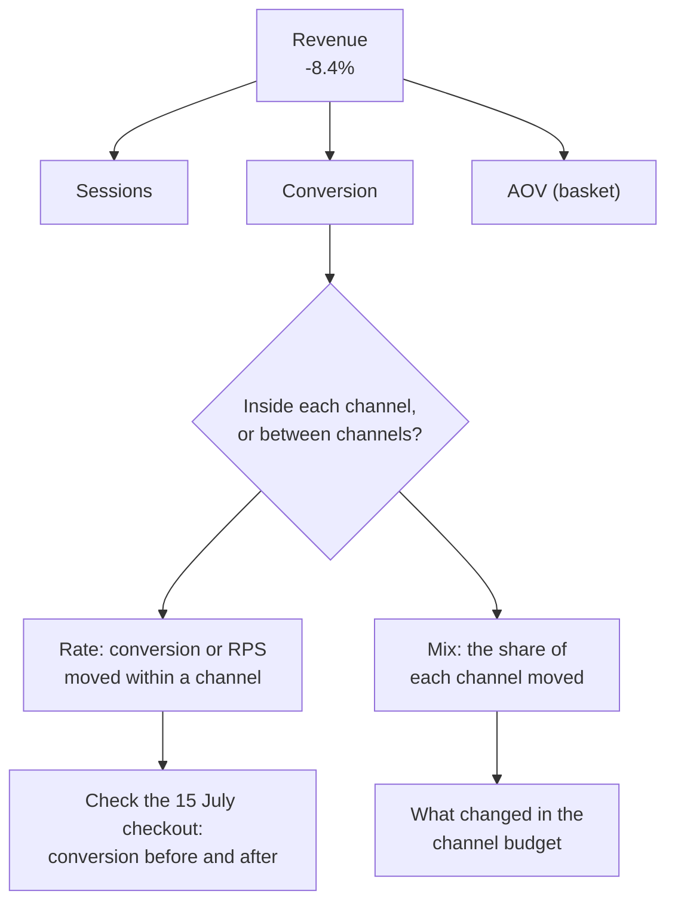

# E-commerce: why is revenue falling?

Business question: revenue is down 8% on last quarter. Is it traffic, conversion, basket size or mix?

## Before you start

- **Level:** 2 (intermediate).
- **Time:** about 4 hours.
- **Builds on:** [GROUP BY from raw rows](../../01-sql/01-group-by-from-raw-rows/), [Joins without losing rows](../../01-sql/02-joins-without-losing-rows/), [Metric trees](../../03-metrics-and-product-analytics/01-metric-trees/) (splitting a number into factors, with the logarithmic mean) and [Segmentation and mix effects](../../03-metrics-and-product-analytics/09-segmentation-and-mix-effects/) (rate versus mix).
- **You need:** Python 3.9 or later. Nothing to install. SQLite comes with Python.
- **How this case is built:** the twelve steps in the [phase README](../README.md). Steps 1 to 6 are in The idea, steps 7 to 12 in Walk through. [RUBRIC.md](RUBRIC.md) grades your steps 10 to 12.

## The problem

Wrenloom, a fictional online shop for home textiles (bedsheets, towels, curtains), made 8.4% less revenue in July to September 2026 than in April to June, even though more people visited the site. Kavya, the founder, has the board call in a week. The product team thinks the new checkout page launched on 15 July is losing sales and wants to roll it back. The marketing team points out that traffic is up and says the site "stopped converting". Kavya wants to know which of traffic, conversion, basket size or mix explains the fall, and what to change.

The files in `data/` are synthetic, generated by `make_data.py` with a fixed seed: `sessions.csv` (549 rows, one per day and channel) and `orders.csv` (1,501 orders), 1 April to 30 September 2026. The pattern in them is one that e-commerce analysts meet often.

## In plain words

Imagine a sweet shop whose takings fell, even though more people walked in. You could blame the cashier (conversion) or say people buy smaller boxes now (basket). But suppose a school next door started sending its children in at lunchtime. The children mostly look and leave, and buy one toffee when they do buy. The regular customers buy exactly as before. Every group behaves the same as last month; the crowd is simply made of more of the group that spends least. That is a mix effect.

Terms used in this case:

- **Session:** one visit to the website.
- **Channel:** where a session came from: search (search engines and search ads), social (paid social media ads) or email.
- **Conversion rate:** orders divided by sessions.
- **Average order value (AOV), or basket:** revenue divided by orders.
- **Revenue per session (RPS):** revenue divided by sessions. It is conversion x AOV.
- **Revenue identity:** revenue = sessions x conversion x AOV. It is always true, so every change in revenue can be split among the three.
- **LMDI (logarithmic mean Divisia index):** a way to split a change in a product of factors into one effect per factor that adds up exactly, with no leftover term. It weights each factor's log change by the logarithmic mean of the revenue before and after.
- **Mix effect:** the part of a change caused by the shares of segments moving (more social, less search).
- **Rate effect:** the part caused by each segment's own number moving (RPS within search, within social).
- **Fan-out:** a join that repeats rows, so a SUM counts the same thing several times.

## What you will build from scratch

- `QUARTER_SQL`: sessions, orders and revenue per quarter, without a fan-out.
- `CHANNEL_SQL`: the same per quarter and channel, with 0 (not NULL) for a channel with no orders.
- `lmdi(before, after)`: the revenue change split into sessions, conversion and basket effects that add up exactly.
- `mix_and_rate(channel_rows)`: the change in revenue per session split into mix and rate.
- `waterfall(steps)`: a text waterfall chart for a message.

## The idea

### 1. Business context

Wrenloom sells online only. Marketing buys traffic from search ads and social ads and sends emails to past customers. Product owns the website, including checkout. Revenue in this case is order revenue after discounts.

### 2. Problem statement

Q3 2026 revenue was 8.4% below Q2. Find which factor of the revenue identity moved, then whether that movement happened inside the channels or between them, before anyone rolls back the checkout or changes the budget.

### 3. Objectives: the decision this informs

Kavya must decide between rolling back the new checkout (product's proposal), pushing more traffic (marketing's instinct), or changing the channel budget. The analysis must say which of these addresses the cause.

### 4. KPIs and their definitions

- Revenue, sessions and orders per quarter: Q2 is 1 April to 30 June 2026, Q3 is 1 July to 30 September 2026.
- Conversion = orders / sessions. AOV = revenue / orders. RPS = revenue / sessions.
- LMDI effect of factor x = L(revenue before, revenue after) x ln(x after / x before), where L(a, b) = (b - a) / (ln b - ln a). The three effects add up to the revenue change.
- Channel share = channel sessions / all sessions in the quarter.
- Mix effect = sum over channels of (share after - share before) x average RPS of the two quarters. Rate effect = sum over channels of (RPS after - RPS before) x average share. Mix + rate = RPS after - RPS before.

### 5. Data required, and what is missing

`sessions.csv`: date, channel, sessions. `orders.csv`: order_id, order_date, channel, items, revenue. The two tables have different grains (one row per day and channel versus one row per order). Missing: ad spend per channel (so we cannot compute cost per session or return on ad spend), product categories, and new versus returning customers.

### 6. Analytical approach

Go down the tree one level at a time and stop where the change lives:



1. Total the quarters correctly (sessions and orders aggregated separately, then joined).
2. Split the revenue change into sessions, conversion and basket with LMDI.
3. Split the change in revenue per session into channel mix and within-channel rate.
4. Test the checkout theory directly: conversion per channel before and after 15 July.

## Walk through

### 7. SQL and Python implementation

Run these blocks in order in one Python session started in this folder (`python3`). First, load both CSVs into SQLite.

```python
import csv, math, sqlite3

con = sqlite3.connect(":memory:")
con.execute("CREATE TABLE sessions (date TEXT, channel TEXT, sessions INTEGER)")
con.execute("CREATE TABLE orders (order_id TEXT, order_date TEXT, channel TEXT, items INTEGER, revenue INTEGER)")
with open("data/sessions.csv", newline="") as f:
    con.executemany("INSERT INTO sessions VALUES (?, ?, ?)", [tuple(r.values()) for r in csv.DictReader(f)])
with open("data/orders.csv", newline="") as f:
    con.executemany("INSERT INTO orders VALUES (?, ?, ?, ?, ?)", [tuple(r.values()) for r in csv.DictReader(f)])

def show(sql):
    for row in con.execute(sql):
        print(row)

show("SELECT COUNT(*), SUM(sessions), MIN(date), MAX(date) FROM sessions")
show("SELECT COUNT(*), SUM(revenue) FROM orders")
```

```
(549, 60346, '2026-04-01', '2026-09-30')
(1501, 3154801)
```

SQLite converts the CSV text to numbers because the columns are declared INTEGER.

Step 7a. The quarters. Aggregate each table to the quarter first, in its own CTE (a named subquery written with `WITH`), and only then join. Joining the raw tables would repeat each day's sessions once per order (Common mistakes, 1).

```python
Q = "CASE WHEN {} < '2026-07-01' THEN 'Q2' ELSE 'Q3' END"
quarters = con.execute(f"""
    WITH s AS (SELECT {Q.format('date')} AS quarter, SUM(sessions) AS sessions FROM sessions GROUP BY quarter),
         o AS (SELECT {Q.format('order_date')} AS quarter, COUNT(*) AS orders, SUM(revenue) AS revenue
               FROM orders GROUP BY quarter)
    SELECT s.quarter, s.sessions, COALESCE(o.orders, 0), COALESCE(o.revenue, 0)
    FROM s LEFT JOIN o ON o.quarter = s.quarter ORDER BY s.quarter""").fetchall()
for q, s, o, r in quarters:
    print(q, s, o, r, "conv %.2f%%" % (100 * o / s), "aov %.0f" % (r / o))
(_, s2, o2, r2), (_, s3, o3, r3) = quarters
print("revenue %+.1f%%, sessions %+.1f%%" % (100 * (r3 / r2 - 1), 100 * (s3 / s2 - 1)))
```

```
Q2 27968 783 1646659 conv 2.80% aov 2103
Q3 32378 718 1508142 conv 2.22% aov 2100
revenue -8.4%, sessions +15.8%
```

Sessions rose 15.8%, conversion fell from 2.80% to 2.22%, and the basket hardly moved.

Step 7b. LMDI: how many rupees each factor is worth. The logarithmic mean L(a, b) is a weight that makes the three effects add up exactly.

```python
L = (r3 - r2) / (math.log(r3) - math.log(r2))
effects = {
    "sessions": L * math.log(s3 / s2),
    "conversion": L * math.log((o3 / s3) / (o2 / s2)),
    "basket": L * math.log((r3 / o3) / (r2 / o2)),
}
for k, v in effects.items():
    print("%-10s %+10.0f" % (k, v))
print("sum %+.0f, actual change %+d" % (sum(effects.values()), r3 - r2))
```

```
sessions      +230812
conversion    -367426
basket          -1902
sum -138517, actual change -138517
```

At the top of the tree, conversion looks guilty: it cost Rs 367,426 while more sessions added Rs 230,812. This is where product's checkout theory comes from. But a fall in overall conversion can happen with no channel converting worse. Go down one level.

Step 7c. By channel. The same two-CTE pattern, grouped by quarter and channel. A LEFT JOIN from sessions keeps a channel that had visits but no orders.

```python
channels = con.execute(f"""
    WITH s AS (SELECT {Q.format('date')} AS quarter, channel, SUM(sessions) AS sessions
               FROM sessions GROUP BY quarter, channel),
         o AS (SELECT {Q.format('order_date')} AS quarter, channel, COUNT(*) AS orders, SUM(revenue) AS revenue
               FROM orders GROUP BY quarter, channel)
    SELECT s.quarter, s.channel, s.sessions, COALESCE(o.orders, 0), COALESCE(o.revenue, 0)
    FROM s LEFT JOIN o ON o.quarter = s.quarter AND o.channel = s.channel
    ORDER BY s.channel, s.quarter""").fetchall()
total = {"Q2": s2, "Q3": s3}
for q, ch, s, o, r in channels:
    print("%-6s %s share %4.1f%% conv %.2f%% aov %4.0f rps %5.2f" % (ch, q, 100 * s / total[q], 100 * o / s, r / o, r / s))
```

```
email  Q2 share 20.2% conv 3.83% aov 1895 rps 72.52
email  Q3 share 18.0% conv 3.90% aov 1830 rps 71.43
search Q2 share 64.5% conv 2.94% aov 2253 rps 66.19
search Q3 share 45.1% conv 2.76% aov 2405 rps 66.39
social Q2 share 15.3% conv 0.86% aov 1169 rps 10.10
social Q3 share 36.9% conv 0.73% aov 1399 rps 10.20
```

Inside every channel, revenue per session is the same in both quarters: search 66.19 and 66.39, social 10.10 and 10.20, email 72.52 and 71.43. What changed is the shares: social went from 15.3% of sessions to 36.9%, search from 64.5% to 45.1%. A social session is worth about Rs 10; a search session about Rs 66.

Step 7d. Mix and rate, with the midpoint method so the two parts add up exactly:

```python
rows = {(q, ch): (s, r) for q, ch, s, o, r in channels}
mix = rate = 0.0
for ch in ("email", "search", "social"):
    sb, rb = rows[("Q2", ch)][0] / s2, rows[("Q2", ch)][1] / rows[("Q2", ch)][0]
    sa, ra = rows[("Q3", ch)][0] / s3, rows[("Q3", ch)][1] / rows[("Q3", ch)][0]
    mix += (sa - sb) * (rb + ra) / 2
    rate += (ra - rb) * (sb + sa) / 2
print("RPS Q2 %.2f, Q3 %.2f, change %.2f" % (r2 / s2, r3 / s3, r3 / s3 - r2 / s2))
print("mix %.2f, rate %.2f, sum %.2f" % (mix, rate, mix + rate))
```

```
RPS Q2 58.88, Q3 46.58, change -12.30
mix -12.23, rate -0.07, sum -12.30
```

Revenue per session fell by Rs 12.30. The mix effect is Rs 12.23 of it; the within-channel rate effect is 7 paise.

### 8. Visualisation

A waterfall in text: start at Q2 revenue, add each effect, land on Q3.

```python
steps = [("Q2 revenue", r2)] + list(effects.items()) + [("Q3 revenue", r3)]
top = max(abs(v) for _, v in steps)
for i, (label, v) in enumerate(steps):
    n = round(abs(v) / top * 30)
    if i in (0, len(steps) - 1):
        print("%-12s %10s %s" % (label, "{:,.0f}".format(v), "#" * n))
    else:
        print("%-12s %10s %s" % (label, "{:+,.0f}".format(v), ("+" if v > 0 else "-") * n))
```

```
Q2 revenue    1,646,659 ##############################
sessions       +230,812 ++++
conversion     -367,426 -------
basket           -1,902 
Q3 revenue    1,508,142 ###########################
```

Put the channel table from step 7c next to it, so the reader sees that "conversion" in the waterfall is really the channel mix.

### 9. Insights

Last check: the checkout theory. If the new checkout (15 July) hurt sales, conversion within a channel would drop after that date.

```python
show("""SELECT s.channel, s.period, ROUND(100.0 * o.orders / s.sessions, 2) AS conv_pct
        FROM (SELECT channel, CASE WHEN date < '2026-07-15' THEN '1-14 Jul' ELSE '15 Jul-30 Sep' END AS period,
                     SUM(sessions) AS sessions FROM sessions WHERE date >= '2026-07-01' GROUP BY 1, 2) s
        JOIN (SELECT channel, CASE WHEN order_date < '2026-07-15' THEN '1-14 Jul' ELSE '15 Jul-30 Sep' END AS period,
                     COUNT(*) AS orders FROM orders WHERE order_date >= '2026-07-01' GROUP BY 1, 2) o
          ON o.channel = s.channel AND o.period = s.period
        ORDER BY s.channel, s.period""")
```

```
('email', '1-14 Jul', 3.92)
('email', '15 Jul-30 Sep', 3.9)
('search', '1-14 Jul', 2.59)
('search', '15 Jul-30 Sep', 2.79)
('social', '1-14 Jul', 0.75)
('social', '15 Jul-30 Sep', 0.72)
```

1. Revenue fell Rs 138,517 (8.4%) while sessions rose 15.8%. At the top level, the fall shows up as conversion (-Rs 367,426), offset by more sessions (+Rs 230,812). The basket did not change (-Rs 1,902).
2. Within each channel, conversion, basket and revenue per session are flat. Of the Rs 12.30 fall in revenue per session, Rs 12.23 is channel mix and Rs 0.07 is within-channel change.
3. The mix moved because Q3 traffic came from social ads (4,283 to 11,940 sessions) instead of search (18,042 to 14,597). A social session is worth Rs 10.20, a search session Rs 66.39.
4. Conversion within each channel is the same before and after the 15 July checkout. The checkout is not the cause.

### 10. Recommendation

Marketing should move the Q3 shift in budget from social ads back to search ads from the next budget cycle (October), returning to the Q2 channel split, and keep the new checkout. From now on, report revenue per session by channel next to total conversion, so a mix shift is visible the week it starts.

### 11. Expected business impact

From the data: Q3 had 3,445 fewer search sessions and 7,657 more social sessions than Q2. Assumption (ad spend is not in the data): the budget moved to social would buy back the same search traffic it bought in Q2, at the same revenue per session as Q3. Then a quarter at the Q2 split gains about 3,445 x Rs 66.39 = Rs 228,700 from search and loses about 7,657 x Rs 10.20 = Rs 78,100 from social, a net gain of about Rs 150,600 a quarter. That brings revenue back to about Rs 1,658,700, in line with Q2.

### 12. Limitations and what would change our mind

- Ad spend is missing. If social sessions cost far less than search sessions, social might still earn more per rupee spent; get cost per session by channel before cutting social entirely.
- Social visitors may buy later through another channel (for example they see an ad, then search for Wrenloom). Last-channel data cannot show that; a holdout test on social ads would.
- Search sessions may cost more in Q4 (more competition for the same keywords), so the Q2 traffic may not come back at the same price.
- Two quarters only: if Q3 is seasonally weaker for home textiles, part of the fall is seasonal. Compare with Q3 last year if it exists.

## Common mistakes

**1. Joining before aggregating (the trap).** Join sessions to orders on date and channel, then sum both:

```python
show("""SELECT CASE WHEN s.date < '2026-07-01' THEN 'Q2' ELSE 'Q3' END AS quarter,
               SUM(s.sessions), COUNT(o.order_id), SUM(o.revenue)
        FROM sessions s LEFT JOIN orders o ON o.order_date = s.date AND o.channel = s.channel
        GROUP BY quarter""")
```

```
('Q2', 126191, 783, 1646659)
('Q3', 96153, 718, 1508142)
```

Orders and revenue are right, but each day's sessions are counted once per order that day (and once on a day with none): 126,191 instead of 27,968. Conversion would read 0.62% instead of 2.80%, and the number of extra counts depends on how many orders a day had. Aggregate each table to the common grain first, then join.

**2. Stopping at the top of the tree.** The waterfall says "conversion cost Rs 367,426", and the checkout gets the blame. Total conversion is a weighted average of the channels' conversion rates; it falls whenever weight moves to a low-converting channel, even if no channel changes. Always split a rate by its main segments before naming a cause.

**3. Shares of revenue instead of rates.** "Social's share of revenue tripled, from 2.6% to 8.1%" sounds like social is working. Its revenue per session did not change at all; it simply got more sessions. Compare rates per session, not shares of the total.

**4. A simple product split with a leftover.** Splitting revenue change as (change in sessions x old conversion x old AOV) and so on leaves an unexplained "interaction" term, and the order you change the factors in changes the answer. LMDI (or the midpoint method for mix) has no leftover.

## Your turn

Open `exercise.py`. Write the two queries and three functions (`log_mean` is given). The docstrings say what each must return, with fewer hints than in Level 1. Then run, from this folder:

    python3 test_lesson.py

The tests run on the committed data, on a second dataset built with another seed (so typed-in answers fail), and on hand-made cases: 30 June and 1 July on either side of the quarter line, two orders on one day (the fan-out), a channel with sessions but no orders, a quarter with no change, a quarter with zero orders, and a channel that is new in Q3. To check the reference answer: `CHECK_SOLUTION=1 python3 test_lesson.py`.

Then write your own steps 10 to 12 and grade them with [RUBRIC.md](RUBRIC.md).

Stretch: `items` is in the orders. Split AOV into items per order x price per item for each channel. Does anything move inside the basket that the flat AOV hides?

## Check yourself

1. Conversion fell from 2.80% to 2.22%, yet no channel's conversion fell much. How?
2. Why aggregate sessions and orders separately before joining?
3. What does LMDI give you that "change one factor at a time" does not?
4. Marketing says "traffic is up 16%, so marketing is doing its job". What do you answer?

<details>
<summary>Answers</summary>

1. Total conversion is the channels' conversion rates weighted by their share of sessions. Social converts at under 1% and grew from 15% to 37% of sessions, so the weighted average fell while each channel stayed flat. That is a mix effect.
2. They have different grains: one row per day and channel versus one row per order. Joining raw rows repeats each day's sessions once per order that day, so SUM(sessions) is inflated (126,191 instead of 27,968 in Q2).
3. Effects that add up exactly to the change, with no interaction term left over and no dependence on the order in which the factors are changed.
4. Traffic is up, but the extra traffic is worth about Rs 10 a session against Rs 66 for the search traffic it replaced. Judge channels on revenue per session (and on cost per session, which we still need), not on session counts.

</details>

## What to tell the stakeholder

To Kavya: "Revenue fell 8.4% because Q3's traffic came from social ads instead of search: a social visit is worth about Rs 10 and a search visit about Rs 66, and within each channel nothing changed, including after the new checkout on 15 July. Moving the budget back to the Q2 split should recover about Rs 150,000 a quarter, assuming search traffic costs what it did in Q2; we need ad spend by channel to confirm that before cutting social."

## In real job postings

In the Real Analyst Jobs data drop of 25 October 2026, 1,477 of the 2,056 analyst postings in the US that name a tool (71.8%) ask for SQL, the tool this case's totals and channel splits are built with. See [SQL data analyst jobs](https://realanalystjobs.com/jobs/sql-data-analyst-jobs).

## Next

[02: SaaS: reduce subscription churn](../02-saas-reduce-subscription-churn/)
