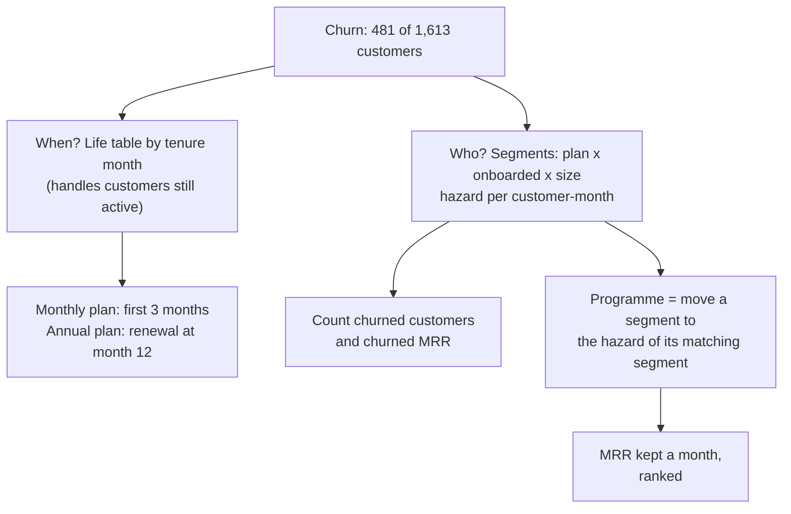

# SaaS: reduce subscription churn

Business question: which customers leave, when, and which change would keep the most revenue?

## Before you start

- **Level:** 2 (intermediate).
- **Time:** about 4 hours.
- **Builds on:** [Cohort retention](../../01-sql/04-cohort-retention/), [Subqueries and CTEs](../../01-sql/07-subqueries-and-ctes/), [Retention curves and churn](../../03-metrics-and-product-analytics/08-retention-curves-and-churn/) (right-censoring) and [Segmentation and mix effects](../../03-metrics-and-product-analytics/09-segmentation-and-mix-effects/).
- **You need:** Python 3.9 or later. Nothing to install. SQLite comes with Python.
- **How this case is built:** the twelve steps in the [phase README](../README.md). Steps 1 to 6 are in The idea, steps 7 to 12 in Walk through. [RUBRIC.md](RUBRIC.md) grades your steps 10 to 12.

## The problem

Tallyfern, a fictional invoicing and bookkeeping app for small businesses, sells seats (one per user) on monthly or annual plans. 481 of the 1,613 customers who signed up since January 2025 have left. Neha, the head of customer success, has budget for one retention programme next quarter. Sales wants a cheaper plan for one- and two-person businesses, "because most of the people who leave are tiny". The onboarding team wants a setup call for every new customer. Neha needs to know which customers leave, when, and which programme would keep the most revenue, before the planning meeting at the end of next week.

The file `data/customers.csv` is synthetic, generated by `make_data.py` with a fixed seed: 1,613 customers who signed up from January 2025 to September 2026, observed at the end of October 2026. The pattern in it is one that SaaS analysts meet often.

## In plain words

Think of a gym. Some members quit in the first few weeks, before the habit forms. Annual members cannot quit until their year is up, so they all leave on one day, at renewal. And if you ask "what share of members quit?", a member who joined last week has had no time to quit, so counting them makes the gym look better than it is. To compare fairly you count quits per month of membership, not per member.

Terms used in this case:

- **Churn:** a customer ending their subscription.
- **MRR (monthly recurring revenue):** what a customer pays per month. An annual plan's price is shown per month.
- **Tenure:** whole months from signup to leaving, or to the end of October 2026 for a customer who is still active.
- **Right-censoring:** for an active customer we know they stayed at least this long, but not when they will leave. Their story is cut off on the right side of the timeline.
- **Life table:** for each month of tenure, how many customers were still subscribed at its start (at risk) and how many left in it.
- **Hazard:** the chance of leaving in a month, given you were still there at its start: left / at risk.
- **Survival:** the share still subscribed after n months: multiply (1 - hazard) month by month.
- **Customer-months:** the sum of every customer's tenure: how much time customers spent at risk. Churned / customer-months is the average monthly hazard of a segment.
- **Onboarded:** the customer connected a bank feed in the first 14 days (the setup step that makes the app useful).
- **Logo churn and revenue churn:** counting customers who leave versus counting the MRR that leaves.

## What you will build from scratch

- `LIFE_SQL`: a life table per plan, with a recursive CTE for the months.
- `SEGMENT_SQL`: customers, churn, customer-months and MRR by plan, onboarding and size.
- `survival(life_rows, plan)`: the survival curve.
- `monthly_hazard(segment)` and `lever(segments, field, from_value, to_value)`: MRR and customers a programme would keep a month.
- `churn_shares(segments, field)`: who leaves by count and by revenue.
- `text_chart(points)`: a survival chart for a message.

## The idea

### 1. Business context

Tallyfern charges Rs 450 a seat a month on the monthly plan and Rs 375 a seat a month on the annual plan. A monthly customer can leave at any month end; an annual customer only at renewal. Customer success owns retention programmes; sales owns pricing.

### 2. Problem statement

Describe who churns and at what tenure, measured fairly for customers with different tenures, and estimate the MRR a month each candidate programme (onboarding calls, a small-business plan) would keep.

### 3. Objectives: the decision this informs

Neha funds one programme next quarter. The analysis must rank the programmes by MRR kept and say how sure we are that the programme, not the kind of customer, causes the difference.

### 4. KPIs and their definitions

- Tenure = month index of churn_month (or 2026-10 if active) - month index of signup_month, where month index = year x 12 + month.
- At risk in month n = customers with tenure >= n. Churned in month n = churned customers with tenure = n. Hazard = churned / at risk.
- Survival after n months = product of (1 - hazard) for months 1 to n.
- Monthly hazard of a segment = churned / customer-months.
- MRR kept by a programme a month = for each segment it targets, active MRR x (its monthly hazard - the hazard of the matching segment it would become), counting only positive gaps.

### 5. Data required, and what is missing

`customers.csv`: customer_id, signup_month, plan, seats, mrr, onboarded, churn_month (blank if active). Missing: product usage, support tickets, cancellation reasons and the price each customer saw. Above all, nobody was assigned to onboard at random, so onboarded and not-onboarded customers may differ in other ways.

### 6. Analytical approach



1. Life table per plan: when do customers leave?
2. Segment hazards per customer-month: who leaves?
3. Who leaves by count versus by MRR.
4. Value each programme as MRR kept a month, compare, and state what would prove it causal.

## Walk through

### 7. SQL and Python implementation

Run these blocks in order in one Python session started in this folder (`python3`). Load the CSV; a blank churn_month (still active) becomes NULL.

```python
import csv, sqlite3

con = sqlite3.connect(":memory:")
con.execute("""CREATE TABLE customers (customer_id TEXT, signup_month TEXT, plan TEXT, seats INTEGER,
               mrr INTEGER, onboarded TEXT, churn_month TEXT)""")
with open("data/customers.csv", newline="") as f:
    con.executemany("INSERT INTO customers VALUES (?, ?, ?, ?, ?, ?, ?)",
                    [[v or None for v in r.values()] for r in csv.DictReader(f)])

def show(sql):
    for row in con.execute(sql):
        print(row)

show("""SELECT COUNT(*), SUM(churn_month IS NOT NULL),
               SUM(CASE WHEN churn_month IS NULL THEN mrr END), SUM(CASE WHEN churn_month IS NOT NULL THEN mrr END)
        FROM customers""")
```

```
(1613, 481, 2101875, 713550)
```

481 customers left, taking Rs 713,550 of MRR; Rs 2,101,875 of MRR is still active.

Step 7a. Tenure. Month strings become a month index (year x 12 + month), so December to February is 2 months even across a year end. (SQLite has no month difference function; PostgreSQL could use `age()` or `EXTRACT`.)

```python
IDX = "(CAST(substr({0}, 1, 4) AS INTEGER) * 12 + CAST(substr({0}, 6, 2) AS INTEGER))"
TENURE = IDX.format("COALESCE(churn_month, '2026-10')") + " - " + IDX.format("signup_month")
show(f"""SELECT signup_month, churn_month, {TENURE} AS tenure FROM customers
         WHERE customer_id IN ('C00001', 'C00006', 'C00713')""")
```

```
('2025-01', None, 21)
('2025-01', '2025-02', 1)
('2025-10', '2026-02', 4)
```

Still active since January 2025: 21 months. Left in its first month: 1. October 2025 to February 2026, across the year end: 4.

Step 7b. The life table. A recursive CTE makes the numbers 1 to the longest tenure; every customer is then compared with every month.

```python
life = con.execute(f"""
    WITH RECURSIVE c AS (SELECT plan, {TENURE} AS tenure, churn_month IS NOT NULL AS gone FROM customers),
    months(n) AS (SELECT 1 UNION ALL SELECT n + 1 FROM months WHERE n < (SELECT MAX(tenure) FROM c))
    SELECT c.plan, n, SUM(c.tenure >= n) AS at_risk, SUM(c.gone AND c.tenure = n) AS churned
    FROM c CROSS JOIN months GROUP BY c.plan, n ORDER BY c.plan, n""").fetchall()
for plan, n, at_risk, churned in life:
    if n in (1, 2, 3, 4, 5, 11, 12, 13):
        print(plan, n, at_risk, churned, "%.2f%%" % (100 * churned / at_risk))
```

```
annual 1 474 0 0.00%
annual 2 457 0 0.00%
annual 3 442 0 0.00%
annual 4 414 0 0.00%
annual 5 391 0 0.00%
annual 11 251 0 0.00%
annual 12 223 65 29.15%
annual 13 138 0 0.00%
monthly 1 1139 83 7.29%
monthly 2 1011 76 7.52%
monthly 3 881 70 7.95%
monthly 4 775 18 2.32%
monthly 5 715 21 2.94%
monthly 11 377 9 2.39%
monthly 12 338 15 4.44%
monthly 13 291 10 3.44%
```

The answer to "when": monthly customers leave at 7% to 8% a month in their first three months, then about 2% to 3%. Annual customers leave only at renewal, and 29% of those who reach month 12 leave then. At-risk numbers fall each month partly because people leave and partly because recent signups have not reached that tenure yet: that is the censoring, handled by using only customers who reached the month.

Step 7c. Segments. A hazard per customer-month compares segments fairly even when one segment is younger.

```python
segs = con.execute(f"""
    WITH c AS (SELECT plan, onboarded, CASE WHEN seats <= 2 THEN '1-2' ELSE '3+' END AS size, mrr,
                      churn_month IS NOT NULL AS gone, {TENURE} AS tenure FROM customers)
    SELECT plan, onboarded, size, COUNT(*), SUM(gone), SUM(tenure), SUM(1 - gone),
           SUM(CASE WHEN gone THEN 0 ELSE mrr END), SUM(CASE WHEN gone THEN mrr ELSE 0 END)
    FROM c GROUP BY plan, onboarded, size ORDER BY plan, onboarded, size""").fetchall()
for plan, onb, size, n, gone, cm, active, amrr, cmrr in segs:
    print("%-7s onboarded=%-3s %-3s customers %3d churned %3d hazard %5.2f%% active MRR %7d churned MRR %6d"
          % (plan, onb, size, n, gone, 100 * gone / cm, amrr, cmrr))
```

```
annual  onboarded=no  1-2 customers  76 churned  20 hazard  2.82% active MRR   34500 churned MRR   9750
annual  onboarded=no  3+  customers  73 churned  21 hazard  2.80% active MRR  146250 churned MRR  67125
annual  onboarded=yes 1-2 customers 178 churned  19 hazard  0.99% active MRR   91875 churned MRR   9375
annual  onboarded=yes 3+  customers 147 churned   5 hazard  0.32% active MRR  414000 churned MRR  11250
monthly onboarded=no  1-2 customers 218 churned 130 hazard 10.46% active MRR   57150 churned MRR  78300
monthly onboarded=no  3+  customers 182 churned  91 hazard  6.98% active MRR  280350 churned MRR 307350
monthly onboarded=yes 1-2 customers 425 churned 149 hazard  4.09% active MRR  182250 churned MRR  99900
monthly onboarded=yes 3+  customers 314 churned  46 hazard  1.52% active MRR  895500 churned MRR 130500
```

Two things raise the hazard in every plan: not onboarding, and being a 1 to 2 seat account. Not onboarding raises it much more for teams (monthly 3+: 6.98% against 1.52%).

Step 7d. Who leaves, by count and by money:

```python
for size in ("1-2", "3+"):
    gone = sum(s[4] for s in segs if s[2] == size)
    mrr = sum(s[8] for s in segs if s[2] == size)
    print(size, gone, round(100 * gone / 481, 1), mrr, round(100 * mrr / 713550, 1))
```

```
1-2 318 66.1 197325 27.7
3+ 163 33.9 516225 72.3
```

Sales is right that two-thirds of the customers who leave are tiny (66.1%). They are only 27.7% of the MRR that leaves.

Step 7e. Value each programme. Onboarding calls would move a not-onboarded customer toward the hazard of an onboarded customer in the same plan and size; a small-business plan would move a 1 to 2 seat account toward the hazard of a team in the same plan and onboarding status.

```python
by_key = {(s[0], s[1], s[2]): s for s in segs}
def hz(s):
    return s[4] / s[5]

def kept(field, frm, to):
    pos = {"plan": 0, "onboarded": 1, "size": 2}[field]
    mrr = cust = 0.0
    for key, s in by_key.items():
        if key[pos] != frm:
            continue
        ref = by_key[tuple(to if i == pos else k for i, k in enumerate(key))]
        gap = max(0.0, hz(s) - hz(ref))
        mrr += s[7] * gap
        cust += s[6] * gap
    return round(mrr), round(cust, 1)

print("onboarding calls:", kept("onboarded", "no", "yes"))
print("small-business plan:", kept("size", "1-2", "3+"))
```

```
onboarding calls: (23204, 12.9)
small-business plan: (7301, 11.2)
```

Each pair is (MRR kept a month, customers kept a month). By customers the two programmes look close (12.9 against 11.2). By revenue, onboarding keeps three times as much: Rs 23,204 of MRR a month against Rs 7,301.

### 8. Visualisation

Survival after selected months, per plan, on a fixed scale (100% is 30 characters) so the two plans compare:

```python
for plan in ("monthly", "annual"):
    s = 1.0
    curve = {}
    for p, n, at_risk, churned in life:
        if p == plan and at_risk:
            s *= 1 - churned / at_risk
            curve[n] = s
    for n in (1, 3, 6, 12, 18):
        print("%-7s M%02d %5.1f%% %s" % (plan, n, 100 * curve[n], "#" * round(curve[n] * 30)))
```

```
monthly M01  92.7% ############################
monthly M03  78.9% ########################
monthly M06  72.7% ######################
monthly M12  59.7% ##################
monthly M18  49.4% ###############
annual  M01 100.0% ##############################
annual  M03 100.0% ##############################
annual  M06 100.0% ##############################
annual  M12  70.9% #####################
annual  M18  70.9% #####################
```

The monthly curve drops steeply in the first three months and then slowly; the annual curve is a staircase with one step at renewal.

### 9. Insights

1. When: monthly customers lose 21% in the first three months (survival 78.9%), then 2% to 3% a month. Annual customers lose 29% at their first renewal.
2. Who: not-onboarded customers have a higher hazard in every plan and size; small accounts too, but less so, and they pay little.
3. By count, 66.1% of leavers are 1 to 2 seat accounts; by revenue they are 27.7%. Ranking problems by customers points at the wrong programme.
4. Bringing not-onboarded customers to the hazard of onboarded ones would keep about Rs 23,204 of MRR a month; a small-business plan that made small accounts churn like teams would keep about Rs 7,301.

### 10. Recommendation

Fund the onboarding programme: from next month, customer success offers a setup call to every new customer who has not connected a bank feed by day 7, starting with teams of 3 or more seats. Run it as an experiment: offer the call to a random half of eligible customers for the first two months, so the effect can be measured, not assumed. Do not build the small-business plan this quarter.

### 11. Expected business impact

Upper bound from the data: about Rs 23,204 of MRR kept a month, if a call made a not-onboarded customer behave exactly like an onboarded one. Assumption: a call closes half of that gap (a stated guess, to be replaced by the experiment's result). That keeps about Rs 11,600 of MRR a month, so after a year about Rs 139,000 more MRR is still active than without the programme (12 x 11,600, ignoring that kept customers can still leave later). The small-business plan's upper bound is Rs 7,301 a month, less than a third, before the cost of building a new plan.

### 12. Limitations and what would change our mind

- Onboarding was not assigned at random. Customers who connect a bank feed may simply be more committed; then a call would close less of the gap. The randomised first two months answer this; if the called half churns no less than the uncalled half, stop the programme.
- Annual customers' monthly hazard is an average of eleven quiet months and one renewal month; the true risk is concentrated at renewal, so an annual programme should target month 11.
- The longest tenure is 21 months, so we know nothing about churn in year three.
- MRR uses list prices. If some customers have discounts, kept MRR is lower.

## Common mistakes

**1. Churn rate as churned / customers by signup period (the trap).** It makes newer customers look loyal:

```python
show("""SELECT substr(signup_month, 1, 4) AS signup_year, COUNT(*),
               ROUND(100.0 * SUM(churn_month IS NOT NULL) / COUNT(*), 1) AS churned_pct
        FROM customers GROUP BY signup_year""")
```

```
('2025', 927, 39.4)
('2026', 686, 16.9)
```

"Churn fell by more than half for 2026 signups" is false. 2026 signups have had at most 9 months to leave, and many only one or two. The life table and the per-customer-month hazard give every customer only the months they were actually observed.

**2. Ranking by customers lost.** 66.1% of leavers are small accounts, so a small-business plan sounds right. Measured in MRR, the onboarding gap is three times bigger. Count both, decide on the one that matches the goal (here revenue).

**3. Counting the annual renewal as a monthly problem.** The annual plan has no churn in months 1 to 11 and 29% at month 12. An average monthly hazard (for example 0.32% for onboarded teams) hides that the whole risk sits in one month. Plan annual retention work around the renewal date.

**4. Treating the gap as the effect.** The difference between onboarded and not-onboarded customers is a correlation in observational data. The programme's real effect could be smaller. Size the impact as an upper bound, and test.

## Your turn

Open `exercise.py`. Write the two queries and five functions; the docstrings say what each must return, with fewer hints than in Level 1. Then run, from this folder:

    python3 test_lesson.py

The tests run on the committed data, on a second dataset built with another seed (so typed-in answers fail), and on hand-made cases: an active customer, a churn in the first month, a tenure across a year end, a plan with no churn, a segment with no match, a segment that is already better than its match, and a segment with no customer-months. To check the reference answer: `CHECK_SOLUTION=1 python3 test_lesson.py`.

Then write your own steps 10 to 12 and grade them with [RUBRIC.md](RUBRIC.md).

Stretch: value a third programme, moving monthly customers to the annual plan (`lever(segs, "plan", "monthly", "annual")`). Why is the result misleading without the 17% annual discount and the renewal spike?

## Check yourself

1. Why is churned / customers a biased churn rate when customers signed up at different times?
2. What is the hazard in month 12 for annual customers, and why is it 0 in month 11?
3. Small accounts are two-thirds of leavers. Why not start there?
4. What would you need to say "onboarding calls cause lower churn"?

<details>
<summary>Answers</summary>

1. Recent customers have had less time to leave, so they pull the rate down. The rate then depends on when people signed up, not on how loyal they are. Use a life table or churned per customer-month.
2. 29.15%: 65 of 223 annual customers who reached month 12 left. They cannot leave mid-contract, so the hazard before renewal is 0.
3. They are 27.7% of the MRR that leaves. Fixing them keeps many customers but little revenue; the onboarding gap is worth three times more MRR.
4. A randomised test: offer calls to a random half of not-onboarded customers and compare churn. Without it, onboarded customers may differ in commitment, size or need.

</details>

## What to tell the stakeholder

To Neha: "Monthly customers who do not connect a bank feed in their first fortnight are the ones who leave, mostly in the first three months; closing that gap is worth up to about Rs 23,000 of MRR a month, three times what a small-business plan could keep. Fund onboarding calls from next month, randomised for the first two months, because we have not yet shown that the call, rather than the kind of customer, makes the difference."

## In real job postings

In the Real Analyst Jobs data drop of 25 October 2026, 1,477 of the 2,056 analyst postings in the US that name a tool (71.8%) ask for SQL, which this case uses for the life table and the segment hazards. See [Product analyst jobs](https://realanalystjobs.com/jobs/product-analyst-jobs) for roles where churn analysis is routine.

## Next

[03: Marketing: is the campaign incremental?](../03-marketing-is-the-campaign-incremental/)
