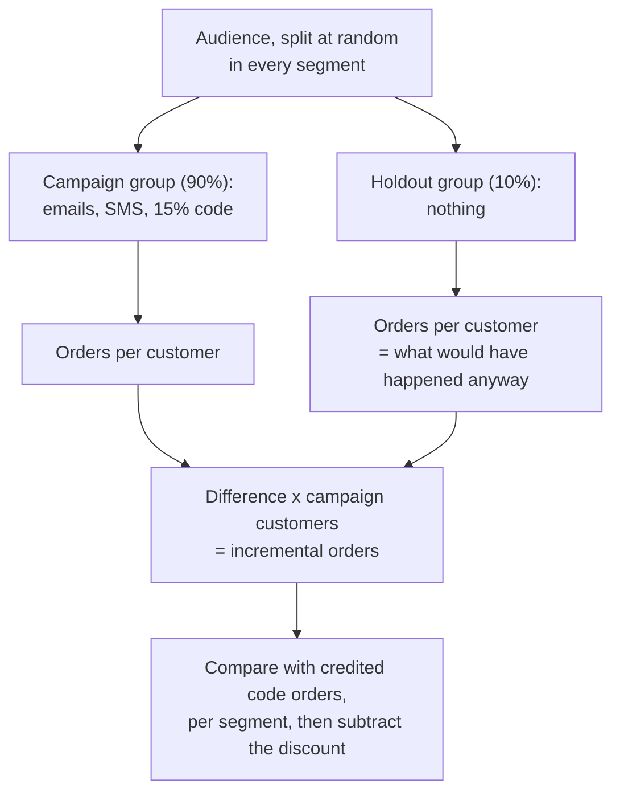

# Marketing: is the campaign incremental?

Business question: the campaign got credit for 3,000 sales. How many would have happened anyway?

## Before you start

- **Level:** 2 (intermediate).
- **Time:** about 4 hours.
- **Builds on:** [GROUP BY from raw rows](../../01-sql/01-group-by-from-raw-rows/), [Joins without losing rows](../../01-sql/02-joins-without-losing-rows/), [A/B test from scratch](../../02-statistics-and-experiments/03-ab-test-from-scratch/) (a randomised comparison and its interval) and [Attribution models](../../03-metrics-and-product-analytics/11-attribution-models/) (how credit for a sale is assigned).
- **You need:** Python 3.9 or later. Nothing to install. SQLite comes with Python.
- **How this case is built:** the twelve steps in the [phase README](../README.md). Steps 1 to 6 are in The idea, steps 7 to 12 in Walk through. [RUBRIC.md](RUBRIC.md) grades your steps 10 to 12.

## The problem

Brackenbee, a fictional online shop for tea, honey and pantry goods, ran its "Harvest" campaign from 1 to 28 September 2026: emails and SMS with a 15% discount code. The code was used on 3,109 orders, and Ishaan, the marketing lead, reports "3,109 sales from Harvest" and asks for twice the budget for the Diwali campaign. Farah, the finance head, asks the question this case is named after: how many of those orders would have come in anyway? Luckily the team held out a random 10% of customers in every segment, who got no messages. The budget is decided on Friday.

The files in `data/` are synthetic, generated by `make_data.py` with a fixed seed: `audience.csv` (6 rows: customers per segment and group) and `daily.csv` (336 rows: orders per day, segment and group from 4 August to 28 September 2026). The pattern in them is one that marketing analysts meet often.

## In plain words

A bakery puts up a sign: "show this sign for 15% off". At the end of the month 300 customers showed the sign. Did the sign bring 300 customers? Many of them were regulars who come every morning anyway; they simply took the discount. To know what the sign did, the baker needs a comparison: the same kind of customers who did not see the sign. If the regulars who never saw it bought just as often, the sign added nothing for them and cost the discount.

Terms used in this case:

- **Attribution:** giving a sale credit to a campaign, here because the order used the campaign's code. It says the campaign touched the sale, not that it caused it.
- **Incremental orders (incrementality):** orders that happened because of the campaign: orders with the campaign minus orders that would have happened without it.
- **Holdout group:** customers chosen at random to receive nothing. Their behaviour estimates what everyone would have done without the campaign.
- **Counterfactual:** what would have happened without the campaign. You never see it directly; the holdout estimates it.
- **Rate:** orders per customer over the four weeks, so groups of different sizes compare.
- **Standard error (SE):** how much an estimate would wobble from one random holdout to another. A 95% interval is roughly the estimate plus or minus 1.96 SE.
- **Poisson approximation:** treating a count of orders as random with variance equal to its mean, which gives a simple SE for a rate.
- **A/A check:** comparing the two groups before the campaign, when they were treated the same. They should look alike; if not, the split was not random.
- **Gross margin:** the share of the full price left after the cost of the goods.

## What you will build from scratch

- `GROUP_SQL`: customers, orders, code orders and revenue per period, segment and group, with 0 for empty groups.
- `lift(rows, segment)`: incremental orders and revenue in a segment, with a 95% interval.
- `total_lift(rows)`: the same for the whole campaign.
- `campaign_profit(rows, segment, margin, discount)`: extra gross profit after the discount given away.
- `text_chart(lifts)`: credited versus real orders per segment.

## The idea

### 1. Business context

Brackenbee's customers fall into three segments: loyal (three or more orders in the last year), recent (one or two orders in the last six months) and lapsed (no order for six months or more). Marketing owns campaigns and reports attributed sales; finance owns the budget. Every order with a code costs 15% of its price.

### 2. Problem statement

Estimate how many orders Harvest added, in total and per segment, with an honest range, and whether those orders paid for the discount given on all the code orders.

### 3. Objectives: the decision this informs

Farah must decide the Diwali budget: double it, keep it, or change who receives the campaign. The analysis must say which segments the campaign works for.

### 4. KPIs and their definitions

- Rate of a group = orders / customers in the four campaign weeks.
- Incremental orders in a segment = (rate campaign group - rate holdout group) x customers in the campaign group.
- SE of incremental orders = campaign customers x sqrt(orders campaign / campaign customers^2 + orders holdout / holdout customers^2). Segments are independent, so their variances add.
- Attributed orders = orders with the code in the campaign group.
- Extra gross profit = (gross profit per customer, campaign - holdout) x campaign customers, where gross profit = margin x revenue - (1 - margin) x discount given, and discount given = code revenue x 0.15 / 0.85.

### 5. Data required, and what is missing

`audience.csv`: segment, grp, customers. `daily.csv`: date, segment, grp, orders, code_orders, revenue, code_revenue. Missing: customer-level rows (so we cannot see repeat buyers), the cost of sending messages, the cost of the goods (the margin is an assumption), and anything after 28 September (orders pulled forward from October would look incremental here).

### 6. Analytical approach



1. Check the split: the groups should look alike in August (A/A check).
2. Total each group per period with SQL.
3. Incremental orders and an interval per segment, then in total.
4. Compare with credited orders, and turn it into profit after the discount.

## Walk through

### 7. SQL and Python implementation

Run these blocks in order in one Python session started in this folder (`python3`). Load both files.

```python
import csv, math, sqlite3

con = sqlite3.connect(":memory:")
con.execute("CREATE TABLE audience (segment TEXT, grp TEXT, customers INTEGER)")
con.execute("""CREATE TABLE daily (date TEXT, segment TEXT, grp TEXT, orders INTEGER, code_orders INTEGER,
               revenue INTEGER, code_revenue INTEGER)""")
with open("data/audience.csv", newline="") as f:
    con.executemany("INSERT INTO audience VALUES (?, ?, ?)", [tuple(r.values()) for r in csv.DictReader(f)])
with open("data/daily.csv", newline="") as f:
    con.executemany("INSERT INTO daily VALUES (?, ?, ?, ?, ?, ?, ?)", [tuple(r.values()) for r in csv.DictReader(f)])

def show(sql):
    for row in con.execute(sql):
        print(row)

show("SELECT SUM(code_orders), SUM(orders) FROM daily WHERE grp = 'campaign' AND date >= '2026-09-01'")
```

```
(3109, 4783)
```

The campaign group placed 4,783 orders in September, 3,109 of them with the code: the number in Ishaan's report.

Step 7a. One row per period, segment and group. The CROSS JOIN with both periods and the LEFT JOIN from the audience make sure every group appears, even one with no orders in a period, with 0 instead of NULL.

```python
rows = con.execute("""
    WITH periods AS (SELECT 'campaign' AS period UNION ALL SELECT 'pre'),
    d AS (SELECT CASE WHEN date >= '2026-09-01' THEN 'campaign' ELSE 'pre' END AS period, segment, grp,
                 SUM(orders) AS orders, SUM(code_orders) AS code_orders, SUM(revenue) AS revenue,
                 SUM(code_revenue) AS code_revenue
          FROM daily GROUP BY period, segment, grp)
    SELECT p.period, a.segment, a.grp, a.customers, COALESCE(d.orders, 0), COALESCE(d.code_orders, 0),
           COALESCE(d.revenue, 0), COALESCE(d.code_revenue, 0)
    FROM audience a CROSS JOIN periods p
    LEFT JOIN d ON d.period = p.period AND d.segment = a.segment AND d.grp = a.grp
    ORDER BY p.period, a.segment, a.grp""").fetchall()
for r in rows:
    print(r, "rate %.4f" % (r[4] / r[3]))
```

```
('campaign', 'lapsed', 'campaign', 27000, 1215, 927, 890602, 657134) rate 0.0450
('campaign', 'lapsed', 'holdout', 3000, 55, 3, 44789, 2408) rate 0.0183
('campaign', 'loyal', 'campaign', 10800, 2367, 1460, 1761804, 1017017) rate 0.2192
('campaign', 'loyal', 'holdout', 1200, 240, 14, 189831, 10128) rate 0.2000
('campaign', 'recent', 'campaign', 16200, 1201, 722, 876979, 491712) rate 0.0741
('campaign', 'recent', 'holdout', 1800, 107, 5, 89622, 4493) rate 0.0594
('pre', 'lapsed', 'campaign', 27000, 476, 0, 395534, 0) rate 0.0176
('pre', 'lapsed', 'holdout', 3000, 43, 0, 34819, 0) rate 0.0143
('pre', 'loyal', 'campaign', 10800, 1833, 0, 1483723, 0) rate 0.1697
('pre', 'loyal', 'holdout', 1200, 199, 0, 159805, 0) rate 0.1658
('pre', 'recent', 'campaign', 16200, 823, 0, 675873, 0) rate 0.0508
('pre', 'recent', 'holdout', 1800, 90, 0, 77215, 0) rate 0.0500
```

The A/A check passes: in August the two groups ordered at almost the same rate in every segment (loyal 0.1697 and 0.1658, recent 0.0508 and 0.0500). In September, holdout loyal customers still ordered 0.2000 times each without any message. 22 holdout orders used the code anyway: it leaked onto coupon sites.

Step 7b. Incremental orders per segment, with a 95% interval:

```python
g = {(r[0], r[1], r[2]): r for r in rows}
lifts = {}
for seg in ("loyal", "recent", "lapsed"):
    c, h = g[("campaign", seg, "campaign")], g[("campaign", seg, "holdout")]
    nc, nh = c[3], h[3]
    inc = (c[4] / nc - h[4] / nh) * nc
    se = nc * math.sqrt(c[4] / nc ** 2 + h[4] / nh ** 2)
    lifts[seg] = (c[5], inc, se)
    print("%-6s credited %4d  incremental %5.0f  95%% %5.0f to %4.0f" % (seg, c[5], inc, inc - 1.96 * se, inc + 1.96 * se))
total = sum(v[1] for v in lifts.values())
se_total = math.sqrt(sum(v[2] ** 2 for v in lifts.values()))
print("all    credited %4d  incremental %5.0f  95%% %5.0f to %4.0f" % (
    sum(v[0] for v in lifts.values()), total, total - 1.96 * se_total, total + 1.96 * se_total))
```

```
loyal  credited 1460  incremental   207  95%   -82 to  496
recent credited  722  incremental   238  95%    43 to  433
lapsed credited  927  incremental   720  95%   572 to  868
all    credited 3109  incremental  1165  95%   786 to 1544
```

The campaign added about 1,165 orders (786 to 1,544), not 3,109. For loyal customers the interval includes 0: we cannot tell the campaign added any loyal orders at all.

### 8. Visualisation

Credited against real, per segment, on one scale:

```python
top = max(max(v[0], v[1]) for v in lifts.values())
for seg, (credited, inc, se) in lifts.items():
    print("%-8s credited %6d %s" % (seg, credited, "#" * round(credited / top * 30)))
    print("%-8s real     %6d %s" % ("", round(inc), "#" * round(max(0, inc) / top * 30)))
```

```
loyal    credited   1460 ##############################
         real        207 ####
recent   credited    722 ###############
         real        238 #####
lapsed   credited    927 ###################
         real        720 ###############
```

### 9. Insights

Does each segment pay for its discount? Assume a 40% gross margin (an example figure, not in the data). The campaign group gives away 15% on every code order, including the orders that would have happened anyway.

```python
margin, d = 0.40, 0.15
def profit_per_customer(r):
    given = r[7] * d / (1 - d)
    return (margin * r[6] - (1 - margin) * given) / r[3]

for seg in ("loyal", "recent", "lapsed"):
    c, h = g[("campaign", seg, "campaign")], g[("campaign", seg, "holdout")]
    print(seg, round((profit_per_customer(c) - profit_per_customer(h)) * c[3]))
```

```
loyal -76703
recent -19630
lapsed 127716
```

1. Of 3,109 credited orders, the campaign added about 1,165 (95% interval 786 to 1,544). About 1,944 credited orders, roughly 63%, would have happened anyway.
2. Lapsed customers: 720 extra orders out of 927 credited (572 to 868). The campaign works here.
3. Loyal customers: 207 extra out of 1,460 credited, and the interval reaches below 0. They mostly bought as usual and took 15% off.
4. With a 40% margin, the campaign earned about Rs 127,716 of extra gross profit from lapsed customers and lost about Rs 76,703 on loyal and Rs 19,630 on recent customers, by giving discounts on orders that were coming anyway. Net: about Rs 31,400, before the cost of sending messages.

### 10. Recommendation

For Diwali, Ishaan's team sends the discount campaign to lapsed customers only, keeps a random 10% holdout again, and does not send the discount code to loyal customers (a no-discount message, such as a new-product email, can be tested on them instead). Report incremental orders from the holdout, not code redemptions, as the campaign's result. Do not double the budget on the strength of 3,109 attributed sales.

### 11. Expected business impact

From Harvest's data: lapsed customers alone gave about 720 extra orders and Rs 127,716 of extra gross profit, against a net of about Rs 31,400 for the whole campaign. Assumptions: a 40% gross margin, Diwali response similar to Harvest's, and message costs small next to the discount. Dropping loyal and recent customers removes about Rs 96,300 of lost profit (76,703 + 19,630), so the same lapsed-only campaign would make about four times the profit of Harvest while sending 27,000 messages instead of 54,000.

### 12. Limitations and what would change our mind

- The loyal estimate is uncertain (-82 to 496 extra orders). A larger holdout for loyal customers (for example 30%) in the next test would settle whether a gentler offer works for them.
- Orders pulled forward: a lapsed customer who would have ordered in October but ordered in September looks incremental here. Compare October orders of the two groups when the data is in; if the holdout catches up, the lift was smaller.
- The code leaked to coupon sites (22 holdout orders used it). If leakage grows, the holdout stops being a clean "no campaign" group.
- The margin is assumed. At a 20% margin, even the lapsed segment barely covers its discounts (about Rs 7,800 of extra gross profit), and below about 19% it loses money.

## Common mistakes

**1. Counting code redemptions as the campaign's result (the trap).** 3,109 orders used the code. A code is a key to a discount, not proof of persuasion: loyal holdout customers ordered 0.2000 times each with no message at all, close to the 0.2192 of loyal campaign customers. Credit a campaign with the difference from a holdout, never with redemptions.

**2. Before and after instead of a holdout.** Comparing the campaign group's September with its own August:

```python
for seg in ("loyal", "recent", "lapsed"):
    sep, aug = g[("campaign", seg, "campaign")], g[("pre", seg, "campaign")]
    print(seg, round((sep[4] / sep[3] - aug[4] / aug[3]) * sep[3]))
```

```
loyal 534
recent 378
lapsed 739
```

That claims 1,651 extra orders. But the holdout shows September was busier for everyone, campaign or not (loyal holdout: 0.1658 in August, 0.2000 in September). Before and after mixes the campaign with the season.

**3. Comparing campaign code users with the holdout.** "Code users ordered 1,460 times; the holdout's whole loyal group ordered at 0.2000" compares a selected subgroup (people keen enough to use a code) with a whole group. Compare whole randomised group with whole randomised group.

**4. Adding standard errors.** The total's SE is the square root of the sum of the squared segment SEs (193), not the sum of the SEs (322). Adding them makes the interval look wider than it is.

## Your turn

Open `exercise.py`. Write the query and four functions; the docstrings say what each must return, with fewer hints than in Level 1. Then run, from this folder:

    python3 test_lesson.py

The tests run on the committed data, on a second dataset built with another seed (so typed-in answers fail), and on hand-made cases: 31 August and 1 September on either side of the campaign start, a group with no orders, a missing or empty holdout, two groups with the same rate, and an all-discount campaign that adds nothing. To check the reference answer: `CHECK_SOLUTION=1 python3 test_lesson.py`.

Then write your own steps 10 to 12 and grade them with [RUBRIC.md](RUBRIC.md).

Stretch: how large would the loyal holdout need to be for the 95% interval to be about plus or minus 100 orders? (The SE shrinks with the square root of the holdout size.)

## Check yourself

1. Why is the holdout a better counterfactual than August?
2. Loyal customers used the code 1,460 times. Why is the incremental number only about 207?
3. The loyal interval is -82 to 496. What can you say, and what can you not?
4. Why can a campaign that adds orders still lose money?

<details>
<summary>Answers</summary>

1. The holdout lives through the same September (season, competitors, prices) and was chosen at random, so the only systematic difference is the campaign. August differs from September for reasons that have nothing to do with the campaign.
2. Most loyal customers would have ordered anyway; the holdout shows they ordered 0.2000 times each without a message. The code was used on orders that were coming regardless.
3. The best estimate is about 207 extra orders, but the data is consistent with no effect at all and with nearly 500. You cannot claim the campaign worked for loyal customers; you need a bigger holdout to know.
4. The discount is paid on every code order, including the ones that would have happened anyway. If the extra orders' margin is smaller than the discount given away, profit falls (loyal: about -Rs 76,700).

</details>

## What to tell the stakeholder

To Farah and Ishaan: "Harvest added about 1,165 orders (between roughly 790 and 1,540), not 3,109; the rest would have come in anyway, mostly from loyal customers who used the code on their usual order. The campaign paid off only for lapsed customers (about Rs 128,000 of extra gross profit at an assumed 40% margin); for Diwali, send the discount to lapsed customers only and keep the 10% holdout."

## In real job postings

In the Real Analyst Jobs data drop of 25 October 2026, 996 of the 2,056 analyst postings in the US that name a tool (48.4%) ask for Python, which this case uses for the lift and its interval. Before you size a holdout for a test like this, the [A/B test calculator](https://realanalystjobs.com/tools/ab-test-calculator) shows how sample size drives the interval.

## Next

[04: Food delivery: why are cancellations rising?](../04-food-delivery-cancellations/)
