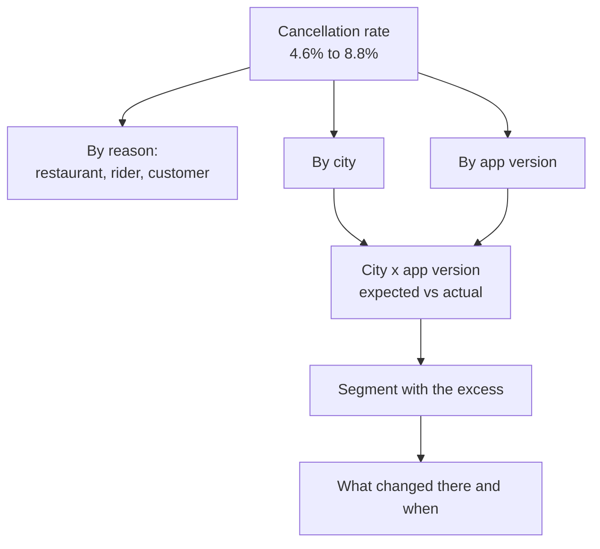

# Food delivery: why are cancellations rising?

Business question: cancellations doubled in six weeks. Is it restaurants, riders, customers or the app?

## Before you start

- **Level:** 2 (intermediate).
- **Time:** about 4 hours.
- **Builds on:** [GROUP BY from raw rows](../../01-sql/01-group-by-from-raw-rows/), [NULLs, CASE and COALESCE](../../00-start-here/05-nulls-case-and-coalesce/) and [Metric trees](../../03-metrics-and-product-analytics/01-metric-trees/) (splitting a number into the parts that explain it).
- **You need:** Python 3.9 or later. Nothing to install. SQLite comes with Python.
- **How this case is built:** the twelve steps in the [phase README](../README.md). Steps 1 to 6 are in The idea, steps 7 to 12 in Walk through. [RUBRIC.md](RUBRIC.md) grades your steps 10 to 12.

## The problem

Tiffinbell, a fictional food delivery app with kitchens and partner restaurants in Pune, Mumbai, Nagpur and Nashik, saw its cancellation rate go from under 5% to almost 9% between August and October 2026. Rohan, the head of operations, has three theories on his desk: restaurants are running out of stock, riders are rejecting long trips, or customers are getting impatient. The customer support lead wants to charge a cancellation fee. Rohan needs an answer for Thursday's leadership meeting: what is driving the rise, and what should the company do this week?

The file `data/orders.csv` is synthetic, generated by `make_data.py` with a fixed seed: 1,832 orders over 12 weeks (3 August to 25 October 2026). The pattern in it is one that delivery analysts meet often.

## In plain words

Imagine a school canteen where more lunch orders are being cancelled. You could blame the cooks, the runners or the students. Before blaming anyone, you would ask: did it get worse everywhere, or only at one counter? Did it start on a particular day? Did anything change that day, like a new token machine? A rise that starts on one date in one place is almost always a change, not a mood.

That is the whole method of this case: split the cancellation rate by every dimension you have, find the slice where the rise lives, and check what changed there.

Terms used in this case:

- **Cancellation rate:** cancelled orders divided by all orders placed, as a percentage. It is a rate, so it can be compared between weeks with different order volumes.
- **Cancel reason:** who pressed cancel: the restaurant, the rider or the customer. It records who acted, not why.
- **App version:** the release of the customer app the order was placed from, for example 7.3.2.
- **Staged rollout:** releasing a new app version to a small group first (here, one city) and widening it if nothing breaks.
- **Segment:** one slice of the data, here a city and app version pair.
- **Baseline rate:** the rate a segment had before the change, used to say what we would have expected after.
- **Excess cancellations:** cancellations above what the baseline rate predicts: actual minus expected.

## What you will build from scratch

- `WEEKLY_SQL`: the cancellation rate per week.
- `REASON_SQL`: cancellations per 100 orders by reason, before and after.
- `SEGMENT_SQL`: orders and cancellations by city, app version and period.
- `excess_by_segment(segments)`: actual minus expected cancellations per segment, ranked.
- `top_segment_share(excess_rows)` and `rate_without(segments, city, app_version)`: how much of the rise one segment explains, and what the rate is without it.
- `text_chart(weekly)`: a bar chart you can paste into a chat message.

## The idea

### 1. Business context

Tiffinbell earns a commission on delivered orders only. A cancelled order earns nothing, may still cost a rider trip, and a customer whose order is cancelled is less likely to order again. Operations owns restaurants and riders; the product team owns the app.

### 2. Problem statement

The weekly cancellation rate was about 4.6% in weeks 1 to 6 and about 8.8% in weeks 7 to 12. Find which part of the business the rise comes from, with numbers, before anyone acts on a theory.

### 3. Objectives: the decision this informs

Rohan must choose between three actions on Thursday: a restaurant stock programme, a rider incentive, or a customer cancellation fee. The analysis must say which of them, if any, addresses the cause.

### 4. KPIs and their definitions

- Cancellation rate = cancelled orders / all orders placed, by order date, in percent.
- Cancellations per 100 orders by reason = cancelled orders with that reason / all orders in the period x 100. The denominator is all orders, so the three reasons add up to the cancellation rate.
- Excess cancellations of a segment = cancelled after - after orders x the segment's city rate before.

### 5. Data required, and what is missing

`orders.csv` has one row per order: order_id, order_date, city, restaurant_id, app_version, status (delivered or cancelled) and cancel_reason (blank when delivered). Missing: the time between placing and cancelling, the screen the customer was on, and app crash logs. Those would confirm the cause directly; without them we can only locate it.

### 6. Analytical approach

Build an issue tree (a diagram of every place the rise could live) and test each branch with a rate, not a count:



1. Confirm the rise week by week (is it real, and when did it start?).
2. Split by reason, per 100 orders.
3. Split by city and app version, compare each segment with its own city's baseline, and rank the excess.
4. Take the top segment out and see what is left.

## Walk through

### 7. SQL and Python implementation

Run these blocks in order in one Python session started in this folder (`python3`). First, load the CSV into SQLite. A blank cancel_reason becomes NULL, as it would in a warehouse table.

```python
import csv, sqlite3

con = sqlite3.connect(":memory:")
con.execute("CREATE TABLE orders (order_id, order_date, city, restaurant_id, app_version, status, cancel_reason)")
with open("data/orders.csv", newline="") as f:
    con.executemany("INSERT INTO orders VALUES (?, ?, ?, ?, ?, ?, ?)",
                    [[v or None for v in r.values()] for r in csv.DictReader(f)])

def show(sql):
    for row in con.execute(sql):
        print(row)

show("SELECT COUNT(*), SUM(status = 'cancelled'), MIN(order_date), MAX(order_date) FROM orders")
```

```
(1832, 122, '2026-08-03', '2026-10-25')
```

`status = 'cancelled'` is 1 when true and 0 when false in SQLite, so `SUM` of it counts cancelled orders. (Other databases write `SUM(CASE WHEN status = 'cancelled' THEN 1 ELSE 0 END)`.)

Step 7a. The weekly rate. `julianday` turns a date into a day number, so days since 3 August divided by 7 gives the week. (SQLite only: PostgreSQL writes `(order_date - DATE '2026-08-03') / 7`.)

```python
WEEK = "CAST((julianday(order_date) - julianday('2026-08-03')) / 7 AS INTEGER) + 1"
weekly = con.execute(f"""
    SELECT {WEEK} AS week, COUNT(*) AS orders, SUM(status = 'cancelled') AS cancelled,
           ROUND(100.0 * SUM(status = 'cancelled') / COUNT(*), 1) AS cancel_rate_pct
    FROM orders GROUP BY week ORDER BY week""").fetchall()
for w in weekly:
    print(w)
```

```
(1, 148, 7, 4.7)
(2, 151, 9, 6.0)
(3, 161, 5, 3.1)
(4, 158, 9, 5.7)
(5, 156, 9, 5.8)
(6, 159, 4, 2.5)
(7, 152, 9, 5.9)
(8, 146, 6, 4.1)
(9, 167, 22, 13.2)
(10, 138, 13, 9.4)
(11, 143, 10, 7.0)
(12, 153, 19, 12.4)
```

Order volume is steady at about 150 a week, so the rise is not a busier kitchen. Weeks 1 to 8 sit between 2.5% and 6.0%; from week 9 every week is 7% or more.

Step 7b. By reason, per 100 orders. The CTE (a named subquery written with `WITH`) tags each order with its period first, so the denominator can be all orders in the period.

```python
PERIOD = f"CASE WHEN {WEEK} <= 6 THEN 'before' ELSE 'after' END"
show(f"""
    WITH tagged AS (SELECT {PERIOD} AS period, cancel_reason FROM orders),
         totals AS (SELECT period, COUNT(*) AS orders FROM tagged GROUP BY period)
    SELECT t.period, t.cancel_reason, COUNT(*) AS cancelled,
           ROUND(100.0 * COUNT(*) / o.orders, 2) AS per_100_orders
    FROM tagged t JOIN totals o ON o.period = t.period
    WHERE t.cancel_reason IS NOT NULL
    GROUP BY t.period, t.cancel_reason, o.orders
    ORDER BY t.period, t.cancel_reason""")
```

```
('after', 'customer', 60, 6.67)
('after', 'restaurant', 11, 1.22)
('after', 'rider', 8, 0.89)
('before', 'customer', 12, 1.29)
('before', 'restaurant', 17, 1.82)
('before', 'rider', 14, 1.5)
```

Restaurant and rider cancellations did not rise; both fell a little. Customer cancellations went from 1.29 to 6.67 per 100 orders. That is where the support lead's fee idea comes from. But a reason code says who pressed the button, not why, so keep going.

Step 7c. By city and app version, and the excess. The Python compares each after-period segment with its city's before rate.

```python
seg = con.execute(f"""
    SELECT city, app_version, {PERIOD} AS period, COUNT(*), SUM(status = 'cancelled')
    FROM orders GROUP BY city, app_version, period ORDER BY city, app_version, period""").fetchall()

before = {}
for city, ver, period, n, c in seg:
    if period == "before":
        b = before.setdefault(city, [0, 0]); b[0] += n; b[1] += c
excess = []
for city, ver, period, n, c in seg:
    if period == "after":
        expected = n * before[city][1] / before[city][0]
        excess.append((round(c - expected, 1), city, ver, n, c, round(expected, 1)))
excess.sort(key=lambda e: (-e[0], e[1], e[2]))
for e in excess:
    print(e)
```

```
(47.1, 'Nagpur', '7.4.0', 127, 54, 6.9)
(0.3, 'Pune', '7.3.2', 264, 11, 10.7)
(-0.3, 'Nagpur', '7.2.5', 6, 0, 0.3)
(-1.1, 'Mumbai', '7.2.5', 28, 0, 1.1)
(-1.3, 'Nashik', '7.2.5', 22, 0, 1.3)
(-1.3, 'Pune', '7.2.5', 32, 0, 1.3)
(-1.5, 'Mumbai', '7.3.2', 200, 6, 7.5)
(-1.5, 'Nagpur', '7.3.2', 45, 1, 2.5)
(-3.7, 'Nashik', '7.3.2', 175, 7, 10.7)
```

Each row is (excess, city, version, after orders, after cancellations, expected). Nagpur orders on version 7.4.0 had 54 cancellations where Nagpur's old rate predicts 6.9. Every other segment is within a few orders of its baseline. Version 7.4.0 exists only in Nagpur: it is a staged rollout.

### 8. Visualisation

A chart someone can read in a chat message: one line per week, the longest bar for the worst week.

```python
top = max(w[3] for w in weekly)
for week, n, c, rate in weekly:
    print("W%02d %5.1f%% %s" % (week, rate, "#" * round(rate / top * 30)))
```

```
W01   4.7% ###########
W02   6.0% ##############
W03   3.1% #######
W04   5.7% #############
W05   5.8% #############
W06   2.5% ######
W07   5.9% #############
W08   4.1% #########
W09  13.2% ##############################
W10   9.4% #####################
W11   7.0% ################
W12  12.4% ############################
```

Next to it, the rollout. The share of Nagpur orders placed on 7.4.0 climbs from week 7, the same weeks the total rate climbs:

```python
show(f"""SELECT {WEEK} AS week, ROUND(100.0 * AVG(app_version = '7.4.0')) AS pct_on_740,
                ROUND(100.0 * AVG(status = 'cancelled'), 1) AS nagpur_cancel_pct
         FROM orders WHERE city = 'Nagpur' AND {WEEK} >= 6 GROUP BY week""")
```

```
(6, 0.0, 3.1)
(7, 31.0, 17.1)
(8, 59.0, 17.6)
(9, 68.0, 40.0)
(10, 84.0, 40.0)
(11, 93.0, 26.7)
(12, 97.0, 38.7)
```

### 9. Insights

```python
n_after = sum(e[3] for e in excess)
c_after = sum(e[4] for e in excess)
expected_after = sum(n * before[city][1] / before[city][0] for city, ver, period, n, c in seg if period == "after")
top_excess = 54 - 127 * before["Nagpur"][1] / before["Nagpur"][0]
print(round(c_after - expected_after, 1), round(top_excess, 1), round(top_excess / (c_after - expected_after), 3))
print(round(100 * c_after / n_after, 2), round(100 * (c_after - 54) / (n_after - 127), 2))
```

```
36.7 47.1 1.284
8.79 3.24
```

1. Across all segments there are 36.7 excess cancellations in the after period. Nagpur on 7.4.0 has 47.1 on its own, more than the whole excess, because the other segments together came in 10.4 below their baselines (noise of a few orders each). That ratio, 1.284, is what `top_segment_share` returns. A share above 1 means one segment accounts for all of the rise.
2. Without Nagpur 7.4.0, the after-period cancellation rate is 3.24%, lower than the 4.61% before. Restaurants and riders did not get worse.
3. Orders on 7.4.0 in Nagpur cancel 54 of 127 times (42.5%), 49 of them with the reason "customer". Customers on 7.3.2 in the same city and the same weeks cancel 1 order in 45. The customer pressed the button; the app gave them a reason to.

### 10. Recommendation

Pause the 7.4.0 rollout in Nagpur today and roll Nagpur users back to 7.3.2, and hold the release for every other city until the product team finds the bug. Do not introduce the customer cancellation fee: it would charge customers for an app fault. Restaurant and rider programmes are not needed for this problem.

### 11. Expected business impact

In weeks 7 to 12, Nagpur 7.4.0 caused about 47 extra cancellations, around 8 a week, while it was on 31% to 97% of Nagpur orders. At full adoption it costs about 30 Nagpur orders a week x (42.5% - 5.5%) = about 11 lost orders a week. Assumption for money: an average order value of Rs 300 and a 20% commission (both example figures, not in the data) gives about Rs 660 of commission a week in Nagpur. The larger risk is the rollout: had 7.4.0 reached all four cities at the same failure rate, about 150 x 37% = 55 extra cancellations a week.

### 12. Limitations and what would change our mind

- The data locates the problem; it does not prove the mechanism. Crash logs or screen events for 7.4.0 would confirm it.
- Nagpur had only 165 orders in the before period, so its 5.5% baseline is itself uncertain by a few points. The excess is so large that this does not change the conclusion.
- Users who update apps early may differ from those who do not. If 7.3.2 users in Nagpur also started cancelling more after the rollback, the cause would be the city, not the app.
- The 12 weeks include no festival or monsoon weeks; seasonal effects are not tested.

## Common mistakes

**1. Trusting the reason code (the trap).** Customer cancellations rose from 1.29 to 6.67 per 100 orders, so "customers are impatient, add a fee" sounds like a data-driven answer. Split the customer reason by version in Nagpur:

```python
show(f"""SELECT app_version, COUNT(*), SUM(cancel_reason = 'customer')
         FROM orders WHERE city = 'Nagpur' AND {PERIOD} = 'after' GROUP BY app_version""")
```

```
('7.2.5', 6, None)
('7.3.2', 45, 1)
('7.4.0', 127, 49)
```

Same city, same weeks, same restaurants: the customers on the old app barely cancel (the None for 7.2.5 is mistake 3 below: six orders, none cancelled). The reason code records who acted. The cause is upstream of the button.

**2. Share of cancellations instead of a rate.** Restaurants were 17 of 43 cancellations before (40%) and 11 of 79 after (14%). "Restaurants improved a lot" is wrong: per 100 orders they went from 1.82 to 1.22, a small move on small counts. A share of the cancellations moves whenever another reason grows. Always divide by orders.

**3. SUM of a comparison on a slice with no cancellations.** `SUM(cancel_reason = 'rider')` is NULL, not 0, in a week where nobody cancelled, because every comparison with a NULL is NULL and SUM skips them all:

```python
show(f"""SELECT {WEEK} AS week, SUM(cancel_reason = 'rider'), COALESCE(SUM(cancel_reason = 'rider'), 0)
         FROM orders WHERE city = 'Mumbai' AND {WEEK} <= 2 GROUP BY week""")
```

```
(1, 0, 0)
(2, None, 0)
```

A NULL in a chart or a Python sum breaks or hides the week. Wrap it in `COALESCE(..., 0)`, or count with `SUM(status = 'cancelled')`, which compares a column that is never NULL.

**4. Comparing the new version with the whole business.** 7.4.0 users cancel at 42.5% against 8.79% overall, but the right comparison is the same city before the release (5.5%). A segment that only exists in one city must be compared with that city, or a city effect gets blamed on the app.

## Your turn

Open `exercise.py`. Write the three queries and the four functions. The docstrings and comments say what each must return; there are fewer hints than in Level 1 lessons. Then run, from this folder:

    python3 test_lesson.py

The tests run on the committed data, on a second dataset built with another seed (so typed-in answers fail), and on hand-made cases: a week with no cancellations, the denominator of the reason rate, the Sunday and Monday on either side of the split, a tie, a city with no before orders, and an all-zero chart. To check the reference answer: `CHECK_SOLUTION=1 python3 test_lesson.py`.

Then write your own steps 10 to 12 and grade them with [RUBRIC.md](RUBRIC.md).

Stretch: restaurant_id is in the data. Write a query that checks no single restaurant explains the rise (top restaurants by excess cancellations), and add it to your limitations.

## Check yourself

1. Customer cancellations rose fivefold. Why is a customer cancellation fee the wrong first move?
2. Why compare Nagpur 7.4.0 with Nagpur before the release, not with the company average?
3. The top segment explains 128% of the excess. How can a share be above 100%?
4. What one extra piece of data would turn "located" into "proved"?

<details>
<summary>Answers</summary>

1. The reason code says who pressed cancel, not why. Customers on 7.3.2 in the same city and weeks cancel about 1 in 45 orders, while those on 7.4.0 cancel 42.5%. The fee would punish customers for an app fault and would not stop the cause.
2. 7.4.0 exists only in Nagpur, so comparing it with the company average mixes a city difference with the version difference. The city's own before rate (5.5%) holds the city fixed.
3. Other segments came in below their baselines (by 10.4 cancellations in total, mostly noise). The total excess is the sum of positive and negative parts, so one segment can be larger than the net total. It means that segment accounts for all of the rise.
4. Event logs for 7.4.0 orders: for example the time from order to cancel and whether the confirmation screen loaded. If the cancels cluster in the first minutes with no confirmation shown, the mechanism is confirmed.

</details>

## What to tell the stakeholder

To Rohan: "The cancellation rise is the new app release 7.4.0, which is live only in Nagpur. Orders placed on it cancel at 42.5% against Nagpur's usual 5.5%, and without it the company rate since mid September is 3.2%, lower than before. Restaurants and riders did not get worse, and the 'customer' reason is customers giving up on the new app. Roll Nagpur back to 7.3.2 and hold the release elsewhere; the data locates the problem, and the product team's logs should confirm the bug."

## In real job postings

In the Real Analyst Jobs data drop of 25 October 2026, 634 of the 900 analyst postings in India that name a tool (70.4%) ask for SQL, the tool this whole case runs on. See [SQL data analyst jobs](https://realanalystjobs.com/jobs/sql-data-analyst-jobs).

## Next

[05: Fintech: loan approvals and defaults](../05-fintech-approvals-and-defaults/)
