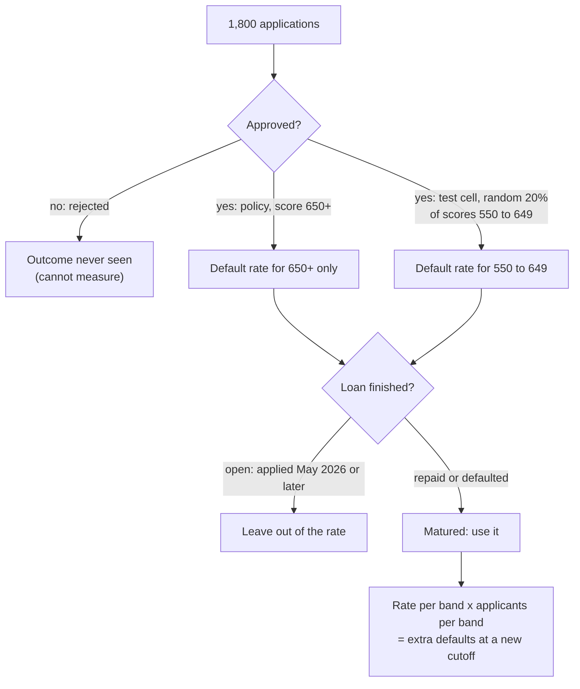

# Fintech: loan approvals and defaults

Business question: if we approve more applicants, how many more defaults do we buy?

## Before you start

- **Level:** 2 (intermediate).
- **Time:** about 4 hours.
- **Builds on:** [GROUP BY from raw rows](../../01-sql/01-group-by-from-raw-rows/), [NULLs, CASE and COALESCE](../../00-start-here/05-nulls-case-and-coalesce/), [Confidence interval by hand](../../02-statistics-and-experiments/02-confidence-interval-by-hand/) (a range for an estimate from a sample) and [Food delivery: why are cancellations rising?](../04-food-delivery-cancellations/), the case before this one.
- **You need:** Python 3.9 or later. Nothing to install. SQLite comes with Python.
- **How this case is built:** the twelve steps in the [phase README](../README.md). Steps 1 to 6 are in The idea, steps 7 to 12 in Walk through. [RUBRIC.md](RUBRIC.md) grades your steps 10 to 12.

## The problem

Ledgerlark, a fictional digital lender, makes small six-month personal loans in India. It approves every applicant with a credit score of 650 or more. Meera, the head of growth, wants to lower the cutoff to 550: "we turn away almost half of the people who apply". Arjun, the chief risk officer, says that would fill the book with defaults. The credit committee meets on Monday and wants one number on the table: for each cutoff, how many more loans a month, and how many more defaults a month?

The file `data/applications.csv` is synthetic, generated by `make_data.py` with a fixed seed: 1,800 applications over 18 months (May 2025 to October 2026). The pattern in it is one that credit analysts meet often.

## In plain words

Imagine a cricket coach who only ever picks players who scored 50 in the nets. He knows exactly how those players do in matches. Someone asks: "what if we also pick the ones who scored 30?" The coach has never seen them play. He cannot answer from his team sheet, however long it is, because the team sheet only contains the players he picked. The only honest way to know is to give some of the 30-scorers a game and watch.

A lender has the same blind spot. It only sees whether a loan is repaid if it made the loan. Ledgerlark was careful: it approved a random 20% of applicants scoring 550 to 649 as a test. Those few loans are the only window onto the people a lower cutoff would let in.

Terms used in this case:

- **Credit score:** a number from a credit bureau that ranks how likely a person is to repay. Higher is safer. Here it runs from 450 to 799.
- **Cutoff:** the lowest score the lender approves.
- **Default:** the borrower stops paying and the loan is written off.
- **Default rate:** defaulted loans divided by loans whose outcome is known, as a percentage.
- **Open loan:** a loan that has not reached its end date. It might still default, so it cannot go in the default rate yet.
- **Matured loan:** a loan that has ended: repaid or defaulted.
- **Vintage:** all loans made in one month, followed over time.
- **Score band:** a range of scores, here 50 points wide and named by its lower end: band 600 holds 600 to 649.
- **Test cell:** applicants below the cutoff approved at random, so the lender can learn how they behave.
- **Selection bias:** a sample that is different from the group you want to learn about because of how it was chosen. Approved loans tell you about approved people only.
- **Marginal default rate:** the default rate of the extra loans a change adds, as opposed to the average of the whole book.
- **Wilson interval:** a 95% range for a proportion that behaves well with small counts and with 0 defaults.
- **Loss given default (LGD):** the share of the loan amount the lender loses when a borrower defaults, after anything it recovers.

## What you will build from scratch

- `BAND_SQL`: applicants, approvals, matured loans and defaults per score band.
- `VINTAGE_SQL`: the same per month of application, to see which loans have finished.
- `wilson(k, n)`: a 95% interval for a default rate.
- `cutoff_impact(bands, new_cutoff, months)`: extra approvals and extra defaults a month, with a range.
- `book_default_rate(bands, cutoff)`: the default rate of the whole book at a cutoff.
- `band_profit(...)` and `break_even_rate(...)`: whether a band earns money under a stated assumption.
- `text_chart(bands)`: default rate by band as a chart you can paste into a message.

## The idea

### 1. Business context

Ledgerlark earns interest and fees on loans that are repaid and loses most of the amount on loans that default. More approvals means more revenue only if the extra borrowers repay often enough. Growth owns approvals; risk owns losses; the credit committee sets the cutoff.

### 2. Problem statement

Estimate, for a cutoff of 600 and of 550, how many extra loans a month Ledgerlark would make and how many extra defaults a month it would buy, with an honest range, using only loans whose outcome is known.

### 3. Objectives: the decision this informs

The committee will choose a cutoff: keep 650, lower to 600, or lower to 550. The analysis must say which bands earn more than they lose, and what we cannot know from this data.

### 4. KPIs and their definitions

- Default rate of a band = defaulted / matured loans in the band. Open loans are left out of both.
- Extra approvals a month at cutoff c = applicants with c <= score < 650, divided by the number of months.
- Extra defaults a month = for each added band, applicants a month x that band's default rate, summed.
- Book default rate at cutoff c = applicants in every band at or above c, each weighted by its band's default rate.
- Expected profit of a band a month = applicants a month x average amount x ((1 - default rate) x margin - default rate x LGD). Margin and LGD are assumptions, stated in step 11.

### 5. Data required, and what is missing

`applications.csv` has one row per application: app_id, applied_month, score, loan_amount, decision, approval_route (policy, test, or blank when rejected) and outcome (repaid, defaulted, open, or blank when rejected). Loans from May 2026 on are still open. Missing: income and other bureau data (so we cannot refine within a band), recoveries after default (so LGD is an assumption), and any outcome at all for scores below 550, where nobody was ever approved.

### 6. Analytical approach

The whole case rests on which loans can tell you what:



1. Find which loans have matured (vintages).
2. Measure the default rate per score band on matured loans, with a Wilson interval.
3. Price each candidate cutoff: extra approvals and extra defaults a month, the marginal and the book rate.
4. Turn defaults into money with a stated margin and LGD, and compare each band with the break-even rate.

## Walk through

### 7. SQL and Python implementation

Run these blocks in order in one Python session started in this folder (`python3`). First, load the CSV into SQLite. Blank cells become NULL.

```python
import csv, math, sqlite3

con = sqlite3.connect(":memory:")
con.execute("""CREATE TABLE applications (app_id TEXT, applied_month TEXT, score INTEGER,
               loan_amount INTEGER, decision TEXT, approval_route TEXT, outcome TEXT)""")
with open("data/applications.csv", newline="") as f:
    con.executemany("INSERT INTO applications VALUES (?, ?, ?, ?, ?, ?, ?)",
                    [[v or None for v in r.values()] for r in csv.DictReader(f)])

def show(sql):
    for row in con.execute(sql):
        print(row)

show("""SELECT decision, approval_route, outcome, COUNT(*) FROM applications
        GROUP BY decision, approval_route, outcome ORDER BY decision, approval_route, outcome""")
```

```
('approved', 'policy', 'defaulted', 26)
('approved', 'policy', 'open', 335)
('approved', 'policy', 'repaid', 638)
('approved', 'test', 'defaulted', 32)
('approved', 'test', 'open', 54)
('approved', 'test', 'repaid', 78)
('rejected', None, None, 637)
```

637 applications were rejected and have no outcome. 389 approved loans are still open. Only the 774 repaid or defaulted loans can say anything about default.

Step 7a. Vintages: which months have finished? `COUNT(CASE WHEN ... THEN 1 END)` counts the rows where the condition is true; it is 0, never NULL, when there are none. `NULLIF(x, 0)` turns a 0 into NULL so that dividing by it gives NULL instead of a wrong number.

```python
MATURED = "COUNT(CASE WHEN outcome IN ('repaid', 'defaulted') THEN 1 END)"
DEFAULTED = "COUNT(CASE WHEN outcome = 'defaulted' THEN 1 END)"
show(f"""SELECT applied_month, SUM(decision = 'approved') AS approved,
                COUNT(CASE WHEN outcome = 'open' THEN 1 END) AS open, {MATURED} AS matured,
                ROUND(100.0 * {DEFAULTED} / NULLIF({MATURED}, 0), 1) AS default_rate_pct
         FROM applications WHERE applied_month >= '2026-02' GROUP BY applied_month""")
```

```
('2026-02', 61, 0, 61, 1.6)
('2026-03', 54, 0, 54, 11.1)
('2026-04', 64, 0, 64, 10.9)
('2026-05', 68, 68, 0, None)
('2026-06', 66, 66, 0, None)
('2026-07', 58, 58, 0, None)
('2026-08', 58, 58, 0, None)
('2026-09', 73, 73, 0, None)
('2026-10', 66, 66, 0, None)
```

Every loan from May 2026 on is open, so the newest six months have no default rate at all. The finished vintages jump between 1.6% and 11.1% from month to month: with about 60 loans a month, a handful of defaults moves the rate a lot.

Step 7b. Default rate by band. `score / 50 * 50` uses integer division (score is an INTEGER column), so 649 becomes 600. (PostgreSQL does the same with integers; in a database that divides to decimals, write `FLOOR(score / 50) * 50`.)

```python
bands = con.execute(f"""
    SELECT score / 50 * 50 AS band, COUNT(*) AS applicants, SUM(decision = 'approved') AS approved,
           {MATURED} AS matured, {DEFAULTED} AS defaulted,
           ROUND(100.0 * {DEFAULTED} / NULLIF({MATURED}, 0), 1) AS default_rate_pct,
           ROUND(AVG(loan_amount), 0) AS avg_amount
    FROM applications GROUP BY band ORDER BY band""").fetchall()
for b in bands:
    print(b)
```

```
(450, 10, 0, 0, 0, None, 40200.0)
(500, 52, 0, 0, 0, None, 33288.0)
(550, 269, 57, 41, 20, 48.8, 33695.0)
(600, 470, 107, 69, 12, 17.4, 35843.0)
(650, 580, 580, 392, 23, 5.9, 36153.0)
(700, 313, 313, 203, 3, 1.5, 35968.0)
(750, 106, 106, 69, 0, 0.0, 36651.0)
```

Each row is (band, applicants, approved, matured, defaulted, default rate, average amount). Bands 450 and 500 have no rate: nobody there was ever lent to. Band 600 defaults 17.4% of the time, three times band 650; band 550 defaults almost half the time. The rates for 550 and 600 come from 41 and 69 test loans, so they need a range.

Step 7c. The Wilson interval. For k defaults in n loans with p = k / n and z = 1.96:

centre = (p + z^2 / 2n) / (1 + z^2 / n), half-width = z x sqrt(p(1 - p) / n + z^2 / 4n^2) / (1 + z^2 / n).

```python
def wilson(k, n, z=1.96):
    p = k / n
    d = 1 + z * z / n
    c = (p + z * z / (2 * n)) / d
    h = z * math.sqrt(p * (1 - p) / n + z * z / (4 * n * n)) / d
    return max(0.0, c - h), min(1.0, c + h)

for band, apps, appr, mat, dft, rate, amt in bands:
    if mat:
        lo, hi = wilson(dft, mat)
        print(band, rate, round(100 * lo, 1), round(100 * hi, 1))
```

```
550 48.8 34.3 63.5
600 17.4 10.2 28.0
650 5.9 3.9 8.7
700 1.5 0.5 4.3
750 0.0 0.0 5.3
```

Band 600 could plausibly default anywhere from 10.2% to 28.0%. Band 750 had no defaults in 69 loans, but the interval still reaches 5.3%: zero defaults is not proof of zero risk.

Step 7d. Price each cutoff. Applicants a month in a band = applicants / 18 months (every month has applications, even the open ones).

```python
months = 18
by_band = {b[0]: b for b in bands}
for new in (600, 550):
    added = [b for b in bands if new <= b[0] < 650]
    extra = sum(b[1] for b in added) / months
    dflt = sum(b[1] * b[4] / b[3] for b in added) / months
    lo = sum(b[1] * wilson(b[4], b[3])[0] for b in added) / months
    hi = sum(b[1] * wilson(b[4], b[3])[1] for b in added) / months
    print(new, round(extra, 1), round(dflt, 1), round(lo, 1), round(hi, 1), round(100 * dflt / extra, 1))
```

```
600 26.1 4.5 2.7 7.3 17.4
550 41.1 11.8 7.8 16.8 28.8
```

Each row is (cutoff, extra approvals a month, extra defaults a month, low, high, marginal default rate %). Going to 600 adds 26.1 loans and about 4.5 defaults a month (2.7 to 7.3). Going to 550 adds 41.1 loans and about 11.8 defaults: the last 15 loans a month bring 7.3 of those defaults.

The book as a whole:

```python
def book_rate(cutoff):
    kept = [b for b in bands if b[0] >= cutoff]
    return sum(b[1] * b[4] / b[3] for b in kept) / sum(b[1] for b in kept)

for c in (650, 600, 550):
    n = sum(b[1] for b in bands if b[0] >= c) / months
    print(c, round(n, 1), round(100 * book_rate(c), 2), round(n * book_rate(c), 1))
```

```
650 55.5 3.87 2.1
600 81.6 8.2 6.7
550 96.6 14.48 14.0
```

Each row is (cutoff, approvals a month, book default rate %, defaults a month). At 650 the policy makes 55.5 loans and about 2.1 defaults a month. At 600 it makes 47% more loans and about three times the defaults. The book rate (8.2%) hides how bad the added loans are (17.4%): the old good loans average it down.

### 8. Visualisation

Default rate by band, with the bands nobody was lent to shown as missing, not as zero:

```python
top = max(b[5] for b in bands if b[5] is not None)
for b in bands:
    label = "%d-%d" % (b[0], b[0] + 49)
    if b[5] is None:
        print("%-8s no data" % label)
    else:
        print("%-8s %5.1f%% %s" % (label, b[5], "#" * round(b[5] / top * 30)))
```

```
450-499  no data
500-549  no data
550-599   48.8% ##############################
600-649   17.4% ###########
650-699    5.9% ####
700-749    1.5% #
750-799    0.0% 
```

The curve is not a straight line: each 50 points down roughly triples the rate or worse. That shape is why extending a line drawn through the approved bands goes wrong (Common mistakes, 2).

### 9. Insights

Does a band earn money? A repaid loan earns the margin; a defaulted loan loses the LGD. The break-even default rate is margin / (margin + LGD). With an assumed 15% margin over six months and 55% LGD (example figures, not in the data):

```python
margin, lgd = 0.15, 0.55
print("break-even default rate:", round(100 * margin / (margin + lgd), 1))
for b in bands:
    if b[3]:
        p = b[4] / b[3]
        profit = b[1] / months * b[6] * ((1 - p) * margin - p * lgd)
        print(b[0], round(profit))
```

```
break-even default rate: 21.4
550 -96412
600 26449
650 126894
700 87346
750 32375
```

1. Lowering the cutoff to 600 buys about 26 extra loans and 4.5 extra defaults a month (range 2.7 to 7.3). Its 17.4% default rate is under the 21.4% break-even, so under these assumptions band 600 earns about Rs 26,000 a month.
2. Band 600's interval (10.2% to 28.0%) straddles the break-even. The data says band 600 is probably profitable, not certainly.
3. Band 550 defaults 48.8% (34.3% to 63.5%), far above break-even even at the bottom of its range. Lowering to 550 would lose about Rs 96,000 a month on that band, more than band 600 earns.
4. Below 550 there is no evidence at all. Any number for those applicants would be invented.

### 10. Recommendation

Lower the cutoff to 600, not 550, as a staged change: approve all of band 600 for the next three months with a cap of about 30 extra loans a month, and keep the 20% random test cell in band 550 so the evidence keeps growing. Arjun's risk team reviews the first-payment results of each new month before the cap is lifted. Do not lower to 550.

### 11. Expected business impact

From the data: about 26 more loans a month (55.5 to 81.6, +47%) and about 4.5 more defaults a month (2.7 to 7.3), so defaults go from about 2 to about 7 a month. Under the stated assumption (15% margin over six months, 55% LGD, average loan Rs 35,843 in band 600), band 600 adds about Rs 26,000 of expected profit a month. Approving band 550 as well would turn that into a net loss of about Rs 70,000 a month (26,449 - 96,412).

### 12. Limitations and what would change our mind

- Band 600's rate rests on 69 matured test loans. If its true rate is above 21.4% (the interval reaches 28.0%), band 600 loses money. A first-payment default rate above that in the staged months should stop the expansion.
- Margin and LGD are assumptions. With a 10% margin the break-even drops to 15.4%, under band 600's 17.4%, and the answer becomes "keep 650".
- The test cell is random only within 550 to 649. If staff had picked who got test loans, the rates would be biased; the approval_route column is what makes them trustworthy.
- The six open vintages may behave differently (for example if the economy turned in 2026). They mature from November 2026; rerun the numbers then.
- Nothing is known below 550. A lower cutoff would need its own test cell first.

## Common mistakes

**1. Counting open loans as good loans (the trap).** Defaults divided by all approved loans looks like a default rate, and it is lower and smoother:

```python
show(f"""SELECT score / 50 * 50 AS band, ROUND(100.0 * {DEFAULTED} / SUM(decision = 'approved'), 1) AS wrong,
                ROUND(100.0 * {DEFAULTED} / NULLIF({MATURED}, 0), 1) AS right
         FROM applications WHERE decision = 'approved' GROUP BY band""")
```

```
(550, 35.1, 48.8)
(600, 11.2, 17.4)
(650, 4.0, 5.9)
(700, 1.0, 1.5)
(750, 0.0, 0.0)
```

Band 600 looks like 11.2%, safely under break-even, when its known rate is 17.4%. A third of the denominator is loans that have not had time to default. This is right-censoring: the clock stopped before the outcome.

**2. Extrapolating from the approved bands.** Someone fits a line through 650 (5.9%) and 700 (1.5%) and extends it: band 600 would be 5.9 + (5.9 - 1.5) = 10.3%, band 550 14.7%. The test cell says 17.4% and 48.8%. Default risk curves upward as scores fall, and the approved bands never show where the curve bends. Use outcomes from the band itself, or say you do not know.

**3. SUM of a comparison in a band with no matured loans.** In bands 450 and 500 every outcome is NULL, so a comparison on it is NULL and SUM returns NULL, not 0:

```python
show("""SELECT score / 50 * 50 AS band, SUM(outcome = 'defaulted'), COUNT(CASE WHEN outcome = 'defaulted' THEN 1 END)
        FROM applications WHERE score < 550 GROUP BY band""")
```

```
(450, None, 0)
(500, None, 0)
```

That is why the queries use `COUNT(CASE ...)`. And the 0 matured loans must give a NULL rate, not 0%: "no defaults seen" and "nobody lent to" are different facts.

**4. Quoting the book rate as the cost of the change.** "The default rate only goes from 3.9% to 8.2%" sounds mild. The 26 added loans a month default at 17.4%. Decisions about a change are made on the marginal rate of what the change adds.

## Your turn

Open `exercise.py`. Write the two queries and the six functions; the docstrings say what each must return, with fewer hints than in Level 1. Then run, from this folder:

    python3 test_lesson.py

The tests run on the committed data, on a second dataset built with another seed (so typed-in answers fail), and on hand-made cases: a band nobody was lent to, a month of only open loans, the score 649 and 650 on either side of a band edge, zero defaults, and the break-even point. To check the reference answer: `CHECK_SOLUTION=1 python3 test_lesson.py`.

Then write your own steps 10 to 12 and grade them with [RUBRIC.md](RUBRIC.md).

Stretch: use 25-point bands for 600 to 649. Is 625 to 649 clearly under break-even and 600 to 624 not? How wide are the intervals now, and would you trust a cutoff of 625?

## Check yourself

1. Why can the policy loans (650 and above) not tell you the default rate of band 600?
2. Why must open loans be left out of the default rate, and what happens to the rate if they are not?
3. Band 750 had 0 defaults in 69 loans. What do you tell someone who says "that band is risk free"?
4. The book default rate at 600 is 8.2%. Why is that the wrong number to judge the change by?

<details>
<summary>Answers</summary>

1. Selection bias: the lender only sees outcomes for people it approved, and band 600 was never approved by policy. Only the random test cell gives outcomes there, and default risk does not fall in a straight line, so extending the approved bands underestimates it.
2. An open loan can still default. Counting it as not defaulted puts it in the denominator without a chance to be in the numerator, so the rate is too low (band 600 shows 11.2% instead of 17.4%).
3. Zero in 69 is consistent with a true rate up to about 5.3% (the Wilson upper bound). It is low risk, not no risk.
4. It averages the added loans with the old book. The decision is about the 26 extra loans a month, whose rate is 17.4%; the marginal rate is what to compare with the break-even.

</details>

## What to tell the stakeholder

To Meera and Arjun: "Lowering the cutoff from 650 to 600 adds about 26 loans a month and about 4.5 defaults a month (somewhere between 3 and 7); with a 15% margin and 55% loss on default, that band earns about Rs 26,000 a month, but its default rate could be as high as the break-even, so do it in stages with a cap. Lowering to 550 adds defaults on nearly half of the extra loans and loses money at any plausible rate; we have no data at all below 550."

## In real job postings

In the Real Analyst Jobs data drop of 25 October 2026, 448 of the 900 analyst postings in India that name a tool (49.8%) ask for Python, which this case uses for the interval and the pricing. See [Python data analyst jobs](https://realanalystjobs.com/jobs/python-data-analyst-jobs).

## Next

[06: Retail: what to restock](../06-retail-what-to-restock/)
