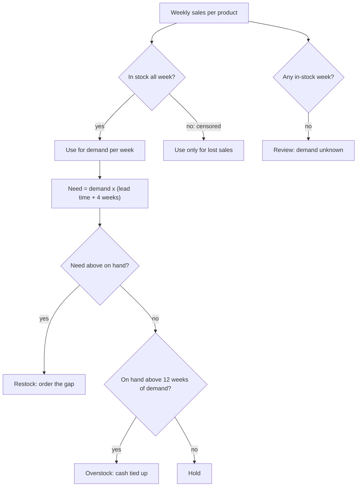

# Retail: what to restock

Business question: which products deserve more inventory next month, and which are tying up cash?

## Before you start

- **Level:** 2 (intermediate).
- **Time:** about 4 hours.
- **Builds on:** [Joins without losing rows](../../01-sql/02-joins-without-losing-rows/), [NULLs, CASE and COALESCE](../../00-start-here/05-nulls-case-and-coalesce/), [Mean, median and skew](../../02-statistics-and-experiments/01-mean-median-and-skew/) and [Define a metric precisely](../../03-metrics-and-product-analytics/05-define-a-metric-precisely/).
- **You need:** Python 3.9 or later. Nothing to install. SQLite comes with Python.
- **How this case is built:** the twelve steps in the [phase README](../README.md). Steps 1 to 6 are in The idea, steps 7 to 12 in Walk through. [RUBRIC.md](RUBRIC.md) grades your steps 10 to 12.

## The problem

Quernstone Hardware is a fictional hardware store that sells 40 products across paint, tools, garden, plumbing and electrical. Gwen, the owner, places the supplier orders for November on Tuesday. She has two complaints that pull in opposite directions: customers keep finding empty shelves on some lines, and the stock room is full of boxes that never seem to move. Her buyer suggests the simple rule they always use: reorder each product in line with its average weekly sales. Gwen wants a list by Monday: what to order, how much, what it costs, and which stock is sitting on cash she could use elsewhere.

The files in `data/` are synthetic, generated by `make_data.py` with a fixed seed: `products.csv` (40 products with cost, price, stock on hand on 1 November 2026 and supplier lead time) and `weekly_sales.csv` (468 rows: 12 weeks of sales per product, 3 August to 25 October 2026). The pattern in them is one that retail analysts meet often.

## In plain words

Think of a bakery that sells out of croissants by 10 every morning. The till says it sells 40 croissants a day. But it bakes 40, so of course it sells 40. How many would it sell if it baked 60? The till cannot tell you, because a customer who finds an empty tray buys nothing and leaves no record. Sales are capped by stock.

So the honest estimate of what customers want comes from the days when there was enough on the tray. Meanwhile, the bakery has 30 jars of a jam that sells one jar a week: that is money on a shelf, not in the till.

That is this case: estimate demand only from weeks when the product was on the shelf, order enough to cover the time until the next delivery, and put a price on the stock that will take months to sell.

Terms used in this case:

- **SKU (stock keeping unit):** one product the store sells, with its own code, here Q101 to Q140.
- **On hand:** units in the store right now (1 November).
- **Stockout:** a week in which the product ran out. `in_stock` is 0 for those weeks.
- **Censored sales:** sales in a stockout week. They show what was sold, not what customers wanted, because sales stopped when the shelf was empty.
- **Demand per week:** units customers want in a week. Here: units sold in in-stock weeks divided by the number of in-stock weeks.
- **Lead time:** weeks from placing an order with the supplier to the goods arriving.
- **Weeks of cover:** how long the stock on hand lasts at the current demand: on hand / demand per week.
- **Excess stock:** units beyond 12 weeks of cover. Valued at cost, it is the cash tied up in stock that will not sell soon.
- **Lost margin:** the profit (price minus cost) on units customers wanted during stockout weeks but could not buy.

## What you will build from scratch

- `SKU_SQL`: one row per product with weeks of history, in-stock weeks and units sold, keeping products that have no sales.
- `WEEKLY_SQL`: units, revenue and products out of stock per week.
- `demand_per_week(row)`: demand from in-stock weeks only.
- `plan(sku_rows)`: order quantity, cost, weeks of cover, excess stock, lost margin and an action per product.
- `summarise(plan_rows)`: the totals Gwen needs.
- `text_chart(items)`: a bar chart for a chat message.

## The idea

### 1. Business context

A hardware store earns its margin on units that leave the shelf. Every empty shelf loses a sale, and often the customer too, because a builder who cannot get filler here buys the whole job somewhere else. Every box in the stock room is cash that was paid to a supplier and has not come back. The owner decides the orders; suppliers deliver in one to three weeks.

### 2. Problem statement

Over the last 12 weeks, some products ran out often while others hardly sold. Find, for each product, how much to order for November, and size the cash tied up in stock that is far beyond what will sell, before the orders go to suppliers on Tuesday.

### 3. Objectives: the decision this informs

Gwen must decide, per product: order, hold, or stop ordering and clear. She also has to choose between the buyer's rule (reorder to average weekly sales) and a different method. The analysis must give an order list with quantities and cost, and a list of products to stop reordering with the cash they hold.

### 4. KPIs and their definitions

- Demand per week = units sold in weeks with in_stock = 1 / number of such weeks. Unknown when the product was never in stock.
- Order quantity = demand per week x (lead time + 4 weeks) - on hand, rounded up to a whole unit, never below 0. The 4 weeks are November; the lead time covers the wait for the delivery.
- Weeks of cover = on hand / demand per week.
- Cash tied up = units above 12 weeks of demand x unit cost.
- Lost margin = (demand per week x stockout weeks - units actually sold in stockout weeks) x (price - cost), never below 0.

### 5. Data required, and what is missing

`products.csv`: sku, name, category, unit_cost, unit_price, on_hand, lead_time_weeks. `weekly_sales.csv`: week_start, sku, units_sold, in_stock. Missing: daily stock levels (we only know a product ran out sometime in the week), supplier minimum order sizes and pack sizes, the season ahead (November in a hardware store is not August), and whether customers bought a substitute when a product was out. Each of these would change quantities; none changes which products are starved and which are bloated.

### 6. Analytical approach



1. Aggregate sales per product, keeping products with no sales at all.
2. Estimate demand from in-stock weeks only; the buyer's average is the naive comparison.
3. Apply one rule to every product: restock, overstock, hold or review.
4. Total the cash the orders need, the cash tied up and the margin lost to stockouts.

## Walk through

### 7. SQL and Python implementation

Run these blocks in order in one Python session started in this folder (`python3`). First, load both CSVs into SQLite.

```python
import csv, math, sqlite3

con = sqlite3.connect(":memory:")
con.execute("CREATE TABLE products (sku, name, category, unit_cost REAL, unit_price REAL, on_hand INTEGER, lead_time_weeks INTEGER)")
con.execute("CREATE TABLE weekly_sales (week_start, sku, units_sold INTEGER, in_stock INTEGER)")
for table, path in (("products", "data/products.csv"), ("weekly_sales", "data/weekly_sales.csv")):
    with open(path, newline="") as f:
        rows = list(csv.reader(f))[1:]
    con.executemany("INSERT INTO %s VALUES (%s)" % (table, ",".join("?" * len(rows[0]))), rows)

def show(sql):
    for row in con.execute(sql):
        print(row)

show("SELECT COUNT(*), SUM(in_stock = 0), MIN(week_start), MAX(week_start) FROM weekly_sales")
show("SELECT COUNT(*), SUM(on_hand * unit_cost) FROM products")
```

```
(468, 76, '2026-08-03', '2026-10-19')
(40, 35786.49)
```

468 product-weeks, 76 of them stockouts. The store holds about GBP 35,800 of stock at cost. The column types (REAL, INTEGER) make SQLite store the text from the CSV as numbers, so `on_hand * unit_cost` is arithmetic, not text.

Step 7a. One row per product. The sales are aggregated in a CTE first and then LEFT JOINed to products, so a product with no sales rows still appears, with COALESCE turning its NULL counts into 0.

```python
SKU_SQL = """
WITH s AS (
  SELECT sku, COUNT(*) AS weeks, SUM(in_stock) AS in_stock_weeks,
         SUM(CASE WHEN in_stock = 1 THEN units_sold ELSE 0 END) AS units_in_stock,
         SUM(units_sold) AS units_total
  FROM weekly_sales GROUP BY sku)
SELECT p.sku, p.category, p.unit_cost, p.unit_price, p.on_hand, p.lead_time_weeks,
       COALESCE(s.weeks, 0), COALESCE(s.in_stock_weeks, 0),
       COALESCE(s.units_in_stock, 0), COALESCE(s.units_total, 0)
FROM products p LEFT JOIN s ON s.sku = p.sku ORDER BY p.sku"""
skus = con.execute(SKU_SQL).fetchall()
print(len(skus))
for r in skus:
    if r[6] - r[7] >= 4 or r[6] == 0:
        print(r)
```

```
40
('Q102', 'paint', 30.23, 48.32, 2, 2, 12, 5, 125, 188)
('Q105', 'paint', 28.27, 52.72, 1, 1, 12, 7, 122, 147)
('Q108', 'paint', 10.13, 14.75, 1, 1, 12, 5, 125, 199)
('Q112', 'tools', 14.15, 21.31, 6, 1, 12, 3, 52, 114)
('Q120', 'garden', 20.82, 42.99, 0, 3, 12, 0, 0, 0)
('Q134', 'electrical', 34.55, 52.51, 3, 2, 12, 8, 130, 151)
('Q135', 'electrical', 23.83, 51.85, 4, 1, 12, 6, 132, 174)
('Q136', 'electrical', 4.19, 8.94, 37, 2, 0, 0, 0, 0)
```

These are the products with four or more stockout weeks, plus Q136, which has no sales rows (weeks 0). Q120 has 12 weeks of history and 0 in-stock weeks: it was empty the whole time. Q112 was out of stock in 9 weeks of 12.

Step 7b. Demand from in-stock weeks against the buyer's average. Each tuple is (sku, stockout weeks, buyer's average, demand from in-stock weeks):

```python
def demand(r):
    return r[8] / r[7] if r[7] else None

for r in skus:
    if r[6] - r[7] >= 4 and r[7] > 0:
        print((r[0], r[6] - r[7], round(r[9] / r[6], 1), round(demand(r), 1)))
```

```
('Q102', 7, 15.7, 25.0)
('Q105', 5, 12.2, 17.4)
('Q108', 7, 16.6, 25.0)
('Q112', 9, 9.5, 17.3)
('Q134', 4, 12.6, 16.2)
('Q135', 6, 14.5, 22.0)
```

On the six products that run out most, the buyer's average understates demand by a fifth to almost a half. Q112 sells 9.5 a week on average, but in the weeks it was on the shelf it sold 17.3.

Step 7c. The plan. One rule for every product, written once:

```python
plan = []
for (sku, cat, cost, price, on_hand, lead, weeks, isw, uis, ut) in skus:
    d = demand((sku, cat, cost, price, on_hand, lead, weeks, isw, uis, ut))
    if d is None:
        plan.append((sku, cat, "review", 0, 0.0, 0.0, 0.0))
        continue
    need = d * (lead + 4) - on_hand
    qty = math.ceil(round(need, 9)) if need > 0 else 0
    excess = max(0.0, on_hand - 12 * d)
    lost = max(0.0, d * (weeks - isw) - (ut - uis)) * (price - cost)
    action = "restock" if qty else ("overstock" if excess else "hold")
    plan.append((sku, cat, action, qty, round(qty * cost, 2), round(excess * cost, 2), round(lost, 2)))

for p in plan:
    if p[2] != "hold":
        print(p)
```

```
('Q102', 'paint', 'restock', 148, 4474.04, 0.0, 2026.08)
('Q103', 'paint', 'restock', 5, 26.8, 0.0, 11.68)
('Q105', 'paint', 'restock', 87, 2459.49, 0.0, 1519.39)
('Q107', 'paint', 'overstock', 0, 0.0, 2128.0, 0.0)
('Q108', 'paint', 'restock', 124, 1256.12, 0.0, 466.62)
('Q110', 'tools', 'restock', 28, 1040.2, 0.0, 115.1)
('Q112', 'tools', 'restock', 81, 1146.15, 0.0, 673.04)
('Q114', 'tools', 'restock', 3, 12.0, 0.0, 0.0)
('Q115', 'tools', 'overstock', 0, 0.0, 606.5, 0.0)
('Q116', 'tools', 'restock', 14, 65.24, 0.0, 23.75)
('Q117', 'garden', 'overstock', 0, 0.0, 95.7, 0.0)
('Q118', 'garden', 'overstock', 0, 0.0, 1274.32, 0.0)
('Q120', 'garden', 'review', 0, 0.0, 0.0, 0.0)
('Q121', 'garden', 'restock', 36, 1154.52, 0.0, 0.0)
('Q126', 'plumbing', 'overstock', 0, 0.0, 380.16, 0.0)
('Q127', 'plumbing', 'overstock', 0, 0.0, 2112.11, 0.0)
('Q128', 'plumbing', 'restock', 3, 68.22, 0.0, 0.0)
('Q132', 'plumbing', 'restock', 9, 171.63, 0.0, 0.0)
('Q134', 'electrical', 'restock', 95, 3282.25, 0.0, 790.24)
('Q135', 'electrical', 'restock', 106, 2525.98, 0.0, 2521.8)
('Q136', 'electrical', 'review', 0, 0.0, 0.0, 0.0)
('Q139', 'electrical', 'restock', 11, 336.93, 0.0, 0.0)
```

Each tuple is (sku, category, action, order quantity, order cost, cash tied up, lost margin). `round(need, 9)` before `math.ceil` stops a tiny floating point error, such as 25.000000000001, from ordering one unit too many.

### 8. Visualisation

Where the cash goes, by category: what the orders need against what is stuck in excess stock.

```python
cats = ["paint", "tools", "garden", "plumbing", "electrical"]
need = {c: sum(p[4] for p in plan if p[1] == c) for c in cats}
tied = {c: sum(p[5] for p in plan if p[1] == c) for c in cats}
top = max(list(need.values()) + list(tied.values()))
for c in cats:
    print("%-10s order %6.0f %s" % (c, need[c], "#" * round(need[c] / top * 30)))
    print(("%-10s stuck %6.0f %s" % ("", tied[c], "=" * round(tied[c] / top * 30))).rstrip())
```

```
paint      order   8216 ##############################
           stuck   2128 ========
tools      order   2264 ########
           stuck    606 ==
garden     order   1155 ####
           stuck   1370 =====
plumbing   order    240 #
           stuck   2492 =========
electrical order   6145 ######################
           stuck      0
```

Paint and electrical need most of the order cash. Plumbing is the opposite: it needs GBP 240 of orders and holds GBP 2,492 of stock it will not sell for months. Garden holds more stuck stock than it needs in orders. The exercise's `text_chart` draws the same kind of bars from (label, value) pairs.

### 9. Insights

```python
starved = [p for p in plan if p[0] in ("Q102", "Q105", "Q108", "Q112", "Q134", "Q135")]
print("restock", sum(p[2] == "restock" for p in plan), round(sum(p[4] for p in plan), 2))
print("six starved", round(sum(p[4] for p in starved), 2), round(sum(p[6] for p in starved), 2))
print("overstock", sum(p[2] == "overstock" for p in plan), round(sum(p[5] for p in plan), 2))
print("lost margin", round(sum(p[6] for p in plan), 2), "review", [p[0] for p in plan if p[2] == "review"])
```

```
restock 14 18019.57
six starved 15144.03 7997.17
overstock 6 6596.79
lost margin 9127.49 review ['Q120', 'Q136']
```

1. 14 products need an order for November, costing GBP 18,019.57 at cost. Six of them (Q102, Q105, Q108, Q112, Q134, Q135) take GBP 15,144 of that: they are fast sellers that ran out in 4 to 9 weeks of 12.
2. Those six lost about GBP 7,997 of margin in 12 weeks, out of GBP 9,127 lost across the store. The empty shelves are concentrated, not spread out.
3. Six products hold GBP 6,596.79 of stock above 12 weeks of cover. Q107 (gloss paint) and Q127 (shower head) alone hold over GBP 4,200; at their sales rate Q107 has 47 weeks of stock and Q127 has 78.
4. Two products cannot be planned from data: Q120 was empty for all 12 weeks, and Q136 is new with no sales yet.

### 10. Recommendation

Place the 14 orders on Tuesday, GBP 18,020 at cost, with the six starved products first. For those six, raise the standing reorder quantity so one delivery covers lead time plus four weeks, because the current lot size is why they keep running out. Stop reordering the six overstock products and clear the oldest stock with a markdown, starting with Q107 and Q127. Do not use the buyer's average-sales rule: on the starved products it would order too little again. Ask the supplier about Q120 before ordering anything, and give Q136 four weeks of sales before planning it.

### 11. Expected business impact

The store lost about GBP 9,127 of margin to stockouts in 12 weeks, about GBP 760 a week. If the November orders stop the six starved products running out, most of that comes back: about GBP 2,700 of margin over November from those six (GBP 7,997 / 12 weeks x 4). On the cash side, selling half of the excess stock at 30% off the shelf price (an assumption, not in the data) brings in about GBP 3,870 for stock that cost GBP 3,300: a thin margin, but cash that pays for about a fifth of the November order.

### 12. Limitations and what would change our mind

- Demand comes from in-stock weeks. If a product ran out late in many weeks, even "in stock" weeks may be slightly low; daily stock data would fix this.
- November demand in a hardware store differs from August to October (less garden, more electrical). A seasonal pattern from last year's sales would change quantities, especially in garden.
- The lost margin assumes every unwanted-for unit was a lost sale. If customers bought a substitute in the store, the true loss is smaller; basket data would show it.
- Supplier minimum orders and pack sizes are not in the data and can push quantities up.

## Common mistakes

**1. Averaging sales over stockout weeks (the trap).** The buyer's rule uses all weeks. Re-run the plan with the average and compare the order quantities on the starved products:

```python
for (sku, cat, cost, price, on_hand, lead, weeks, isw, uis, ut) in skus:
    if weeks - isw >= 4 and isw > 0:
        naive = math.ceil(max(0, ut / weeks * (lead + 4) - on_hand))
        right = [p[3] for p in plan if p[0] == sku][0]
        print(sku, "buyer's rule", naive, "in-stock demand", right)
```

```
Q102 buyer's rule 92 in-stock demand 148
Q105 buyer's rule 61 in-stock demand 87
Q108 buyer's rule 82 in-stock demand 124
Q112 buyer's rule 42 in-stock demand 81
Q134 buyer's rule 73 in-stock demand 95
Q135 buyer's rule 69 in-stock demand 106
```

On these six products the buyer's rule orders 222 fewer units, so they run out again in November. Sales during a stockout are capped by the stock, not by customers. Never average them as if they were demand.

**2. An inner join drops the products you most need to see.** `JOIN` instead of `LEFT JOIN` removes Q136, which has no sales rows, so it vanishes from the plan without a warning:

```python
show("SELECT COUNT(DISTINCT p.sku) FROM products p JOIN weekly_sales s ON s.sku = p.sku")
```

```
(39,)
```

Check the row count against `products` after every join: 40 products in, 40 rows out.

**3. Dividing by zero demand, or guessing it.** Q120 has no in-stock week, so demand is unknown, not zero. Treating it as 0 says "never reorder" a product that may sell well; treating weeks of cover as on hand / 0 crashes. The plan marks it "review".

**4. Valuing stock at selling price.** Cash tied up is what the store paid, so use unit_cost. At price, the GBP 6,597 would look like GBP 11,069 and the markdown decision would look better than it is.

## Your turn

Open `exercise.py`. Write the two queries and the four functions. The docstrings say what each must return; there are fewer hints than in Level 1 lessons. Then run, from this folder:

    python3 test_lesson.py

The tests run on the committed data, on a second dataset built with another seed (so typed-in answers fail), and on hand-made cases: a product with no sales rows, a product never in stock, zero demand, an order that lands exactly on whole units, and an all-zero chart. To check the reference answer: `CHECK_SOLUTION=1 python3 test_lesson.py`.

Then write your own steps 10 to 12 and grade them with [RUBRIC.md](RUBRIC.md).

Stretch: add a budget. If Gwen can spend only GBP 12,000 in November, rank the restock lines by lost margin per pound of order cost and fill the budget from the top. Which products miss out?

## Check yourself

1. Why is average weekly sales a bad estimate of demand for a product that often runs out?
2. A product sold 0 units in 12 weeks and was never in stock. Is its demand zero?
3. Why is excess stock valued at cost, not at price?
4. What one extra piece of data would most improve the order quantities?

<details>
<summary>Answers</summary>

1. In a stockout week, sales stop when the shelf is empty, so the number is a floor, not demand (censored data). Averaging it in pulls the estimate down, the order is too small, and the product runs out again. Use in-stock weeks only.
2. No. It is unknown: nobody could buy it. Treat it as a separate decision (ask the supplier, look at sales before it ran out), not as a zero.
3. Cash tied up is the money already paid to suppliers. Price includes margin that has not been earned and may never be if the stock is marked down.
4. Daily stock levels (or the day each stockout started). Then demand can be estimated from in-stock days, including the first part of stockout weeks, and lost sales become precise. Last year's November sales would be a close second, for seasonality.

</details>

## What to tell the stakeholder

To Gwen: "Order 14 products for November, GBP 18,020 at cost; six fast sellers (Q102, Q105, Q108, Q112, Q134, Q135) take GBP 15,144 of that and caused most of the GBP 9,127 of margin lost to empty shelves in the last 12 weeks. Stop reordering six slow lines that hold GBP 6,597 of stock beyond 12 weeks, starting with the gloss paint and the shower heads. The buyer's average-sales rule would under-order the fast sellers again, because it counts the weeks they were empty. Quantities assume November sells like August to October; adjust garden down if last year's November was quieter."

## In real job postings

In the Real Analyst Jobs data drop of 25 October 2026, 860 of the 2,056 US analyst postings that name a tool (41.8%) ask for Excel, where many inventory and replenishment plans like this one still live. See [Excel skills in analyst jobs](https://realanalystjobs.com/skills/excel).

## Next

[07: Growth: why is acquisition cost rising?](../07-growth-why-is-cac-rising/)
