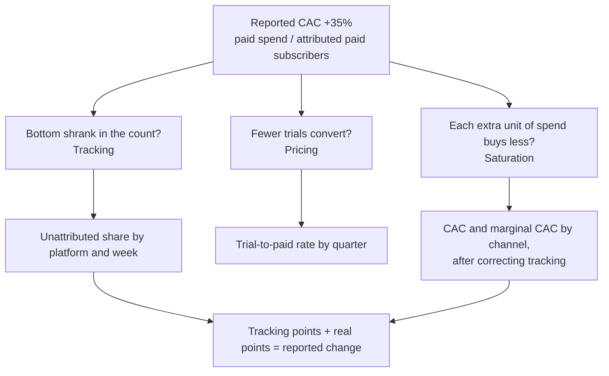

# Growth: why is acquisition cost rising?

Business question: CAC is up 35% this year. Is it channel saturation, pricing or tracking?

## Before you start

- **Level:** 2 (intermediate).
- **Time:** about 4 hours.
- **Builds on:** [Joins without losing rows](../../01-sql/02-joins-without-losing-rows/) (the fan-out this case hides), [Subqueries and CTEs](../../01-sql/07-subqueries-and-ctes/), [Metric trees](../../03-metrics-and-product-analytics/01-metric-trees/) and [Percent points and averages of ratios](../../03-metrics-and-product-analytics/06-percent-points-and-averages-of-ratios/).
- **You need:** Python 3.9 or later. Nothing to install. SQLite comes with Python.
- **How this case is built:** the twelve steps in the [phase README](../README.md). Steps 1 to 6 are in The idea, steps 7 to 12 in Walk through. [RUBRIC.md](RUBRIC.md) grades your steps 10 to 12.

## The problem

Plinkwell is a fictional language learning app with a paid subscription, sold on iOS, Android and the web. The finance dashboard shows cost per acquired subscriber up 35% from the first quarter of 2026 to the third. Henrik, the finance director, wants to cut the paid marketing budget by a third. Amara, the head of growth, has heard three explanations: the social ads have hit their ceiling, the April price rise put people off paying after the free trial, or the tracking broke when the social network changed how iOS ads are measured. She has to answer Henrik at the budget review on Friday, with the share of the rise each explanation accounts for.

The files in `data/` are synthetic, generated by `make_data.py` with a fixed seed: `spend.csv` (117 rows: weekly spend on search, social and video ads) and `acquisitions.csv` (585 rows: weekly signups and new subscribers by channel and platform), 5 January to 4 October 2026. The pattern in them is one that growth analysts meet often.

## In plain words

Imagine a street stall that pays a boy to hand out flyers. Last month each flyer-day cost 100 and brought 10 customers: 10 per customer. This month it costs 150 per customer. Three possible reasons. The boy now covers streets where everyone already has a flyer, so extra flyers bring fewer new faces (saturation). The stall raised its prices, so people who read the flyer no longer buy (pricing). Or the stall stopped asking "did you get a flyer?", so customers who came from flyers are now counted as walk-ins (tracking). Only the first two are real; the third makes the flyers look worse while nothing changed.

The method: check the counting first, then the price, then the channel.

Terms used in this case:

- **CAC (customer acquisition cost):** marketing spend divided by the new paying customers it brought. Here a customer is a subscriber.
- **Reported CAC:** what the dashboard shows: paid spend / subscribers whose channel is search, social or video.
- **Attribution:** the record of which channel a subscriber came from. **Unattributed** means the app could not tell.
- **Signup:** someone starting the free trial. **Trial-to-paid rate:** subscribers / signups.
- **Saturation (diminishing returns):** each extra unit of spend in a channel brings fewer new customers than the one before.
- **Marginal CAC:** the cost of the extra customers only: extra spend / extra subscribers between two periods. It shows saturation when the average hides it.
- **Fan-out:** a join that matches one row to several, so a SUM after the join counts it several times.

## What you will build from scratch

- `QUARTER_SQL`: spend, signups and subscribers per quarter and channel, joined without fan-out.
- `PLATFORM_SQL`: subscribers and unattributed subscribers per quarter and platform.
- `WEEKLY_SQL`: reported CAC and the iOS unattributed share per week.
- `reported_cac`, `channel_cac`, `trial_to_paid`: the three checks.
- `excess_unattributed` and `decompose`: how much of the rise is tracking and how much is real.
- `marginal_cac`: the cost of the extra subscribers.
- `text_chart(items)`: a bar chart for a chat message.

## The idea

### 1. Business context

Plinkwell buys ads on search, social and video. The growth team sets budgets per channel each quarter using CAC per channel from the dashboard. Finance uses the blended number to decide the total budget. An error in either moves real money.

### 2. Problem statement

Reported CAC rose from about 42 to about 57 between Q1 and Q3 2026 (all money in this case is in a fictional currency unit). Find how much of the rise comes from tracking, pricing and channel saturation, before the budget is cut.

### 3. Objectives: the decision this informs

Henrik proposes cutting paid spend by a third across all channels. Amara must say whether to cut, where, and by how much, and whether the dashboard number can be trusted for the decision.

### 4. KPIs and their definitions

- Reported CAC = paid spend / subscribers attributed to search, social and video, per quarter.
- Unattributed share = unattributed subscribers / all subscribers, per platform and quarter.
- Excess unattributed = unattributed in Q3 - Q3 subscribers x the platform's Q1 unattributed share.
- Corrected CAC = Q3 paid spend / (Q3 paid subscribers + positive excess unattributed).
- Trial-to-paid rate = subscribers / signups, all channels.
- Marginal CAC = (spend Q3 - spend Q1) / (subscribers Q3 - subscribers Q1) for one channel.

### 5. Data required, and what is missing

`spend.csv` has one row per week and paid channel. `acquisitions.csv` has one row per week, channel and platform. The two have different grains (the level of detail of one row), which is the first trap. Missing: user-level click and install logs (which would re-attribute the lost subscribers one by one), the date and detail of the iOS measurement change, prices paid per subscriber (to check revenue, not only counts), and spend split by platform.

### 6. Analytical approach

The reported CAC is a ratio, so it can rise because the top grows or because the bottom shrinks. Test the three explanations in order of cheapness: counting, then price, then channel.



1. Aggregate both tables to quarter and channel before joining.
2. Reported and channel CAC by quarter.
3. Tracking: unattributed share by platform and week; size the excess; recompute CAC.
4. Pricing: trial-to-paid rate by quarter.
5. Saturation: corrected channel CAC and marginal CAC.

## Walk through

### 7. SQL and Python implementation

Run these blocks in order in one Python session started in this folder (`python3`). First, load both CSVs into SQLite.

```python
import csv, sqlite3

con = sqlite3.connect(":memory:")
con.execute("CREATE TABLE spend (week_start, channel, spend REAL)")
con.execute("CREATE TABLE acquisitions (week_start, channel, platform, signups INTEGER, subscribers INTEGER)")
for table, path in (("spend", "data/spend.csv"), ("acquisitions", "data/acquisitions.csv")):
    with open(path, newline="") as f:
        rows = list(csv.reader(f))[1:]
    con.executemany("INSERT INTO %s VALUES (%s)" % (table, ",".join("?" * len(rows[0]))), rows)

def show(sql):
    for row in con.execute(sql):
        print(row)

show("SELECT COUNT(*), ROUND(SUM(spend), 2), MIN(week_start), MAX(week_start) FROM spend")
show("SELECT COUNT(*), SUM(signups), SUM(subscribers) FROM acquisitions")
```

```
(117, 622455.78, '2026-01-05', '2026-09-28')
(585, 76926, 19671)
```

Step 7a. Quarter and channel. Week 1 starts Monday 5 January, and 13 weeks make a quarter. Each table is aggregated in its own CTE first, then joined, so one spend row never meets three platform rows. (`julianday` is SQLite; PostgreSQL writes `(week_start - DATE '2026-01-05') / 7`.)

```python
Q = "'Q' || (CAST((julianday(week_start) - julianday('2026-01-05')) / 7 AS INTEGER) / 13 + 1)"
quarters = con.execute(f"""
    WITH a AS (SELECT {Q} AS quarter, channel, SUM(signups) AS signups, SUM(subscribers) AS subscribers
               FROM acquisitions GROUP BY quarter, channel),
         s AS (SELECT {Q} AS quarter, channel, SUM(spend) AS spend FROM spend GROUP BY quarter, channel)
    SELECT a.quarter, a.channel, ROUND(COALESCE(s.spend, 0), 2), a.signups, a.subscribers
    FROM a LEFT JOIN s ON s.quarter = a.quarter AND s.channel = a.channel
    ORDER BY a.quarter, a.channel""").fetchall()
for r in quarters:
    if r[0] != "Q2":
        print(r)
```

```
('Q1', 'organic', 0.0, 7043, 1802)
('Q1', 'search', 77178.05, 7651, 1949)
('Q1', 'social', 65088.35, 6463, 1655)
('Q1', 'unattributed', 0.0, 582, 148)
('Q1', 'video', 38292.13, 2535, 648)
('Q3', 'organic', 0.0, 7085, 1814)
('Q3', 'search', 76225.38, 7748, 1981)
('Q3', 'social', 118269.24, 5771, 1472)
('Q3', 'unattributed', 0.0, 3959, 1016)
('Q3', 'video', 39346.36, 2505, 639)
```

Social spend went from about 65,000 to about 118,000, while social subscribers fell from 1,655 to 1,472. More money, fewer customers: that is not saturation, which would give fewer customers per unit of money but not fewer customers. And unattributed subscribers went from 148 to 1,016.

Step 7b. Reported CAC and channel CAC by quarter:

```python
PAID = ("search", "social", "video")
def cac(rows, quarter, channels=PAID):
    sp = sum(r[2] for r in rows if r[0] == quarter and r[1] in channels)
    n = sum(r[4] for r in rows if r[0] == quarter and r[1] in channels)
    return sp / n

for q in ("Q1", "Q2", "Q3"):
    print(q, round(cac(quarters, q), 2), [round(cac(quarters, q, (c,)), 2) for c in PAID])
print("change", round(100 * (cac(quarters, "Q3") / cac(quarters, "Q1") - 1), 1), "%")
```

```
Q1 42.46 [39.6, 39.33, 59.09]
Q2 45.16 [39.62, 47.23, 54.99]
Q3 57.15 [38.48, 80.35, 61.57]
change 34.6 %
```

Reported CAC rose 34.6%. Search and video are flat. Social doubled, from 39 to 80.

Step 7c. Tracking. The iOS unattributed share per week, around the start of Q3:

```python
W = "CAST((julianday(week_start) - julianday('2026-01-05')) / 7 AS INTEGER) + 1"
show(f"""SELECT {W} AS week, platform,
                ROUND(100.0 * SUM(CASE WHEN channel = 'unattributed' THEN subscribers ELSE 0 END) / SUM(subscribers), 1)
         FROM acquisitions WHERE {W} BETWEEN 25 AND 28 GROUP BY week, platform ORDER BY week, platform""")
```

```
(25, 'android', 1.6)
(25, 'ios', 3.4)
(25, 'web', 1.3)
(26, 'android', 3.6)
(26, 'ios', 2.8)
(26, 'web', 3.8)
(27, 'android', 3.3)
(27, 'ios', 28.8)
(27, 'web', 1.1)
(28, 'android', 2.0)
(28, 'ios', 30.2)
(28, 'web', 1.3)
```

On iOS only, the share jumps from about 3% to about 29% in week 27, the week of 6 July. Android and web do not move. A behaviour change does not happen on one platform in one week; a measurement change does.

Step 7d. Size it. Expected unattributed in Q3 is each platform's Q1 share times its Q3 subscribers; the rest is excess. Add the excess back to the paid subscribers and recompute.

```python
plat = {(q, p): (n, u) for q, p, n, u in con.execute(f"""
    SELECT {Q} AS quarter, platform, SUM(subscribers),
           SUM(CASE WHEN channel = 'unattributed' THEN subscribers ELSE 0 END)
    FROM acquisitions GROUP BY quarter, platform""")}
excess = {p: plat[("Q3", p)][1] - plat[("Q3", p)][0] * plat[("Q1", p)][1] / plat[("Q1", p)][0]
          for p in ("android", "ios", "web")}
print({p: round(v, 1) for p, v in excess.items()})

c1, c3 = cac(quarters, "Q1"), cac(quarters, "Q3")
sp3 = sum(r[2] for r in quarters if r[0] == "Q3" and r[1] in PAID)
n3 = sum(r[4] for r in quarters if r[0] == "Q3" and r[1] in PAID)
corrected = sp3 / (n3 + sum(max(0, v) for v in excess.values()))
print(round(c1, 2), round(c3, 2), round(corrected, 2))
print("tracking", round(100 * (c3 - corrected) / c1, 1), "real", round(100 * (corrected - c1) / c1, 1))
```

```
{'android': -6.3, 'ios': 866.3, 'web': -8.9}
42.46 57.15 47.16
tracking 23.5 real 11.1
```

About 866 iOS subscribers lost their channel. With them added back, Q3 CAC is 47.16, not 57.15. Of the 34.6% rise, 23.5 points are counting and 11.1 points are real. The two parts add up exactly because both are divided by the same Q1 CAC.

Step 7e. Pricing. If the April price rise put people off, fewer trials would convert:

```python
for q in ("Q1", "Q2", "Q3"):
    n = sum(r[4] for r in quarters if r[0] == q)
    s = sum(r[3] for r in quarters if r[0] == q)
    print(q, s, n, round(n / s, 4))
```

```
Q1 24274 6202 0.2555
Q2 25584 6547 0.2559
Q3 27068 6922 0.2557
```

The trial-to-paid rate is 25.5% to 25.6% in every quarter. The price rise did not change how many trials pay, so pricing explains none of the CAC rise.

Step 7f. Saturation. Social with its lost iOS subscribers given back (all the excess came from iOS, where only social changed its measurement), against search:

```python
s1 = [r for r in quarters if r[0] == "Q1" and r[1] == "social"][0]
s3 = [r for r in quarters if r[0] == "Q3" and r[1] == "social"][0]
social3 = s3[4] + excess["ios"]
print("social Q1", round(s1[2] / s1[4], 2), "Q3 corrected", round(s3[2] / social3, 2))
print("social marginal", round((s3[2] - s1[2]) / (social3 - s1[4]), 2))
g1 = [r for r in quarters if r[0] == "Q1" and r[1] == "search"][0]
g3 = [r for r in quarters if r[0] == "Q3" and r[1] == "search"][0]
print("search Q1", round(g1[2] / g1[4], 2), "Q3", round(g3[2] / g3[4], 2))
```

```
social Q1 39.33 Q3 corrected 50.58
social marginal 77.83
search Q1 39.6 Q3 38.48
```

After the correction, social CAC rose from 39.33 to about 50.6, and each extra social subscriber bought since Q1 cost about 78, twice the search CAC. That is saturation: the average hides it, the marginal shows it.

### 8. Visualisation

Reported CAC per week. A steady climb is saturation; a step is a change in counting.

```python
weekly = con.execute(f"""
    WITH a AS (SELECT week_start, SUM(CASE WHEN channel IN ('search', 'social', 'video') THEN subscribers END) AS n
               FROM acquisitions GROUP BY week_start),
         s AS (SELECT week_start, SUM(spend) AS sp FROM spend GROUP BY week_start)
    SELECT CAST((julianday(a.week_start) - julianday('2026-01-05')) / 7 AS INTEGER) + 1, s.sp / a.n
    FROM a JOIN s ON s.week_start = a.week_start ORDER BY 1""").fetchall()
top = max(v for _, v in weekly)
for w, v in weekly:
    if w % 2 == 1 or w in (26, 27):
        print("W%02d %5.1f %s" % (w, v, "#" * round(v / top * 30)))
```

```
W01  42.6 #####################
W03  42.7 #####################
W05  42.1 #####################
W07  40.1 ####################
W09  44.5 ######################
W11  43.9 ######################
W13  45.1 ######################
W15  44.5 ######################
W17  40.8 ####################
W19  44.4 ######################
W21  43.7 #####################
W23  43.8 #####################
W25  47.7 #######################
W26  48.1 ########################
W27  57.9 ############################
W29  54.6 ###########################
W31  56.6 ############################
W33  58.1 ############################
W35  52.1 ##########################
W37  61.2 ##############################
W39  57.2 ############################
```

Odd weeks plus weeks 26 and 27, to keep it short. CAC drifts up slowly from about 42 to about 48 through Q2 as social spend grows, then jumps by about 10 in one week at week 27 and stays there. The drift is the real part; the step is the tracking.

### 9. Insights

1. Reported CAC rose 34.6% (42.46 to 57.15). 23.5 points of that are a tracking break: from week 27 about 29% of iOS subscribers arrive with no channel, against about 2% before, and 866 subscribers in Q3 lost their social attribution.
2. Corrected for tracking, CAC rose 11.1% (to 47.16). That part is real.
3. Pricing explains none of it: trial-to-paid is 25.5% to 25.6% in every quarter.
4. The real rise is social saturation. Social spent about 53,000 more in Q3 than in Q1; each extra social subscriber cost about 78, against a social average of 39 in Q1 and a search CAC of about 38 to 40 throughout. Search and video did not get more expensive.

### 10. Recommendation

Do not cut paid spend by a third across the board: two thirds of the rise is a counting error, and search and video cost the same as in January. Fix the iOS social attribution with the social network's new measurement method this sprint, and until then report CAC with the correction method above next to the dashboard number. Cap social spend at its Q2 level (about 7,000 a week) and test moving the next 10% of the social budget to search, measuring search's marginal CAC as spend rises. Keep the price.

### 11. Expected business impact

Compared with Q1, the extra 53,000 of social spend in Q3 bought about 683 more subscribers, about 78 each. Capping social at its Q2 level of about 91,000 a quarter saves about 27,000 a quarter. Assumption: the subscribers that money brought cost about 78 each at the margin, so about 350 fewer subscribers; if the same 27,000 goes to search and search stays near its 39 CAC (an assumption: search may saturate too), it buys about 700, about 350 more subscribers a quarter for the same money. The tracking fix costs nothing in subscribers and prevents a cut of a third of paid spend (about 78,000 a quarter) that, at the corrected CAC of 47, would have removed about 1,650 subscribers a quarter.

### 12. Limitations and what would change our mind

- The tracking correction assumes the excess unattributed iOS subscribers came from social. If the iOS change also hid search subscribers, social looks a little worse than it is and search a little better. Click and install logs would settle it.
- The excess uses Q1 as the baseline share. If organic iOS growth really rose in Q3, part of the excess is real organic, and the real CAC rise is a little bigger than 11.1%.
- Marginal CAC compares two quarters; other things changed between them (season, creative). A spend-level test in social (hold spend lower in some regions for four weeks) would measure saturation directly.
- Search's marginal CAC at higher spend is unknown; moving budget there is a test, not a certainty.

## Common mistakes

**1. Joining spend to acquisitions before aggregating (the trap).** Spend has one row per week and channel; acquisitions has three per week and channel, one per platform. Join first and sum after, and every spend row is counted three times:

```python
show("""SELECT ROUND(SUM(s.spend), 2), (SELECT ROUND(SUM(spend), 2) FROM spend)
        FROM spend s JOIN acquisitions a ON a.week_start = s.week_start AND a.channel = s.channel""")
```

```
(1867367.34, 622455.78)
```

The query runs, gives no error, and triples the CAC. Aggregate each table to the same grain first, or check that the joined total matches the source total.

**2. Reading channel CAC from the dashboard after a tracking change.** Social CAC "doubled" to 80. Cutting social to zero on that number would also cut the 866 subscribers it brought that the dashboard credited to nobody. When one platform's unattributed share jumps in one week, fix the counting before judging the channel.

**3. Judging saturation by average CAC.** Social's corrected average rose from 39 to about 51, which looks tolerable. The extra subscribers cost about 78 each. Budget decisions are about the next unit of spend, so use marginal CAC.

**4. Averaging weekly CACs instead of dividing totals.** The mean of 13 weekly CACs is not the quarter CAC, because weeks with more subscribers should weigh more. Sum spend and subscribers for the quarter, then divide.

## Your turn

Open `exercise.py`. Write the three queries and the seven functions. The docstrings say what each must return; there are fewer hints than in Level 1 lessons. Then run, from this folder:

    python3 test_lesson.py

The tests run on the committed data, on a second dataset built with another seed (so typed-in answers fail), and on hand-made cases: the join fan-out, a channel with no spend, a week with no paid subscribers, the week on the Q1 to Q2 boundary, a platform missing from the base quarter, and zero growth for marginal CAC. To check the reference answer: `CHECK_SOLUTION=1 python3 test_lesson.py`.

Then write your own steps 10 to 12 and grade them with [RUBRIC.md](RUBRIC.md).

Stretch: compute the marginal CAC of social between Q1 and Q2 and between Q2 and Q3 (corrected). Is the curve getting steeper?

## Check yourself

1. Why check tracking before checking the channels?
2. Reported CAC rose 34.6%: 23.5 points tracking, 11.1 real. Why do the two parts add up exactly?
3. Average social CAC went from 39 to 51 after correction. Why is that not the number to budget with?
4. How would a price rise show up in this data, and why is it ruled out here?

<details>
<summary>Answers</summary>

1. A tracking break changes the denominator of every channel CAC at once, so any channel comparison made before fixing it is wrong. It is also the cheapest check: one query of unattributed share by platform and week.
2. Both parts are differences divided by the same Q1 CAC: (reported Q3 - corrected Q3) / Q1 plus (corrected Q3 - Q1) / Q1 equals (reported Q3 - Q1) / Q1.
3. The average mixes the cheap early subscribers with the expensive extra ones. The next unit of budget buys at the marginal cost, about 78, twice the search CAC.
4. Fewer trials would convert to paid, so the trial-to-paid rate would fall from April. It stays at 25.5% to 25.6% every quarter, so the price rise did not change conversion.

</details>

## What to tell the stakeholder

To Amara, for Henrik: "Reported CAC is up 34.6% from Q1 to Q3, but 23.5 points of that is a tracking break: since 6 July most iOS social subscribers arrive with no channel, so the dashboard divides the spend by too few customers. Corrected, CAC is up 11%, and nearly all of that is social getting saturated: the extra social subscribers bought since January cost about 78 each, twice what search pays. The April price rise changed nothing (25.5% of trials still pay). Fix the iOS tracking, cap social at its Q2 level and test search with the difference; do not cut a third of the budget. The correction assumes the lost iOS subscribers came from social."

## In real job postings

In the Real Analyst Jobs data drop of 25 October 2026, 1,477 of the 2,056 US analyst postings that name a tool (71.8%) ask for SQL, the tool that both causes and catches the fan-out in this case. See [SQL data analyst jobs](https://realanalystjobs.com/jobs/sql-data-analyst-jobs).

## Next

[08: Banking: which segments are profitable?](../08-banking-profitable-segments/)
