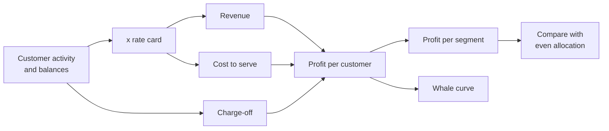

# Banking: which segments are profitable?

Business question: which customer segments earn more than they cost to serve?

## Before you start

- **Level:** 2 (intermediate).
- **Time:** about 4 hours.
- **Builds on:** [GROUP BY from raw rows](../../01-sql/01-group-by-from-raw-rows/), [Subqueries and CTEs](../../01-sql/07-subqueries-and-ctes/), [Mean, median and skew](../../02-statistics-and-experiments/01-mean-median-and-skew/) and [Segmentation and mix effects](../../03-metrics-and-product-analytics/09-segmentation-and-mix-effects/).
- **You need:** Python 3.9 or later. Nothing to install. SQLite comes with Python.
- **How this case is built:** the twelve steps in the [phase README](../README.md). Steps 1 to 6 are in The idea, steps 7 to 12 in Walk through. [RUBRIC.md](RUBRIC.md) grades your steps 10 to 12.

## The problem

Corriebrook Bank is a fictional retail bank with branches, a contact centre and an app. Its yearly profitability report splits operating cost equally across customers, and on that view retirees are a solid earner and students are the bank's biggest loss. Two proposals are on the table: a branch-based "later life" service to win more retirees, and closing the student account offer. Morag, the head of retail strategy, does not trust the equal split, because she knows retirees and students use the bank in very different ways. She needs a segment view built on what each customer actually costs, for the planning meeting at the end of the month.

The files in `data/` are synthetic, generated by `make_data.py` with a fixed seed: `customers.csv` (1,350 customers, one row each, October 2025 to September 2026) and `rates.csv` (an example rate card, fictional: margins on balances and the unit cost of each kind of contact). Money is in GBP. The pattern in them is one that bank analysts meet often.

## In plain words

Think of a sandwich shop with two kinds of regulars. One orders online, collects in ten seconds and never asks for anything. The other comes at lunchtime, chats with staff for ten minutes and wants a custom order every day. If the shop splits its staff costs equally between them, the chatty regular looks like a great customer, because they spend a bit more. Count the staff minutes each one uses and the picture can reverse.

A bank is the same. Customers bring in money (interest margin on what they deposit and borrow, plus fees) and use up money (branch visits, phone calls, app sessions, a fixed cost to keep the account open, and loans that are never repaid). Profit per segment depends on charging each customer for what they use.

Terms used in this case:

- **Segment:** a group of customers the bank manages together, such as Students or Retirees.
- **Net interest margin (here, margin):** what the bank earns per GBP of balance per year. A deposit of 1,000 at a 2.5% margin earns 25.
- **Cost to serve:** what it costs to look after a customer: each branch visit, call and app session at its unit cost, plus a fixed yearly cost per account.
- **Activity-based costing:** charging cost to each customer by the activities they use. The opposite is an **even allocation**: total cost divided equally per customer.
- **Charge-off:** a loan amount the bank writes off as lost.
- **Whale curve:** cumulative profit with customers sorted from most to least profitable. It rises, peaks after the last profitable customer, then falls as the loss-making ones are added. A peak above 100% of total profit is normal in banking.

## What you will build from scratch

- `PROFIT_SQL`: revenue, cost to serve, charge-off and profit per customer, with the rates read from the rates table.
- `SEGMENT_SQL`: the same rolled up per segment, with the count of unprofitable customers.
- `even_allocation(segment_rows)` and `flips(segment_rows)`: the equal-split view and the segments whose answer it reverses.
- `top_share(profits, fraction)` and `whale_curve(profits)`: how concentrated profit is.
- `text_chart(items)`: a bar chart with negative bars, for a chat message.

## The idea

### 1. Business context

A retail bank earns margin on balances and fees, and spends on branches, the contact centre, technology and credit losses. Segment strategy (what to offer whom, where to open or close branches, which products to push) is set once a year from a profitability view. If that view allocates cost wrongly, the bank invests in the wrong customers.

### 2. Problem statement

The current report spreads cost to serve equally per customer. Build segment profit from each customer's own activity, find which segments earn more than they cost, and show where the two methods disagree, before the bank backs either proposal.

### 3. Objectives: the decision this informs

Morag must recommend, per proposal: go, stop or change. Specifically: should the bank build a branch-heavy retiree service, and should it close the student account?

### 4. KPIs and their definitions

- Revenue = deposit_balance x deposit_margin + loan_balance x loan_margin + fee_income.
- Cost to serve = branch_visits x branch_visit + calls x call + digital_sessions x digital_session + account_fixed.
- Profit = revenue - cost to serve - charge_off. Per segment: the sum over its customers, and per customer.
- Unprofitable customers = customers with profit below 0.
- Top 20% share = profit of the most profitable 20% of customers / total profit.

### 5. Data required, and what is missing

`customers.csv`: one row per customer with average balances, fees, contact counts and charge-off for the year. `rates.csv`: six rates. Missing: the cost of capital and branch overheads that do not scale with visits (the rate card treats a visit as a variable cost, which is generous to branch users if the branch stays open anyway), customer lifetime (a student today may be a family customer in five years), and products held at other banks. The rate card is an example; a real one comes from the finance team.

### 6. Analytical approach



1. Profit per customer in SQL, with rates read from the table.
2. Roll up to segments; count unprofitable customers.
3. Recompute with the equal split and list the segments that change sign.
4. Look inside the flip: which activity drives the cost?
5. Whale curve: how concentrated profit is.

## Walk through

### 7. SQL and Python implementation

Run these blocks in order in one Python session started in this folder (`python3`). First, load both CSVs into SQLite.

```python
import csv, sqlite3

con = sqlite3.connect(":memory:")
con.execute("""CREATE TABLE customers (customer_id, segment, deposit_balance REAL, loan_balance REAL,
               fee_income REAL, branch_visits INTEGER, calls INTEGER, digital_sessions INTEGER, charge_off REAL)""")
con.execute("CREATE TABLE rates (item, value REAL)")
for table, path in (("customers", "data/customers.csv"), ("rates", "data/rates.csv")):
    with open(path, newline="") as f:
        rows = list(csv.reader(f))[1:]
    con.executemany("INSERT INTO %s VALUES (%s)" % (table, ",".join("?" * len(rows[0]))), rows)

def show(sql):
    for row in con.execute(sql):
        print(row)

show("SELECT * FROM rates")
show("SELECT COUNT(*), COUNT(DISTINCT segment), SUM(charge_off > 0) FROM customers")
```

```
('deposit_margin', 0.025)
('loan_margin', 0.035)
('branch_visit', 14.0)
('call', 5.5)
('digital_session', 0.08)
('account_fixed', 36.0)
(1350, 6, 19)
```

A branch visit costs 14.00 and an app session 0.08 in this rate card: one visit costs as much as 175 app sessions.

Step 7a. Profit per customer. The rates table has one row per item, so a CTE turns it into one row with six columns (a pivot), and a CROSS JOIN puts that row next to every customer. Reading rates from the table, rather than typing 14.00 into the query, means a new rate card needs no code change.

```python
PROFIT = """
WITH r AS (
  SELECT MAX(CASE WHEN item = 'deposit_margin' THEN value END) AS dep,
         MAX(CASE WHEN item = 'loan_margin' THEN value END) AS loan,
         MAX(CASE WHEN item = 'branch_visit' THEN value END) AS visit,
         MAX(CASE WHEN item = 'call' THEN value END) AS call,
         MAX(CASE WHEN item = 'digital_session' THEN value END) AS digital,
         MAX(CASE WHEN item = 'account_fixed' THEN value END) AS fixed
  FROM rates)
SELECT c.customer_id, c.segment,
       c.deposit_balance * r.dep + c.loan_balance * r.loan + c.fee_income AS revenue,
       c.branch_visits * r.visit + c.calls * r.call + c.digital_sessions * r.digital + r.fixed AS cost,
       c.charge_off,
       c.branch_visits, c.digital_sessions
FROM customers c CROSS JOIN r"""
show(f"SELECT customer_id, segment, ROUND(revenue, 2), ROUND(cost, 2), charge_off FROM ({PROFIT}) ORDER BY customer_id LIMIT 4")
```

```
('C0001', 'Young professionals', 149.73, 86.0, 0.0)
('C0002', 'Retirees', 177.13, 633.68, 0.0)
('C0003', 'Families', 1288.33, 171.76, 0.0)
('C0004', 'Small business', 1507.6, 356.78, 0.0)
```

Step 7b. Per segment, costed by activity:

```python
seg = con.execute(f"""
    SELECT segment, COUNT(*), ROUND(SUM(revenue)), ROUND(SUM(cost)), ROUND(SUM(charge_off)),
           ROUND(SUM(revenue - cost - charge_off)), ROUND(SUM(revenue - cost - charge_off) / COUNT(*), 1),
           SUM(revenue - cost - charge_off < 0)
    FROM ({PROFIT}) GROUP BY segment ORDER BY 6 DESC""").fetchall()
for s in seg:
    print(s)
```

```
('Premier', 80, 161098.0, 11758.0, 0.0, 149340.0, 1866.8, 0)
('Small business', 120, 198665.0, 41057.0, 35587.0, 122020.0, 1016.8, 4)
('Families', 300, 154685.0, 43173.0, 42858.0, 68653.0, 228.8, 25)
('Young professionals', 330, 121611.0, 29706.0, 41800.0, 50104.0, 151.8, 19)
('Students', 260, 11935.0, 20791.0, 4209.0, -13064.0, -50.2, 227)
('Retirees', 260, 74801.0, 96831.0, 0.0, -22030.0, -84.7, 184)
```

Each row is (segment, customers, revenue, cost to serve, charge-offs, profit, profit per customer, unprofitable customers). Four segments earn more than they cost. Students and Retirees do not, and Retirees lose the most: GBP 22,030, with 184 of 260 retirees unprofitable.

Step 7c. The report's method. Split the total cost to serve equally across all 1,350 customers:

```python
n = sum(s[1] for s in seg)
per_customer = sum(s[3] for s in seg) / n
print("equal cost per customer", round(per_customer, 2))
for s in seg:
    even = s[2] - s[4] - s[1] * per_customer
    print((s[0], s[5], round(even)))
```

```
equal cost per customer 180.23
('Premier', 149340.0, 146679)
('Small business', 122020.0, 141450)
('Families', 68653.0, 57757)
('Young professionals', 50104.0, 20334)
('Students', -13064.0, -39135)
('Retirees', -22030.0, 27940)
```

Each tuple is (segment, profit costed by activity, profit with an equal split). Under the equal split, Retirees make GBP 27,940; costed by activity they lose GBP 22,030. Students lose three times as much under the equal split as they really do. The two proposals on the table come straight from the equal split.

Step 7d. Why retirees cost so much. Average activity per customer, by segment:

```python
show(f"""SELECT segment, ROUND(AVG(branch_visits), 1), ROUND(AVG(digital_sessions)), ROUND(AVG(cost), 1)
         FROM ({PROFIT}) GROUP BY segment ORDER BY 4 DESC""")
```

```
('Retirees', 21.6, 17.0, 372.4)
('Small business', 12.6, 400.0, 342.1)
('Premier', 2.4, 337.0, 147.0)
('Families', 4.6, 204.0, 143.9)
('Young professionals', 1.3, 280.0, 90.0)
('Students', 0.7, 325.0, 80.0)
```

Retirees visit a branch about 22 times a year and almost never use the app. At 14.00 a visit, the visits alone cost about 300 a year per retiree, more than the 288 their balances and fees earn. Students visit less than once a year and log in about 325 times, at 0.08 each.

Step 7e. How concentrated profit is: the whale curve.

```python
profits = sorted((r[0] for r in con.execute(f"SELECT revenue - cost - charge_off FROM ({PROFIT})")), reverse=True)
total = sum(profits)
cum, peak = 0.0, 0.0
for p in profits:
    cum += p
    peak = max(peak, cum)
top = sum(profits[:int(len(profits) * 0.2)])
print(round(total), round(peak), round(peak / total, 3), round(top / total, 3), sum(p < 0 for p in profits))
```

```
355024 515420 1.452 1.04 459
```

Total profit is GBP 355,024. The most profitable customers earn GBP 515,420 before the loss-makers are added: the curve peaks at 145% of total profit. The top 20% of customers alone earn 104% of it. 459 customers (34%) cost more than they bring in.

### 8. Visualisation

Profit per segment, both ways, as signed bars: `#` for profit, `-` for loss.

```python
rows = [(s[0], s[5]) for s in seg] + [(s[0] + " (equal)", s[2] - s[4] - s[1] * per_customer) for s in seg if s[0] in ("Retirees", "Students")]
top_abs = max(abs(v) for _, v in rows)
for label, v in rows:
    print("%-20s %8.0f %s" % (label, v, ("#" if v >= 0 else "-") * round(abs(v) / top_abs * 20)))
```

```
Premier                149340 ####################
Small business         122020 ################
Families                68653 #########
Young professionals     50104 #######
Students               -13064 --
Retirees               -22030 ---
Students (equal)       -39135 -----
Retirees (equal)        27940 ####
```

The two segments at the bottom are the ones the proposals target. With the equal split, Retirees jump from a loss to a profit and Students' loss triples.

### 9. Insights

1. Costed by activity, four segments earn more than they cost: Premier (GBP 149,340), Small business (GBP 122,020), Families (GBP 68,653) and Young professionals (GBP 50,104). Students (GBP -13,064) and Retirees (GBP -22,030) do not.
2. The equal split reverses the answer for Retirees: GBP +27,940 instead of GBP -22,030. That is what `flips` returns. The difference is branch visits: about 22 a year per retiree against 0.7 for students.
3. Students lose GBP 50 each a year, not the GBP 151 the equal split suggests. Their cost is mostly the fixed 36 per account; they use the cheapest channel.
4. Profit is concentrated: the top 20% of customers earn 104% of it, and 459 customers (34%) are loss-making, spread across every segment except Premier.

### 10. Recommendation

Do not launch the branch-based retiree service as designed: it would grow the segment that loses the most per customer, through the most expensive channel. Instead, offer retirees a phone and assisted-digital service (a named contact on the phone, help setting up the app at their next branch visit) and test it with one region's retirees for six months. Do not close the student account: it loses GBP 50 a student, not GBP 151, and students become the young professionals who earn GBP 152 each. Change the profitability report to activity-based costing before next year's plan.

### 11. Expected business impact

If half of retirees' branch visits became phone calls, each moved visit saves 14.00 - 5.50 = 8.50. Retirees made 5,608 branch visits in the year (about 22 each), so moving half of them saves about GBP 23,800 a year, enough to close the segment's GBP 22,030 loss. Assumption: a branch visit's cost really goes away when the visit does; if branches stay open with the same staff, the saving is smaller until staffing changes. Keeping the student account protects the pipeline into Young professionals at a cost of about GBP 13,000 a year.

### 12. Limitations and what would change our mind

- The rate card treats a branch visit as a fully variable cost. If most branch cost is fixed rent and staff that stay, retirees cost less at the margin than shown, and the flip is smaller. Finance's split of fixed and variable branch cost would settle it.
- One year of charge-offs is noisy, especially in Small business, where a few write-offs move the segment total by tens of thousands. Expected loss rates over several years would be steadier.
- Profit is for one year. Students' lifetime value depends on how many stay into their working years; the data has no history to measure it.
- Retirees may hold other products (pensions, investments) booked elsewhere in the bank; including them could make the segment profitable.

## Common mistakes

**1. Splitting cost equally (the trap).** Shown in step 7c: it turns the bank's largest loss-making segment into a GBP 27,940 profit. An equal split is only right when every customer uses the same mix of channels, which is exactly what segments differ on.

**2. Averaging per-customer profit and calling it the segment's contribution.** Small business earns GBP 1,017 per customer and Families GBP 229, but Families has 300 customers. Rank segments on total profit for "which matter most" and on profit per customer for "which to grow". They answer different questions.

**3. Leaving out charge-offs.** Without them, Young professionals look much better:

```python
show(f"""SELECT segment, ROUND(SUM(revenue - cost)), ROUND(SUM(revenue - cost - charge_off))
         FROM ({PROFIT}) WHERE segment IN ('Young professionals', 'Small business') GROUP BY segment""")
```

```
('Small business', 157607.0, 122020.0)
('Young professionals', 91904.0, 50104.0)
```

GBP 41,800 of Young professionals' profit and GBP 35,587 of Small business' goes to loans written off. A profitability view without credit losses rewards lending to anyone.

**4. Typing the rates into the query.** `branch_visits * 14.00` works today and silently stays wrong when finance sends a new rate card. Read rates from the table; the test changes the rates table and checks that profit moves.

## Your turn

Open `exercise.py`. Write the two queries and the four functions. The docstrings say what each must return; there are fewer hints than in Level 1 lessons. Then run, from this folder:

    python3 test_lesson.py

The tests run on the committed data, on a second dataset built with another seed (so typed-in answers fail), and on hand-made cases: a changed rate card, a customer with no activity, a profit of exactly zero, an empty list and a loss-making total. To check the reference answer: `CHECK_SOLUTION=1 python3 test_lesson.py`.

Then write your own steps 10 to 12 and grade them with [RUBRIC.md](RUBRIC.md).

Stretch: within Retirees, split customers into those with 10 or fewer branch visits and the rest. Is the low-visit group profitable? That tells you whether the problem is the segment or the channel.

## Check yourself

1. Why does an equal split of cost make Retirees look profitable?
2. The whale curve peaks at 145% of total profit. What does that mean in plain words?
3. Students lose money in both views. Why keep the student account anyway?
4. Which single number from finance would most change the retiree conclusion?

<details>
<summary>Answers</summary>

1. Retirees use the branch about 22 times a year, the most expensive channel. An equal split charges them the bank-wide average cost (about 180 a year), far less than the roughly 370 their activity costs, so their decent balances look like profit.
2. The profitable customers together earn 1.45 times what the bank makes in total; the loss-making customers give back the other 45%. Serving the loss-makers better (or more cheaply) is worth as much as finding new profitable customers.
3. The loss is small (GBP 50 a student) and students become young professionals, who earn GBP 152 each. A one-year view undervalues a segment whose value comes later.
4. How much of a branch visit's cost is truly variable. If most branch cost stays whether retirees visit or not, the marginal cost per visit is lower and the retiree loss shrinks.

</details>

## What to tell the stakeholder

To Morag: "Costed by what customers actually use, Retirees are our biggest loss-making segment (GBP -22,030 a year, 184 of 260 unprofitable), not a GBP 27,940 earner as the equal-split report says; the difference is about 22 branch visits a year each. Students lose GBP 50 each, not 151. So: do not build a branch-heavy retiree service; pilot a phone and assisted-digital service instead, which could save about GBP 23,800 a year if half the visits move to the phone. Keep the student account. Caveat: this assumes branch cost falls when visits fall; finance's fixed and variable split of branch cost would firm it up."

## In real job postings

In the Real Analyst Jobs data drop of 25 October 2026, 286 of the 413 UK analyst postings that name a tool (69.2%) ask for SQL, the tool this case builds its profitability view in. See [data analyst jobs in the UK](https://realanalystjobs.com/jobs/data-analyst-jobs-in-uk).

## Next

[09: Operations: why are deliveries late?](../09-operations-late-deliveries/)
