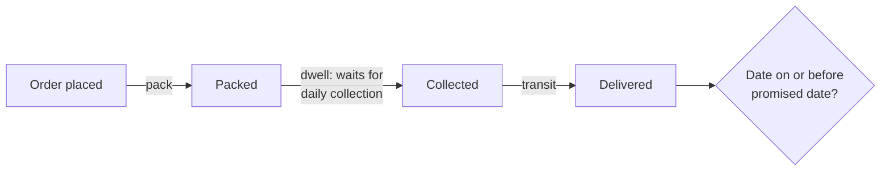

# Operations: why are deliveries late?

Business question: on-time delivery fell from 94% to 87%. Where in the chain is the delay?

## Before you start

- **Level:** 2 (intermediate).
- **Time:** about 4 hours.
- **Builds on:** [Dates and the date spine](../../01-sql/05-dates-and-the-date-spine/), [Dates, weeks and time zones](../../05-python-for-analysts/03-dates-weeks-and-time-zones/), [Spread, percentiles and outliers](../../02-statistics-and-experiments/06-spread-percentiles-and-outliers/) and [Metric trees](../../03-metrics-and-product-analytics/01-metric-trees/).
- **You need:** Python 3.9 or later. Nothing to install. SQLite comes with Python.
- **How this case is built:** the twelve steps in the [phase README](../README.md). Steps 1 to 6 are in The idea, steps 7 to 12 in Walk through. [RUBRIC.md](RUBRIC.md) grades your steps 10 to 12.

## The problem

Parcelwren is a fictional online retailer of home and garden goods. It packs orders in two warehouses, North and South, and hands them to two carriers, A and B, which deliver them. Every customer is promised delivery within two days of ordering. Over the summer of 2026 the share of parcels delivered on time fell from about 94% to about 87%, and complaints doubled. Customer service blames carrier B, the South warehouse manager says his team is packing as fast as ever, and the chief executive is ready to drop carrier B. Dev, the head of fulfilment, wants to know where in the chain the time is being lost before anyone changes a contract. He needs it for the carrier review next Wednesday.

The file `data/shipments.csv` is synthetic, generated by `make_data.py` with a fixed seed: 1,715 shipments ordered between Monday 6 July and Sunday 27 September 2026 (12 weeks), with a timestamp at every step. The pattern in it is one that operations analysts meet often.

## In plain words

Think of a relay race with three runners: the packer, the waiting area, the driver. The team's time got worse. You could blame the slowest-looking runner. Or you could time each leg, before and after, and see which leg got longer. Then ask: did it get longer for everyone, or only for some starts?

A parcel's journey is a relay with three legs. If one leg got longer only for parcels that reach it at a certain time of day, the cause is a rule or a schedule, not a person working slower.

Terms used in this case:

- **On time:** delivered on or before the promised date (order date + 2 days). It is judged on the date, not the hour.
- **On-time rate:** on-time shipments / all shipments, in percent.
- **Stage:** one leg of the journey. **Pack:** from order to packed. **Dwell:** from packed to collected by the carrier (the parcel waits in the warehouse). **Transit:** from collection to delivery.
- **Collection time (cut-off):** the time of day the carrier picks up parcels from a warehouse. A parcel packed after it waits for the next day's collection.
- **Before and after:** weeks 1 to 6 (6 July to 16 August) and weeks 7 to 12 (17 August to 27 September), by order date.
- **What-if (counterfactual):** recomputing the result as if one thing had been different, keeping everything else as it happened.

## What you will build from scratch

- `WEEKLY_SQL`: shipments and on-time rate per week.
- `STAGE_SQL`: average hours per stage by warehouse and period.
- `BAND_SQL`: on-time rate by the time of day the parcel was packed.
- `stage_change(stage_rows)`: which stage at which warehouse got longer, ranked.
- `on_time_with_collection(shipments, warehouse, hour)`: the on-time rate if a warehouse's collection had been at a different hour.
- `text_chart(weekly)`: a weekly chart with a cut axis, for a chat message.

## The idea

### 1. Business context

Parcelwren promises two-day delivery on every product page. A late parcel costs a customer service contact, sometimes a refund of the delivery fee, and repeat orders. The warehouses report to Dev; the carriers are contracted per parcel, with collection times agreed per warehouse.

### 2. Problem statement

The on-time rate was 94.2% for orders in weeks 1 to 6 and 86.5% in weeks 7 to 12. Find which stage, at which warehouse and for which parcels, lost the time, before the carrier contract is changed.

### 3. Objectives: the decision this informs

Wednesday's carrier review chooses between: dropping carrier B, adding packing staff at South, or something else. The analysis must say which action would bring on-time delivery back, and by how much.

### 4. KPIs and their definitions

- On-time rate = shipments with date(delivered_ts) <= promised_date / all shipments, by order week.
- Stage hours = (later timestamp - earlier timestamp) in hours, averaged per warehouse and period.
- Total hours = pack + dwell + transit, so the change in total hours is exactly the sum of the stage changes.
- On-time rate by packed band: by the time of day the parcel was packed, before 16:00, 16:00 to 20:00, from 20:00.

### 5. Data required, and what is missing

One row per shipment: shipment_id, order_ts, warehouse, carrier, zone, packed_ts, collected_ts, delivered_ts, promised_date. Missing: the carrier's collection schedule (we have to infer it from collected_ts), failed delivery attempts (they show only as a long transit), and the reason for any schedule change. The carrier's own scan events would confirm the cause directly.

### 6. Analytical approach



1. Confirm the drop week by week and find when it started.
2. Time each stage before and after, per warehouse; rank the changes.
3. Inside the stage that changed, split by the time of day parcels reach it.
4. Check the popular theory (carrier B) on the same split.
5. Size the fix with a what-if.

## Walk through

### 7. SQL and Python implementation

Run these blocks in order in one Python session started in this folder (`python3`). First, load the CSV into SQLite.

```python
import csv, datetime, sqlite3

con = sqlite3.connect(":memory:")
con.execute("CREATE TABLE shipments (shipment_id, order_ts, warehouse, carrier, zone, packed_ts, collected_ts, delivered_ts, promised_date)")
with open("data/shipments.csv", newline="") as f:
    rows = list(csv.DictReader(f))
con.executemany("INSERT INTO shipments VALUES (?, ?, ?, ?, ?, ?, ?, ?, ?)", [list(r.values()) for r in rows])

def show(sql):
    for row in con.execute(sql):
        print(row)

show("SELECT COUNT(*), MIN(order_ts), MAX(order_ts), SUM(date(delivered_ts) <= promised_date) FROM shipments")
```

```
(1715, '2026-07-06 08:18', '2026-09-27 18:14', 1551)
```

`date(delivered_ts)` cuts '2026-07-08 14:20' to '2026-07-08', so it can be compared with promised_date as text. ISO dates compare correctly as text because the year comes first.

Step 7a. On time per week, by order date. (`julianday` and `date` are SQLite; PostgreSQL writes `delivered_ts::date <= promised_date` and `(order_ts::date - DATE '2026-07-06') / 7`.)

```python
WEEK = "CAST((julianday(date(order_ts)) - julianday('2026-07-06')) / 7 AS INTEGER) + 1"
weekly = con.execute(f"""
    SELECT {WEEK} AS week, COUNT(*), SUM(date(delivered_ts) <= promised_date),
           ROUND(100.0 * SUM(date(delivered_ts) <= promised_date) / COUNT(*), 1)
    FROM shipments GROUP BY week ORDER BY week""").fetchall()
for w in weekly:
    print(w)
```

```
(1, 153, 145, 94.8)
(2, 141, 134, 95.0)
(3, 156, 141, 90.4)
(4, 148, 142, 95.9)
(5, 137, 129, 94.2)
(6, 143, 136, 95.1)
(7, 141, 127, 90.1)
(8, 132, 113, 85.6)
(9, 136, 113, 83.1)
(10, 147, 128, 87.1)
(11, 143, 123, 86.0)
(12, 138, 120, 87.0)
```

Weeks 1 to 6 run at 90% to 96%; from week 7 (17 August) every week is 90.1% or below. Volume is steady at about 140 a week, so it is not a rush.

Step 7b. Each stage, before and after, per warehouse. Hours between two timestamps are the julianday difference times 24.

```python
PERIOD = "CASE WHEN julianday(date(order_ts)) - julianday('2026-07-06') < 42 THEN 'before' ELSE 'after' END"
H = "(julianday({1}) - julianday({0})) * 24"
stages = con.execute(f"""
    SELECT warehouse, {PERIOD} AS period, COUNT(*),
           ROUND(AVG({H.format('order_ts', 'packed_ts')}), 2) AS pack_h,
           ROUND(AVG({H.format('packed_ts', 'collected_ts')}), 2) AS dwell_h,
           ROUND(AVG({H.format('collected_ts', 'delivered_ts')}), 2) AS transit_h,
           ROUND(AVG({H.format('order_ts', 'delivered_ts')}), 2) AS total_h,
           ROUND(100.0 * AVG(date(delivered_ts) <= promised_date), 1)
    FROM shipments GROUP BY warehouse, period ORDER BY warehouse, period""").fetchall()
for s in stages:
    print(s)
```

```
('North', 'after', 466, 1.75, 6.71, 35.64, 44.1, 92.9)
('North', 'before', 483, 1.76, 6.5, 36.02, 44.28, 93.4)
('South', 'after', 371, 1.77, 9.12, 35.94, 46.83, 78.4)
('South', 'before', 395, 1.73, 6.33, 36.0, 44.07, 95.2)
```

Each row is (warehouse, period, shipments, pack, dwell, transit, total hours, on-time %). North is unchanged: 93.4% to 92.9%. South fell from 95.2% to 78.4%. At South, pack and transit hours are flat; dwell, the wait for the carrier, went from 6.33 to 9.12 hours.

Step 7c. Rank the changes. Because total = pack + dwell + transit for every parcel, the change in average total hours is exactly the sum of the stage changes, so this table accounts for all of it:

```python
by = {(s[0], s[1]): s for s in stages}
changes = []
for wh in ("North", "South"):
    for i, st in ((3, "pack"), (4, "dwell"), (5, "transit")):
        changes.append((round(by[(wh, "after")][i] - by[(wh, "before")][i], 2), wh, st))
for c in sorted(changes, reverse=True):
    print(c)
```

```
(2.79, 'South', 'dwell')
(0.21, 'North', 'dwell')
(0.04, 'South', 'pack')
(-0.01, 'North', 'pack')
(-0.06, 'South', 'transit')
(-0.38, 'North', 'transit')
```

South dwell is the only stage that grew. But 2.8 hours on average does not obviously make a parcel a day late. An average can hide a change that hits only some parcels hard.

Step 7d. When in the day were the parcels packed? The carrier collects once a day, so a parcel packed just after collection waits almost a full day.

```python
show(f"""SELECT warehouse, {PERIOD} AS period,
                CASE WHEN time(packed_ts) < '16:00' THEN '00-16' WHEN time(packed_ts) < '20:00' THEN '16-20' ELSE '20-24' END AS band,
                COUNT(*), ROUND(100.0 * AVG(date(delivered_ts) <= promised_date), 1),
                ROUND(AVG({H.format('packed_ts', 'collected_ts')}), 1)
         FROM shipments GROUP BY 1, 2, 3 ORDER BY 1, 2 DESC, 3""")
```

```
('North', 'before', '00-16', 331, 96.4, 7.2)
('North', 'before', '16-20', 136, 96.3, 2.7)
('North', 'before', '20-24', 16, 6.3, 23.5)
('North', 'after', '00-16', 323, 96.0, 7.1)
('North', 'after', '16-20', 122, 100.0, 2.6)
('North', 'after', '20-24', 21, 4.8, 23.8)
('South', 'before', '00-16', 264, 97.0, 7.1)
('South', 'before', '16-20', 118, 99.2, 2.7)
('South', 'before', '20-24', 13, 23.1, 23.8)
('South', 'after', '00-16', 254, 96.5, 3.2)
('South', 'after', '16-20', 97, 40.2, 22.5)
('South', 'after', '20-24', 20, 35.0, 19.6)
```

Each row is (warehouse, period, packed band, shipments, on-time %, average dwell hours). At South after 17 August, parcels packed between 16:00 and 20:00 wait about 22.5 hours instead of about 3, and only 40.2% arrive on time. Parcels packed before 16:00 are as good as ever. The earliest collection times in the data say why:

```python
show(f"""SELECT warehouse, {PERIOD} AS period, MIN(time(collected_ts)), MAX(time(collected_ts))
         FROM shipments GROUP BY 1, 2 ORDER BY 1, 2 DESC""")
```

```
('North', 'before', '20:00:00', '20:39:00')
('North', 'after', '20:00:00', '20:39:00')
('South', 'before', '20:00:00', '20:39:00')
('South', 'after', '16:00:00', '16:39:00')
```

At South the carrier now collects between 16:00 and 16:40, not 20:00 to 20:40. The collection moved four hours earlier from week 7. Parcels packed in those four hours now wait for tomorrow's van.

Step 7e. Size the fix: what would on time have been if South had kept its 20:00 collection? For each South parcel from week 7, find the day a 20:00 collection would have taken it and move the delivery earlier by the days saved.

```python
def ts(t):
    return datetime.datetime.strptime(t, "%Y-%m-%d %H:%M")

start = datetime.date(2026, 7, 6)
after = [r for r in rows if (ts(r["order_ts"]).date() - start).days >= 42]
good = 0
for r in after:
    delivered = ts(r["delivered_ts"]).date()
    if r["warehouse"] == "South":
        packed = ts(r["packed_ts"])
        new_day = packed.date() + datetime.timedelta(days=0 if packed.hour < 20 else 1)
        delivered -= datetime.timedelta(days=max(0, (ts(r["collected_ts"]).date() - new_day).days))
    good += delivered.isoformat() <= r["promised_date"]
print(len(after), sum(r["delivered_ts"][:10] <= r["promised_date"] for r in after), good, round(100 * good / len(after), 1))
```

```
837 724 778 93.0
```

With the 20:00 collection kept, 778 of 837 after-period parcels would have been on time: 93.0%, against 86.5% actual and 94.2% before. The collection change explains about 6.5 of the 7.7 points lost.

### 8. Visualisation

On time per week. The axis starts at 80%, not 0, so the bars show the change; say so whenever you share a cut axis, because it makes a 7-point drop look like a collapse.

```python
for week, n, ok, pct in weekly:
    print("W%02d %5.1f%% %s" % (week, pct, "#" * round(max(0, pct - 80) / 20 * 30)))
print("(axis from 80% to 100%)")
```

```
W01  94.8% ######################
W02  95.0% ######################
W03  90.4% ################
W04  95.9% ########################
W05  94.2% #####################
W06  95.1% #######################
W07  90.1% ###############
W08  85.6% ########
W09  83.1% #####
W10  87.1% ###########
W11  86.0% #########
W12  87.0% ##########
(axis from 80% to 100%)
```

### 9. Insights

1. On time fell from 94.2% (weeks 1 to 6) to 86.5% (weeks 7 to 12), starting in week 7, the week of 17 August.
2. The drop is all at South: 95.2% to 78.4%. North is flat (93.4% to 92.9%).
3. At South, pack and transit times did not change. The dwell time rose because the carrier's daily collection moved from about 20:00 to about 16:00. Parcels packed between 16:00 and 20:00 now wait about 22.5 hours and arrive on time 40.2% of the time, against 99.2% before.
4. Restoring the 20:00 collection would have put after-period on time at 93.0%: about 6.5 of the 7.7 points lost.
5. Carrier B is not the cause. Its on-time rate at North is 91.9% before and after. It fell more than A at South only because its longer transit leaves less slack when a parcel starts a day late.

### 10. Recommendation

Ask the carrier serving South to restore the 20:00 collection this week, or add a second collection at 19:30. Until it changes, have South pack parcels received after 13:00 first, so more of them make the 16:00 van, and show customers a three-day promise for South orders placed after 14:00. Do not drop carrier B: its performance at North did not change. Do not add packing staff at South: packing time did not change.

### 11. Expected business impact

About 140 shipments a week; restoring the collection lifts on time by about 6.5 points, so about 9 fewer late parcels a week (837 after-period parcels over 6 weeks = about 140 a week; 778 - 724 = 54 parcels over 6 weeks). Assumption for money (example figures, not in the data): if one in three late parcels causes a contact costing GBP 4 and a refunded GBP 3.99 delivery fee, that is about GBP 24 a week, small in money; the larger cost is repeat orders from customers who were let down, which this data does not measure. Dropping carrier B would have cost a contract change and fixed none of this.

### 12. Limitations and what would change our mind

- The collection time is inferred from collected_ts. If the carrier's records show the 16:00 collection was a one-off Parcelwren asked for, the fix is internal, not with the carrier.
- The what-if moves deliveries by whole days and ignores the carrier's evening delivery window, so 93.0% is approximate.
- About 1.2 points of the drop are not explained by the collection change. Twelve weeks are too few to say whether that is noise or a second, smaller cause; it should be watched after the fix.
- Failed delivery attempts are not recorded separately; if they rose, they would sit inside transit and be missed here.

## Common mistakes

**1. Stopping at the average (the trap).** South's average dwell rose by only 2.8 hours, and a manager can reasonably say "under three hours does not make a two-day promise late". The average mixes the many parcels that did not change with the quarter that got a whole day longer. Count the long waits instead:

```python
show(f"""SELECT warehouse, {PERIOD} AS period, COUNT(*),
                SUM({H.format('packed_ts', 'collected_ts')} > 12) AS waited_over_12h
         FROM shipments GROUP BY 1, 2 ORDER BY 1, 2 DESC""")
```

```
('North', 'before', 483, 17)
('North', 'after', 466, 22)
('South', 'before', 395, 13)
('South', 'after', 371, 116)
```

At South, parcels waiting more than 12 hours went from 13 to 116. When a process has a schedule (a daily van, a nightly batch), look at the distribution, not only the mean.

**2. Blaming the carrier from its own numbers.** Carrier B fell from 93.8% to 81.7%, much worse than A. Split it by warehouse:

```python
show(f"""SELECT carrier, warehouse, {PERIOD} AS period, COUNT(*), ROUND(100.0 * AVG(date(delivered_ts) <= promised_date), 1)
         FROM shipments GROUP BY 1, 2, 3 ORDER BY 1, 2, 3 DESC""")
```

```
('A', 'North', 'before', 298, 94.3)
('A', 'North', 'after', 317, 93.4)
('A', 'South', 'before', 239, 94.6)
('A', 'South', 'after', 230, 83.0)
('B', 'North', 'before', 185, 91.9)
('B', 'North', 'after', 149, 91.9)
('B', 'South', 'before', 156, 96.2)
('B', 'South', 'after', 141, 70.9)
```

B at North did not move (91.9% both times). B's drop is South's drop, made worse by B's longer transit. Dropping B would not have helped.

**3. Comparing timestamps instead of dates.** The promise is a date. `delivered_ts <= promised_date` compares '2026-07-08 14:20' with '2026-07-08' as text, and the longer string is bigger, so every parcel delivered on its promised day counts as late. Always cut the timestamp to a date first.

**4. A cut axis without a warning.** The chart in step 8 starts at 80%. It is the right choice to see a 7-point change, but a reader who does not notice will think on time halved. Say it under the chart.

## Your turn

Open `exercise.py`. Write the three queries and the three functions. The docstrings say what each must return; there are fewer hints than in Level 1 lessons. Then run, from this folder:

    python3 test_lesson.py

The tests run on the committed data, on a second dataset built with another seed (so typed-in answers fail), and on hand-made cases: the Sunday and Monday either side of the split, delivery on the promised day itself, the 16:00 and 20:00 band edges, a warehouse with only one period, a parcel the what-if cannot help, and no after-period shipments at all. To check the reference answer: `CHECK_SOLUTION=1 python3 test_lesson.py`.

Then write your own steps 10 to 12 and grade them with [RUBRIC.md](RUBRIC.md).

Stretch: zone is in the data. Does the collection change hurt zone 3 (the furthest) more than zone 1? Explain why, using transit time.

## Check yourself

1. South's average dwell rose by under 3 hours. How did that make on time fall by 17 points there?
2. Why is "carrier B got worse" the wrong conclusion, even though B's on-time rate fell the most?
3. Why does the change in total hours equal the sum of the stage changes?
4. What would you ask the carrier for to prove the cause?

<details>
<summary>Answers</summary>

1. The change hit only parcels packed between 16:00 and 20:00, 97 of South's 371 after-period parcels, and added about 20 hours of waiting to each of them, enough to miss the promised date. Averaged with the three quarters that did not change, it looks like under 3 hours.
2. At North, B's on-time rate did not change (91.9% before and after). B fell more at South only because its transit is longer, so a parcel that starts a day late has less slack. The cause is the South collection, which affects both carriers.
3. For every parcel, total = pack + dwell + transit exactly, because the timestamps chain. An average of a sum is the sum of the averages, so the differences add up too.
4. The collection schedule for South by date: when the 20:00 collection stopped and why. If it changed on 17 August, the cause is confirmed.

</details>

## What to tell the stakeholder

To Dev: "The drop from 94.2% to 86.5% on time is all at South, and it is the carrier's collection there moving from about 20:00 to about 16:00 from 17 August: parcels packed in those four hours now wait a day and arrive on time only 40% of the time. Packing speed and carrier B are not the cause; B at North is unchanged at 91.9%. Restoring the 20:00 collection would have kept on time at about 93%. Ask the carrier to restore it this week; until then, pack late-morning South orders first. The collection time is inferred from scan times, so confirm the schedule change with the carrier."

## In real job postings

In the Real Analyst Jobs data drop of 25 October 2026, 996 of the 2,056 US analyst postings that name a tool (48.4%) ask for Python, which this case uses for the what-if that SQL alone makes awkward. See [Python data analyst jobs](https://realanalystjobs.com/jobs/python-data-analyst-jobs).

## Next

You have finished the business case studies. Go on to the [capstone projects](../../10-capstone-projects/README.md), where you put a whole analysis together on your own.
