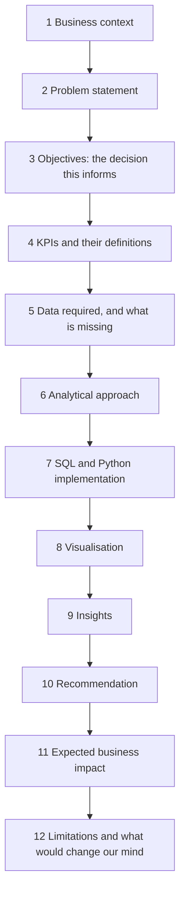

# 09 Business case studies

The earlier phases teach methods. This phase teaches the job: a vague business problem, data that does not quite fit, and a recommendation someone will act on. Each case takes about four hours and uses SQL, statistics, metrics and Python together.

## How every case is built

Each case follows the same twelve steps, so you learn a repeatable way to work, not just twelve answers.

The test checks the numbers in steps 7 to 9. A rubric in each case checks steps 10 to 12: is the recommendation specific, is the impact sized with a stated assumption, are the limits honest. The data is synthetic and says so, but each case is built on a pattern analysts meet in that industry.

## Cases

1. [E-commerce: why is revenue falling?](01-ecommerce-why-is-revenue-falling/) Revenue is down 8% on last quarter. Traffic, conversion, basket size or mix?
2. [SaaS: reduce subscription churn](02-saas-reduce-subscription-churn/). Which customers leave, when, and which change would keep the most revenue?
3. [Marketing: is the campaign incremental?](03-marketing-is-the-campaign-incremental/) The campaign got credit for 3,000 sales. How many would have happened anyway?
4. [Food delivery: why are cancellations rising?](04-food-delivery-cancellations/) Cancellations doubled in six weeks. Restaurants, riders, customers or the app?
5. [Fintech: loan approvals and defaults](05-fintech-approvals-and-defaults/). If we approve more applicants, how many more defaults do we buy?
6. [Retail: what to restock](06-retail-what-to-restock/). Which products deserve more inventory next month, and which are tying up cash?
7. [Growth: why is acquisition cost rising?](07-growth-why-is-cac-rising/) CAC is up 35% this year. Channel saturation, pricing or tracking?
8. [Banking: which segments are profitable?](08-banking-profitable-segments/) Which customer segments earn more than they cost to serve?
9. [Operations: why are deliveries late?](09-operations-late-deliveries/) On-time delivery fell from 94% to 87%. Where in the chain is the delay?

The percentages in these questions describe the fictional case data, not real companies.

Before this phase, reach [Milestone 1](../../LEARNING_ROADMAP.md#milestone-1-answer-a-clear-question-end-of-level-1) in the roadmap: SQL joins and GROUP BY, mean vs median, and a metric definition.
