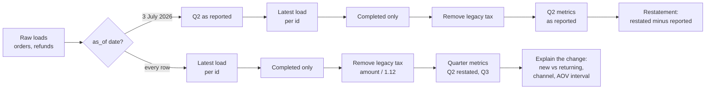

# E-commerce performance review

Business question: prepare the quarterly business review (QBR) for an online store, and answer whether its new checkout platform hurt sales.

## Before you start

- **Level:** 3 (advanced). A capstone: an ambiguous brief, several messy tables, and a deliverable a hiring manager can open and run.
- **Time:** about 10 hours.
- **Builds on:** [E-commerce: why is revenue falling?](../../09-business-case-studies/01-ecommerce-why-is-revenue-falling/) (splitting a revenue change), [Duplicates and reconciliation](../../01-sql/08-duplicates-and-reconciliation/), [Incremental models and backfills](../../08-modern-data-stack/03-incremental-models-and-backfills/) (late rows), [Define a metric precisely](../../03-metrics-and-product-analytics/05-define-a-metric-precisely/), [Bootstrap intervals](../../02-statistics-and-experiments/12-bootstrap-intervals/) and [Explain findings to leadership](../../07-getting-hired/06-explain-findings-to-leadership/).
- **You need:** Python 3.9 or later. Nothing to install.
- **How this capstone is built:** see the [phase README](../README.md). [BRIEF.md](BRIEF.md) is the request, [DELIVERABLES.md](DELIVERABLES.md) says what to hand in, [RUBRIC.md](RUBRIC.md) scores the parts with no single right answer, and `solution/` is the worked answer to read after you finish.

## The problem

Pottlemere, a fictional online kitchenware shop in India, holds its quarterly business review with the board on Thursday 5 November 2026. Anjali Rao, the CEO, wants the Q3 pack by Monday 2 November: how Q3 went against Q2 and why, whether the new checkout platform launched on 1 August is losing sales (a board member wants to roll it back), and what to focus on in Q4. The Q2 numbers changed after last quarter's meeting, and she does not want that again. Read the full request and the data team's notes in [BRIEF.md](BRIEF.md).

The files in `data/` are synthetic, generated by `make_data.py` with a fixed seed. They are the raw warehouse export of 26 October 2026: `orders.csv` (1,633 rows), `refunds.csv` (112 rows) and `customers.csv` (738 rows), covering 1 January to 30 September 2026.

## In plain words

Think of a shop's till rolls at the end of a quarter. Some receipts were printed twice. Some sales were later voided, and the void slip is a separate receipt that came days later. Halfway through the quarter the shop got a new till that prints prices without tax, while the old one printed them with tax. If you add up every slip, you get a big, wrong number, and the month the new till arrived looks like a crash. A business review is the careful version: one line per sale, in the same units, then the story of what moved and why.

Terms used in this capstone:

- **QBR (quarterly business review):** the meeting, and the pack of numbers behind it, where leaders review the last quarter and set the next one.
- **Load:** one row written by the warehouse's nightly job. The same order can be loaded several times.
- **Latest load wins:** when an order has several loads, the one with the latest `loaded_at` is the truth, because it carries the latest status.
- **Late row:** a row that reaches the warehouse days after the event happened. A report run before it arrived does not include it.
- **As of a date:** what the warehouse knew on that date: only rows loaded on or before it.
- **Restatement:** changing a number you already reported, because rows arrived or changed after the report. A good pack says by how much and why.
- **Definition change:** a column whose meaning changed at a point in time. Here `amount` includes tax before 1 August and excludes it after.
- **Net sales:** completed orders' amounts excluding tax. **Net revenue:** net sales minus refunds.
- **AOV (average order value):** net sales divided by orders.
- **New customer:** someone whose first ever sale falls in the quarter. **Returning customer:** bought in the quarter and had bought before.
- **Reconciliation:** a step-by-step walk from one number to another (raw total to clean total), showing what each step changed.
- **Standard error (SE) and confidence interval:** the SE says how much an average would wobble if the quarter had gone slightly differently; the 95% interval is roughly the estimate plus or minus 1.96 SE.
- **Welch interval:** an interval for the difference between two averages that does not assume the two groups have the same spread.
- **Bootstrap:** resampling your own data with replacement many times to see how much an estimate wobbles. Here it is an independent check on the Welch SE.

## What you will build from scratch

- `clean_orders` and `clean_refunds`: one row per record, latest load wins, as of any date, in one unit (excluding tax).
- `quarter_summary`: the QBR numbers for a quarter, from finance's definitions.
- `restate`: Q2 as reported on 3 July against Q2 as known today.
- `new_customers_by_channel`: where the quarter's new customers came from, with repeated and missing customer rows handled.
- `mean_diff_ci`: the change in AOV with a Welch interval, which the test checks against a bootstrap.
- `monthly_net_sales`: the series for the chart.
- Your QBR table, a reconciliation, one chart and a one-page write-up ([DELIVERABLES.md](DELIVERABLES.md)).

## The idea

A QBR number is only as good as the rows under it. Work in this order: make one clean row per sale as of a date, define each metric once, compute both quarters with the same code, then explain the change.



The definitions, written once (they are in [DELIVERABLES.md](DELIVERABLES.md) too):

- net amount = amount / 1.12 if platform = legacy, else amount
- net sales(q) = sum of net amount over completed clean orders with order_date in q
- refunds(q) = sum of refund_amount over clean refunds with refund_date in q
- net revenue(q) = net sales(q) - refunds(q); AOV(q) = net sales(q) / orders(q)
- restatement(q) = net revenue(q, every row) - net revenue(q, rows loaded by the report date)

Why growth splits into new and returning: revenue = customers x orders per customer x AOV, and customers = new + returning. A young shop's returning base grows every quarter by itself, so total customers can rise while the flow of new customers falls. The two need separate lines in the table.

Is a change in AOV real? Treat each order's net amount as a draw. The difference in means is d = mean(Q3) - mean(Q2), with SE = sqrt(s2^2 / n2 + s3^2 / n3), where s^2 is the sample variance (divided by n - 1). The 95% Welch interval is d +/- 1.96 SE. With hundreds of orders per quarter the normal approximation is reasonable even for skewed order values; the test confirms it by resampling each quarter's orders 1,500 times and checking that the spread of the resampled differences (the bootstrap SE) is within 10% of the formula's SE. If the interval includes zero, "AOV went up" is not a finding.

## Walk through

This walk through finds the mess and shows how much each part of it moves the numbers. It stops before the QBR table, which is yours to build. Run the blocks in order in one Python session started in this folder (`python3`).

Step 1. Load the three files and count rows against distinct ids.

```python
import csv, datetime
from collections import Counter

def read(name):
    with open("data/" + name + ".csv", newline="") as f:
        return list(csv.DictReader(f))

orders, refunds, customers = read("orders"), read("refunds"), read("customers")
for name, rows, key in (("orders", orders, "order_id"), ("refunds", refunds, "refund_id"),
                        ("customers", customers, "customer_id")):
    ids = Counter(r[key] for r in rows)
    print("%-9s rows %4d  distinct %4d  ids loaded more than once %d"
          % (name, len(rows), len(ids), sum(1 for n in ids.values() if n > 1)))
```

```
orders    rows 1633  distinct 1532  ids loaded more than once 101
refunds   rows  112  distinct  104  ids loaded more than once 8
customers rows  738  distinct  722  ids loaded more than once 16
```

Every table has repeated ids. A `SUM` or `COUNT(*)` over any of them is wrong before you start.

Step 2. Are the repeats identical, or did something change between loads?

```python
by_id = {}
for r in orders:
    by_id.setdefault(r["order_id"], []).append(r)

def without_load(r):
    return {k: v for k, v in r.items() if k != "loaded_at"}

kinds = Counter()
for loads in by_id.values():
    if len(loads) > 1:
        kinds["identical" if all(without_load(x) == without_load(loads[0]) for x in loads) else "changed"] += 1
print(kinds)
for r in by_id["P000007"]:
    print(r["order_id"], r["status"], r["amount"], "loaded", r["loaded_at"])
```

```
Counter({'identical': 56, 'changed': 45})
P000007 completed 1202.88 loaded 2026-01-03
P000007 cancelled 1202.88 loaded 2026-01-06
```

56 repeats are plain double loads. 45 changed: the order was loaded as completed and loaded again, days later, as cancelled. So "drop exact duplicates" is not enough. Keep the latest load of each order, then keep completed orders.

Step 3. The definition change. Compare the average stored amount around 1 August.

```python
month_platform = {}
for r in orders:
    k = (r["order_date"][:7], r["platform"])
    n, s = month_platform.get(k, (0, 0.0))
    month_platform[k] = (n + 1, s + float(r["amount"]))
for (month, platform), (n, s) in sorted(month_platform.items()):
    if month >= "2026-06":
        print(month, platform, "rows", n, "mean amount %.0f" % (s / n))
```

```
2026-06 legacy rows 226 mean amount 2017
2026-07 legacy rows 228 mean amount 2135
2026-08 v2 rows 223 mean amount 1855
2026-09 v2 rows 225 mean amount 1911
```

The average stored amount drops by about 13% on the day the platform changes, with the same number of rows. That is the tax leaving the column, as the data team's note says, not shoppers spending less.

Step 4. Late rows. How many days after the order did each row load, and what did the 3 July report miss?

```python
def lag(r):
    return (datetime.date.fromisoformat(r["loaded_at"]) - datetime.date.fromisoformat(r["order_date"])).days

print({("5+" if k == 5 else k): v for k, v in sorted(Counter(min(lag(r), 5) for r in orders).items())})
late_q2 = [r for r in orders if "2026-04-01" <= r["order_date"] <= "2026-06-30" and r["loaded_at"] > "2026-07-03"]
print("Q2 order rows loaded after the 3 July report:", len(late_q2),
      "of which cancellations:", sum(1 for r in late_q2 if r["status"] == "cancelled"))
known = {c["customer_id"] for c in customers}
print("customers in orders but not in customers.csv:", len({r["customer_id"] for r in orders} - known))
```

```
{1: 1496, 2: 2, 3: 5, 4: 4, '5+': 126}
Q2 order rows loaded after the 3 July report: 8 of which cancellations: 3
customers in orders but not in customers.csv: 5
```

Most rows load the next day. The 126 rows at five days or more are late orders and later reloads (status changes, re-exports). Eight Q2 rows arrived after the Q2 report, three of them cancelling orders the report had counted. That is why Q2 moved after the meeting. Q3 is in the same position today: rows can still arrive. Five customers have orders but no customer row; count them as "unknown" rather than dropping their orders.

Step 5. Reconcile Q3 net sales from the raw sum to the clean number, one fix at a time.

```python
def q3(rows):
    return [r for r in rows if "2026-07-01" <= r["order_date"] <= "2026-09-30"]

step0 = sum(float(r["amount"]) for r in q3(orders))
latest = {}
for r in sorted(orders, key=lambda r: r["loaded_at"]):
    latest[r["order_id"]] = r
step1 = sum(float(r["amount"]) for r in q3(list(latest.values())))
completed = [r for r in latest.values() if r["status"] == "completed"]
step2 = sum(float(r["amount"]) for r in q3(completed))
step3 = sum(float(r["amount"]) / (1.12 if r["platform"] == "legacy" else 1) for r in q3(completed))
print("raw rows summed           %10.0f" % step0)
print("latest load per order     %10.0f  (%+.0f)" % (step1, step1 - step0))
print("completed only            %10.0f  (%+.0f)" % (step2, step2 - step1))
print("legacy tax removed        %10.0f  (%+.0f)" % (step3, step3 - step2))
```

```
raw rows summed              1330362
latest load per order        1222314  (-108048)
completed only               1122870  (-99443)
legacy tax removed           1078637  (-44233)
```

The raw sum overstates Q3 net sales by Rs 251,725, or 23%. This table is deliverable 3: a reviewer can rebuild your number from it. Sorting by `loaded_at` before filling the dictionary is what makes the latest load win.

Step 6. The August question, before and after the tax fix.

```python
def month_sum(rows, month, fix_tax):
    return sum(float(r["amount"]) / (1.12 if fix_tax and r["platform"] == "legacy" else 1)
               for r in rows if r["order_date"][:7] == month)

for fix in (False, True):
    jul, aug = month_sum(completed, "2026-07", fix), month_sum(completed, "2026-08", fix)
    print("tax fixed" if fix else "as stored", "July %.0f, August %.0f, change %+.1f%%" % (jul, aug, 100 * (aug / jul - 1)))
```

```
as stored July 412844, August 351218, change -14.9%
tax fixed July 368611, August 351218, change -4.7%
```

Most of the "15% fall" is July being stored with tax. A 4.7% fall is left. Whether that is the platform or something else (the brief mentions that paid social was paused for Q3) is the question your `new_customers_by_channel` and `mean_diff_ci` answer. Now build the rest: the functions in `exercise.py`, the QBR table, the chart and the write-up.

## Common mistakes

**1. Summing the raw rows (the trap).** Step 5 shows it: Rs 1,330,362 instead of Rs 1,078,637 for Q3 net sales, 23% too high, and the error is different in every quarter because reloads and cancellations are not spread evenly. Count rows against distinct ids before any total.

**2. Keeping the first load instead of the latest.** "Remove duplicates" with a keep-first rule keeps the completed version of every order that was later cancelled. On this data that overstates Q3 net sales by Rs 45,106 (Rs 1,123,743 instead of Rs 1,078,637). Decide which load is the truth, and sort by `loaded_at` to get it.

**3. Comparing July with August in mixed units.** As stored, August is 14.9% below July and the platform looks guilty. In one unit, the fall is 4.7%. Any time series that crosses 1 August must convert first; so must a dashboard.

**4. Comparing Q3 with Q2 as reported.** The 3 July report missed late rows and later cancellations. Q2 restated is the like-for-like base; say in the pack that Q2 changed, by how much and why, before someone else notices. Q3 itself will still move a little for the same reason.

**5. Joining refunds to raw order rows.** Each refund is repeated once per load of its order. On this data the Q3 refunds come out as Rs 72,241 instead of Rs 68,503. Clean each table to one row per id first, then join.

**6. Reporting a change in AOV without its interval.** AOV moving by a few dozen rupees between quarters is normal wobble with a few hundred orders. If the 95% interval for the difference includes zero, say "no evidence the basket changed", not "AOV grew".

## Your turn

Open [DELIVERABLES.md](DELIVERABLES.md). It lists everything to hand in and the exact metric definitions. Start with `exercise.py`: fill in every function, then run, from this folder:

    python3 test_lesson.py

The test runs your functions on the committed data, on a second dataset built from another seed, and on hand-made tables: a double load, a status change after the report date, a customer who first bought on 31 March, a refund paid in a different quarter from its order, a quarter with no orders, a repeated and a missing customer row, and lists too short for a variance. To check the reference answer: `CHECK_SOLUTION=1 python3 test_lesson.py`.

Then build the QBR table, the reconciliation, the chart and the one-page write-up, and score them with [RUBRIC.md](RUBRIC.md). Read `solution/` only after that: [solution/WRITEUP.md](solution/WRITEUP.md) is a two-point answer on every rubric row, with the reasoning.

Stretch: refunds are counted by refund date, so Q3 refunds include refunds of Q2 orders. Compute the refund rate by order quarter (refunds of orders placed in the quarter / that quarter's net sales). Why can you not finish this number for Q3 yet?

## Check yourself

1. An order appears three times in the export: completed, completed, cancelled. How many sales is it, and why does the rule "drop duplicate rows" get this wrong?
2. Anjali asks why Q2 net revenue in your pack differs from the number she showed the board in July. What do you tell her?
3. The AOV went up Rs 67 between quarters. A board member says the new platform's upsell widget is working. What do you answer?
4. New customers fell 28% but net revenue grew 16%. How can both be true, and why does it matter for Q4?

<details>
<summary>Answers</summary>

1. None. The latest load says cancelled, so it is not a sale. "Drop duplicate rows" only removes rows that are identical in every column; the cancelled load differs in `status`, so it survives next to a completed one and the order is counted once as a sale. Keep the latest load per order, then filter on status.
2. The July report used the warehouse as it stood on 3 July. Eight Q2 rows arrived later, three of them cancelling orders already counted, plus refunds paid after the report. Q2 net revenue moved from Rs 866,762 to Rs 871,868 (+Rs 5,106, 0.6%). From now on the pack shows the previous quarter restated, and the as-of date of every number.
3. The 95% interval for the change runs from about Rs -65 to Rs +198 and includes zero, so the data does not show the basket changing. Also, the widget would have to explain a change inside the August and September orders, and nothing in the data isolates it.
4. Returning customers almost doubled (126 to 249) because a shop that opened in January has more past buyers every quarter, and they keep ordering. That masks the fall in new customers (260 to 188, mostly paid social: 89 to 25). Today's new customers are next quarter's returning ones, so the acquisition gap shows up in revenue later.

</details>

## What to tell the stakeholder

To Anjali: "Q3 net revenue was Rs 1,010,134, up 15.9% on Q2 restated (Rs 871,868; Q2 moved up Rs 5,106 after the July report because late rows and cancellations arrived). The August 'fall' is mostly the new platform storing prices without tax: in the same units August is 4.7% below July, which lines up with fewer new customers after paid social was paused (89 in Q2, 25 in Q3), not with the platform, so keep v2. My recommendation for Q4 is to restart paid social in November as a test with a holdout, because we cannot see ad spend and need to know what those customers cost before calling the pause a mistake."

## In real job postings

In the Real Analyst Jobs data drop of 25 October 2026, 1,477 of the 2,056 US analyst postings that name a tool (71.8%) ask for SQL and 860 (41.8%) ask for Excel, the two places a QBR pack like this one is usually built. See [SQL data analyst jobs](https://realanalystjobs.com/jobs/sql-data-analyst-jobs) and the [analyst job market report](https://realanalystjobs.com/analyst-job-market).

## Next

[10-02: Customer retention and cohort analysis](../02-retention-and-cohorts/)
