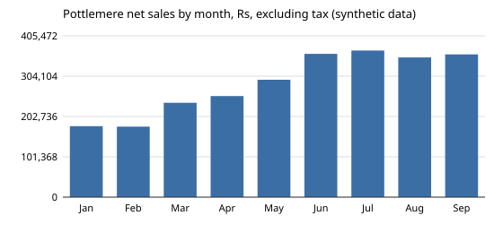

# Worked solution: the Pottlemere Q3 2026 QBR

Read this after you have built your own. The numbers come from `python3 solution/solution.py` on the committed (synthetic) data. The reasoning notes in italics say why each choice was made; they are not part of the page Anjali gets.

## The QBR table

Revenue in rupees, excluding tax. Q3 is compared with Q2 restated.

| Metric | Q2 as reported (3 July) | Q2 restated | Q3 | Q3 vs Q2 restated |
|---|---|---|---|---|
| Orders | 506 | 508 | 581 | +73 (+14.4%) |
| Customers | 384 | 386 | 437 | +51 (+13.2%) |
| New customers | 259 | 260 | 188 | -72 (-27.7%) |
| Returning customers | 125 | 126 | 249 | +123 (+97.6%) |
| Net sales | 904,134 | 909,240 | 1,078,637 | +169,397 (+18.6%) |
| Refunds (by refund date) | 37,372 | 37,372 | 68,503 | +31,132 (+83.3%) |
| Net revenue | 866,762 | 871,868 | 1,010,134 | +138,265 (+15.9%) |
| AOV | 1,787 | 1,790 | 1,857 | +67 (95% CI -65 to +198) |

New customers by acquisition channel: search 119 to 103, social 89 to 25, referral 50 to 58, unknown (missing from the customer table) 2 and 2.

*Reasoning: the "as reported" column is there so nobody has to ask why the Q2 number changed. Refunds get their own row because they grew much faster than sales; see the limits.*

## Reconciliation of Q3 net sales

| Step | Q3 total (Rs) | Moved by |
|---|---|---|
| Sum of `amount` over every raw row | 1,330,362 | |
| Keep the latest load per order | 1,222,314 | -108,048 |
| Keep completed orders | 1,122,870 | -99,443 |
| Remove the 12% tax from legacy (July) rows | 1,078,637 | -44,233 |

## The chart

Monthly net sales, excluding tax, synthetic data. Sales grew every month to June and then flattened: July 368,611, August 351,218, September 358,808.

*Reasoning: one unit across the whole series and a zero baseline. A chart of the stored `amount` would show a cliff on 1 August that is only the tax leaving the column.*

## The one-page write-up

**To:** Anjali Rao. **Re:** Q3 2026 QBR. **Data:** warehouse export of 26 October 2026; Q3 may still move slightly (see 5).

1. **Headline.** Q3 net revenue was Rs 1,010,134, up 15.9% on Q2. The growth came from returning customers, which almost doubled (126 to 249) as the customers we won in the first half kept buying. New customers fell 28% (260 to 188), and sales were flat from July to September.

2. **Did the new platform hurt sales? No evidence that it did.** The dashboard's 15% August fall is mostly a units problem: the old platform stored prices with tax, the new one without. In the same units, August is 4.7% below July. What is left lines up with paid social being paused for Q3: new customers from social fell from 89 in Q2 to 25 in Q3, while search and referral barely moved. The basket did not change: AOV moved by Rs +67, with a 95% interval from Rs -65 to Rs +198, so the data cannot tell it apart from zero. Recommendation: keep v2.

3. **Q2 has moved since July.** Q2 net revenue is Rs 871,868, not the Rs 866,762 we reported (+Rs 5,106, 0.6%). Eight Q2 order rows reached the warehouse after the 3 July report, three of them cancelling orders it had counted. The pack now shows the previous quarter restated and the as-of date of every number.

4. **Q4 focus.**
   - *Marketing (owner: head of marketing), from 2 November:* restart paid social at a test budget with a random holdout region or audience for four weeks, and report new customers and cost per new customer for test and holdout. Impact if social returns to its Q2 level: about 64 more new customers a quarter (89 - 25), worth about Rs 118,800 a quarter in first orders at the Q3 AOV of Rs 1,857, before ad cost, plus their later repeat orders. Assumptions: new social customers buy like Q3's average customer, and the same budget buys the same number of customers as in Q2.
   - *Finance and data (owner: Vikram), before the Q4 close:* adopt one rule for every report: latest load per order, completed only, revenue excluding tax, refunds by refund date, and show the previous quarter restated.

5. **Limits.**
   - We have no ad spend, so we cannot say whether pausing social saved more than it cost. The test in 4 answers that.
   - Q3 is not final. Rows still arrive for weeks; Q2 moved 0.6% after its report, so expect a similar small change.
   - Refunds by refund date mix quarters: Q3 refunds include refunds of June orders. The 83% rise in refunds needs a refund rate by order quarter before anyone calls it a quality problem.
   - Part of the returning-customer growth is the natural ageing of a shop that opened in January; it will slow as the base matures, which makes the acquisition gap more important for Q4.

*Reasoning for the recommendation: the brief offered a roll-back; the evidence says the platform is not the cause, so the write-up says so plainly and gives the alternative explanation with its number. It stops short of "the pause caused the fall", because with no spend data and no test the honest claim is "lines up with". The proposed test is what would turn that into a cause.*

## How this answer scores on the rubric

Every row scores 2: the four questions are answered in Anjali's order; the reconciliation and the restatement are shown; the August answer sizes the tax effect and what is left and gives the AOV interval; each action has an owner and a date; the impact has a number and its assumptions; four specific limits; one page with a zero-baseline chart.
