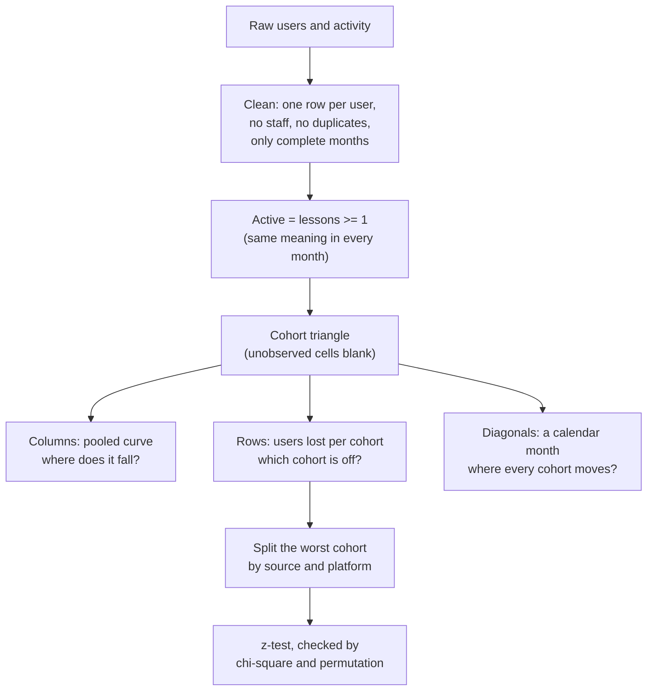

# Customer retention and cohort analysis

Business question: find where retention breaks and which cohort to study first.

## Before you start

- **Level:** 3 (advanced). A capstone: an ambiguous brief, messy tables, two competing stories, and one recommendation.
- **Time:** about 10 hours.
- **Builds on:** [Cohort retention](../../01-sql/04-cohort-retention/), [Retention curves and churn](../../03-metrics-and-product-analytics/08-retention-curves-and-churn/) (classic retention and right-censoring), [Segmentation and mix effects](../../03-metrics-and-product-analytics/09-segmentation-and-mix-effects/), [Diagnose a metric drop](../../03-metrics-and-product-analytics/10-diagnose-a-metric-drop/) (a tracking change that looks like a real drop), [Chi-square test](../../02-statistics-and-experiments/09-chi-square-test/) and [Hypothesis test by permutation](../../02-statistics-and-experiments/08-hypothesis-test-by-permutation/). The previous capstone, [E-commerce performance review](../01-ecommerce-performance-review/), shows how the files fit together.
- **You need:** Python 3.9 or later. Nothing to install.
- **How this capstone is built:** see the [phase README](../README.md). [BRIEF.md](BRIEF.md) is the request, [DELIVERABLES.md](DELIVERABLES.md) says what to hand in, [RUBRIC.md](RUBRIC.md) scores the parts with no single right answer, and `solution/` is the worked answer to read after you finish.

## The problem

Chordwhistle, a fictional guitar learning app, sees a cliff on its retention dashboard around June 2026. Lucia Ferrante, the CEO, hears two stories: the head of product blames the app redesign shipped on 2 June, and the head of growth wants to double the paid social budget for the holidays, repeating the April and May campaign. She needs, by Tuesday 13 October, where retention really breaks, which sign-up cohort the product team should study first, whether the redesign is to blame, and what it means for the holiday campaign. Read the full request and the data team's notes in [BRIEF.md](BRIEF.md).

The files in `data/` are synthetic, generated by `make_data.py` with a fixed seed. They are the raw export of 5 October 2026: `users.csv` (577 rows) and `activity.csv` (1,575 rows, one per user and month), for users who signed up from January to August 2026.

## In plain words

A gym wants to know if members keep coming. It groups members by the month they joined (the January joiners, the February joiners) and asks, for each group: what share still came in one month later, two months later, and so on. That table shows whether newer groups stick around less, and at which month people give up. Two traps: the gym changed its door scanner in June and stopped logging people who only used the café, so attendance seems to crash in June for everyone. And a big discount in April brought a crowd of bargain hunters who never came back, so April's group looks awful even though the regulars in it behaved as usual.

Terms used in this capstone:

- **Cohort:** a group of users who signed up in the same calendar month. The April cohort is everyone who signed up in April.
- **Month k:** the k-th calendar month after sign-up. Month 0 is the sign-up month, month 1 the next one.
- **Retention at month k (classic retention):** the share of a cohort active in month k, whatever they did in between.
- **Active:** completed at least one lesson in the month (product's definition).
- **Retention matrix (cohort triangle):** cohorts as rows, months since sign-up as columns, retention in the cells. It is a triangle because newer cohorts have fewer months behind them.
- **Right-censoring:** a month that has not happened yet for a cohort. It is unknown, not 0%.
- **Calendar diagonal:** cells that fall in the same calendar month (January's month 5, February's month 4, March's month 3 are all June). A pattern on a diagonal points to something that happened on a date; a pattern along a row points to the cohort.
- **Pooled curve:** retention at each month over all cohorts observed there, adding up active users and sizes before dividing.
- **Mix:** what a cohort is made of (here, its share of users by source). A cohort can look worse only because it holds more of a weak segment.
- **Users lost:** a cohort's size times the gap between the other cohorts' retention and its own. It ranks cohorts by how many people the gap cost, not by the rate alone.
- **Two-proportion z-test:** a test of whether two shares differ by more than chance. It gives a z (the gap in standard errors) and a p-value (how often a gap that large shows up when there is no real difference).
- **Chi-square statistic and permutation test:** two other routes to the same question. The test uses both to check your z-test independently.

## What you will build from scratch

- `clean_users` and `active_months`: one row per real user and the months each was active, by product's definition.
- `retention_matrix`: the cohort triangle with counts and rates, censored at September.
- `pooled_curve`: retention by month since sign-up across cohorts.
- `shortfall`: cohorts ranked by users lost at month 1.
- `two_proportion_z`: is the chosen cohort really worse than the rest?
- `retention_by_segment`: the chosen cohort split by source or platform.
- Your cohort table, a chart and a one-page write-up ([DELIVERABLES.md](DELIVERABLES.md)).

## The idea

Retention questions have a standard shape: fix the definition of active, build the triangle, then read it three ways: along columns (how a typical user decays), along rows (is one cohort different?), and along diagonals (did something happen on a date?). Only then split the outlier cohort by segment to see whether it is a different kind of user or the same kind of user doing worse.



The formulas, written once:

- retention(c, k) = active users of cohort c in month c + k / size(c)
- pooled(k) = sum over cohorts observed at k of active(c, k) / sum of size(c)
- users lost(c, k) = size(c) x (pooled rate of the other cohorts at k - retention(c, k))
- z = (p1 - p2) / sqrt(p (1 - p) (1/n1 + 1/n2)), p = (x1 + x2) / (n1 + n2); two-sided p-value = erfc(abs(z) / sqrt(2))

Why rank by users lost and not by the rate: a 30-user cohort at 20% and a 130-user cohort at 25% are both poor, but the second one cost more people, and a study of it has more users to interview. Why compare with the other cohorts and not with all of them: including the cohort in its own baseline pulls the baseline toward it and shrinks the gap.

Why two checks on the z-test: for a 2 x 2 table (cohort or not, active or not), z squared equals the chi-square statistic exactly, a different formula built from expected counts. A permutation test reaches the p-value a third way: shuffle the "active" labels between the two groups thousands of times and count how often the shuffled gap is as large as the real one. If all three agree, the arithmetic is right; whether the comparison is the right one is still your judgement.

## Walk through

This walk through finds the mess and shows the false cliff. It stops before the cohort ranking and the test, which are yours to build. Run the blocks in order in one Python session started in this folder (`python3`).

Step 1. Load both files and compare rows with distinct records.

```python
import csv
from collections import Counter

def read(name):
    with open("data/" + name + ".csv", newline="") as f:
        return list(csv.DictReader(f))

users, activity = read("users"), read("activity")
print("users rows", len(users), "distinct", len({u["user_id"] for u in users}))
pairs = Counter((r["user_id"], r["activity_month"]) for r in activity)
print("activity rows", len(activity), "distinct user-months", len(pairs),
      "repeated", sum(1 for n in pairs.values() if n > 1))
print(Counter(u["account_type"] for u in {u["user_id"]: u for u in users}.values()))
```

```
users rows 577 distinct 565
activity rows 1575 distinct user-months 1526 repeated 49
Counter({'customer': 560, 'staff': 5})
```

Twelve user rows and 49 user-months are repeats, and 5 accounts are staff. Counting rows would inflate every number; count distinct users.

Step 2. The definition change and the partial month. Count rows and zero-lesson rows per month.

```python
by_month = {}
for r in activity:
    n, zero = by_month.get(r["activity_month"], (0, 0))
    by_month[r["activity_month"]] = (n + 1, zero + (r["lessons_completed"] == "0"))
for month, (n, zero) in sorted(by_month.items()):
    print(month, "rows %3d" % n, "with 0 lessons %3d" % zero)
print("October rows loaded on:", sorted({r["loaded_at"] for r in activity if r["activity_month"] == "2026-10"}))
```

```
2026-01 rows  52 with 0 lessons   4
2026-02 rows  95 with 0 lessons  10
2026-03 rows 142 with 0 lessons  37
2026-04 rows 242 with 0 lessons  47
2026-05 rows 260 with 0 lessons  74
2026-06 rows 174 with 0 lessons   0
2026-07 rows 175 with 0 lessons   0
2026-08 rows 197 with 0 lessons   0
2026-09 rows 176 with 0 lessons   0
2026-10 rows  62 with 0 lessons   0
October rows loaded on: ['2026-10-05']
```

Zero-lesson rows exist until May and vanish from June: the logging change in the data team's note. Rows per month fall from 260 to 174 in June partly for that reason alone. October was loaded on 5 October, five days in: it is not a complete month, so the last month you can use is September.

Step 3. The dashboard's cliff. Build three cohorts' rows two ways: "any row means active" (what the dashboard does) and product's definition.

```python
def months_between(start, end):
    return (int(end[:4]) - int(start[:4])) * 12 + int(end[5:7]) - int(start[5:7])

customers = {u["user_id"]: u["signup_date"][:7] for u in users if u["account_type"] == "customer"}

def cohort_row(cohort, rule):
    ids = {uid for uid, c in customers.items() if c == cohort}
    seen = {}
    for r in activity:
        if r["user_id"] in ids and r["activity_month"] <= "2026-09" and rule(r):
            seen.setdefault(months_between(cohort, r["activity_month"]), set()).add(r["user_id"])
    return " ".join("%3.0f%%" % (100 * len(seen.get(k, ())) / len(ids)) for k in range(months_between(cohort, "2026-09") + 1))

for cohort in ("2026-02", "2026-03", "2026-04"):
    print(cohort, "any row     ", cohort_row(cohort, lambda r: True))
    print(cohort, "lessons >= 1", cohort_row(cohort, lambda r: int(r["lessons_completed"]) >= 1))
```

```
2026-02 any row       92%  75%  72%  43%  36%  36%  30%  28%
2026-02 lessons >= 1  90%  49%  48%  38%  36%  36%  30%  28%
2026-03 any row       95%  65%  58%  25%  20%  20%  18%
2026-03 lessons >= 1  84%  33%  33%  25%  20%  20%  18%
2026-04 any row       94%  60%  26%  25%  28%  28%
2026-04 lessons >= 1  87%  29%  26%  25%  28%  28%
```

With "any row", March falls from 58% to 25% at month 3 and April from 60% to 26% at month 2. Both of those cells are June: the cliff sits on a calendar diagonal, the signature of something that happened on a date. With lessons >= 1 the same cohorts fall at month 1 (from 84% to 33%, from 87% to 29%) and then stay roughly flat, and the rows agree from June on because the two definitions are identical from June. The dashboard's cliff is the logging change. The redesign shipped the same week, which is why it got the blame.

Step 4. What the cohorts are made of.

```python
mix = {}
for u in {u["user_id"]: u for u in users if u["account_type"] == "customer"}.values():
    mix.setdefault(u["signup_date"][:7], Counter())[u["source"]] += 1
for cohort, c in sorted(mix.items()):
    n = sum(c.values())
    print(cohort, "size %3d" % n, "paid_social %3.0f%%" % (100 * c["paid_social"] / n))
```

```
2026-01 size  52 paid_social  13%
2026-02 size  61 paid_social  18%
2026-03 size  55 paid_social  25%
2026-04 size 136 paid_social  68%
2026-05 size  93 paid_social  51%
2026-06 size  62 paid_social  13%
2026-07 size  48 paid_social  12%
2026-08 size  53 paid_social  11%
```

The April and May cohorts are more than twice the usual size, and half or more of them came from paid social. Before calling April or May "broken", you need to know whether paid social users retain worse in every cohort. That is what `retention_by_segment` answers. Now build the rest: the functions in `exercise.py`, the cohort table, the chart and the write-up.

## Common mistakes

**1. Counting any row as active (the trap).** Step 3 shows it: the "any row" definition adds 26 points to February's month 1 and makes a cliff on the June diagonal that is only the logging change. A definition must mean the same thing in every month of the window; lessons >= 1 does, "has a row" does not.

**2. Showing months that have not happened as 0%.** The August cohort has been observed for two months. Filling its months 2 to 8 with 0% makes the newest cohorts look like disasters and drags the pooled curve down. Leave them blank, and pool each month over the cohorts observed there.

**3. Using October.** October's rows cover five days. Including them makes month 1 of the September cohort, month 2 of August, and so on look terrible. Stop at the last complete month.

**4. Averaging cohort rates instead of pooling counts.** The mean of eight cohort rates gives a 48-user cohort the same weight as a 136-user one. Add active users and sizes, then divide.

**5. Calling the cohort the cause.** April and May have the worst month 1, but split by source and the gap moves to the users: paid social users retain far worse in every cohort, and the campaign months simply held more of them. "Fix the April cohort" is not an action; "find out why paid social users stop after month 0" is.

**6. Comparing a cohort with a baseline that includes itself.** The pooled rate of all cohorts includes the one you are testing, which shrinks the gap and the z. Compare with the others.

## Your turn

Open [DELIVERABLES.md](DELIVERABLES.md). It lists everything to hand in and the definitions the test uses. Start with `exercise.py`: fill in every function, then run, from this folder:

    python3 test_lesson.py

The test runs your functions on the committed data, on a second dataset built from another seed, and on hand-made tables: a duplicate user, a staff account, a zero-lesson row, a row before sign-up, an October row, a cohort observed only at month 0, cohorts of different sizes to pool, a cohort with no others to compare with, and groups with no successes. To check the reference answer: `CHECK_SOLUTION=1 python3 test_lesson.py`.

Then build the cohort table, the chart and the one-page write-up, and score them with [RUBRIC.md](RUBRIC.md). Read `solution/` only after that: [solution/WRITEUP.md](solution/WRITEUP.md) is a two-point answer on every rubric row, with the reasoning.

Stretch: classic retention counts a user active in month 3 even if they skipped month 2. Compute unbounded retention (active in month k or any later observed month) for the paid social users. Does the gap with organic users shrink, and what would that mean for the campaign?

## Check yourself

1. The dashboard shows every cohort dropping in June. What two explanations would produce that, and how does the triangle tell them apart?
2. Why rank cohorts by users lost rather than by month-1 retention?
3. The May cohort's month-1 retention is significantly below the others (p under 0.01). Does that mean something went wrong in May?
4. Priyanka says the April campaign doubled sign-ups, so it worked. What do you answer?

<details>
<summary>Answers</summary>

1. A real event in June (the redesign) or a measurement change in June (the logging job). Both put the drop on the June diagonal. The difference: a measurement change disappears when you use a definition that means the same thing before and after (lessons >= 1); a real event does not. Here the cliff vanishes, so it was the measurement.
2. A rate alone favours small cohorts with noisy rates. Users lost weighs the gap by how many people it applied to, which is what matters for the business and for how many users the product team can study.
3. It means the May cohort retained worse than the others, not why. Split by source: May's organic users retain like organic users elsewhere; its paid social users retain like paid social users elsewhere (about 12% at month 1 against 47% for organic). May looks bad because half of it came from paid social.
4. It doubled sign-ups, but about 12% of paid social users are still active a month later, against 47% of organic users. Judge the campaign on users still active after a month per rupee, which needs the ad spend we do not have yet, before doubling it.

</details>

## What to tell the stakeholder

To Lucia: "Retention breaks in the first month after sign-up, and almost entirely for users from paid social ads: 12% of them are still practising a month later against 47% of organic users, and that holds in every cohort. The June cliff on the dashboard is a logging change in the same week as the redesign, not the redesign. I recommend the product team study the May paid social users first (May lost the most users against the other cohorts, p under 0.01) and that we test the holiday campaign small and judge it on users still active after a month before doubling it; we cannot size the money until we have ad spend."

## In real job postings

In the Real Analyst Jobs data drop of 25 October 2026, 1,477 of the 2,056 US analyst postings that name a tool (71.8%) ask for SQL, and 996 (48.4%) ask for Python, the two tools cohort triangles like this one are usually built with. See [product analyst jobs](https://realanalystjobs.com/jobs/product-analyst-jobs) and [SQL data analyst jobs](https://realanalystjobs.com/jobs/sql-data-analyst-jobs).

## Next

[10-03: Marketing attribution and campaign effectiveness](../03-marketing-attribution/)
