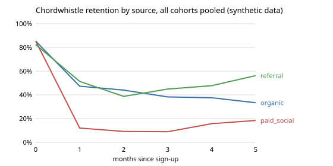

# Worked solution: where Chordwhistle's retention breaks

Read this after you have built your own. The numbers come from `python3 solution/solution.py` on the committed (synthetic) data. The reasoning notes in italics say why each choice was made; they are not part of the page Lucia gets.

## Cleaning, and what each step changed

| Step | Effect |
|---|---|
| One row per user_id | 577 user rows to 565 users |
| Drop staff accounts | 565 to 560 users |
| Active = lessons_completed >= 1 | removes 172 zero-lesson rows (January to May only) |
| One row per user and month | 49 repeated user-months removed |
| Stop at September 2026 | October holds 5 days of data |

## The cohort table

Retention by month since sign-up (classic: active in that month). Blank = not observed yet.

| Cohort | Size | M0 | M1 | M2 | M3 | M4 | M5 | M6 | M7 | M8 |
|---|---|---|---|---|---|---|---|---|---|---|
| 2026-01 | 52 | 85% | 44% | 37% | 35% | 38% | 37% | 33% | 31% | 31% |
| 2026-02 | 61 | 90% | 49% | 48% | 38% | 36% | 36% | 30% | 28% | |
| 2026-03 | 55 | 84% | 33% | 33% | 25% | 20% | 20% | 18% | | |
| 2026-04 | 136 | 87% | 29% | 26% | 25% | 28% | 28% | | | |
| 2026-05 | 93 | 82% | 24% | 22% | 23% | 27% | | | | |
| 2026-06 | 62 | 85% | 31% | 26% | 26% | | | | | |
| 2026-07 | 48 | 88% | 48% | 38% | | | | | | |
| 2026-08 | 53 | 79% | 47% | | | | | | | |
| Pooled | | 85.0% | 35.7% | 30.6% | 27.5% | 29.2% | 29.6% | 26.8% | 29.2% | 30.8% |

Users lost at month 1 against the other cohorts: May 13.4, April 11.3, June 3.5, March 1.8; January, July, August and February lost fewer than the others would have.

May against the other cohorts at month 1: 24% against 38%, a gap of 14.5 points, z = -2.66, p = 0.008.

Month-1 retention by source, all cohorts pooled: organic 47% (139 of 294), referral 51% (38 of 74), paid social 12% (23 of 192). In May: organic 41% (14 of 34), paid social 9% (4 of 47). By platform in May: Android 23%, iOS 24%.

*Reasoning: the ranking says May by a small margin over April. Both are the campaign months and share one cause, so the write-up names May for the study and the paid social users of both months as the target. Platform shows nothing, which rules out an Android or iOS bug.*

## The chart

Pooled retention by months since sign-up, one line per source, synthetic data. Each point pools the cohorts observed at that month, so later points rest on fewer, older cohorts (month 5 uses January to April only, and the paid social line there rests on a few dozen users).

## The one-page write-up

**To:** Lucia Ferrante. **Re:** where retention breaks. **Data:** export of 5 October 2026, sign-ups January to August, activity to September.

1. **Answer.** Retention breaks in the first month after sign-up, and almost entirely for users who came from paid social ads: 12% of them complete a lesson in their second month, against 47% of organic and 51% of referral users. That gap holds in every cohort.

2. **The cohort to study first: May**, then April. May lost the most users at month 1 against the other cohorts (13 users; April 11), and its month-1 retention of 24% is clearly below the other cohorts' 38% (p = 0.008). Both are the paid social campaign months: half of May and two thirds of April came from paid social. The study should be about those users, not about the month: interview May and April paid social users who completed a lesson in their first month and none in the second.

3. **The June cliff is a logging change, not the redesign.** Until May, the activity job also logged users who opened the app without completing a lesson; from 1 June it stopped. The dashboard counts any row as active, so every cohort drops in June. With the product definition (at least one lesson), the cliff disappears and the curves are flat after month 1. The redesign shipped the same week, which is why it got the blame. Recommendation: keep the redesign, and switch the dashboard to lessons >= 1 for every month.

4. **What to do.**
   - *Product (owner: Tomas), interviews done by 13 November, onboarding experiment live by 30 November:* study the May and April paid social users, then test an onboarding change for paid social sign-ups against the current one, with month-1 retention as the metric.
   - *Growth (owner: Priyanka), before the holiday budget is set:* run the holiday paid social campaign at a test budget first and judge it on users still active after a month, per rupee. Expected effect, with assumptions: a campaign the size of April's brings about 90 paid social sign-ups; at today's 12% month-1 retention that is about 11 users still practising a month later; if they retained like organic users it would be about 44. Doubling the budget doubles the 11, not the sign-up count, unless onboarding changes.

5. **Limits.**
   - No ad spend or revenue: we cannot say whether paid social users are worth their cost, only that few of them stay.
   - Observational data: paid social users may simply be less committed. The onboarding experiment, not this analysis, will show whether retention can be changed.
   - Later months rest on few cohorts and small paid social groups (a few dozen users), so the curves after month 3 are noisy.
   - Classic retention ignores comebacks; a user who skips a month counts as lost that month.

*Reasoning for the recommendation: the brief offered two stories, and both were partly wrong. The redesign is cleared by a definition check, and the campaign "worked" only on sign-ups. The write-up turns both into actions that produce evidence (a test budget, an onboarding experiment) instead of a verdict the data cannot support.*

## How this answer scores on the rubric

Every row scores 2: the four questions are answered in Lucia's order; each cleaning step is stated; the break is placed at month 1 and in the paid social users; the cohort is chosen by users lost with a test; the June cliff is shown to be the logging change; each action has an owner and a date with assumptions; four specific limits.
