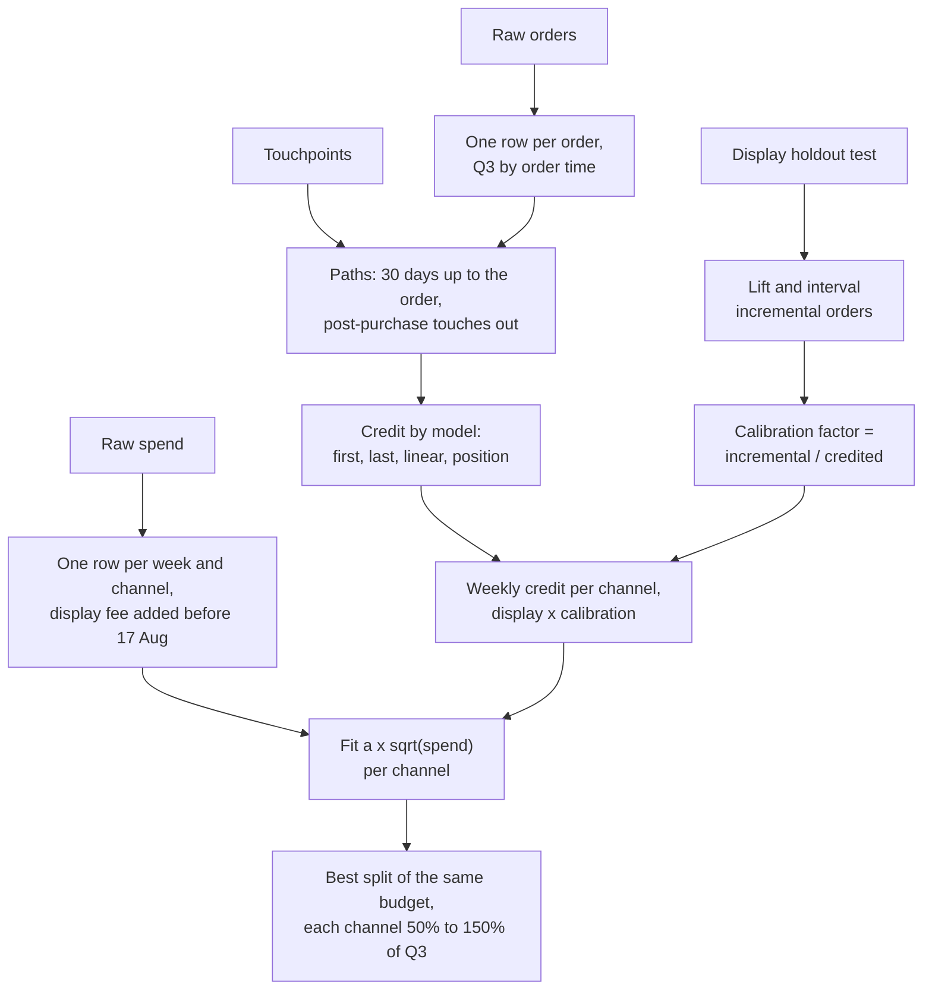

# Marketing attribution and campaign effectiveness

Business question: reallocate next quarter's budget across channels, and defend it.

## Before you start

- **Level:** 3 (advanced). A capstone: an ambiguous brief, messy tables, an experiment to read, and a budget to optimise.
- **Time:** about 10 hours.
- **Builds on:** [Attribution models](../../03-metrics-and-product-analytics/11-attribution-models/), [Marketing: is the campaign incremental?](../../09-business-case-studies/03-marketing-is-the-campaign-incremental/) (holdouts), [Growth: why is CAC rising?](../../09-business-case-studies/07-growth-why-is-cac-rising/), [A/B test from scratch](../../02-statistics-and-experiments/03-ab-test-from-scratch/), [Linear regression from scratch](../../02-statistics-and-experiments/11-linear-regression-from-scratch/) and [Bootstrap intervals](../../02-statistics-and-experiments/12-bootstrap-intervals/). The first capstone, [E-commerce performance review](../01-ecommerce-performance-review/), shows how the files fit together.
- **You need:** Python 3.9 or later. Nothing to install.
- **How this capstone is built:** see the [phase README](../README.md). [BRIEF.md](BRIEF.md) is the request, [DELIVERABLES.md](DELIVERABLES.md) says what to hand in, [RUBRIC.md](RUBRIC.md) scores the parts with no single right answer, and `solution/` is the worked answer to read after you finish.

## The problem

Brambletoe, a fictional online running shop in India, keeps its Q4 paid media budget the same as Q3's and must split it between paid search, paid social and display. The display agency's report says display has the lowest cost per order and proposes moving a third of the search budget into display. Sana Mirza, the CFO, does not trust last-click credit and wants a split she can defend at the budget meeting on Thursday 22 October 2026, using the display holdout test marketing ran in August. No channel may move by more than half of its Q3 spend. Read the full request and the data team's notes in [BRIEF.md](BRIEF.md).

The files in `data/` are synthetic, generated by `make_data.py` with a fixed seed. They are the raw export of 12 October 2026: `spend.csv` (60 rows, weekly per channel), `touchpoints.csv` (1,558 rows), `orders.csv` (913 rows) and `display_test.csv` (1,800 users).

## In plain words

A bakery hands out flyers at the station, puts an ad in the paper, and has a sign at its door. Every customer who walks in has seen the door sign last, so "last thing seen" gives the sign all the credit. But the sign mostly catches people who were already walking to the bakery. To know what the sign adds, cover it for half the days and compare. Then, with a fixed amount to spend, give the next rupee to whichever of flyers, paper or sign brings the most extra customers for it, and keep doing that until the next rupee brings the same everywhere.

Terms used in this capstone:

- **Touch (touchpoint):** one ad click or view, or email open, tied to a user and a time.
- **Path:** the touches a buyer had in the 30 days up to the order, oldest first.
- **Attribution model:** a rule that shares one order's credit among the touches in its path: first touch, last touch, linear (equal shares) or position-based (40% first, 40% last, 20% for the middle).
- **Lookback window:** how far back a touch can be and still get credit, here 30 days.
- **CPA (cost per acquisition):** spend divided by the orders credited to a channel.
- **Incremental orders (incrementality):** orders that happened because of the channel, which a holdout test measures. Attribution only measures who was touched.
- **Holdout test:** users randomly split into exposed (see the ads) and holdout (do not). The difference in conversion is the lift.
- **Lift and Wald interval:** lift = conversion exposed - conversion holdout. The Wald interval is lift +/- 1.96 x SE, with SE built from each group's own rate.
- **Calibration factor:** incremental orders / attributed orders for the same users. Below 1 means the model over-credits the channel.
- **Response curve:** how orders grow with spend. Here assumed to be a x sqrt(spend): each extra rupee buys a little less than the one before (diminishing returns).
- **Marginal cost per extra order:** what the next order costs at the current spend. With the square-root curve it is 2 x sqrt(weekly spend) / a.
- **Optimisation with bounds:** choosing the split that gives the most predicted orders for a fixed budget, with each channel kept between a lower and an upper limit.

## What you will build from scratch

- `clean_spend` and `clean_orders`: one value per week and channel including fees, one row per order inside the quarter.
- `attribute`: credit per channel under four models, with the window and the post-purchase touches handled.
- `holdout_lift` and `calibration_factor`: what display really adds, with an interval the test checks against a bootstrap.
- `fit_sqrt_response`: one response curve per channel from 13 weekly points.
- `allocate`: the best split under bounds, which the test checks against a brute-force grid search.
- `plan`: the whole chain, from raw data to a Q4 budget.
- Your attribution table, test readout, budget proposal, chart and one-page write-up ([DELIVERABLES.md](DELIVERABLES.md)).

## The idea

Attribution and incrementality answer different questions. Attribution asks "which ads did buyers see?" and shares the credit by a rule; every model's credits add up to the number of orders, and none of them knows what would have happened without the ad. A holdout test asks "how many more orders did the ad cause?" and answers it for one channel, in one period. A defensible budget uses attribution for the week-by-week shape (which is all you have for most channels) and the test to correct the level where you have one.



The optimisation, from first principles. Predicted orders per week are a_c x sqrt(s_c) for each channel c with weekly spend s_c. The extra orders from one more rupee are a_c / (2 sqrt(s_c)), which shrinks as spend grows. If one channel's next rupee brings more than another's, moving a rupee raises the total, so at the best split every channel inside its limits has the same marginal return. Write that common value as lambda: s_c = (a_c / (2 lambda))^2, then clip to the channel's limits. A bigger lambda means less spend everywhere, so search for the lambda whose clipped spends add up to the budget (bisection: halve the interval until it is tiny). Without limits this gives spend in proportion to a_c squared.

Two checks that do not trust the formulas. The test builds a grid of every split in 1.7% steps inside the limits and checks that none beats yours. It also resamples each test group 1,000 times (the bootstrap) and checks your lift's SE is within 10% of the spread of the resampled lifts.

## Walk through

This walk through finds the mess and reproduces the agency's number. It stops before the attribution models, the test readout and the plan, which are yours to build. Run the blocks in order in one Python session started in this folder (`python3`).

Step 1. Load the four files and compare rows with distinct records.

```python
import csv, datetime
from collections import Counter

def read(name):
    with open("data/" + name + ".csv", newline="") as f:
        return list(csv.DictReader(f))

spend, touches, orders, test = read("spend"), read("touchpoints"), read("orders"), read("display_test")
print("spend rows", len(spend), "distinct week-channels", len({(r["week_start"], r["channel"]) for r in spend}))
print("order rows", len(orders), "distinct order_ids", len({r["order_id"] for r in orders}))
print("orders by month", sorted(Counter(r["order_time"][:7] for r in orders).items()))
print("display test", Counter(r["grp"] for r in test))
```

```
spend rows 60 distinct week-channels 52
order rows 913 distinct order_ids 882
orders by month [('2026-06', 74), ('2026-07', 221), ('2026-08', 363), ('2026-09', 233), ('2026-10', 22)]
display test Counter({'holdout': 928, 'exposed': 872})
```

Eight spend rows repeat (two weeks for four channels) and 31 orders were fired twice by the pixel. The file also holds orders from the week before and the week after Q3; Q3 is 29 June to 27 September, by order time. August is busy partly because the display test audience ordered then.

Step 2. The display fee. Look at the display rows around the change.

```python
for r in spend:
    if r["channel"] == "display" and "2026-08-03" <= r["week_start"] <= "2026-08-24":
        print(r["week_start"], r["spend"])
```

```
2026-08-03 52260.87
2026-08-03 52260.87
2026-08-10 33826.09
2026-08-17 61600.00
2026-08-24 53100.00
```

Before 17 August the amounts have paise (52,260.87 is 60,100 / 1.15): the agency was reporting media cost without its fee. From 17 August the amounts are round: fee included. Weekly spend moves too much to see a 15% step by eye, which is why the data team's note matters. The week of 3 August also shows the duplicate.

Step 3. Which touches can get credit? Compare each Q3 buyer's touches with the order time.

```python
first = {}
for r in sorted(orders, key=lambda r: r["loaded_at"]):
    if "2026-06-29" <= r["order_time"][:10] <= "2026-09-27":
        first.setdefault(r["order_id"], r)
q3 = list(first.values())
when = {r["user_id"]: datetime.datetime.strptime(r["order_time"], "%Y-%m-%d %H:%M") for r in q3}
kinds = Counter()
for t in touches:
    if t["user_id"] in when:
        gap = when[t["user_id"]] - datetime.datetime.strptime(t["touch_time"], "%Y-%m-%d %H:%M")
        kinds["after the order" if gap < datetime.timedelta(0) else
              "more than 30 days before" if gap > datetime.timedelta(days=30) else "in the window"] += 1
print(len(q3), "Q3 orders")
print(kinds)
```

```
783 Q3 orders
Counter({'in the window': 1073, 'after the order': 230, 'more than 30 days before': 70})
```

230 touches come after the order (confirmation and follow-up emails), and 70 are older than the 30-day window. A model that counts them gives email credit for orders it could not have caused.

Step 4. The agency's number. Last touch before the order, no window, spend as stored.

```python
last = {}
for r in q3:
    path = sorted((t["touch_time"], t["channel"]) for t in touches
                  if t["user_id"] == r["user_id"] and t["touch_time"] <= r["order_time"])
    ch = path[-1][1] if path else "(none)"
    last[ch] = last.get(ch, 0) + 1
stored = {}
for r in {(r["week_start"], r["channel"]): r for r in spend}.values():
    stored[r["channel"]] = stored.get(r["channel"], 0.0) + float(r["spend"])
for ch in sorted(stored):
    print("%-12s last-click orders %3d  spend %8.0f  cost per order %5.0f" % (ch, last[ch], stored[ch], stored[ch] / last[ch]))
```

```
display      last-click orders 303  spend   662409  cost per order  2186
email        last-click orders  64  spend   104000  cost per order  1625
paid_search  last-click orders 200  spend   749000  cost per order  3745
paid_social  last-click orders 113  spend   581200  cost per order  5143
```

On these numbers display costs Rs 2,186 an order against Rs 3,745 for search, and moving search money into display looks obvious. Two things flatter display here: its early weeks are missing the fee, and display ads are often the last thing a buyer sees just before an order they had already decided on. The fee is a cleaning fix. The second needs the holdout test: that is your `holdout_lift` and `calibration_factor`. Now build the rest: the functions in `exercise.py`, the tables, the chart and the write-up.

## Common mistakes

**1. Trusting the cost per order from attribution (the trap).** Step 4 shows display at Rs 2,186 an order. Attribution says who was touched, not who was persuaded. Display reaches many people who were about to buy; the August holdout shows only a fraction of its credited orders are extra orders. Use a test to correct the level before you move money.

**2. Mixing spend definitions.** Without the fee, display's Q3 spend is Rs 662,409 instead of Rs 711,100, 7% too cheap, and only in the weeks before 17 August, which also bends its weekly response curve.

**3. Counting touches after the order.** Post-purchase emails sit in the same table. A model that does not cut the path at the order time gives email credit for 230 touches that came after the sale.

**4. Reading the lift without its interval.** "Display brought 16 extra orders in the test" sounds precise. The 95% interval for the lift runs from below zero to about four points; the test was small. It is still evidence that display's incremental orders are well below its credit, but say how wide the range is and propose a bigger test.

**5. Optimising without limits, or believing the curve far from the data.** The unbounded optimum puts money in proportion to a squared and can push a channel far outside any spend level it has had. The square-root curve was fitted on Q3's range only. Keep the 50% limit and treat the predicted gain as an estimate.

**6. Choosing the model that gives the answer you like.** First, last, linear and position-based give different credits; picking one after seeing the results is not analysis. Use the spread between models to show how uncertain credit is, and the test for the one channel where you can measure.

## Your turn

Open [DELIVERABLES.md](DELIVERABLES.md). It lists everything to hand in, the definitions and the planning steps the test uses. Start with `exercise.py`: fill in every function, then run, from this folder:

    python3 test_lesson.py

The test runs your functions on the committed data, on a second dataset built from another seed, and on hand-made tables: a duplicate spend row, a display week on each side of the fee change, an order on each edge of Q3, a touch exactly 30 days before, one 30 days and a minute before, one at the same minute as the order and one after it, paths of one, two and four touches, a user with two orders in the test, an exact square-root curve, and budgets where a bound binds or no split is possible. To check the reference answer: `CHECK_SOLUTION=1 python3 test_lesson.py`.

Then build the tables, the chart and the one-page write-up, and score them with [RUBRIC.md](RUBRIC.md). Read `solution/` only after that: [solution/WRITEUP.md](solution/WRITEUP.md) is a two-point answer on every rubric row, with the reasoning.

Stretch: how many test users would the display holdout need for the 95% interval of the lift to exclude zero, if the true lift is what this test measured? Use the SE formula, not a guess, and turn it into a Q4 test proposal.

## Check yourself

1. Every attribution model's credits add up to the number of orders. Why does that make attribution unable to show that a channel adds nothing?
2. The display test's interval includes zero. Why is it still reasonable to cut display?
3. Why does the best split leave paid search and paid social with the same marginal cost per extra order?
4. The plan predicts only about 2% more orders for the same budget. Is that worth a fight with the agency?

<details>
<summary>Answers</summary>

1. The models only share out orders that happened among the touches that were there. An order with a display touch gives display some credit under every model except first-touch when display was not first, whatever display caused. Only a comparison with people who did not see the ads (a holdout) can show that a channel adds nothing.
2. The question is not whether display adds exactly zero but whether it adds as much as its credit. The test puts display's incremental orders at about 0.42 of its linear credit; even the top of the interval is near its credit, not above it. Cutting display to the 50% floor is a bounded bet, and the Q4 test will narrow the range.
3. If one channel's next rupee brought more orders than another's, moving a rupee from the second to the first would raise the total. The split stops improving only when the marginal returns are equal, or when a channel hits its limit, as display does at the 50% floor.
4. Yes, but say it honestly. About nine more orders a quarter for the same money is small; the bigger value is not moving a third of search into display, which on the calibrated curves would lose orders, and running a bigger test so the Q1 decision rests on better evidence.

</details>

## What to tell the stakeholder

To Sana: "For Q4, I recommend cutting display to Rs 355,550 (half its Q3 spend, the most Daniel allows), and moving the money to paid search (Rs 965,663) and paid social (Rs 720,087), same total. The August holdout shows display brings about 0.42 extra orders for every order attribution credits it with, so the agency's low cost per order is mostly people who were already on their way to buy. On fitted response curves this split predicts about 9 more orders a quarter (2%), but the test was small (its interval includes zero) and the curves only cover Q3's spend range, so we should run a larger display holdout and a first paid search holdout in Q4 before going further."

## In real job postings

In the Real Analyst Jobs data drop of 25 October 2026, 1,477 of the 2,056 US analyst postings that name a tool (71.8%) ask for SQL and 996 (48.4%) ask for Python, the tools marketing analysts use to build attribution paths and read holdout tests. Check a test readout with the [A/B test calculator](https://realanalystjobs.com/tools/ab-test-calculator), or browse [SQL data analyst jobs](https://realanalystjobs.com/jobs/sql-data-analyst-jobs).

## Next

[10-04: SaaS subscription and churn analysis](../04-saas-churn/)
