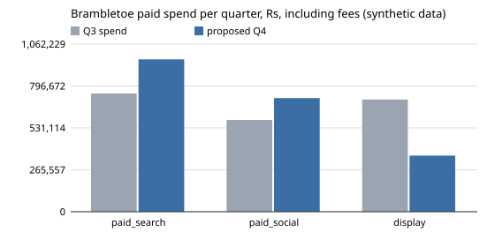

# Worked solution: Brambletoe's Q4 paid budget

Read this after you have built your own. The numbers come from `python3 solution/solution.py` on the committed (synthetic) data. The reasoning notes in italics say why each choice was made; they are not part of the page Sana gets.

## Cleaning, and what each step changed

| Step | Effect |
|---|---|
| One spend value per week and channel | 60 rows to 52 (two weeks exported twice) |
| Add the 15% fee to display before 17 August | display Q3 spend Rs 662,409 to Rs 711,100 |
| One row per order_id | 913 rows to 882 orders (pixel fired twice) |
| Q3 by order time, 29 June to 27 September | 882 to 783 orders |
| Paths cut at the order time and 30 days back | 230 post-purchase and 70 old touches of Q3 buyers get no credit |

## The attribution table

Q3 spend including fees: paid search Rs 749,000, paid social Rs 581,200, display Rs 711,100, email Rs 104,000. 115 of the 783 orders had no touch in the window.

| Channel | First | Last | Linear | Position | CPA first | CPA last | CPA linear | CPA position |
|---|---|---|---|---|---|---|---|---|
| Paid search | 152.0 | 196.0 | 177.8 | 176.4 | 4,928 | 3,821 | 4,214 | 4,246 |
| Paid social | 160.0 | 111.0 | 135.4 | 135.6 | 3,632 | 5,236 | 4,292 | 4,286 |
| Display | 214.0 | 297.0 | 249.8 | 251.9 | 3,323 | 2,394 | 2,847 | 2,823 |
| Email | 142.0 | 64.0 | 105.1 | 104.1 | | | | |

Display calibrated (linear credit x 0.417): 104.2 orders, CPA Rs 6,826.

Every model ranks display as the cheapest paid channel, and the models disagree by up to 44% on the cost of a paid social order. The spread shows how much of "credit" is a choice of rule; none of the four can tell which orders display caused.

## The test readout

| | Exposed | Holdout |
|---|---|---|
| Users | 872 | 928 |
| Converted (3 to 30 August) | 7.57% | 5.71% |

Lift 1.86 points, 95% interval -0.45 to +4.16 points. Incremental orders 16.2 (interval roughly -4 to +36). Linear attribution gave display 38.8 orders among the exposed users in the window, so the calibration factor is 16.2 / 38.8 = 0.417.

*Reasoning: the interval includes zero, so the test alone cannot prove display adds anything. But the question for the budget is whether display earns its credit, and even the top of the interval (about 36) is below its 38.8 credited orders. The point estimate is used for planning; the width goes in the limits.*

## The budget proposal

| Channel | Q3 spend | Proposed Q4 | Change | Marginal cost per extra order, Q3 split | Proposed split |
|---|---|---|---|---|---|
| Paid search | 749,000 | 965,663 | +216,663 (+28.9%) | 8,469 | 9,616 |
| Paid social | 581,200 | 720,087 | +138,887 (+23.9%) | 8,639 | 9,616 |
| Display | 711,100 | 355,550 | -355,550 (-50.0%) | 13,773 | 9,739 |
| Total | 2,041,300 | 2,041,300 | 0 | | |

Fitted curves (orders per week = a x sqrt(weekly spend)): paid search a = 0.0567, paid social 0.0489, display 0.0340 after calibration.

Predicted orders from paid channels per quarter: 414.7 at the Q3 split, 423.6 at the proposed split (+8.9, +2.1%). The agency's proposal (a third of search moved into display) predicts 399.0, 15.7 fewer than today.

*Reasoning: search and social end with the same marginal cost (Rs 9,616), which is what an optimum looks like. Display stops at the 50% floor with a marginal cost still slightly higher (Rs 9,739): without Daniel's limit the optimiser would cut it further, which is a reason to test, not to override the limit.*

## The chart

Q3 spend against proposed Q4 spend, rupees including fees, synthetic data.

## The one-page write-up

**To:** Sana Mirza. **Re:** Q4 paid budget. **Data:** export of 12 October 2026, Q3 = 29 June to 27 September.

1. **Proposal.** Same total budget, Rs 2,041,300. Display down to Rs 355,550 (half of Q3), paid search up to Rs 965,663 (+29%) and paid social up to Rs 720,087 (+24%). On our fitted response curves this predicts about 424 paid-channel orders a quarter against 415 today (+2%); the agency's proposal predicts about 399.

2. **Why not the agency's split.** Their report gives each order to the last ad seen. Display is often the last thing people see just before an order they were already going to place, so it collects credit for orders it did not cause. Every attribution model we tried shares credit the same way and none can see what would have happened without the ad. The August holdout can: display users converted at 7.57% against 5.71% without display, about 16 extra orders where attribution credited display with about 39. Display earns roughly 0.42 of its credit; corrected, it costs about Rs 6,800 an order, not Rs 2,400.

3. **How sure.** Moderately. The direction is solid (even the optimistic end of the test leaves display below its credit), the size is not: the test's 95% interval runs from no effect to about 36 extra orders. The response curves assume diminishing returns of a square-root shape and were fitted on Q3's spend range only, which is why we stay within Daniel's 50% limit. Treat +2% as an estimate, the cut to display as the decision.

4. **What to measure in Q4.**
   - *Marketing (owner: Daniel), from 2 November:* repeat the display holdout for eight weeks on a larger audience (about four times the August one, to halve the interval).
   - *Marketing with the analyst, from 2 November:* a first holdout for paid search on brand terms in two regions, because brand search probably also collects credit for people already looking for us; we have not calibrated search or social at all.
   - *Analyst, monthly:* report spend including fees for every week, and cost per order next to the test-calibrated cost.

5. **Limits.** One test, one month, one channel. No revenue or margin by channel, so this optimises orders, not profit. The curve shape is assumed. Search and social are taken at their attributed credit, which probably flatters search. If the Q4 display test comes back at or above display's credit, restore its budget in Q1.

*Reasoning for the recommendation: Sana asked for a split she can defend, not the mathematically largest number. The write-up leads with the decision, explains the one concept the meeting will challenge (credit versus causation) with the test's own numbers, and is honest that the gain is small and the evidence narrow. The Q4 tests turn the next budget from a debate into a readout.*

## How this answer scores on the rubric

Every row scores 2: the split leads, then the reason; every cleaning step is stated with its effect; the models are treated as credit rules and the test as the evidence; the interval and calibration are reported with their width; the split is explained by equal marginal cost within the limit, with the small gain stated; two specific Q4 tests have owners and dates; four specific limits, one page, one chart.
