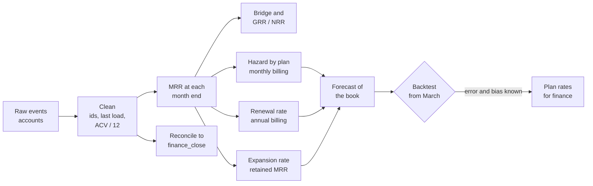

# SaaS subscription and churn analysis

Business question: build the churn model the finance team can plan with, and find out whether recurring revenue is really falling.

## Before you start

- **Level:** 3 (advanced). A capstone: an ambiguous brief, several messy tables, and a deliverable a hiring manager can open and run.
- **Time:** about 10 hours.
- **Builds on:** [SaaS: reduce subscription churn](../../09-business-case-studies/02-saas-reduce-subscription-churn/) (life tables and hazards), [Growth accounting](../../03-metrics-and-product-analytics/07-growth-accounting/) (splitting a change into parts that add up), [Retention curves and churn](../../03-metrics-and-product-analytics/08-retention-curves-and-churn/) (right-censoring), [LTV, CAC and payback](../../03-metrics-and-product-analytics/12-ltv-cac-and-payback/), [Duplicates and reconciliation](../../01-sql/08-duplicates-and-reconciliation/) and [Incremental models and backfills](../../08-modern-data-stack/03-incremental-models-and-backfills/) (late rows).
- **You need:** Python 3.9 or later. Nothing to install.
- **How this capstone is built:** see the [phase README](../README.md). [BRIEF.md](BRIEF.md) is the request, [DELIVERABLES.md](DELIVERABLES.md) says what to hand in, [RUBRIC.md](RUBRIC.md) scores the parts with no single right answer, and `solution/` is the worked answer to read after you finish.

## The problem

Shiftwren, a fictional staff-rota app for restaurants and clinics, sells per location on three plans with monthly or annual billing. Ciara Brennan, the CFO, starts the 2027 budget on 10 November 2026 and needs a churn model by Friday 6 November that Declan in FP&A can rebuild in a spreadsheet. Her MRR chart has fallen since April while sales insist the base is growing, and finance has always planned with one blended churn rate of about 3% a month. She wants to know which side is right, what rates to plan with, what today's customers will pay through March 2027, and how far to trust it. Read the full request and the data team's notes in [BRIEF.md](BRIEF.md).

The files in `data/` are synthetic, generated by `make_data.py` with a fixed seed: `accounts.csv` (580 rows), `subscription_events.csv` (917 rows) and `finance_close.csv` (21 rows, one per month-end close from January 2025 to September 2026).

## In plain words

Think of a gym. Some members pay every month and can stop any month. Others pay for a year up front and can only leave when the year is up. If the front desk writes the yearly members into the "monthly fees" ledger at their full yearly price, the gym looks twelve times richer in those rows. And if the manager asks "what share of members quit this month?" and divides by everyone, the yearly members, who could not quit this month anyway, make the answer look calm while monthly members walk out at twice the rate.

A churn model for finance is the careful version: put every fee in the same unit, measure leaving only among people who could leave, and check the model against months that already happened.

Terms used in this capstone:

- **MRR (monthly recurring revenue):** what all paying customers pay per month for their subscription, in EUR here. An annual contract counts as one twelfth of its value each month.
- **ACV (annual contract value):** the price of a year of an annual contract.
- **Event log:** one row per change to a subscription: start, change (upgrade or downgrade), cancel, reactivate. The subscription's state at any date is the latest event on or before it.
- **Effective date:** when a change applies. **Requested date:** when the customer asked. **Load date:** when the row reached the warehouse.
- **Month-end close:** the numbers finance freezes for a month, here run on the 3rd of the next month. A **late row** arrives after the close.
- **Restated:** recomputed from every row, with today's definitions. **Reported:** what the close said.
- **MRR bridge:** the walk from last month's MRR to this month's: + new, + reactivation, + expansion, - contraction, - churn. Each account lands in exactly one box, so the bridge adds up.
- **Logo churn:** churned accounts as a share of accounts (a "logo" is a customer). **Revenue churn** counts EUR instead.
- **GRR and NRR (gross and net revenue retention):** of the MRR that customers paid a year ago, the share still paid today without (GRR) or with (NRR) upgrades counted.
- **Hazard:** the chance that a customer who is still paying at the start of a month leaves during it. **At risk:** the customers who could leave that month.
- **Renewal rate:** of annual contracts that reached their anniversary, the share that renewed.
- **Expected value:** the average outcome over the chances, here MRR x the probability the account is still paying.
- **Backtest:** run the model from a past date, as if you did not know what came next, and compare with what happened.

## What you will build from scratch

- `clean_accounts` and `clean_events`: one row per account and per event, latest load wins, as at any load date, amounts in EUR a month.
- `mrr_by_account` and `mrr_bridge`: MRR at any month end and the bridge that explains its change.
- `retention_12m`: GRR and NRR over a year.
- The churn model: `monthly_hazards` by plan, `renewal_rate` for annual contracts, `expansion_rate` for upgrades.
- `forecast` of the existing book and `backtest` against what happened.
- `reconcile`: the walk from finance's reported MRR to the restated one.
- Your restatement table, model table, one chart and a one-page memo ([DELIVERABLES.md](DELIVERABLES.md)).

## The idea

Two questions hide in the brief. "Is MRR falling?" is a data question: rebuild MRR from the events and reconcile it to the reported number before you believe either. "What churn rate do we plan with?" is a modelling question: measure leaving only where it can happen, then prove the model on the past.



The state of an account at a month end is its latest event on or before the last day of the month. MRR at month end t is the sum over accounts of that event's amount (in EUR a month).

The bridge for month t compares each account's MRR at the end of t - 1 (p) and t (c):

- p = 0, c > 0: **new** if the account never paid at an earlier month end, else **reactivation**
- p > 0, c = 0: **churn** of p
- c > p: **expansion** of c - p; 0 < c < p: **contraction** of p - c
- so MRR(t) = MRR(t - 1) + new + reactivation + expansion - contraction - churn

The model has three rates, each measured where it applies:

- Monthly billing, plan j: hazard h_j = churned / at risk, summed over the last 6 months. At risk in month t are monthly accounts on plan j paying at the end of t - 1.
- Annual billing: renewal rate r = renewed / due over the last 12 months. An annual account is due in the month its term completes a whole number of years.
- Expansion: g = sum of MRR change / sum of MRR, over accounts paying at both ends of a month, last 6 months.

For an account with MRR v paying at the end of the base month, the expected MRR after k months is v x (1 - h_j)^k x (1 + g)^k on monthly billing, and v x (r if an anniversary has passed, else 1) x (1 + g)^k on annual billing. Summing over accounts gives the forecast. This is an expected value, so the test checks it against a seeded simulation of the same customers: draw each account's survival at random 400 times and average. The two must agree within 1%.

A forecast nobody has checked is an opinion. The backtest fits the rates on the six months to March 2026 and forecasts April to September, which already happened. Its error, and which way it leans, is what you tell Ciara about trust.

## Walk through

This walk through finds the mess and shows how much each part of it moves the numbers. It stops before the model, which is yours to build. Run the blocks in order in one Python session started in this folder (`python3`).

Step 1. Load the three files and count rows against distinct ids.

```python
import csv
from collections import Counter

def read(name):
    with open("data/" + name + ".csv", newline="") as f:
        return list(csv.DictReader(f))

accounts, events, close = read("accounts"), read("subscription_events"), read("finance_close")
ids = Counter(r["event_id"] for r in events)
print("events   rows %d  distinct event_ids %d  loaded twice %d"
      % (len(events), len(ids), sum(1 for n in ids.values() if n > 1)))
print("accounts rows %d  distinct as written %d  distinct trimmed and upper-cased %d"
      % (len(accounts), len({a["account_id"] for a in accounts}),
         len({a["account_id"].strip().upper() for a in accounts})))
print("event rows with a messy account id:", sum(1 for r in events if r["account_id"] != r["account_id"].strip().upper()))
```

```
events   rows 917  distinct event_ids 886  loaded twice 31
accounts rows 580  distinct as written 580  distinct trimmed and upper-cased 561
event rows with a messy account id: 27
```

The account ids look unique until you trim and upper-case them: 19 accounts are in the CRM twice. 27 event rows use the messy form too, so normalise ids on both sides before any join.

Step 2. The 31 events loaded twice: plain repeats, or corrections?

```python
by_id = {}
for r in events:
    by_id.setdefault(r["event_id"], []).append(r)
kinds = Counter()
for loads in by_id.values():
    if len(loads) == 2:
        a, b = sorted(loads, key=lambda r: r["loaded_on"])
        kinds["identical" if (a["locations"], a["amount"]) == (b["locations"], b["amount"]) else "corrected"] += 1
print(kinds)
example = next(v for v in by_id.values() if len(v) == 2 and v[0]["amount"] != v[1]["amount"])
for r in sorted(example, key=lambda r: r["loaded_on"]):
    print(r["event_id"], r["account_id"], r["event_type"], r["plan"], "locations", r["locations"],
          "amount", r["amount"], "loaded", r["loaded_on"])
```

```
Counter({'identical': 18, 'corrected': 13})
EV00128 SW-0119 start starter locations 2 amount 78 loaded 2025-05-09
EV00128 SW-0119 start starter locations 1 amount 39 loaded 2025-05-29
```

13 repeats carry a corrected location count. The rule is "the last load of each `event_id` wins", not "drop duplicates": dropping exact duplicates keeps both versions of these 13, and keeping the first load keeps the wrong one.

Step 3. The definition change. Price per location of new pro accounts, by billing and by when the start was requested:

```python
billing = {a["account_id"].strip().upper(): a["billing"] for a in accounts}
per_location = {}
for r in events:
    if r["event_type"] == "start" and r["plan"] == "pro":
        key = (billing[r["account_id"].strip().upper()], "before April" if r["requested_on"] < "2026-04-01" else "from April")
        per_location.setdefault(key, set()).add(int(r["amount"]) // int(r["locations"]))
for key, values in sorted(per_location.items()):
    print(key, sorted(values))
```

```
('annual', 'before April') [912]
('annual', 'from April') [76]
('monthly', 'before April') [89]
('monthly', 'from April') [89]
```

An annual pro location was stored at 912 EUR before April and 76 EUR from April: 912 = 12 x 76, the annual contract value. Monthly prices did not change. So every annual row requested before 1 April must be divided by 12, and the rows from April must not be.

Step 4. Late rows. How long after taking effect did rows arrive, and what did the September close miss?

```python
import datetime as dt

def days(a, b):
    return (dt.date.fromisoformat(b) - dt.date.fromisoformat(a)).days

lag = Counter(min(days(r["effective_on"], r["loaded_on"]) // 7, 4) for r in events
              if r["requested_on"] == r["effective_on"])
print("whole weeks from effective_on to loaded_on (4 = 4 or more):", dict(sorted(lag.items())))
missed = [r for r in events if "2026-09-01" <= r["effective_on"] <= "2026-09-30" and r["loaded_on"] > "2026-10-03"]
print("September events loaded after the close on 3 October:", len(missed),
      Counter(r["event_type"] for r in missed))
```

```
whole weeks from effective_on to loaded_on (4 = 4 or more): {0: 663, 1: 18, 2: 29, 3: 13, 4: 38}
September events loaded after the close on 3 October: 4 Counter({'start': 3, 'cancel': 1})
```

Most rows land within a week, but 98 took a week or more (monthly cancels are left out here because they are requested weeks before they take effect). The September close missed four events. Late rows are real, but small; keep them in mind for step 5.

Step 5. Rebuild MRR at a few month ends and set it beside what finance reported.

```python
def mrr_at(month_end, fix=True):
    latest = {}
    for r in sorted(events, key=lambda r: r["loaded_on"]):
        latest[r["event_id"]] = r                     # the last load of each event wins
    state = {}
    for r in sorted(latest.values(), key=lambda r: (r["effective_on"], r["event_id"])):
        if r["effective_on"] <= month_end:
            aid = r["account_id"].strip().upper()
            amount = int(r["amount"])
            if fix and billing[aid] == "annual" and r["requested_on"] < "2026-04-01":
                amount /= 12
            state[aid] = amount
    return sum(state.values())

reported = {r["month"]: int(r["reported_mrr"]) for r in close}
for month, end in (("2026-01", "2026-01-31"), ("2026-04", "2026-04-30"), ("2026-07", "2026-07-31"),
                   ("2026-09", "2026-09-30")):
    print(month, "reported %7d   restated %7.0f   no definition fix %7.0f"
          % (reported[month], mrr_at(end), mrr_at(end, fix=False)))
```

```
2026-01 reported  144119   restated   37176   no definition fix  145009
2026-04 reported  187610   restated   42020   no definition fix  188155
2026-07 reported  175348   restated   51253   no definition fix  174783
2026-09 reported  173542   restated   57533   no definition fix  173770
```

This answers Ciara's first question. Without the definition fix you get finance's line, give or take the late rows: falling since April. With it, MRR rises every month, from 42,020 EUR in April to 57,533 EUR in September. The reported line falls because every annual account that changes its plan after April gets a new row at the monthly amount, so its reported MRR drops by eleven twelfths while it actually grew.

Step 6. Where can churn happen? Count cancels by billing, and whether they fall on an anniversary of the start date.

```python
first = {}
for r in sorted(events, key=lambda r: r["effective_on"]):
    first.setdefault(r["account_id"].strip().upper(), r["effective_on"])
gap = Counter()
for r in events:
    if r["event_type"] == "cancel":
        aid = r["account_id"].strip().upper()
        start, end = first[aid], r["effective_on"]
        months = (int(end[:4]) * 12 + int(end[5:7])) - (int(start[:4]) * 12 + int(start[5:7]))
        gap[(billing[aid], "anniversary" if months % 12 == 0 and end[8:] == start[8:] else "other")] += 1
print(gap)
```

```
Counter({('monthly', 'other'): 156, ('annual', 'anniversary'): 17})
```

Every annual cancel falls exactly on an anniversary. An annual customer is not "at risk" in the eleven months between, so a monthly hazard that counts them in the denominator is diluted. That is why the model has a hazard for monthly billing and a renewal rate for annual billing. (The counts here are raw rows, duplicates included; your clean functions fix that.) Now build the model: the functions in `exercise.py`, then the tables, the chart and the memo.

## Common mistakes

**1. Summing `amount` as stored (the trap).** It gives finance's line: 173,542 EUR in September and falling since April. Restated MRR is 57,533 EUR and rising. Any column whose meaning changed on a date must be converted to one unit before it is summed, charted or compared across that date. Check per-unit prices before and after (step 3) whenever a series has a kink.

**2. One blended churn rate.** Finance's close divides churned accounts by all paying accounts, annual ones included. Over the six months to September that gives 71 of 2,221 account-months, 3.20%. Among monthly-billing accounts alone it is 4.21%, and by plan it is 7.26% for starter and about 1.9% for pro and business. Used as a plan, the blend is badly wrong: the March close's 4.86% applied to the March book predicts 30,819 EUR for September; those accounts actually paid 40,498 EUR, so the blend was 24% too low.

**3. Keeping the first load.** The 13 corrected events change the September MRR from 57,533 EUR to 58,565 EUR if you keep the first load. Small here, but it is a rule with a direction: corrections arrive later, so the last load wins.

**4. Forecasting churn only.** The churn-only model, backtested from March, is 13.20% too low by September, because retained customers keep upgrading. Adding the expansion rate brings the error to 5.15%. What is left leans the same way (reactivations are not modelled), so say "cautious floor", not "point estimate".

**5. Showing a forecast without a backtest.** Every model in this capstone fits the past by construction. Only a forecast made from an earlier date and compared with what happened tells you its error and its bias. Ciara's fourth question is not optional.

## Your turn

Open [DELIVERABLES.md](DELIVERABLES.md). It lists everything to hand in and the exact definitions. Start with `exercise.py`: fill in every function, then run, from this folder:

    python3 test_lesson.py

The test runs your functions on the committed data, on a second dataset built from another seed, and on hand-made event logs: a duplicate with a correction, a messy id, an annual row before and after the switch, an as-at date, a cancel that takes effect on the 1st, an annual lapse on its anniversary, a reactivation, a plan with no monthly customers, a window with no renewals due, and a renewal inside the horizon with no rate to use. It also checks your forecast against a seeded simulation. To check the reference answer: `CHECK_SOLUTION=1 python3 test_lesson.py`.

Then build the restatement table, the model table, the chart and the memo, and score them with [RUBRIC.md](RUBRIC.md). Read `solution/` only after that: [solution/WRITEUP.md](solution/WRITEUP.md) is a two-point answer on every rubric row, with the reasoning.

Stretch: Declan wants a range, not a point. Fit the starter hazard on the six months to March and to September, and the renewal rate with a 95% Wilson interval (see [How big an eval set](../../06-ai-for-analysts/07-how-big-an-eval-set/), which builds the Wilson interval). Run the forecast at the low and high ends. How wide is the March 2027 range, and which input drives most of it?

## Check yourself

1. Reported MRR fell 7.5% from April to September while restated MRR rose 36.9%. Explain the gap in two sentences a CFO would accept.
2. Why does the model use a renewal rate for annual customers instead of a monthly hazard?
3. The backtest error is -5.15% at month six. What is the main cause, and would you correct for it or report it?
4. Pro churn was 4.0% a month in the six months to March and 1.8% in the six months to September. What do you tell Declan to plan with?

<details>
<summary>Answers</summary>

1. Before April the billing system stored annual contracts at their annual value, twelve times the monthly figure, so reported MRR counted most annual customers twelve times. From April, every annual customer who changed plan got a new row at the monthly amount, so the reported number fell as customers upgraded, while what they actually pay a month rose.
2. Annual customers can only leave at an anniversary. In the eleven months between, their chance of leaving is zero, so putting them in a monthly hazard dilutes it; and when they do leave, a third go at once (66% renewal), which a smooth monthly rate spreads over the wrong months.
3. Reactivations: churned monthly customers often come back, and the model leaves them out. Report it as a known downward bias ("the forecast is a cautious floor, about 5% low by month six"), and if Declan needs a central estimate, add a reactivation rate measured the same way, then backtest again.
4. A range, not the latest number: pro and business together are about 1.9% (15 of 806 account-months), and the earlier window says up to 4%. Nine or sixteen churned accounts is too few to call a trend. Plan at 2% with a 4% downside case, and re-measure each quarter.

</details>

## What to tell the stakeholder

To Ciara: "MRR is not falling: restated, it rose every month this year, to 57,533 EUR a month at the end of September; the reported 173,542 EUR counts most annual contracts at their yearly value, because the billing system changed what it stores on 1 April. Plan with 7.3% monthly churn for starter, 1.9% for pro and business on monthly billing, and 66% renewal for annual contracts; on that basis today's customers pay about 53,200 EUR a month by March 2027 before new sales, with the biggest drop in January when the promotion cohort renews. Tested on April to September the model was within 5%, and it errs low because it leaves out customers who come back; I recommend finance adopts the restated MRR from the November close, and that customer success starts the January renewals in November."

## In real job postings

In the Real Analyst Jobs data drop of 25 October 2026, 1,477 of the 2,056 US analyst postings that name a tool (71.8%) ask for SQL and 860 (41.8%) ask for Excel, the two places a finance team will rebuild a churn model like this one. See [Product analyst jobs](https://realanalystjobs.com/jobs/product-analyst-jobs) for roles where churn and MRR analysis is routine.

## Next

[10-05: Executive dashboard](../05-executive-dashboard/)
