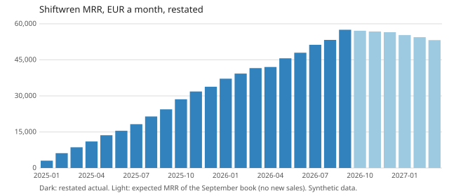

# Worked solution: the Shiftwren churn model

Read this after you have tried the capstone. Every number comes from `python3 solution/solution.py` on the committed (synthetic) data. Part of capstone [10-04](../README.md).

## How I approached it

1. **Ask what the decision is.** Ciara is setting the 2027 revenue plan. She needs rates Declan can type into a sheet, a forecast of the existing book, and a reason to trust it. A clever model Declan cannot rebuild is worse than three rates he can.
2. **Distrust the headline first.** "MRR falling since April" coincides with the date the billing system changed what `amount` means. Before modelling churn, rebuild MRR from the events and reconcile it to the reported number.
3. **Clean in the order the notes suggest.** Normalise ids, keep the last load per `event_id`, divide pre-April annual amounts by 12. Each fix is a function with a flag, so the reconciliation can switch fixes on one at a time.
4. **Measure churn where it can happen.** Monthly customers can leave any month; annual customers only at an anniversary. So two kinds of rate: a monthly hazard by plan, and a renewal rate. Mixing them is the error in the blended 3%.
5. **Test the model on the past before showing the future.** Fit on the six months to March 2026, forecast April to September, compare with what those accounts paid.

## 1. Is MRR falling?

No. Restated MRR rose every month this year, from 37,176 EUR at the end of January to 57,533 EUR at the end of September 2026. The reported figure of 173,542 EUR counts most annual customers at twelve times their monthly value.

| Month end | Reported | Restated |
|---|---|---|
| 2026-01 | 144,119 | 37,176 |
| 2026-03 | 185,254 | 41,556 |
| 2026-04 | 187,610 | 42,020 |
| 2026-06 | 180,698 | 47,969 |
| 2026-09 | 173,542 | 57,533 |

September, from reported to restated:

| Step | EUR a month |
|---|---|
| As at close (rows loaded by 3 October, no fix): equals the reported figure | 173,542 |
| Definition fix: annual contract values requested before April divided by 12 | -116,237 |
| Late rows loaded after the close | +228 |
| Restated | 57,533 |

Why the reported line fell after April: every annual account that upgraded or added a location after 1 April got a new event stored at the monthly amount, so its reported MRR dropped by about 90% while it actually grew. The more customers changed their plan, the further the reported line fell. The late rows are small (+228 EUR), so the close is not the problem; the definition is.

## 2. The rates to plan with

Measured on the six months April to September 2026 (monthly billing) and the twelve months October 2025 to September 2026 (annual renewals):

| Rate | Value | Counts |
|---|---|---|
| Monthly hazard, starter | 7.26% a month | 45 churned of 620 account-months at risk |
| Monthly hazard, pro | 1.78% a month | 9 of 505 |
| Monthly hazard, business | 1.99% a month | 6 of 301 |
| Monthly hazard, pooled | 4.21% a month | 60 of 1,426 |
| Annual renewal rate | 66.0% | 33 renewed of 50 due |
| Net expansion of retained accounts | 1.74% of MRR a month | +4,797 EUR on 275,005 EUR of retained MRR, summed over the six months |

Over the last twelve months, the accounts paying in September 2025 (24,418 EUR) kept 72.42% of that MRR (gross revenue retention) and, with upgrades, 90.30% (net revenue retention).

The blended 3% is wrong twice. It is a logo rate (accounts, not EUR) taken over every account including annual ones, which cannot leave most months; that dilutes it. And it hides a factor of four between plans: starter customers on monthly billing leave at 7.26% a month, pro and business at about 2%. Planning at 3% understates starter churn and overstates pro and business churn.

Pro (1.78%) and business (1.99%) are within noise of each other: 9 and 6 churned accounts. I would plan them with one rate and keep starter separate.

## 3. The forecast of the September book

Expected MRR of the 431 accounts paying at the end of September, with no new sales and no reactivations:

| Month end | Expected MRR (EUR) | Drop from previous month |
|---|---|---|
| 2026-10 | 57,104 | |
| 2026-11 | 56,799 | 306 |
| 2026-12 | 56,519 | 280 |
| 2027-01 | 55,319 | 1,200 |
| 2027-02 | 54,449 | 871 |
| 2027-03 | 53,201 | 1,248 |

The month Declan must not miss is January 2027. The January to March 2026 promotion sold many annual plans; 8,610 EUR a month of annual MRR reaches its first anniversary in January to March 2027, and at a 66% renewal rate about a third of it goes. That is why the drop quadruples in January.

## 4. How far to trust it

Fitted on the six months to March 2026 and run forward from the March book:

| Month end | Forecast | Actual | Error |
|---|---|---|---|
| 2026-04 | 41,089 | 39,867 | +3.06% |
| 2026-06 | 40,004 | 39,879 | +0.31% |
| 2026-09 | 38,413 | 40,498 | -5.15% |

The churn-only version (no expansion term) was 13.20% too low by September; adding the expansion rate cut the error at month six to 5.15%. The remaining bias is downward: the model leaves out reactivations, and in this data churned monthly customers often come back. So read the forecast as a cautious floor, about 5% low by month six.

## 5. Recommendation

- **Finance (Declan) replaces the reported MRR with the restated series from the November close**, and the billing team back-fills the old annual rows so the warehouse holds one definition. Until then, every MRR chart built from `amount` is wrong for annual customers.
- **Plan with three numbers, not one:** 7.3% a month for starter on monthly billing, 1.9% for pro and business on monthly billing (pooled, because the two are not distinguishable yet), 66% renewal for annual contracts at their anniversary, plus 1.7% monthly net expansion on retained MRR.
- **Customer success starts renewal conversations for the January to March 2027 annual cohort in November.** Each point of renewal rate on that cohort is worth about 86 EUR a month (1% of 8,610 EUR).

## 6. Limits and what would change my mind

- The renewal rate rests on 50 renewals, almost all from 2025 annual customers who bought without the promotion. Promotion buyers may renew less; if the first January renewals come in below 60%, lower the rate.
- The hazards assume the next six months look like the last six. Starter churn was 7.1% in the six months to March and 7.3% to September, which is reassuring; pro moved from 4.0% to 1.8%, which is not, so pro deserves a range (2% to 4%).
- The forecast ignores reactivations and pending cancels (the extract holds only events effective by 30 September). Both are known biases; the backtest says their net effect was about 5% low by month six.
- The definition fix assumes every pre-April annual amount is an annual contract value. A spot check of ten contracts against invoices would confirm it.
