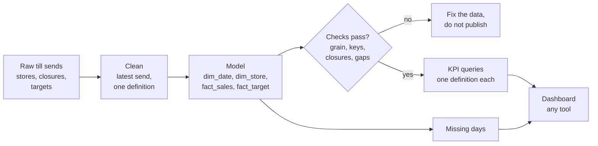

# Executive dashboard

Business question: design, model and verify the CEO dashboard, in the tool of your choice, so that the leadership team stops arguing about the numbers.

## Before you start

- **Level:** 3 (advanced). A capstone: an ambiguous brief, several messy tables, and a deliverable a hiring manager can open and run.
- **Time:** about 10 hours.
- **Builds on:** [Model the data a dashboard needs](../../04-dashboards/01-model-the-data-a-dashboard-needs/) (star schemas and grain), [Dashboard design and KPI cards](../../04-dashboards/07-dashboard-design-and-kpi-cards/) (cards, comparisons, status), [The semantic layer](../../04-dashboards/09-the-semantic-layer/) (one definition per metric), [Dates and the date spine](../../01-sql/05-dates-and-the-date-spine/), [Percent, points and averages of ratios](../../03-metrics-and-product-analytics/06-percent-points-and-averages-of-ratios/) and [Data quality tests as code](../../05-python-for-analysts/09-data-quality-tests-as-code/).
- **You need:** Python 3.9 or later. Nothing to install. A BI tool (Power BI, Tableau, Looker Studio) is optional: the test checks the model and the numbers, which you build in Python and SQLite.
- **How this capstone is built:** see the [phase README](../README.md). [BRIEF.md](BRIEF.md) is the request, [DELIVERABLES.md](DELIVERABLES.md) says what to hand in, [RUBRIC.md](RUBRIC.md) scores the parts with no single right answer, and `solution/` is the worked answer to read after you finish.

## The problem

Kettlemoor, a fictional chain of four bakery-cafes in Yorkshire, opens every monthly leadership meeting with half an hour of arguing about whose spreadsheet is right. Hannah Okoro, the CEO, wants one dashboard for September 2026 by Wednesday 7 October: performance against target for the business and each shop, whether the "+23% on last year" in last month's spreadsheet is real, where rising ingredient costs are hurting margin, and a trend. Any tool is fine, as long as the numbers are right, the same every time, and missing data is called out. Read the full request and the data team's notes in [BRIEF.md](BRIEF.md).

The files in `data/` are synthetic, generated by `make_data.py` with a fixed seed: `daily_sales.csv` (1,423 rows, one per shop and day as the till sent it, September 2025 to September 2026), `stores.csv` (4 rows), `store_closures.csv` (1 row) and `targets.csv` (46 rows, the 2026 monthly targets per shop).

## In plain words

Think of a cricket scoreboard. Everyone in the ground reads the same board, so nobody argues about the score. That works because the scorer follows fixed rules: a no-ball is one extra, a run-out is not a wicket for the bowler. If each spectator kept score by their own rules, there would be as many scores as spectators.

A CEO dashboard is the scoreboard. The arguments Hannah describes are spectators keeping their own score. The fix is not a nicer board; it is one scorer with written rules: a clean model of the data, one definition per number, and checks that run before anyone sees it.

Terms used in this capstone:

- **KPI (key performance indicator):** one of the few numbers a business steers by. A **KPI card** shows one KPI, one comparison and a status.
- **Net revenue:** sales after discounts. **Cost of goods sold (COGS):** what the ingredients and packaging cost. **Gross margin:** (net revenue - COGS) / net revenue, as a percentage.
- **AOV (average order value):** net revenue / orders.
- **Target:** the monthly revenue the budget planned. **Status:** a traffic light from the share of target reached: green, amber or red.
- **Star schema:** a model with **fact** tables (events you add up, such as daily sales) joined to **dimension** tables (things you slice by, such as date and shop). The **grain** of a fact table is what one row means, here one shop on one day.
- **Date spine (date dimension):** a table with every calendar day, so a day with no sales still exists and can be counted as missing.
- **Year on year (YoY):** this month against the same month a year earlier.
- **Like-for-like (LFL):** the same comparison over only the shops that traded fully in both months, so new shops and closures do not count as growth.
- **Definition change:** a column whose meaning changed on a date. Here the till's `gross_sales` is before discounts until 30 June 2026 and after discounts from 1 July.
- **BI tool (business intelligence tool):** software such as Power BI, Tableau or Looker Studio that draws dashboards from a model.

## What you will build from scratch

- `clean_sales`: one row per shop-day, the latest send, net revenue in one definition.
- `build_model`: a SQLite star schema with a date spine, shops, closures, sales and targets.
- `check_model` and `missing_days`: the tests a dashboard model must pass before anyone sees a number.
- `lfl_stores`, `monthly_kpis`, `store_table` and `trend`: every number on the dashboard, as queries on the model.
- Your dashboard in the tool of your choice, a metric sheet and a note for Hannah ([DELIVERABLES.md](DELIVERABLES.md)).

## The idea

A dashboard is three layers, and most dashboard arguments come from skipping the middle one.



**The model.** `fact_sales` has one row per shop per day; its grain is (date_key, store_id). `dim_date` is a date spine with every day from the first to the last sale, so "York has no row on 14 September" becomes a query, not a guess. `dim_store` carries each shop's opening date, and `store_closure` the days it was shut. Everything on the dashboard is a sum or a ratio of sums over `fact_sales`, filtered by the dimensions.

**The checks.** Before any number is shown: no duplicate grain; every fact row's date and shop exist in the dimensions; no negative values; no sales before a shop opened or on a closure day; no gap in the date spine. And one check that does not stop publishing but must appear on the dashboard: missing shop-days, where a shop was open and no data arrived.

**The KPIs.** Each is defined once (the full list is in [DELIVERABLES.md](DELIVERABLES.md)):

- net revenue = sum of net_revenue; AOV = net revenue / orders, over the whole month
- gross margin % = 100 x (sum of net revenue - sum of COGS) / sum of net revenue
- % of target = 100 x net revenue / target; status green at 100 or more, amber from 95, red below
- YoY % = 100 x (revenue this month / revenue same month last year - 1)
- LFL % = the same, over shops opened by the first day of last year's month with no closure in either month

Ratios are computed from totals, never averaged: the average of four shops' margins weights a small shop like a big one.

**Why LFL leads.** Growth from opening a shop is real money but says nothing about whether the existing shops are doing better. A chain that opens shops can show double-digit YoY growth while every shop shrinks. The CEO needs both numbers and must know which is which.

**The tool.** Every BI tool can load these five tables and recompute the same sums; the semantic layer and DAX lessons ([The semantic layer](../../04-dashboards/09-the-semantic-layer/), [DAX measures from scratch](../../04-dashboards/02-dax-measures-from-scratch/)) show how measures map to SQL. Load the clean model, not the raw sends, so the tool never re-implements the cleaning rules. The test's optional export check then compares the tool's cards with the model.

## Walk through

This walk through finds the mess and shows how much each part of it moves the numbers. It stops before the model, which is yours to build. Run the blocks in order in one Python session started in this folder (`python3`).

Step 1. Count rows against distinct shop-days, and look at a re-send.

```python
import csv
from collections import Counter, defaultdict

def read(name):
    with open("data/" + name + ".csv", newline="") as f:
        return list(csv.DictReader(f))

sales, stores, closures, targets = read("daily_sales"), read("stores"), read("store_closures"), read("targets")
keys = Counter((r["sales_date"], r["store_id"]) for r in sales)
print("daily_sales rows", len(sales), " distinct shop-days", len(keys),
      " shop-days sent more than once", sum(1 for n in keys.values() if n > 1))
sends = defaultdict(list)
for r in sales:
    sends[(r["sales_date"], r["store_id"])].append(r)
changed = [v for v in sends.values() if len(v) > 1 and v[0]["gross_sales"] != v[1]["gross_sales"]]
print("re-sends with different numbers:", len(changed))
for r in sorted(changed[0], key=lambda r: r["loaded_at"]):
    print(" ", r["sales_date"], r["store_id"], "orders", r["orders"], "gross", r["gross_sales"], "loaded", r["loaded_at"])
```

```
daily_sales rows 1423  distinct shop-days 1390  shop-days sent more than once 33
re-sends with different numbers: 12
  2025-09-17 KM01 orders 514 gross 4153.92 loaded 2025-09-18 02:54:00
  2025-09-17 KM01 orders 467 gross 3776.29 loaded 2025-09-22 06:54:00
```

33 shop-days arrived twice; 12 of the second sends differ, because the first send went out before the evening till count. The rule from the data team: the later send wins.

Step 2. The till change. Revenue per order, as stored, around 1 July:

```python
per_month = defaultdict(lambda: [0, 0.0, 0.0])
for r in sales:
    if "2026-05" <= r["sales_date"][:7] <= "2026-08":
        t = per_month[r["sales_date"][:7]]
        t[0] += int(r["orders"])
        t[1] += float(r["gross_sales"])
        t[2] += float(r["discounts"])
for month, (orders, gross, disc) in sorted(per_month.items()):
    print(month, "gross per order %.2f   gross minus discounts per order %.2f" % (gross / orders, (gross - disc) / orders))
```

```
2026-05 gross per order 8.24   gross minus discounts per order 7.75
2026-06 gross per order 8.25   gross minus discounts per order 7.76
2026-07 gross per order 7.79   gross minus discounts per order 7.29
2026-08 gross per order 7.80   gross minus discounts per order 7.30
```

Gross per order drops by about 6% on 1 July and then sits at the old net figure (7.79 against 7.76). That is the new till reporting gross after discounts. Subtracting discounts again from July would invent a 6% price cut.

Step 3. The calendar. Days with sales per shop in the two Septembers:

```python
open_days = Counter()
for (day, store) in keys:
    if day[:7] in ("2025-09", "2026-09"):
        open_days[(store, day[:7])] += 1
for s in stores:
    print(s["store_id"], s["city"].ljust(9), "opened", s["opened_on"],
          " days with sales: Sep 2025", open_days[(s["store_id"], "2025-09")], " Sep 2026", open_days[(s["store_id"], "2026-09")])
print(closures)
```

```
KM01 York      opened 2019-04-06  days with sales: Sep 2025 30  Sep 2026 29
KM02 Harrogate opened 2021-08-14  days with sales: Sep 2025 30  Sep 2026 30
KM03 Leeds     opened 2023-03-11  days with sales: Sep 2025 23  Sep 2026 30
KM04 Ripon     opened 2026-03-02  days with sales: Sep 2025 0  Sep 2026 30
[{'store_id': 'KM03', 'closed_from': '2025-09-08', 'closed_to': '2025-09-14', 'reason': 'refit'}]
```

Three different stories in one table. Leeds has 23 days last September because of the refit, which is in `store_closures.csv`. Ripon did not exist. York has 29 days this September with no closure to explain it: that is the missing day the data team mentioned. Your `missing_days` must find it from the model, not from this printout.

Step 4. "+23% on last year", and the same comparison on the shops that traded fully in both months:

```python
latest = {}
for r in sorted(sales, key=lambda r: r["loaded_at"]):
    latest[(r["sales_date"], r["store_id"])] = r

def net(r):
    return float(r["gross_sales"]) - (float(r["discounts"]) if r["sales_date"] < "2026-07-01" else 0.0)

def revenue(month, shops=None):
    return sum(net(r) for (day, shop), r in latest.items() if day[:7] == month and (shops is None or shop in shops))

now, last_year = revenue("2026-09"), revenue("2025-09")
print("all shops      Sep 2025 %9.2f  Sep 2026 %9.2f  growth %+.2f%%" % (last_year, now, 100 * (now / last_year - 1)))
same = ["KM01", "KM02"]
a, b = revenue("2026-09", same), revenue("2025-09", same)
print("York+Harrogate Sep 2025 %9.2f  Sep 2026 %9.2f  growth %+.2f%%" % (b, a, 100 * (a / b - 1)))
```

```
all shops      Sep 2025 231044.18  Sep 2026 284248.51  growth +23.03%
York+Harrogate Sep 2025 176684.58  Sep 2026 169785.87  growth -3.90%
```

The spreadsheet's +23% is correct arithmetic and the wrong answer to "are we growing?". The two shops that traded all of both Septembers sold 3.90% less. Part of that is York's missing day, which is why the dashboard must flag it.

Step 5. The target.

```python
target = defaultdict(float)
for t in targets:
    target[t["month"]] += float(t["revenue_target"])
print("months with targets:", min(target), "to", max(target), " September target", target["2026-09"])
print("September revenue as a share of target: %.2f%%" % (100 * now / target["2026-09"]))
```

```
months with targets: 2026-01 to 2026-12  September target 305500.0
September revenue as a share of target: 93.04%
```

93.04% is red on the thresholds in DELIVERABLES.md. Now build the model, the checks and the KPI queries in `exercise.py`, then the dashboard in the tool of your choice.

## Common mistakes

**1. Leading with year-on-year growth (the trap).** +23.03% sounds like a great month. Like-for-like is -3.90%. The difference is Ripon, which opened in March, and Leeds, which was shut for a week last September. A dashboard that leads with +23% will be quoted, and the York manager will be right to say it is not true for her shop.

**2. Subtracting discounts twice.** Applying `gross_sales - discounts` to every row gives September net revenue of GBP 265,945.01 instead of GBP 284,248.51, 6.4% too low, and the 13-month trend gets a cliff on 1 July that never happened. A kink on the date a system changed is a definition, not a business event, until proven otherwise.

**3. Summing every send.** Adding all rows double counts the 33 re-sent days: September comes out at GBP 299,376.39, 5.3% too high. Keeping the first send instead of the last gives GBP 284,001.22, close but wrong, with the till-count corrections lost. Decide the grain, then enforce it with a check.

**4. Averaging ratios.** The average of the four shops' September margins is 67.99%; the company margin is 68.28%. With four similar shops the gap is small, but the method is wrong, and it grows as shops differ in size. The same holds for AOV: compute it from total revenue and total orders.

**5. Hiding a missing day.** York shows 93.99% of target, red. One weekday is worth about GBP 3,262 there; with it, York would be near 97%, amber. The company is red either way. A dashboard that shows York red without saying a day is missing sends the York manager on a hunt for a problem that is partly in the data pipe.

## Your turn

Open [DELIVERABLES.md](DELIVERABLES.md). It lists everything to hand in and the exact definitions. Start with `exercise.py`: fill in every function, then run, from this folder:

    python3 test_lesson.py

The test runs your model and KPIs on the committed data, on a second dataset built from another seed, and on hand-made tables: a re-send with corrected numbers, the 30 June and 1 July boundary, a day with no sales inside the date spine, a sale on a closure day, an unknown shop, a duplicate shop-day, a shop that opened mid-month, a month with no orders, no target and no sales a year earlier. To check the reference answer: `CHECK_SOLUTION=1 python3 test_lesson.py`.

Then build the dashboard in any tool, the metric sheet and the note, and score them with [RUBRIC.md](RUBRIC.md). If you use a BI tool, export its card values to `exports/kpis_from_tool.csv` (see DELIVERABLES.md) and the test will compare them with your model. Read `solution/` only after that: [solution/WRITEUP.md](solution/WRITEUP.md) is a two-point answer on every rubric row, and `solution/dashboard.svg` is one standard-library version of the dashboard.

Stretch: add a like-for-like comparison on matched days, leaving out any day that is missing in either year for any LFL shop. What does September's LFL become, and would you show it on the dashboard or only in the note?

## Check yourself

1. Why does the model need a date spine, when `fact_sales` already has a date on every row?
2. Hannah asks why the dashboard says -3.90% when finance's spreadsheet says +23.03%. What do you answer in two sentences?
3. A shop manager averages her 30 daily AOVs and gets a different number from the card. Who is right, and why?
4. You find the till change on 1 July only because a chart had a kink. What check would have caught it automatically?

<details>
<summary>Answers</summary>

1. A day with no row cannot be seen by querying the rows that exist. The spine lists every day, so "open, not closed, and no row" is a query: that is how York's 14 September is found.
2. Both are correct sums of different things: +23.03% includes Ripon, which did not exist a year ago, and a Leeds refit week last year. On the shops that traded fully in both Septembers, revenue fell 3.90%, so the business we had is not growing; the growth is the new shop.
3. The card: total revenue / total orders. An average of daily AOVs weights a quiet Tuesday like a busy Saturday, so it drifts towards the quiet days' basket.
4. A check on a ratio that should be stable, such as revenue per order or discounts as a share of gross, by month, failing when it moves more than a few percent in one step. It would have fired in July and forced someone to read the till release notes.

</details>

## What to tell the stakeholder

To Hannah: "September came in at GBP 284,249, 93.04% of target (red), with every shop below target: three are red, and Ripon is amber at 95.95%. We are not growing like for like: the two shops that traded fully in both Septembers sold 3.90% less (about 1.6% less if York's missing day is set aside), and the +23% is Ripon plus last year's Leeds refit. Margin is holding at about 70% everywhere except Harrogate, down from 68.5% to 65.5% since April, and Harrogate is also the furthest below target; I recommend Harrogate's manager and finance review its costs and prices before the November meeting."

## In real job postings

In the Real Analyst Jobs data drop of 25 October 2026, 740 of the 2,056 US analyst postings that name a tool (36.0%) ask for Tableau and 492 (23.9%) for Power BI; SQL, at 71.8%, is asked for more than either, which is why this capstone tests the model rather than the picture. See [Power BI skills](https://realanalystjobs.com/skills/power-bi) and [Power BI vs Tableau in job postings](https://realanalystjobs.com/research/power-bi-vs-tableau-job-postings-2026).

## Next

[10-06: Automated analytics reporting](../06-automated-reporting-pipeline/)
