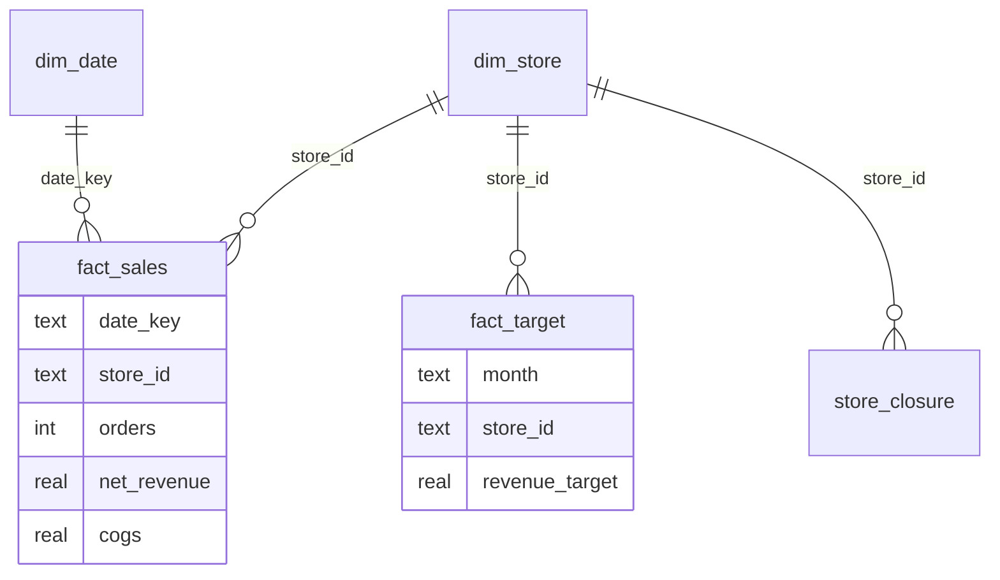
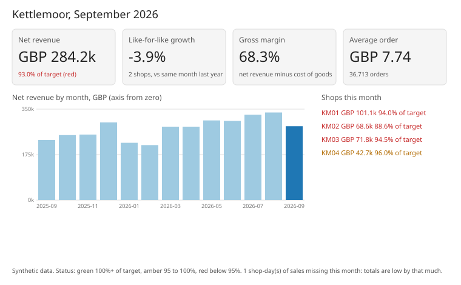

# Worked solution: the Kettlemoor CEO dashboard

Read this after you have tried the capstone. Every number comes from `python3 solution/solution.py` on the committed (synthetic) data. Part of capstone [10-05](../README.md).

## How I approached it

1. **The model before the picture.** Hannah's real complaint is arguments about numbers. A prettier chart does not fix that; one clean model with one definition per KPI does. So the first deliverable is a star schema that passes its own checks, and every card is a query on it.
2. **Find what changes the numbers.** Re-sent days, the till change on 1 July, a new shop, a refit and a missing day. Each needs a rule, written down once.
3. **Choose comparisons that mean something.** Against target for "should I worry", like-for-like for "are we growing", the 13-month trend for "is this normal".
4. **Say what is missing on the dashboard itself**, not in an email nobody reads.

## The model

| Table | Grain | Rows |
|---|---|---|
| `dim_date` | one calendar day, 1 Sep 2025 to 30 Sep 2026, no gaps | 395 |
| `dim_store` | one shop | 4 |
| `store_closure` | one closure period | 1 |
| `fact_sales` | one shop-day, latest send, net revenue after discounts | 1,390 |
| `fact_target` | one shop-month of 2026 | 46 |

Cleaning rules, all in `clean_sales`: the latest `loaded_at` wins per shop-day (1,423 rows become 1,390; 12 of the 33 re-sends carried corrected numbers); net revenue is `gross_sales - discounts` before 1 July 2026 and `gross_sales` from then. `check_model` returns no problems on the committed data. `missing_days` returns one: York, Monday 14 September 2026.

## September 2026, as the dashboard shows it

| Card | Value |
|---|---|
| Net revenue | GBP 284,248.51, 93.04% of the GBP 305,500 target: red |
| Like-for-like growth | -3.90% (York and Harrogate) |
| Year on year, all shops | +23.03% (shown small, under LFL, with its reason) |
| Gross margin | 68.28% |
| AOV | GBP 7.74 on 36,713 orders |

| Shop | Net revenue | % of target | Gross margin |
|---|---|---|---|
| York | 101,136.95 | 93.99% red (one day missing) | 69.89% |
| Harrogate | 68,648.92 | 88.58% red | 65.42% |
| Leeds | 71,766.34 | 94.55% red | 69.29% |
| Ripon | 42,696.30 | 95.95% amber | 67.35% |

## The answers

**How did September go?** Below target: 93.04% of the budget, red. September is also seasonally lower than August (GBP 337,124), so the drop on the trend is expected; the gap to target is the signal.

**Are we growing?** The +23.03% is real money but not growth of the business we had: it adds Ripon, which did not exist a year ago (GBP 42,696 this month), and Leeds, which was shut for a week last September. On the two shops that traded fully in both Septembers, revenue fell 3.90%. York's missing day accounts for part of that: if we leave 14 September out of both years, like-for-like is -1.56%. So the honest answer is "flat to slightly down on the shops we had, and the growth is Ripon".

**Where does margin hurt?** Harrogate. Its gross margin fell from 68.47% in January to March to 65.45% from April to September; York and Leeds held at about 70%. The company margin moved from about 69.5% to 68.3%, and Harrogate is most of that. Harrogate is also furthest below target (88.58%), so it is losing on both lines.

**What is missing?** York's 14 September. At York's average weekday revenue that day is worth about GBP 3,262, which would take York from 93.99% to about 97.0% of target (amber, not red). The company stays red either way (about 94.1%). The dashboard says so in its footer.

## Recommendation

- **Harrogate's manager and the finance lead review Harrogate's ingredient costs and prices before the November meeting.** It is the one shop where both revenue against target and margin are failing, and the margin drop starts in April, when the cost increase did.
- **Sam (data) gets York's 14 September from the till supplier this week**, and the dashboard refresh re-runs `check_model` and `missing_days` before it publishes, so a missing day is never silent again.
- Lead the dashboard with like-for-like growth, with year-on-year shown small under it. Otherwise the +23% will be quoted, and it will be wrong the month Ripon has been open a year.

## Limits

- Targets were set in January assuming at least 3% growth everywhere; a shop can be "red" because the target was optimistic. One budget is not evidence about any shop.
- Like-for-like rests on two shops this month, so one bad day moves it by a point or more.
- Cost of goods comes from the till's recipe costs, not supplier invoices. If recipes were not updated after the spring price rise, real margins are lower than shown.
- The trend before July uses the old till's definition converted by the rule above. A spot check of one July day against the bank deposit would confirm the conversion.
