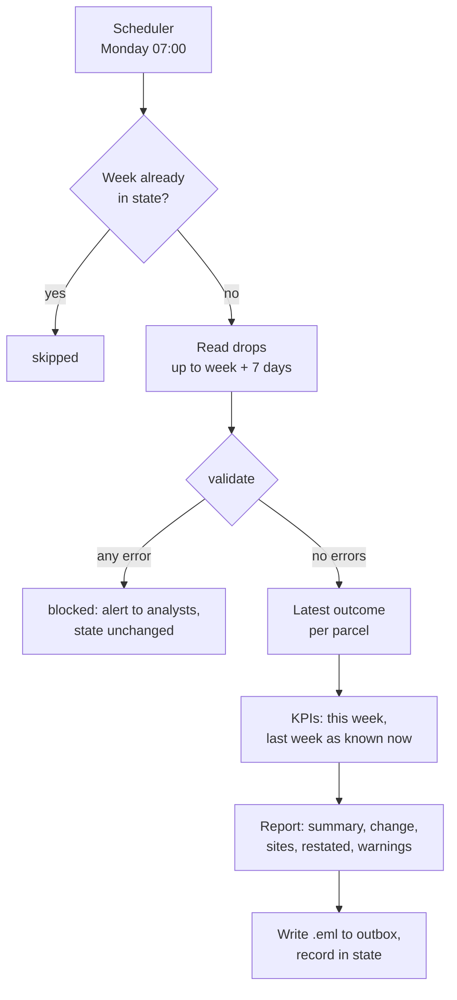

# Automated analytics reporting

Business question: make the weekly business review build, test and send itself, so it is never wrong quietly, never sent twice, and says when last week's numbers changed.

## Before you start

- **Level:** 3 (advanced). A capstone: an ambiguous brief, several messy files, and a deliverable a hiring manager can open and run.
- **Time:** about 10 hours.
- **Builds on:** [Automate the weekly report](../../05-python-for-analysts/04-automate-the-weekly-report/) (the Monday report as one command, idempotent), [Data quality tests as code](../../05-python-for-analysts/09-data-quality-tests-as-code/) (checks that stop a bad load), [Incremental models and backfills](../../08-modern-data-stack/03-incremental-models-and-backfills/) (late rows and lookback), [Dates, weeks and time zones](../../05-python-for-analysts/03-dates-weeks-and-time-zones/) and [Explain findings to leadership](../../07-getting-hired/06-explain-findings-to-leadership/).
- **You need:** Python 3.9 or later. Nothing to install. No email server: "sending" writes an `.eml` file to an outbox folder, and nothing touches the network.
- **How this capstone is built:** see the [phase README](../README.md). [BRIEF.md](BRIEF.md) is the request, [DELIVERABLES.md](DELIVERABLES.md) says what to hand in, [RUBRIC.md](RUBRIC.md) scores the parts with no single right answer, and `solution/` is the worked answer to read after you finish.

## The problem

Parcelwick, a fictional parcel-locker network with five sites in Bristol, sends a weekly business review (WBR) to its leadership every Monday. Femi builds it by hand from the courier system's 06:00 drop, and Femi leaves on 6 November 2026. Owen Marsh, the COO, wants the WBR to run itself at 07:00 with three rules: never send wrong numbers quietly (alert the analysts instead), never send twice, and say when last week's numbers have changed. He also wants Bedminster's on-time problem visible without anyone asking. Read the full request and the data team's notes in [BRIEF.md](BRIEF.md).

The files in `data/` are synthetic, generated by `make_data.py` with a fixed seed: `sites.csv` (5 sites) and `drops/` (14 files: 13 weekly drops from 3 August to 26 October 2026 and one re-sent copy, 142 to 214 rows each). `report_config.json` holds the addresses and thresholds.

## In plain words

Think of a newspaper. It goes out every morning without the editor typing it fresh. Stories come in from reporters, the subeditors check them, and if a story fails the checks it is held back, not printed with a question mark. If yesterday's paper had an error, today's prints a correction. And the printing press never prints the same edition twice.

An automated report is that newspaper. The drop is the reporters' copy, the validation is the subeditors, the outbox is the press, the state file is the log of what was printed, and the "Restated" note is the correction.

Terms used in this capstone:

- **WBR (weekly business review):** the weekly email of the few numbers leadership steers by.
- **Drop:** a file another system delivers to a folder on a schedule, here every Monday at 06:00.
- **Pipeline:** the steps from raw drop to sent report: read, check, clean, compute, write, send.
- **Validation:** checks on the data before any number is computed. An **error** blocks sending; a **warning** is sent with the report.
- **Schema:** the columns a file must have. **Schema drift:** a source changes its columns or codes without telling you.
- **Idempotent:** running it twice has the same effect as running it once. Here, the second run sends nothing.
- **State:** a small file the pipeline keeps between runs, here `state.json` with each week it sent and the numbers it said.
- **Deterministic:** the same input gives the same output, byte for byte.
- **Restatement:** a number already sent that has changed because late data arrived. A good report says so.
- **Outbox:** a folder where finished emails wait for a mail relay to send them. Writing the file is the last thing the pipeline does.
- **Scheduler:** a program that starts another at set times, such as cron on Linux and macOS or a scheduled job in a CI service.
- **.eml:** a plain-text file holding one email in the standard format, which any mail program can open.

## What you will build from scratch

- `read_drops` and `normalise_outcome`: read every drop up to a date and map two generations of outcome codes to one.
- `clean_parcels`: the latest outcome per parcel, across late rows, attempt rows and a copied file.
- `weekly_kpis`: the week's numbers, total and by site.
- `validate`: the errors that block and the warnings that travel with the report.
- `render_report`: the email body, starting with a summary block a machine can read.
- `run`: the whole pipeline for one week: skipped, blocked or sent, with state.
- An outbox with two weeks of email, an alert from a broken load, a runbook and a design note ([DELIVERABLES.md](DELIVERABLES.md)).

## The idea

A report that runs itself has to make the decisions a careful analyst makes by eye, every week, with nobody watching. Write those decisions down as code, in this order:



**One row per parcel.** The latest outcome of each parcel is the truth: latest `outcome_date`, then latest drop. That one rule absorbs the old app's attempt rows (an `F` followed by a `D`), the late rows and the copied file, without special cases.

**One week per parcel.** A parcel counts in the week of its latest outcome. The alternative, the week it was promised, makes every newest week look better than it is: late deliveries have not happened yet, so they are missing from the count, and the on-time rate is flattered. The walk through and Common mistakes show by how much.

**Errors versus warnings.** Ask: does this make every number wrong, or one number low in a way a reader can understand? A missing column, an outcome code nobody mapped, an empty week or a volume collapse make every number untrustworthy: block, and alert the analysts. A site that sent nothing this week lowers the totals in a way a sentence can explain: send, and name the site next to the totals.

**Volume check.** Let n be this week's parcels and m the mean of the four weeks before. Block when n < 0.5 x m. The threshold is in `report_config.json` because it is a business choice, not a fact.

**State and restatement.** After sending, record the week and its summary numbers. Next week, recompute last week from all drops so far and compare with what was sent. If parcels or on-time moved, the email says "it was X, it is Y". The same state makes the pipeline idempotent: a week in the state is skipped.

**Determinism.** The email's Date header comes from the week, not the clock, and its MIME boundary from the subject (`write_email` is given). So the same drop always writes the same bytes, and "did anything change?" is a byte comparison.

## Walk through

This walk through finds the mess in the drops and shows how much each part of it moves the numbers. It stops before the pipeline, which is yours to build. Run the blocks in order in one Python session started in this folder (`python3`).

Step 1. List the drops and check the suspected copy.

```python
import csv, os
from collections import Counter, defaultdict

drops = {}
for name in sorted(os.listdir("data/drops")):
    with open(os.path.join("data/drops", name), newline="") as f:
        drops[name] = list(csv.DictReader(f))
for name, rows in drops.items():
    print(name, len(rows), "rows")
print("the resend is an exact copy:",
      drops["parcels_2026-10-12.csv"] == drops["parcels_2026-10-12_resend.csv"])
```

```
parcels_2026-08-03.csv 187 rows
parcels_2026-08-10.csv 193 rows
parcels_2026-08-17.csv 197 rows
parcels_2026-08-24.csv 214 rows
parcels_2026-08-31.csv 203 rows
parcels_2026-09-07.csv 199 rows
parcels_2026-09-14.csv 151 rows
parcels_2026-09-21.csv 176 rows
parcels_2026-09-28.csv 181 rows
parcels_2026-10-05.csv 166 rows
parcels_2026-10-12.csv 185 rows
parcels_2026-10-12_resend.csv 185 rows
parcels_2026-10-19.csv 184 rows
parcels_2026-10-26.csv 142 rows
the resend is an exact copy: True
```

The copy is harmless if you keep one outcome per parcel, and doubles a week if you count rows. Notice the step down in rows from 14 September: the new app writes only the final outcome, so fewer rows describe the same parcels.

Step 2. The outcome codes, before and after the app change.

```python
codes = Counter()
for name, rows in drops.items():
    era = "before 14 Sep" if name < "parcels_2026-09-14" else "from 14 Sep"
    for r in rows:
        codes[(era, r["outcome"])] += 1
for key, n in sorted(codes.items()):
    print(key, n)
```

```
('before 14 Sep', 'D') 976
('before 14 Sep', 'F') 187
('before 14 Sep', 'R') 30
('from 14 Sep', 'delivered') 1294
('from 14 Sep', 'failed') 32
('from 14 Sep', 'returned') 44
```

Two vocabularies for the same three outcomes. Map both, and treat any other value as an error: the next app update could add a fourth spelling, and the pipeline must stop rather than drop those rows.

Step 3. Several rows per parcel.

```python
rows = [(name[8:18], r) for name, rs in drops.items() for r in rs]
by_parcel = defaultdict(list)
for drop, r in rows:
    by_parcel[r["parcel_id"]].append((drop, r))
print("rows", len(rows), " parcels", len(by_parcel))
pid = next(p for p, v in by_parcel.items() if len({r["outcome"] for _, r in v}) > 1)
for drop, r in by_parcel[pid]:
    print(" drop", drop, r["parcel_id"], r["site_id"], "promised", r["promised_date"], r["outcome"], r["outcome_date"], r["fee_gbp"])
```

```
rows 2563  parcels 2224
 drop 2026-08-03 P000015 PW01 promised 2026-07-27 F 2026-07-27 0.00
 drop 2026-08-03 P000015 PW01 promised 2026-07-27 D 2026-07-28 2.99
```

P000015 failed its first attempt on the promised day and was delivered the next: one parcel, delivered, late. Counting rows would also count a failure that did not stick.

Step 4. Late rows, and what they do to a week that was already reported.

```python
import datetime as dt

def monday(day):
    d = dt.date.fromisoformat(day)
    return (d - dt.timedelta(days=d.weekday())).isoformat()

def next_monday(day):
    return (dt.date.fromisoformat(monday(day)) + dt.timedelta(days=7)).isoformat()

late = [(drop, r) for drop, r in rows if drop > next_monday(r["outcome_date"])]
print("rows that missed their Monday:", len(late), "of", len(rows))
CODES = {"D": "delivered", "F": "failed", "R": "returned"}

def week_numbers(week, up_to):
    best = {}
    for drop, r in sorted(rows, key=lambda x: (x[1]["outcome_date"], x[0])):
        if drop <= up_to:
            best[r["parcel_id"]] = (r, CODES.get(r["outcome"], r["outcome"]))
    end = (dt.date.fromisoformat(week) + dt.timedelta(days=6)).isoformat()
    mine = [(r, o) for r, o in best.values() if week <= r["outcome_date"] <= end]
    on_time = sum(1 for r, o in mine if o == "delivered" and r["outcome_date"] <= r["promised_date"])
    return len(mine), round(100.0 * on_time / len(mine), 2)

print("week of 2026-10-12 as of the 19 October drop:", week_numbers("2026-10-12", "2026-10-19"))
print("week of 2026-10-12 as of the 26 October drop:", week_numbers("2026-10-12", "2026-10-26"))
```

```
rows that missed their Monday: 120 of 2563
week of 2026-10-12 as of the 19 October drop: (179, 85.47)
week of 2026-10-12 as of the 26 October drop: (186, 86.02)
```

The week of 12 October was 179 parcels and 85.47% on time on the morning it would have been sent, and 186 parcels and 86.02% a week later. That is Owen's third complaint, measured. The pipeline cannot stop it; it can say so.

Step 5. Who sent what in the latest drop.

```python
per_site = Counter()
for drop, r in rows:
    if drop == "2026-10-26":
        per_site[r["site_id"]] += 1
with open("data/sites.csv", newline="") as f:
    for s in csv.DictReader(f):
        print(s["site_id"], s["site_name"].ljust(10), "rows in the 26 October drop:", per_site[s["site_id"]])
```

```
PW01 Clifton    rows in the 26 October drop: 46
PW02 Bedminster rows in the 26 October drop: 38
PW03 Redland    rows in the 26 October drop: 24
PW04 Easton     rows in the 26 October drop: 34
PW05 Southville rows in the 26 October drop: 0
```

Southville sent nothing. Nobody mentioned it in the notes; that is exactly what a check is for. Now build the pipeline in `exercise.py`.

## Common mistakes

**1. Counting rows instead of parcels (the trap).** For the week of 5 October there are 351 rows with an outcome date in the week, and 178 parcels: the re-sent copy doubles it. Across all drops, 2,563 rows describe 2,224 parcels. Any count must be over `parcel_id` after picking the latest outcome.

**2. Filtering on one spelling.** `outcome == "D"` finds no delivered parcels at all from 14 September; the week of 19 October would report 0 delivered and 0% on time, and a pipeline without an outcome check would send it. Map every known code, and block on anything unknown.

**3. Counting parcels in the week they were promised.** It sounds natural and it flatters every newest week, because the late deliveries have not happened yet. For the week of 12 October it would have reported 90.00% on time; a week later the same week was 84.66%. By outcome week the email said 85.47% and the restated figure is 86.02%.

**4. No state.** Without a record of what was sent, a re-run sends the email again, and the next week cannot say what changed. Keep the state small, readable and backed up, and never record a blocked week as sent.

**5. Percent change on tiny counts.** Failed parcels went from 1 to 5 in the week of 19 October: "+400.0%" in the solution's table. That is four parcels. Show differences for small counts, and keep percentages for amounts and points for rates.

## Your turn

Open [DELIVERABLES.md](DELIVERABLES.md). It lists everything to hand in and the exact rules. Start with `exercise.py`: fill in every function under "yours", then run, from this folder:

    python3 test_lesson.py

The test runs your functions on the committed data, on a second dataset built from another seed, and on hand-made drops: both code sets, an unknown outcome, an attempt row followed by a delivery, two drops with the same outcome date, a parcel resolved on the Monday after its week, a missing column, an empty week, a volume collapse, a silent site and an unknown site. It runs your `run` end to end in temporary folders: two weeks sent, a repeat skipped, a broken drop blocked with an alert, and the same email written byte for byte twice. To check the reference answer: `CHECK_SOLUTION=1 python3 test_lesson.py`.

Then produce the outbox, the runbook and the design note, and score them with [RUBRIC.md](RUBRIC.md). Read `solution/` only after that: [solution/WRITEUP.md](solution/WRITEUP.md) is a two-point answer on every rubric row, and `solution/sample_outbox/` holds the emails the worked solution writes.

Stretch: add a like-for-like line to the report, totals over the sites that reported in both weeks, so a silent site no longer shows up as a 27% fall in parcels. Which check should decide which sites count?

## Check yourself

1. Why does a silent site warn instead of block, while an unknown outcome code blocks?
2. The pipeline crashed after writing the email but before saving the state. What happens on the next run, and how would you make that impossible?
3. Owen asks why the email for last week said 179 parcels and this week's says 186 for the same week. What do you tell him?
4. Why does the test insist on byte-for-byte identical emails?

<details>
<summary>Answers</summary>

1. An unknown code makes the totals wrong in a way nobody reading the email can see: rows vanish from delivered, failed and on-time at once. A silent site lowers the totals in one explainable way, and the email can name it next to the numbers. Block when the reader cannot correct for it; warn when one sentence lets them.
2. The week is not in the state, so the next run sends it again. Write the email to a temporary name, save the state, then rename the email into the outbox (a rename is a single step on one disk), or check for the email file as well as the state before sending.
3. Seven more parcels from that week arrived in the next drop: rows that missed their Monday, about one in twenty. The email now says "Restated" with both numbers, and the newest week will always move a little, which is why it is labelled as still moving.
4. So "has anything changed?" has a yes or no answer. If the same input can produce different files, you cannot tell a re-run from a change, and you cannot test idempotency at all.

</details>

## What to tell the stakeholder

To Owen: "The WBR now builds, checks and sends itself every Monday at 07:00: it refuses to send when the data is broken and emails analytics instead, it never sends a week twice, and it says when last week's numbers moved (the week of 12 October went from 179 parcels and 85.47% on time to 186 and 86.02% once late rows arrived). This week's email flags that Southville sent no data, which explains about half of the fall in parcels, and its 4-week site table shows Bedminster at 85.7%, 63.4%, 82.5% and 73.0% on time since the contract change. I recommend Femi's replacement owns the runbook from 6 November, and that we add a like-for-like parcels line after the first month so a silent site no longer reads as a fall in volume. The newest week is never final: expect it to move by up to about a point of on-time."

## In real job postings

In the Real Analyst Jobs data drop of 25 October 2026, 996 of the 2,056 US analyst postings that name a tool (48.4%) ask for Python, the language this pipeline is written in, and 1,477 (71.8%) ask for SQL. See [Python data analyst jobs](https://realanalystjobs.com/jobs/python-data-analyst-jobs).

## Next

[10-07: A natural-language-to-SQL assistant](../07-nl-to-sql-assistant/)
