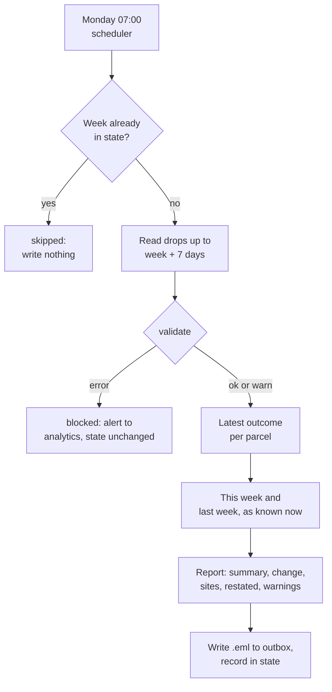

# Worked solution: the Parcelwick weekly pipeline

Read this after you have tried the capstone. Every number comes from `python3 solution/solution.py` on the committed (synthetic) data, which rebuilds [sample_outbox/](sample_outbox/). Part of capstone [10-06](../README.md).

## How I approached it

1. **Owen's three rules are the spec.** Never wrong quietly, never twice, say when numbers change. Each became a test before it became code: a broken drop must produce an alert and no report; a second run must write nothing; an email must carry a "Restated" note when last week moved.
2. **Clean by rule, not by luck.** The latest outcome per parcel handles the old app's attempt rows, the late rows and the copied file with one rule. A mapping handles both code sets, and anything outside it blocks the run instead of disappearing.
3. **Separate "every number is wrong" from "one number is low".** A missing column, unknown codes, an empty week or a collapsed volume make every number untrustworthy: block. A silent site lowers the totals in a way a reader can understand: send, and say so next to the totals.
4. **Make the output reproducible.** Fixed Date header and MIME boundary, sorted state, no clock reads: the same drop writes the same bytes, which is what makes "did it change?" a question you can answer.

## The two emails

| | Week of 12 October | Week of 19 October |
|---|---|---|
| Subject | Parcelwick WBR, week of 2026-10-12: on time 85.5% | Parcelwick WBR, week of 2026-10-19: on time 83.7% |
| Parcels | 179 | 135 |
| On time | 85.47% | 83.70% |
| Revenue | GBP 569.75 | GBP 402.75 |
| Issues | none | warn: site PW05 silent |
| Restated note | none (first run) | last week 179 parcels, 85.47% on time as sent; 186 and 86.02% now |

A third run for 19 October returns "skipped" and writes nothing.

## Decisions worth defending

**Week of the latest outcome.** Counting a parcel in the week it was promised would make every newest week look better than it is: the late deliveries have not happened yet. On this data, the week of 12 October counted by promise date showed 90.00% on time when it would have been sent and 84.66% a week later. Counting by outcome week, the email for 12 October said 85.47% and the restated figure is 86.02%: it still moves, because about one row in twenty arrives a week late, but by about half a point, not five (by up to about a point over the last three weeks).

**Restating instead of freezing.** A frozen number is wrong forever; a restated one is right and explained. The state file keeps what was sent, so the next email can say "it was X, it is Y".

**Where the error line sits.** Unknown outcome codes block, because the 14 September app change shows how one new spelling silently zeroes "delivered". A silent site only warns: the week of 19 October has no rows from Southville (PW05), which lowers parcels to 135 against 186 the week before; the email names PW05 under "Data warnings", and the site table and 4-week table show it as missing rather than zero.

**Bedminster.** The by-site table plus a 4-week on-time table makes it visible without anyone asking: 85.7%, 63.4%, 82.5% and 73.0% in the four weeks to 19 October, the lowest of the five sites in two of the four and below 75% twice. Before the contract change it was in line with the others.

## The runbook, in short

- **Schedule:** Monday 07:00, after the 06:00 drop. With cron (reference only, check your scheduler's docs): `0 7 * * 1 cd /path/to/capstone && python3 solution/solution.py --week $(date -d 'last monday' +\%F) --outbox outbox`. The command must be given the week that ended yesterday.
- **Blocked:** read `outbox/alerts/<week>_blocked.eml`. Schema or outcome errors mean the courier system changed something: fix the mapping or the export, then run again. Empty or volume errors mean the drop is incomplete: ask the courier team for the file, then run again. A blocked week is not in the state, so the next run retries it.
- **Re-send on purpose:** delete the week's entry from `outbox/state.json` and its `.eml`, then run the week again.
- **Back up:** `outbox/state.json`. Losing it means the next email cannot say what was sent last week, and a re-run would send again.

## What I would change after the first month

The parcels row compares a week with a silent site to a week without one (-27.4%). A like-for-like line, totals over sites present in both weeks, would separate "volume fell" from "a site did not report". I would also show changes in tiny counts (failed 1 to 5) as differences, not percentages.

## Limits

- The newest week is never final: late rows moved on-time by 0.1 to 0.9 points in the last three weeks.
- A parcel that has not been resolved yet is invisible: there is no row until something happens to it. The pipeline cannot count parcels stuck in transit.
- The old app's attempt rows mean "failed" before 14 September includes parcels later delivered, until their delivery row arrives. Weeks around the switch are less comparable on failed counts.
- Sending is a file in a folder. In production, the mail relay, its retries and its bounce handling are a separate system to test.
