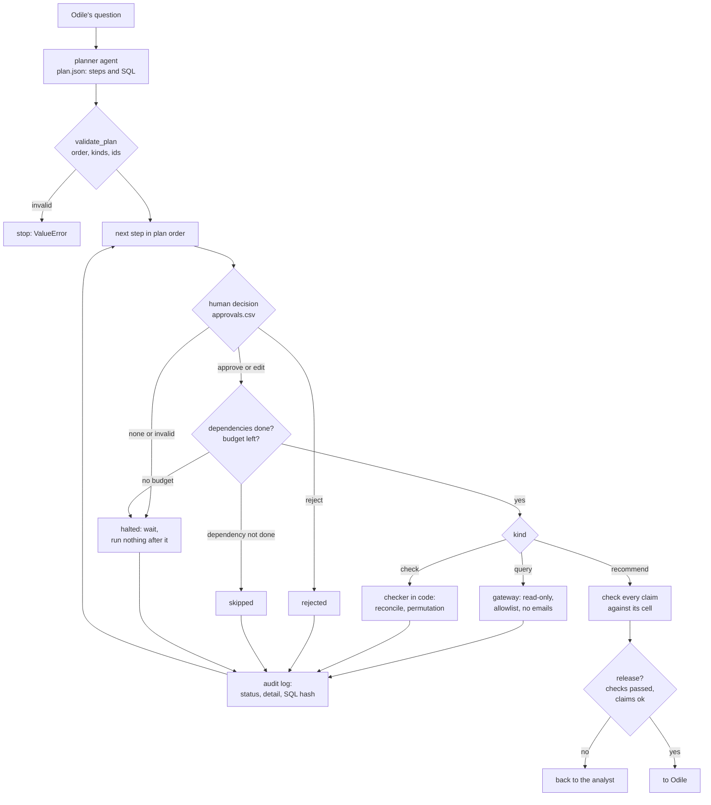

# A multi-agent analytics copilot

Business question: agents that plan, query, check and recommend, with a human approving each step. Can we trust what they found about the fall in weekend rentals, and what should we do?

## Before you start

- **Level:** 3 (advanced). A capstone: an ambiguous brief, several messy tables, and a deliverable a hiring manager can open and run.
- **Time:** about 14 hours.
- **Builds on:** [A natural-language-to-SQL assistant](../07-nl-to-sql-assistant/) (the gateway this copilot runs every query through), [An analytics agent loop from scratch](../../06-ai-for-analysts/13-agent-loop-from-scratch/) and [Audit an agent's work](../../06-ai-for-analysts/14-audit-an-agent-run/) (one agent, its steps and its log), [Catch made-up numbers](../../06-ai-for-analysts/03-catch-made-up-numbers/) (checking a number at the precision it is written), [Human in the loop: confidence thresholds](../../06-ai-for-analysts/08-human-in-the-loop-thresholds/), [Hypothesis test by permutation](../../02-statistics-and-experiments/08-hypothesis-test-by-permutation/), [Diagnose a metric drop](../../03-metrics-and-product-analytics/10-diagnose-a-metric-drop/), [Duplicates and reconciliation](../../01-sql/08-duplicates-and-reconciliation/) and [Orchestration: a DAG runner](../../08-modern-data-stack/04-orchestration-dag-runner/).
- **You need:** Python 3.9 or later. Nothing to install. No API key: the agents' outputs are recorded in `data/`.
- **How this capstone is built:** see the [phase README](../README.md). [BRIEF.md](BRIEF.md) is the request, [DELIVERABLES.md](DELIVERABLES.md) says what to hand in, [RUBRIC.md](RUBRIC.md) scores the parts with no single right answer, and `solution/` is the worked answer to read after you finish.

## The problem

Bramblequay Bikes, a fictional e-bike rental company with docking stations in four zones of a city, saw weekend rentals fall by about a third in September. Odile Marchetti, the chief operating officer, asked the company's new analytics copilot why. Its agents planned the work, wrote and ran SQL, and drafted an answer that says rentals fell 49.7% and recommends a 15% discount sent to lapsed riders. Nadia, an analyst, approved, edited or rejected each step as it went. Before the ops meeting on Thursday 8 October 2026, Odile wants the session replayed under the team's rules, every number in the draft checked, and your own recommendation. Read the full request and the copilot's rules in [BRIEF.md](BRIEF.md).

The files in `data/` are synthetic, generated by `make_data.py` with a fixed seed: `rentals_raw.csv` (1,559 rows, July to September 2026), `stations.csv`, `station_events.csv`, `riders.csv`, and the recorded session: the plan (`plan.json`), Nadia's decisions (`approvals.csv`) and the draft (`draft.json`). **No model was called.** The agents' outputs and the reviewer's decisions are simulated, with planted problems, and `data/fixture.json` says so.

## In plain words

Think of a kitchen with a head chef, three cooks and a food-safety inspector. The head chef writes the order of work. Each cook does one job. Before any dish leaves the kitchen, the head chef tastes it and says yes, change it, or bin it. And the inspector checks the fridge temperatures with a thermometer, not by asking the cooks how cold it feels.

A multi-agent copilot is that kitchen. The **agents** are the cooks: one plans, one writes SQL, one writes the recommendation. The **human approval** is the head chef tasting each dish: nothing runs until a person says yes. The **checks** are the thermometer: code that tests the results, because a model asked "is this right?" will usually say yes. Your job is to build the kitchen's rules into code, replay a recorded shift, and decide what reaches the customer.

Terms used in this capstone:

- **Agent:** a model given one role and a fixed output format (here: planner, query agent, recommender). **Multi-agent:** several such roles passing work along.
- **Orchestrator:** the plain code that runs the plan, step by step, and enforces the rules. The agents suggest; the orchestrator decides what runs.
- **Plan:** a list of steps, each with a kind (query, check or recommend) and the steps it depends on. A step can only use results of steps that ran before it.
- **Human in the loop:** a person approves, edits or rejects each step before it runs.
- **Halt:** stop the session, because a step has no valid approval or the budget is used up. Nothing after it runs.
- **Budget:** the most steps one session may run, so a confused agent cannot loop forever.
- **Audit log:** a record of every step: what happened, why, and a **fingerprint** (SHA-256 hash, a short code that changes if one character of the SQL changes) of the exact SQL that ran.
- **Claim:** a number in the draft, with the step and cell it says it came from.
- **Reconciliation:** checking that parts add up to the whole (zones to the total).
- **Permutation test:** shuffle which days belong to which month many times and see how often the difference is as large as the real one; that share is the **p-value** ([lesson 02-08](../../02-statistics-and-experiments/08-hypothesis-test-by-permutation/)). Here every possible shuffle is counted, so the p-value is exact.

## What you will build from scratch

- `clean_rentals`: the snapshot: latest load wins, late rows out, false starts out in every month.
- `validate_plan`: refuse a plan whose steps are out of order, repeated or of an unknown kind.
- `run_plan`: the orchestrator: approvals, edits, rejections, dependencies, the budget, the gateway and the audit log.
- `reconcile`, `permutation_p` and `noise_check`: the checker, in code.
- `check_claims` and `release`: every number in the draft against its cited cell, and the decision whether the draft may go out.
- Your audit log, claim check, analysis table, chart and one-page write-up ([DELIVERABLES.md](DELIVERABLES.md)).

## The idea

The agents propose and the code disposes. Every arrow below that leads to the database or to Odile passes through code you write and test.



**1. Two walls, not one.** The human approval and the gateway protect different things. A person can approve a step that reads email addresses (people click "yes" when tired), and the gateway still blocks it. The gateway cannot tell a correct weekend filter from a wrong one, and the person can. Keep both.

**2. A step without a decision stops everything.** It is tempting to skip a step with no approval and carry on. Do not: later steps may depend on it, and a session that runs around a missing decision has quietly made the decision itself. Halt, log why, and mark the rest `not_reached`.

**3. Run what was approved, and log exactly that.** When the reviewer edits a step, the orchestrator runs the edited SQL, and the log stores the hash of the SQL that ran. Anyone can later check that the log matches what happened.

**4. Checks are code.** The reconciliation adds up S2's zones and compares them with S1's total for each month. The noise check runs an exact permutation test on daily weekend rentals outside Riverside: with 10 August days and 8 September days there are C(18, 8) = 43,758 ways to split the 18 days, so count them all.

**5. A claim is checked at the precision it is written.** "21.4" must be within 0.05 of the cited value, "49.7%" within 0.05 percentage points, "171" within 0.5 (the rule from [lesson 06-03](../../06-ai-for-analysts/03-catch-made-up-numbers/)). A claim citing a step that did not run is `not_run`, however plausible the number. A number with no claim is uncited, unless it is labelled as an assumption.

**6. Compare like with like.** Weekend rentals per month depend on how many weekend days the month had. August 2026 has 10 (it starts on a Saturday), September 8.

## Walk through

This walk through finds the mess in the data, reads the plan, and finds the two problems the checks are there to catch. It stops before your analysis and write-up. Run each block from this folder; `sys.path.insert(0, "solution")` lets Python find the worked answer.

Step 1. How messy are the raw rentals?

```python
import sys
sys.path.insert(0, "solution")
import solution as s

data = s.load()
raw = data["rentals_raw"]
ids = [r["rental_id"] for r in raw if r["loaded_at"] < s.SNAPSHOT]
print("raw rows", len(raw), "| loaded after the snapshot", sum(r["loaded_at"] >= s.SNAPSHOT for r in raw),
      "| extra loads", len(ids) - len(set(ids)), "| clean rentals", len(s.clean_rentals(raw)))
for month in ("2026-07", "2026-08", "2026-09"):
    short = {r["rental_id"] for r in raw if r["start_date"][:7] == month and int(r["duration_min"]) < 2}
    print(month, "rentals under 2 minutes:", len(short))
```

```
raw rows 1559 | loaded after the snapshot 9 | extra loads 50 | clean rentals 1434
2026-07 rentals under 2 minutes: 0
2026-08 rentals under 2 minutes: 28
2026-09 rentals under 2 minutes: 38
```

Nine rows (30 September's rentals) arrived after the snapshot and 50 are second loads of the same rental. July has no rentals under 2 minutes and August and September do: that is the definition change on 16 August, not riders behaving differently. Counting them would add rentals only to the later months.

Step 2. The plan and Nadia's decisions.

```python
import sys
sys.path.insert(0, "solution")
import solution as s

data = s.load()
decision = {a["step"]: a["decision"] for a in data["approvals"]}
for step in data["plan"]:
    print(step["step"], step["kind"], "after", step["depends_on"] or "-", "|", decision[step["step"]], "|", step["purpose"][:60])
```

```
S1 query after - | approve | Weekend rentals per month, and how many weekend days each mo
S2 query after - | approve | Weekend rentals by zone, August and September
S3 query after - | approve | Station closures that overlap August or September
S4 query after - | edit | Daily weekend rentals outside Riverside, August and Septembe
S5 query after - | reject | Email addresses of casual riders who rode in August but not 
S6 check after ['S1', 'S2'] | approve | The zones in S2 must add up to the monthly totals in S1 for 
S7 check after ['S4'] | approve | Is the change outside Riverside bigger than day-to-day varia
S8 recommend after ['S1', 'S2', 'S3', 'S4', 'S6', 'S7'] | approve | Draft the recommendation; every number must come from an app
```

Eight steps: five queries, two checks, one draft. Nadia approved six, edited S4 and rejected S5, which asks for riders' email addresses for a win-back offer: personal data that does not help find the cause.

Step 3. Why Nadia edited S4. The query agent wrote the weekend as `strftime('%w', start_date) IN ('5', '6')`.

```python
import sqlite3
conn = sqlite3.connect(":memory:")
for day in ["2026-09-04", "2026-09-05", "2026-09-06", "2026-09-07"]:
    print(day, conn.execute("SELECT strftime('%w', ?), strftime('%w', ?) IN ('5', '6'), strftime('%w', ?) IN ('0', '6')",
                            (day, day, day)).fetchone())
```

```
2026-09-04 ('5', 1, 0)
2026-09-05 ('6', 1, 1)
2026-09-06 ('0', 0, 1)
2026-09-07 ('1', 0, 0)
```

In SQLite, `%w` is 0 for Sunday and 6 for Saturday. The agent's filter keeps Friday 4 September and drops Sunday 6 September; Nadia's edit uses `('0', '6')`. The query ran without an error either way: only a person who knows the function, or a test on known dates, catches this. (`strftime('%w', ...)` is SQLite. PostgreSQL writes `EXTRACT(DOW FROM d)`, also 0 for Sunday; other databases differ, so check yours.)

Step 4. What the reconciliation will find: rentals at a station that is not in the station list.

```python
import os, sqlite3, sys, tempfile
sys.path.insert(0, "solution")
import solution as s

data = s.load()
path = os.path.join(tempfile.mkdtemp(), "bramblequay.db")
s.build_db(path, data)
conn = sqlite3.connect(path)
print(conn.execute("SELECT r.station_id, COUNT(*), MIN(r.start_date) FROM rentals r LEFT JOIN stations s "
                   "ON s.station_id = r.station_id WHERE s.station_id IS NULL GROUP BY r.station_id").fetchall())
print(conn.execute("SELECT COUNT(*) FROM rentals r LEFT JOIN stations s ON s.station_id = r.station_id "
                   "WHERE s.station_id IS NULL AND strftime('%w', r.start_date) IN ('0', '6')").fetchone())
```

```
[('BQ13', 15, '2026-09-12')]
(9,)
```

Station BQ13 started taking rentals on 12 September but nobody added it to `stations.csv`. S2 joins rentals to stations to get the zone, so BQ13's 9 weekend rentals vanish from the zone breakdown while S1, which has no join, counts them. An anti-join like this one ([lesson 01-06](../../01-sql/06-anti-joins-self-joins-and-union/)) finds them in one query.

Step 5. Replay the whole session.

```
python3 solution/solution.py
```

```
rentals: 1559 raw rows, 1434 clean
S1 done      1e567185a8 
S2 done      227cf5fa54 
S3 done      9a0425e041 
S4 done      e14a9ac9d9 ran the reviewer's edit
S5 rejected   personal data: emails are not needed to find the cause, and win-back goes through CRM
S6 done       FAILED
S7 done       passed
S8 done       not released
S6 {'passed': False, 'diffs': {'2026-08': 0, '2026-09': -9}}
S7 mean Aug 18.10, mean Sep 18.50, p = 0.8688
claims {'C1': 'ok', 'C2': 'ok', 'C3': 'mismatch', 'C4': 'ok', 'C5': 'ok', 'C6': 'ok', 'C7': 'ok', 'C8': 'ok', 'C9': 'ok', 'C10': 'ok', 'C11': 'ok', 'C12': 'ok', 'C13': 'not_run'}
release {'released': False, 'reasons': ['check S6 failed', 'claim C3: mismatch', 'claim C13: not_run', 'uncited number 15%']}
2026-08 per weekend day {'Riverside': 7.5, 'Other zones': 18.1, 'Unplaced': 0.0} total 25.60
2026-09 per weekend day {'Riverside': 1.75, 'Other zones': 18.5, 'Unplaced': 1.12} total 21.38
```

Every step ran or was stopped as the rules say, and the log holds the fingerprint of the SQL each query ran, including Nadia's edit of S4. The reconciliation failed by 9 in September: the BQ13 rentals from Step 4. Outside Riverside, the average weekend day went from 18.1 rentals to 18.5, and a difference that large or larger turns up in 87% of all ways to split the days (p = 0.87): no sign of a change. Eleven of the draft's 13 cited numbers are right. The draft is not released, for four reasons. The last two lines split weekend rentals per weekend day into Riverside, the other zones, and rentals the zone join could not place (BQ13), and the script redraws `solution/weekend_per_day.svg`. Turning that into an answer, and saying what each of the four reasons means, is your analysis.

## Common mistakes

**1. Comparing monthly totals when the months have different numbers of weekend days (the trap).**

```python
import datetime, sys
sys.path.insert(0, "solution")
import solution as s

rentals = s.clean_rentals(s.load()["rentals_raw"])
total, per_day = {}, {}
for month in ("2026-08", "2026-09"):
    days = {r["start_date"] for r in rentals if r["start_date"][:7] == month
            and datetime.date.fromisoformat(r["start_date"]).weekday() >= 5}
    total[month] = sum(1 for r in rentals if r["start_date"] in days)
    per_day[month] = total[month] / len(days)
    print(month, "weekend rentals", total[month], "weekend days", len(days), "per day %.1f" % per_day[month])
fall = lambda d: (d["2026-08"] - d["2026-09"]) / d["2026-08"] * 100
print("fall in the total %.1f%%, fall per weekend day %.1f%%" % (fall(total), fall(per_day)))
```

```
2026-08 weekend rentals 256 weekend days 10 per day 25.6
2026-09 weekend rentals 171 weekend days 8 per day 21.4
fall in the total 33.2%, fall per weekend day 16.5%
```

Half of the "fall by a third" is the calendar: August had two more weekend days. A dashboard that compares monthly totals will show a fall like this every time a 10-weekend-day month is followed by an 8-day one, with nothing wrong.

**2. Trusting a number because it has a citation.** Claim C3 cites the right cells and still says the wrong thing:

```python
import json
draft = json.load(open("data/draft.json"))
c3 = [c for c in draft["claims"] if c["id"] == "C3"][0]
print(c3["text"], c3["from"], c3["to"])
print("from August: %.1f%%   from September: %.1f%%" % ((256 - 171) / 256 * 100, (256 - 171) / 171 * 100))
```

```
49.7% {'expr': 'rentals', 'step': 'S1', 'where': {'month': '2026-08'}} {'expr': 'rentals', 'step': 'S1', 'where': {'month': '2026-09'}}
from August: 33.2%   from September: 49.7%
```

The recommender divided the fall by September instead of August. Both inputs are right, so a reviewer who only checks that the cited cells exist passes it. Recompute every derived number from its inputs.

**3. Treating approval as the only safety wall.** If Nadia had clicked approve on everything:

```python
import os, sys, tempfile
sys.path.insert(0, "solution")
import solution as s

data = s.load()
path = os.path.join(tempfile.mkdtemp(), "bramblequay.db")
s.build_db(path, data)
careless = [dict(a, decision="approve") for a in data["approvals"]]
run = s.run_plan(data["plan"], careless, path, data["draft"])
print([(e["step"], e["status"], e["detail"]) for e in run["log"] if e["step"] in ("S4", "S5")])
```

```
[('S4', 'done', ''), ('S5', 'blocked', 'column riders.email is not allowed')]
```

The email query is still blocked: the gateway does not care who approved it. But S4 runs with Friday as a weekend day, and nothing stops that. Approval catches meaning; the gateway catches access. Neither replaces the other.

**4. Letting the model check its own work.** Asked "do the zones add up?", a model that wrote the plan will say yes. The reconciliation is three lines of code and it found the missing station. Every check step in a copilot should be code with a pass or fail, and a failed check should stop the release, as S6 does here.

**5. Counting the new kind of row.** From 16 August the app logs false starts:

```python
import datetime, sys
sys.path.insert(0, "solution")
import solution as s

raw = s.load()["rentals_raw"]
kept = s.clean_rentals(raw)
with_short = s.clean_rentals([dict(r, duration_min=str(max(2, int(r["duration_min"])))) for r in raw])
for label, rows in (("rentals of 2 minutes or more", kept), ("false starts counted too", with_short)):
    wk = [r for r in rows if datetime.date.fromisoformat(r["start_date"]).weekday() >= 5]
    aug = sum(r["start_date"][:7] == "2026-08" for r in wk)
    sep = sum(r["start_date"][:7] == "2026-09" for r in wk)
    print("%-29s August %d, September %d" % (label, aug, sep))
```

```
rentals of 2 minutes or more  August 256, September 171
false starts counted too      August 271, September 194
```

With false starts, September gains 23 weekend rentals and August only 15 (it had them for half the month), so the fall looks smaller and the month-on-month trend bends at 16 August for no real reason. Apply one definition to every month.

## Your turn

Open [DELIVERABLES.md](DELIVERABLES.md). It lists everything to hand in and the exact rules. Start with `exercise.py`: loading, `build_db`, the gateway `run_guarded`, `sql_hash` and `parse_number` are given; fill in every function that raises `NotImplementedError`, then run, from this folder:

    python3 test_lesson.py

The test rebuilds the clean rentals a second way, on the committed data and on a second city built from another seed. It checks plan validation on six broken plans, the reconciliation and the claim checker on hand-made cases (a comma in a number, a ratio, the precision rule, a step that was rejected, a row that does not exist, a labelled assumption), and your permutation p-value against an exact count of subset sums and a seeded simulation. It replays the session on both datasets and checks every status, the SQL fingerprint of the edited step, every query's rows against plain Python, the checks, every claim's verdict against an answer key that `make_data.build()` keeps in memory, and the release. It also replays variants: a missing approval, a rejected dependency, an unedited S4, an approved email query, a budget of 3 steps and an invalid plan. The database file is hashed after every replay. To check the reference answer: `CHECK_SOLUTION=1 python3 test_lesson.py`.

Then write the audit log table, the claim check, the analysis table, the chart and the one-page write-up, and score them with [RUBRIC.md](RUBRIC.md). Read `solution/` only after that: [solution/WRITEUP.md](solution/WRITEUP.md) is a two-point answer on every rubric row, with the reasoning.

Optional: `live_run.py` sends the planner and recommender prompts to a real model through a command you supply, which holds your own key, so you can replay a live session with the same rules.

Stretch: add a third check step to the plan, `definition`, that fails if any rental in a query result lasted under 2 minutes, and make the orchestrator accept it. Then write a short policy: which kinds of step may run without a human decision (for example a check step that only reads earlier results), and what must still stop?

## Check yourself

1. Why must the copilot halt, rather than skip, when a step has no decision?
2. Nadia rejected S5. If she had approved it, what would have happened, and why is that not a reason to drop the approval step?
3. The draft's C3 cites the right step and the right cells. Why is it still wrong, and what in your code caught it?
4. Odile asks: "So did fewer people want bikes in September?" What do you answer?

<details>
<summary>Answers</summary>

1. Later steps may depend on it, and the person has not decided. Skipping it means the code decided on the person's behalf, and the results of later steps would be built on a choice nobody made. Halting is safe and visible; the log says where and why.
2. The gateway would have blocked it, because it reads `riders.email`. The approval step is still needed because it catches what the gateway cannot: S4's wrong weekend filter ran without an error, and only a person (or a test) knew Friday is not the weekend.
3. It divides the fall by September's total instead of August's: 49.7% instead of 33.2%. `check_claims` recomputes a `pct_fall` claim from its two cited cells and compares it at the stated precision.
4. No. Per weekend day, rentals went from 25.6 to 21.4. Riverside alone fell by 5.8 per day while its three stations were closed for roadworks from 7 September; the other zones went from 18.1 to 18.5 per day, well within normal variation (p = 0.87), and the new BQ13 station added about 1.1. Half of the fall in the monthly total is only the calendar: 8 weekend days instead of 10.

</details>

## What to tell the stakeholder

To Odile: "Weekend demand did not fall. Per weekend day, rentals went from 25.6 in August to 21.4 in September, and that is the Riverside roadworks: its three stations were closed from 7 September and its weekend rentals fell from 7.5 a day to under 2, while the other zones were flat (18.1 to 18.5 a day, normal variation). The rest of the 'third' is the calendar, since September had 8 weekend days to August's 10. I recommend no discount; instead, confirm Riverside reopened on 1 October and check October's weekends per day, and add the new BQ13 station to the station list, which is why the copilot's own check failed. The copilot's draft overstated the fall (49.7% instead of 33.2%) and used a number from a step Nadia had rejected, and both were caught before they reached you. Limits: one month of closure, 8 weekend days, and no weather data."

## In real job postings

Checking an AI system's work step by step is analyst work in Python and SQL. In the Real Analyst Jobs data drop of 25 October 2026, 996 of the 2,056 US analyst postings that list a tool ask for Python (48.4%), and 1,477 ask for SQL (71.8%). See [how to become an AI analyst](https://realanalystjobs.com/tools/how-to-become-an-ai-analyst) and [Python data analyst jobs](https://realanalystjobs.com/jobs/python-data-analyst-jobs).

## Next

You have reached the last capstone. Go back to the [phase 10 overview](../README.md) to pick another project, and see [Publish your portfolio](../../07-getting-hired/12-publish-your-portfolio/) to turn this one into a portfolio piece.
