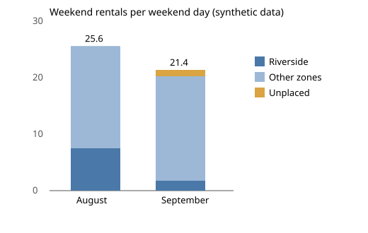

# Worked solution: the Bramblequay weekend question

Read this after you have built your own. The numbers come from `python3 solution/solution.py` on the committed (synthetic) data, and the agents' outputs it replays are simulated. The reasoning notes in italics say why each choice was made; they are not part of the page Odile gets.

## The audit log

| Step | Agent | For | Decision (Nadia) | Status | SQL fingerprint |
|---|---|---|---|---|---|
| S1 | query | Weekend rentals and weekend days per month | approve | done | 1e567185a8 |
| S2 | query | Weekend rentals by zone, August and September | approve | done | 227cf5fa54 |
| S3 | query | Station closures in August and September | approve | done | 9a0425e041 |
| S4 | query | Daily weekend rentals outside Riverside | edit | done (edited SQL) | e14a9ac9d9 |
| S5 | query | Emails of lapsed casual riders | reject | rejected | none |
| S6 | checker | Zones add up to the total | approve | done, FAILED | none |
| S7 | checker | Permutation test outside Riverside | approve | done, passed | none |
| S8 | recommender | Draft | approve | done, not released | none |

- **S4 was edited.** The query agent wrote the weekend as `strftime('%w', ...) IN ('5', '6')`, which is Friday and Saturday in SQLite. Nadia changed it to `('0', '6')`. Without the edit, the noise test would have compared Fridays and Saturdays.
- **S5 was rejected.** It asked for riders' email addresses. They are not needed to find the cause, and the gateway would have blocked the email column even if she had approved it.
- **S6 failed.** In September the zones add up to 9 fewer weekend rentals than the total. Station BQ13 started on 12 September and is not in `stations.csv`, so its rentals drop out of the zone join.

*Reasoning: the log is the evidence that nothing ran without a person's decision. The fingerprint lets anyone check that the S4 that ran is Nadia's version, not the agent's.*

## The claim check

| Claim | Says | Cited | Found | Verdict |
|---|---|---|---|---|
| C1 | 256 (August weekend rentals) | S1 | 256 | ok |
| C2 | 171 (September) | S1 | 171 | ok |
| C3 | 49.7% drop | S1, August to September | 33.2% | mismatch: divided by September, not August |
| C4, C5 | 8 and 10 weekend days | S1 | 8 and 10 | ok |
| C6, C7 | 25.6 and 21.4 per weekend day | S1 | 25.6 and 21.375 | ok |
| C8, C9 | Riverside 75 and 14 | S2 | 75 and 14 | ok |
| C10 | 3 stations closed | S3 | 3 | ok |
| C11 | +2.2% outside Riverside | S7 | +2.2% | ok |
| C12 | p = 0.87 | S7 | 0.8688 | ok |
| C13 | 52 casual riders | S5 | (rejected) | not_run: cannot be used |
| none | 15% discount | none | | uncited: an unlabelled proposal |

*Reasoning: 11 of 13 cited numbers were right. That is worth saying: the copilot did most of the work well, and the two bad numbers were caught by code, not by luck.*

## The analysis: weekend rentals per weekend day

| | August (10 weekend days) | September (8) | Change |
|---|---|---|---|
| Riverside | 7.5 | 1.75 | -5.75 |
| Other zones | 18.1 | 18.5 | +0.4 |
| Unplaced (BQ13, not in the station list) | 0.0 | 1.125 | +1.125 |
| **All** | **25.6** | **21.375** | **-4.225** |

- The monthly total fell 33.2% (256 to 171). Per weekend day it fell 16.5%. The other half is the calendar: September 2026 had 8 weekend days, August 10.
- Riverside's three stations were closed from 7 September to 30 September for roadworks. Its weekend rentals fell from 7.5 to 1.75 a day; the 14 September rentals are all from the first weekend, before the closure.
- Outside Riverside, the average weekend day went from 18.1 to 18.5 rentals. In an exact permutation test over all 43,758 ways to split the 18 weekend days, a difference at least that large turns up 87% of the time (p = 0.87): no evidence of any change.

## The chart

Weekend rentals per weekend day, synthetic data. Riverside shrinks; the other zones do not.

## The page for Odile

**Weekend demand did not fall.** Per weekend day, rentals went from 25.6 in August to 21.4 in September, and all of that drop is Riverside, whose three stations were closed for roadworks from 7 September: its weekend rentals went from 7.5 a day to under 2. The other zones were flat (18.1 to 18.5 a day, well within normal variation). The "fall by a third" on the dashboard is half calendar: September had 8 weekend days and August 10.

**What I recommend.**
1. No discount. There is no sign that riders outside Riverside rode less, so a discount would cost money without a cause to fix.
2. Confirm that Riverside reopened on 1 October as planned, and report October's weekend rentals per weekend day, not as a monthly total (owner: me, by 16 October).
3. Add station BQ13, opened 12 September, to the station list, so zone reports add up again (owner: Theo, this week).
4. For the next roadworks, plan a temporary dock nearby before the closure starts, and measure it (owner: operations, with the city's works calendar).

**About the copilot.** It planned sensible queries and 11 of its 13 cited numbers were right. Three things went wrong and none reached you. It wrote the weekend as Friday and Saturday, which Nadia corrected before it ran. It asked for riders' email addresses, which Nadia rejected and the database would have refused anyway. Its draft overstated the fall (49.7% instead of 33.2%, divided by the wrong month), quoted 52 lapsed riders from the rejected step, and proposed a 15% discount with nothing behind it; the claim check stopped the draft. Its own check also found the missing station. I would keep the approval step and the claim check on every copilot answer.

**Limits.** This is one month of closure and 8 weekend days, so small changes cannot be seen. There is no weather or events data. Some Riverside riders may have moved to BQ13 or to Old Town; this data cannot tell. And the copilot session is a recording: a live run could plan differently.

*Reasoning: Odile asked about demand and a discount, so the page answers those first and in her words. The copilot section is short and balanced: what it did well, what was caught, and by what. The bridge table adds up, so every number on the page can be traced.*
