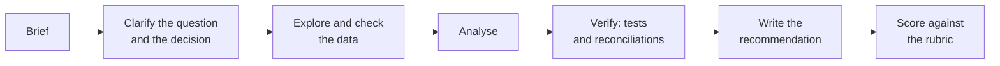

# 10 Capstone projects

A capstone is the size of real work: 10 to 14 hours, an ambiguous brief, several datasets, and a deliverable a hiring manager can open and run. These are the projects you put in your portfolio.

## What every capstone contains

| Part | What you get |
|---|---|
| `BRIEF.md` | The request as a stakeholder would send it, with the decision it informs and a deadline |
| `data/` | Several synthetic tables built by `make_data.py`, with realistic mess: duplicates, late-arriving rows, a changed definition halfway through |
| `DELIVERABLES.md` | Exactly what to hand in: the analysis, the numbers, a chart, a one-page write-up |
| `test_capstone.py` | Checks the numbers that have a single right answer, on two seeded datasets |
| `RUBRIC.md` | How a reviewer scores the parts that do not: framing, judgement, communication, limits. Use it to grade yourself or a study partner |
| `solution/` | A worked solution with the reasoning, to read after you finish |

## Projects

1. E-commerce performance review *(planned)*. Prepare the quarterly business review for an online store.
2. Customer retention and cohort analysis *(planned)*. Find where retention breaks and which cohort to study first.
3. Marketing attribution and campaign effectiveness *(planned)*. Reallocate next quarter's budget across channels, and defend it.
4. SaaS subscription and churn analysis *(planned)*. Build the churn model the finance team can plan with.
5. Executive dashboard *(planned)*. Design, model and verify the CEO dashboard, in the tool of your choice.
6. Automated analytics reporting *(planned)*. Make the weekly business review build, test and send itself.
7. A natural-language-to-SQL assistant *(planned)*. Build, evaluate and guard an assistant that answers questions from a database.
8. A multi-agent analytics copilot *(planned)*. Agents that plan, query, check and recommend, with a human approving each step.

The AI capstones (7 and 8) run offline on recorded model outputs, and include an optional script to run them against a live model with your own key.

## Publishing yours

[Phase 07](../07-getting-hired) shows how to turn a capstone into a portfolio piece: a README a stranger can follow, one command to run it, a chart, and resume bullets whose every number comes from your own output.
