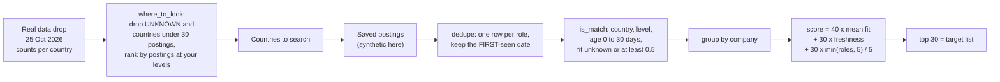

# Build a target list from real postings

Where are the analyst roles you can actually get, and which 30 companies go on your list?

## Before you start

- Level 4 (land the job). About 3 hours.
- You can read and fill in short Python functions: [00-06 Python for spreadsheet people](../../00-start-here/06-python-for-spreadsheet-people/).
- [07-01 Read job postings like data](../../07-getting-hired/01-read-job-postings-like-data/) treats postings as rows. [07-05 Role roadmaps from postings](../../07-getting-hired/05-role-roadmaps-from-postings/) reads the same real data drop and explains shares of postings that list a tool.
- [01-08 Duplicates and reconciliation](../../01-sql/08-duplicates-and-reconciliation/) explains why a business key matters when the same thing appears twice.

## The problem

Dev finished the analyst course at Lanternway Courses, a fictional online course platform, and lives in Manchester. He can work in the UK and Ireland without a visa, knows SQL, Excel, Power BI and some Python, and has never had an analyst title. His careers coach, Nikhil, has a rule: no applications until there is a written target list of 30 companies, ranked, with a reason for each. Dev has a spreadsheet of 638 postings he saved over the last two months and a session with Nikhil on Monday. Before then he needs two answers: where the roles at his level are, and which 30 companies are worth his time first.

There are two sources, and it matters which is which:

- **Real counts, by country.** The [Real Analyst Jobs data drop](../../../data/job-market/2026-10/) of 25 October 2026 (CC BY 4.0, credit "Real Analyst Jobs (realanalystjobs.com)") counts analyst postings per country, per country and experience level, and per country and tool. It has **no company or job rows**, so it can say where the roles are but not which company to call.
- **Synthetic saved postings.** `data/postings.csv` holds 638 postings from fictional companies, built by `make_data.py` with a fixed seed. Every company, title, date and skill list is invented to teach the method. Run the same code on postings you save yourself to get your real list.

## In plain words

Think of house hunting. First you pick the areas: where are there homes you can afford, in the size you need? A city with ten thousand flats, all of them penthouses, is not a good area for you. Then, inside those areas, you make a shortlist of streets, and you rank them by how well they fit, how recently something came up, and how many options each has. The same flat advertised by two agents is still one flat, and a listing an agent put back up last week is not a new flat.

A job search works the same way. The country step uses the real data drop. The company step uses postings you saved.

Words used in this lesson:

- **Posting**: one advert for a job. The same role can have more than one posting.
- **Role**: one job you could apply for. Here a role is one company, one title (ignoring capitals and spaces) and one country.
- **Experience label**: the level the feed attaches to a posting: Entry Level, Mid Level, Senior, Lead / Staff or Not Specified.
- **Labelled posting**: a posting whose experience label is not Not Specified.
- **Skill fit**: of the skills a posting lists, the share you have. A posting that asks for SQL and SAS when you know SQL has a fit of 0.5.
- **Age**: days from the date a role was first posted to today.
- **Reposter**: a site that copies postings from other sites, usually later. Its copy carries a newer date for an older role.
- **Dedupe**: keep one row per role.
- **Target list**: the companies you will research, contact and apply to first, in order.

## What you will build from scratch

- `where_to_look`: from the real drop, the countries with the most postings at your experience levels, with the share of labelled postings that are at your levels.
- `skill_share`: the share of a country's postings listing tools that list a given tool.
- `parse_skills`, `skill_fit`, `age_days`, `dedupe` and `is_match`: the filters for one posting.
- `score_companies` and `target_list`: a score per company from fit, freshness and the number of matching roles, and the top 30.

## The idea



**Step 1, countries.** For each country in the drop, add up the postings whose label is one of your levels. That count is how many roles at your level the board saw that day. Two rules keep it honest:

- `UNKNOWN` is not a country. It is the feed's code for postings with no country, often remote or multi-location roles. You cannot move there, so it is left out.
- A country with a few dozen postings can move a lot from one month to the next (the drop's README says so), so countries under `MIN_POSTINGS = 30` are left out.

Many postings say nothing about level. A share computed over all postings mixes "not entry level" with "did not say". So the share is computed over labelled postings only:

```
at_level          = postings whose label is in your levels
share_of_labelled = labelled postings at your levels / labelled postings x 100
```

**Step 2, companies.** For each saved posting:

```
fit  = (skills the posting lists that you have) / (skills the posting lists)    None if it lists none
age  = as_of - first posted date, in days
match when: country in your list, label in your levels, 0 <= age <= 30, and fit is None or fit >= 0.5
```

A posting that lists no skills is not ruled out, because you cannot tell. In the mean it counts as 0.5, halfway.

Then for each company with at least one matching role:

```
mean_fit   = average fit of its matching roles (unknown = 0.5)
freshness  = max(0, 1 - newest_age / 30)        1 for a role posted today, 0 at 30 days
volume     = min(roles, 5) / 5                  stops growing at 5 roles
score      = 40 x mean_fit + 30 x freshness + 30 x volume     out of 100
```

The weights are a choice, not a law. What matters is that they are written down, so you can change them and see what moves. Volume is capped at 5 so that one company with 60 postings cannot win on size alone. Ties are broken by more roles, then the newer role, then the name, so the list is the same every time.

## Walk through

Run these from the lesson folder.

Step 1. Read the real drop. `sys.path.insert(0, "solution")` lets Python find the worked answer, and `import solution as s` loads it.

```python
import sys
sys.path.insert(0, "solution")
import solution as s

drop = s.load_drop()
for c in ["US", "IN", "UNKNOWN", "GB", "IE"]:
    print(c, drop[c]["postings"], drop[c]["companies"], drop[c]["levels"])
```

```
US 2789 667 {'Mid Level': 1048, 'Not Specified': 838, 'Entry Level': 375, 'Lead / Staff': 336, 'Senior': 192}
IN 1174 385 {'Not Specified': 339, 'Mid Level': 321, 'Lead / Staff': 202, 'Entry Level': 183, 'Senior': 129}
UNKNOWN 705 310 {'Not Specified': 344, 'Mid Level': 206, 'Entry Level': 75, 'Lead / Staff': 49, 'Senior': 31}
GB 620 274 {'Not Specified': 368, 'Mid Level': 126, 'Lead / Staff': 63, 'Entry Level': 43, 'Senior': 20}
IE 46 34 {'Not Specified': 20, 'Mid Level': 17, 'Lead / Staff': 6, 'Senior': 2, 'Entry Level': 1}
```

On 25 October 2026 the board had 620 UK (GB) analyst postings at 274 companies. 368 of them, more than half, have no level. Ireland had 46.

Step 2. Where are the roles at entry and mid level?

```python
import sys
sys.path.insert(0, "solution")
import solution as s

drop = s.load_drop()
rows = s.where_to_look(drop, ["Entry Level", "Mid Level"])
print(len(rows), "countries with at least", s.MIN_POSTINGS, "postings")
for r in rows[:6]:
    print("%-3s postings %4d  at your levels %4d  share of labelled %.0f%%"
          % (r["country"], r["postings"], r["at_level"], r["share_of_labelled"]))
ie = [r for r in rows if r["country"] == "IE"][0]
print(ie)
```

```
32 countries with at least 30 postings
US  postings 2789  at your levels 1423  share of labelled 73%
IN  postings 1174  at your levels  504  share of labelled 60%
GB  postings  620  at your levels  169  share of labelled 67%
CA  postings  214  at your levels  100  share of labelled 75%
ES  postings  142  at your levels   75  share of labelled 89%
MX  postings  130  at your levels   68  share of labelled 76%
{'country': 'IE', 'postings': 46, 'companies': 34, 'at_level': 18, 'share_of_labelled': 69.23076923076923}
```

For Dev, who can work in GB and IE, that is 169 UK postings labelled entry or mid level, plus 18 in Ireland. Two thirds of the UK postings that carry a label are at his levels. The 368 unlabelled UK postings are not in the 169, so the real number at his level is higher: he has to read them.

Step 3. Which of his tools do those countries ask for?

```python
import sys
sys.path.insert(0, "solution")
import solution as s

drop = s.load_drop()
for c in ["GB", "IE", "US"]:
    print(c, drop[c]["any_tool"], {k: round(s.skill_share(drop, c, k), 1) for k in ["SQL", "Excel", "Power BI", "Python"]})
print(s.skill_share(drop, "KW", "SQL"))
```

```
GB 413 {'SQL': 69.2, 'Excel': 35.1, 'Power BI': 24.5, 'Python': 53.8}
IE 32 {'SQL': 46.9, 'Excel': 40.6, 'Power BI': 31.2, 'Python': 28.1}
US 2056 {'SQL': 71.8, 'Excel': 41.8, 'Power BI': 23.9, 'Python': 48.4}
None
```

The last line is `None`: no Kuwait posting lists a tool, so there is no share. Of the 413 UK postings that list tools, 69.2% list SQL and 53.8% list Python. Ireland's 32 postings are too few to read much into. The drop counts tools and levels separately, so it cannot say how many entry-level UK postings ask for SQL. Do not multiply the two shares: that assumes level and tools are unrelated, and the drop does not show that.

Step 4. The filters on one posting.

```python
import sys
sys.path.insert(0, "solution")
import solution as s

asked = s.parse_skills("sql, Power BI , SAS, ")
print(sorted(asked), s.skill_fit(asked, s.PROFILE["skills"]), s.skill_fit(set(), s.PROFILE["skills"]))
print(s.age_days("2026-10-01", "2026-10-31"))
rows = [{"company": "Rookmere Foods", "title": "Data Analyst", "country": "GB", "posted_date": "2026-09-12"},
        {"company": "Rookmere Foods", "title": "DATA ANALYST ", "country": "GB", "posted_date": "2026-10-20"}]
print(s.dedupe(rows))
```

```
['power bi', 'sas', 'sql'] 0.6666666666666666 None
30
[{'company': 'Rookmere Foods', 'title': 'Data Analyst', 'country': 'GB', 'posted_date': '2026-09-12'}]
```

Dev has two of the three skills, so the fit is 2 / 3. An empty list gives `None`, not 0. The repost in capital letters with a trailing space is the same role, and the kept row is the first-seen one, 49 days old: too old to count as fresh.

Step 5. The target list.

```python
import sys
sys.path.insert(0, "solution")
import solution as s

P = s.load_postings()
roles = s.dedupe(P)
matching = [p for p in roles if s.is_match(p, s.PROFILE)]
print(len(P), "rows,", len(roles), "roles,", len(matching), "matching roles")
scored = s.score_companies(P, s.PROFILE)
print(len(scored), "companies have a matching role")
for i, r in enumerate(s.target_list(P, s.PROFILE)[:8], 1):
    print("%2d %-22s roles %d  fit %.2f  newest %2d days  score %.1f"
          % (i, r["company"], r["roles"], r["mean_fit"], r["newest_age"], r["score"]))
print("30th:", scored[29]["company"], round(scored[29]["score"], 1), "| 31st:", scored[30]["company"], round(scored[30]["score"], 1))
```

```
638 rows, 534 roles, 57 matching roles
39 companies have a matching role
 1 Kestrelwood Foods      roles 4  fit 0.88  newest  0 days  score 89.0
 2 Mirefield Lending      roles 2  fit 1.00  newest  0 days  score 82.0
 3 Quillary Health        roles 1  fit 1.00  newest  0 days  score 76.0
 4 Kestrelwood Insurance  roles 3  fit 0.89  newest  8 days  score 75.6
 5 Kestrelwood Telecom    roles 2  fit 0.88  newest  2 days  score 75.0
 6 Kestrelwood Retail     roles 3  fit 0.76  newest  5 days  score 73.2
 7 Corrowen Health        roles 1  fit 1.00  newest  4 days  score 72.0
 8 Vantorre Insurance     roles 1  fit 1.00  newest  5 days  score 71.0
30th: Harrowfield Energy 49.0 | 31st: Ivelstone Insurance 48.0
```

638 saved rows are 534 roles once copies are merged, and 57 of those match Dev's profile, at 39 companies. The top 30 is the list. Ivelstone Insurance, 31st, misses by one point: it has two roles but a fit of 0.5. That is the kind of company Nikhil will ask about, and the score shows why it is just outside.

### Honest limits

- **The company numbers are synthetic.** They show the method, not which real employers are hiring.
- **One board, one day.** The drop is one board's postings on 25 October 2026. Companies whose careers sites the board cannot read are missing, and the drop's README lists more limits.
- **The label can be wrong.** A posting labelled entry level can be a senior role, so read the posting before you rule it in or out.
- **A role key is a choice.** Two real openings with the same title at the same company and country count as one role here. For a target list that is fine: you apply to the company, and the careers page will show both.
- **Your list is a start, not a census.** A company's own careers page is the primary source for its roles. LinkedIn shows who you know there and who could refer you. A target list says where to look first; it does not replace either.

## Common mistakes

1. **Ranking companies by how many postings they have.**

    ```python
    import collections
    import sys
    sys.path.insert(0, "solution")
    import solution as s

    P = s.load_postings()
    print(collections.Counter(p["company"] for p in P).most_common(3))
    giant = [p for p in s.dedupe(P) if p["company"] == "Brackenly Retail"]
    print(collections.Counter(p["country"] for p in giant).most_common(), sum(s.is_match(p, s.PROFILE) for p in giant))
    ```

    ```
    [('Brackenly Retail', 64), ('Brackenly Foods', 12), ('Nettlecombe Health', 12)]
    [('US', 20), ('IN', 12), ('GB', 10), ('DE', 4)] 0
    ```

    Brackenly Retail has more than five times as many postings as anyone else and would top a list sorted by count. None of its roles match Dev: most are senior, outside the UK, or both. A big employer is worth a look, but only the roles you can get count. The cap on volume in the score stops size alone from winning.
2. **Keeping the newest copy of a repost.**

    ```python
    import sys
    sys.path.insert(0, "solution")
    import solution as s

    def dedupe_newest(postings):
        last = {}
        for p in postings:
            k = s.role_key(p)
            if k not in last or p["posted_date"] > last[k]["posted_date"]:
                last[k] = p
        return list(last.values())

    P = s.load_postings()
    right = [p for p in s.dedupe(P) if s.is_match(p, s.PROFILE)]
    wrong = [p for p in dedupe_newest(P) if s.is_match(p, s.PROFILE)]
    print(len(right), "matching roles by first-seen date,", len(wrong), "by the newest repost")
    ```

    ```
    57 matching roles by first-seen date, 65 by the newest repost
    ```

    8 roles that were first posted more than 30 days ago look fresh because a reposter copied them later. A role open for two months may already be in final interviews. Freshness belongs to the role, so use the date it was first seen. Not deduping at all is worse: every copy counts as an extra role.
3. **Filtering on Entry Level only, and reading entry share over all postings.**

    ```python
    import sys
    sys.path.insert(0, "solution")
    import solution as s

    P = s.load_postings()
    entry_only = dict(s.PROFILE, levels=["Entry Level"])
    print(len(s.score_companies(P, entry_only)), "companies with Entry Level only, against", len(s.score_companies(P, s.PROFILE)))
    gb = s.load_drop()["GB"]["levels"]
    labelled = sum(gb.values()) - gb["Not Specified"]
    print("GB entry share: %.1f%% of all postings, %.1f%% of labelled postings" % (100 * gb["Entry Level"] / sum(gb.values()), 100 * gb["Entry Level"] / labelled))
    ```

    ```
    12 companies with Entry Level only, against 39
    GB entry share: 6.9% of all postings, 17.1% of labelled postings
    ```

    Most postings carry no level. Filtering them out leaves Dev with 12 companies instead of 39. And "6.9% of UK postings are entry level" sounds bleak, but it divides by postings that never said: of the UK postings that do carry a label, 17.1% are entry level.
4. **Treating UNKNOWN as a country.** With the `NOT_A_COUNTRY` rule removed, `where_to_look` puts `['US', 'IN', 'UNKNOWN', 'GB']` in the top four. UNKNOWN has 281 postings at entry or mid level, but they have no country in the feed. They are worth reading one by one, and lesson 11-04 in this phase covers remote roles, but they are not a place to target.

## Your turn

Open `exercise.py`. `load_drop`, `load_postings`, `role_key` and `PROFILE` are written for you. Fill in `where_to_look`, `skill_share`, `parse_skills`, `skill_fit`, `age_days`, `dedupe`, `is_match`, `score_companies` and `target_list`. Then run, from this folder:

```
python3 test_lesson.py
```

The test checks your country table on the real drop for three sets of levels, a hand-made drop where every posting is unlabelled, a tie and an empty drop, a country with no tool list, a posting with no skills, a fit of exactly 0.5, ages of exactly 30 and 31 days and a date in the future, a repost in capital letters, a score worked out by hand, the cap on volume, and the full top 30 on the committed postings and on a second set built from another seed.

Stretch: change `PROFILE` to your own countries, levels and skills, and save 50 postings from careers pages you care about in the same CSV shape as `data/postings.csv`. Run `target_list` on them and compare the top 10 with the companies you would have named from memory.

## Check yourself

1. Why is `share_of_labelled` divided by labelled postings, not by all postings?
2. A posting lists no skills. Why does it match, and why does it count as 0.5 in the mean fit instead of 0 or 1?
3. Why is the dedupe rule "keep the earliest date" and not "keep the newest"?
4. Nikhil asks why a company with 12 matching roles is not twelve times more attractive than a company with one. What do you say?

<details>
<summary>Answers</summary>

1. Not Specified means the posting did not say, not that it is senior. Dividing by all postings counts every silent posting as "not at your level", which makes the share look smaller than it is (6.9% against 17.1% for UK entry level).
2. With no skills listed you cannot rule it out, so dropping it would throw away roles you might fit. Counting it as 1 would rank unknown postings above ones you know you fit; 0 would punish a company for writing a short advert. 0.5 is neutral, and it is written down so you can change it.
3. A reposter copies an old role later. Keeping the newest date makes a role open for two months look a week old. The first-seen date is the role's real age.
4. Each extra role is another chance, but the chances are not independent: the same hiring manager, the same process, often the same rejection. The score counts volume up to 5 roles and gives the rest of its weight to fit and freshness. The cap is a choice; the point is that size alone should not decide.

</details>

## What to tell the stakeholder

"In the UK, the public data drop of 25 October 2026 shows 169 analyst postings labelled entry or mid level, plus 368 with no level that need reading, and Ireland adds 18. From the 638 postings I saved, 57 roles at 39 companies fit my levels and skills and were first posted in the last 30 days. Here is the top 30, scored on fit, freshness and number of roles, with the score next to each so we can see what is just outside. The list is only as complete as the postings I saved, so I will check each company's careers page before I apply."

## In real job postings

On 31 October 2026, Real Analyst Jobs listed 8,952 live analyst roles at 1,542 companies, 2,458 of them posted in the last 7 days (Real Analyst Jobs data, retrieved 31 October 2026 through its MCP server, tool `analyst_market_stats`). The [analyst job market](https://realanalystjobs.com/analyst-job-market) page shows the live counts, [companies](https://realanalystjobs.com/companies) lists the hiring companies, and [entry-level data analyst jobs](https://realanalystjobs.com/jobs/entry-level-data-analyst-jobs) is a starting point for Dev's level. Check each company's own careers page before you apply.

## Next

[Search smarter: titles and synonyms](../02-titles-and-synonyms/)
