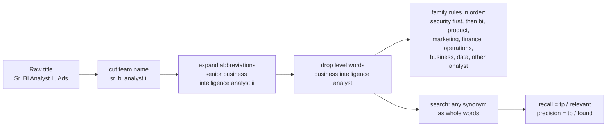

# Search smarter: titles and synonyms

Why does a search for data analyst miss most of the analyst roles at a company like Amazon?

## Before you start

- Level 4 (land the job). About 2 hours.
- [11-01 Build a target list from real postings](../01-build-a-target-list/) gives you the companies. This lesson makes sure you find their roles.
- [07-05 Role roadmaps from postings](../../07-getting-hired/05-role-roadmaps-from-postings/) puts titles into role families with ordered rules and word edges (`\b`). This lesson adds the messy parts of real titles: team names, abbreviations and level words.
- Precision and recall are defined below. [06-01 Grade an LLM classifier](../../06-ai-for-analysts/01-grade-an-llm-classifier/) uses them on a classifier.

## The problem

Dev, the Lanternway Courses learner from [11-01](../01-build-a-target-list/), put a large online retailer on his target list. He typed "data analyst" into its careers search, got a handful of results, and decided the company was not hiring analysts. His coach Nikhil disagrees and wants proof before Friday's session: how many analyst roles did that search miss, which search terms would have found them, and what does a broader search cost in noise? You have two sources: real titles and counts from Real Analyst Jobs, and a synthetic set of 450 postings at a fictional retailer, Orrowind Commerce, where the truth about each title is known, so recall and precision can be measured.

- **Real evidence.** `data/real_snapshot_2026-10-31.json` holds aggregates and job titles copied from Real Analyst Jobs data, retrieved 31 October 2026 through its MCP server (tools `analyst_market_stats`, `company_analyst_hiring` and `search_analyst_jobs`), with a provenance block. It has the market-wide role family counts and Amazon's most common analyst titles. It does not have every posting, so it cannot measure recall.
- **Synthetic postings.** `data/postings.csv` and `data/labels.csv` are built by `make_data.py` with a fixed seed. The title mix is loosely shaped like the real evidence, but every title and count is invented, and Orrowind Commerce is fictional.

## In plain words

Imagine looking for a "sofa" on a furniture shop's website. The shop also calls them couches, settees, two-seaters and "living room seating", and lists half of them under a range name like "The Harlow". Search for "sofa" and you see a fraction of what is there. Search for "seat" and you get sofas, but also car seats and seat cushions. The trick is a list of the shop's own words for the thing you want, plus a way to throw out the junk.

Job titles work the same way. Big companies write "Financial Analyst", "Business Intelligence Engineer" or "Operations Analyst" for work much like a data analyst's, then add team names and levels.

Words used in this lesson:

- **Raw title**: the title as the posting writes it, for example `Sr. BI Analyst II, Ads`.
- **Team name**: the part after a comma, a " - " or a bracket. It names the team, not the job.
- **Level words**: senior, junior, lead, principal, staff, and I, II, III, IV. They say how senior, not what the job is.
- **Normalised title**: the raw title in lower case, with the team name cut, abbreviations written out and level words removed. `Sr. BI Analyst II, Ads` becomes `business intelligence analyst`.
- **Role family**: a group of titles that mean the same kind of work, such as finance or bi (business intelligence).
- **Synonyms**: the different titles a family goes by.
- **Relevant**: a posting the job seeker wants to see. Here, any analyst work, in a named family or not.
- **Recall**: of the relevant postings, the share the search found. Low recall means missed roles.
- **Precision**: of the postings the search found, the share that are relevant. Low precision means time spent reading noise.
- **True positive (tp)**, **false positive (fp)**, **false negative (fn)**: found and relevant, found but not relevant, relevant but missed.

## What you will build from scratch

- `normalise_title`: cut the team name, expand abbreviations (Sr., BI, BIE, Ops, FP&A), drop level words.
- `FAMILY_RULES` and `role_family`: ordered rules from a normalised title to a role family, with security analysts excluded first.
- `naive_search`, `expand` and `search`: the search most people type, and a search over the synonyms of the families you want.
- `measure` and `term_costs`: recall and precision, and what each extra term adds in found roles and in noise.

## The idea



**Normalise before you match.** A team name can hold words that look like a role: `Program Manager I, Last Mile Analytics & Quality` is a programme manager, not an analyst. Cutting the team name first stops "analytics" from matching. Abbreviations are expanded word by word, so `BIE` becomes `business intelligence engineer` and `Ops` becomes `operations`. Level words are dropped last, so `Senior Financial Analyst` and `Financial Analyst II` are the same title.

**Order the family rules.** The first rule that matches wins, so the order is part of the logic:

1. `security` goes first and means not_analyst, because `security operations analyst` would otherwise match "operations analyst".
2. bi, product, marketing, finance, operations, business, data: each a list of synonym phrases.
3. Any other title with the word `analyst` is other_analyst: pricing, risk or category analysts. It must come last, or it would swallow every family.
4. Everything else is not_analyst.

**Measure a search.** With the set of relevant postings known:

```
recall    = tp / (tp + fn)      the share of relevant postings you found
precision = tp / (tp + fp)      the share of what you found that is relevant
```

A search that finds nothing has no precision (None), and a set with nothing relevant has no recall.

**Price each extra term.** Adding a term can only find more. `term_costs` counts what a term adds on top of a base search: new relevant postings (more recall) and new noise (less precision). A good term adds many of the first and few of the second.

## Walk through

Run these from the lesson folder.

Step 1. The real evidence. `sys.path.insert(0, "solution")` lets Python find the worked answer, and `import solution as s` loads it.

```python
import sys
sys.path.insert(0, "solution")
import solution as s

snap = s.load_snapshot()
fam = snap["market_role_families"]
print("Data Analyst family: %d of %d live roles, %.1f%%"
      % (fam["counts"]["Data Analyst"], fam["live_roles"], 100 * fam["counts"]["Data Analyst"] / fam["live_roles"]))
print("Other analyst titles: %.1f%%" % (100 * fam["counts"]["Other analyst titles"] / fam["live_roles"]))
top = snap["amazon"]["top_titles"]
for t in top:
    print("%-62s %d  %s" % (t["title"], t["count"], s.role_family(t["title"])))
print(sum(t["count"] for t in top), "postings,", sum(t["count"] for t in top if "data analyst" in t["title"].lower()), "say data analyst")
```

```
Data Analyst family: 1299 of 8952 live roles, 14.5%
Other analyst titles: 46.6%
Senior Financial Analyst, NACF                                 6  finance
Business Analyst, Global Solutions & Risk Compliance (GSRC)    5  business
Operations Analyst, RI Operations                              4  operations
Program Manager I, Last Mile Analytics & Quality (LMAQ)        4  not_analyst
Senior Financial Analyst, Amazon Leo                           4  finance
Business Analyst, NCC- Hercules                                3  business
Business Analyst, ROC                                          3  business
Business Intelligence Engineer II                              3  bi
32 postings, 0 say data analyst
```

On 31 October 2026 Real Analyst Jobs counted 8,952 live analyst roles, and the provider put 1,299 of them, 14.5%, in its Data Analyst family. Almost half, 46.6%, have analyst titles outside its named families. At Amazon, which had 570 open roles that day, none of the 8 most common titles says "data analyst". They are financial analysts, business analysts, operations analysts and business intelligence engineers. A "data analyst" search finds none of those 32 postings.

Step 2. Normalise and classify a few raw titles.

```python
import sys
sys.path.insert(0, "solution")
import solution as s

for raw in ["Sr. BI Analyst II", "BIE III - Ads", "FP&A Analyst (Retail Finance)",
            "Program Manager I, Last Mile Analytics & Quality (LMAQ)", "Network planning Analyst"]:
    print("%-56s -> %-40s %s" % (raw, s.normalise_title(raw), s.role_family(raw)))
```

```
Sr. BI Analyst II                                        -> business intelligence analyst            bi
BIE III - Ads                                            -> business intelligence engineer           bi
FP&A Analyst (Retail Finance)                            -> financial planning and analysis analyst  finance
Program Manager I, Last Mile Analytics & Quality (LMAQ)  -> program manager                          not_analyst
Network planning Analyst                                 -> network planning analyst                 operations
```

Each step is visible: "Sr." and "II" are gone, BIE is written out, the team in brackets is cut, and the program manager on an analytics team is not an analyst. "Network planning Analyst" is a real Amazon title from the newest roles in the evidence; it falls under operations through "planning analyst".

Step 3. The synthetic company.

```python
import collections
import sys
sys.path.insert(0, "solution")
import solution as s

P = s.load_postings()
L = s.load_csv("data/labels.csv")
print(len(P), "postings at", P[0]["company"])
print(collections.Counter(s.role_family(p["title"]) for p in P).most_common())
print(sum(s.role_family(p["title"]) == l["family"] for p, l in zip(P, L)), "of", len(P), "agree with the labels")
for p in P[:4]:
    print(p["title"])
```

```
450 postings at Orrowind Commerce
[('not_analyst', 97), ('finance', 95), ('operations', 65), ('business', 59), ('bi', 39), ('other_analyst', 35), ('data', 29), ('product', 16), ('marketing', 15)]
450 of 450 agree with the labels
Senior Risk Analyst I
Senior BIE
Senior Insights Analyst II, Ads
Business Analyst
```

Finance, operations and business titles outnumber data titles, as in the real evidence. The rules agree with the generator's labels on all 450 titles, which is what the test checks on two seeds.

Step 4. The naive search against the expanded one.

```python
import sys
sys.path.insert(0, "solution")
import solution as s

P = s.load_postings()
relevant = {r["posting_id"] for r in s.load_csv("data/labels.csv") if r["relevant"] == "1"}
print(len(relevant), "relevant postings")
print("naive   ", s.measure(s.naive_search(P, "data analyst"), relevant))
terms = s.expand(s.SYNONYMS)
print(len(terms), "terms")
print("expanded", s.measure(s.search(P, terms), relevant))
```

```
353 relevant postings
naive    {'tp': 17, 'fp': 0, 'fn': 336, 'recall': 0.04815864022662889, 'precision': 1.0}
14 terms
expanded {'tp': 318, 'fp': 10, 'fn': 35, 'recall': 0.9008498583569405, 'precision': 0.9695121951219512}
```

"data analyst" is perfectly precise and almost useless: it finds 17 of 353 relevant postings, a recall of 4.8%. Dev saw a handful of results and concluded the company was not hiring. The 14 synonym terms find 318, a recall of 90.1%, at a precision of 97.0%. The 10 false positives are security operations analysts, caught by "operations analyst". The 35 misses are the pricing, risk, category and quantitative analysts that no named family covers.

Step 5. What each broader term costs.

```python
import sys
sys.path.insert(0, "solution")
import solution as s

P = s.load_postings()
relevant = {r["posting_id"] for r in s.load_csv("data/labels.csv") if r["relevant"] == "1"}
terms = s.expand(s.SYNONYMS)
for c in s.term_costs(P, relevant, terms, ["analyst", "data"]):
    print(c)
for extra in [[], ["analyst"], ["analyst", "data"]]:
    m = s.measure(s.search(P, terms + extra), relevant)
    print("+", extra, "recall %.3f precision %.3f" % (m["recall"], m["precision"]))
wide = s.search(P, terms + ["analyst"])
by_id = {p["posting_id"]: p for p in P}
kept = {i for i in wide if s.role_family(by_id[i]["title"]) != "not_analyst"}
m = s.measure(kept, relevant)
print("search wide, then drop not_analyst: recall %.3f precision %.3f" % (m["recall"], m["precision"]))
```

```
{'term': 'analyst', 'added_tp': 35, 'added_fp': 9}
{'term': 'data', 'added_tp': 0, 'added_fp': 39}
+ [] recall 0.901 precision 0.970
+ ['analyst'] recall 1.000 precision 0.949
+ ['analyst', 'data'] recall 1.000 precision 0.859
search wide, then drop not_analyst: recall 1.000 precision 1.000
```

"analyst" on its own adds the 35 missed roles and 9 security analysts: a good trade. "data" adds nothing relevant and 39 postings of noise (data engineers, data entry, data centre technicians), so precision falls to 85.9%. The best pattern is two steps: search wide for recall, then filter with `role_family` for precision.

### Honest limits

- **The synthetic recall numbers are not Amazon's.** They show how much a narrow search can miss, not how much it misses at any real company. The real evidence shows only the top titles.
- **The rules fit the titles they were written for.** `role_family` agrees with every synthetic title because both were written together. On real titles it will miss some: read a sample of what it calls not_analyst and add rules.
- **The provider's families are its own.** "Data Analyst 14.5%" is Real Analyst Jobs' classification of titles, not a market definition.
- **A title is not the job.** A Financial Analyst role can be pure spreadsheets or heavy SQL. The title search gets you to the posting; reading it tells you whether the work fits.

## Common mistakes

1. **Searching the raw title, team name and all.**

    ```python
    import sys
    sys.path.insert(0, "solution")
    import solution as s

    P = s.load_postings()
    relevant = {r["posting_id"] for r in s.load_csv("data/labels.csv") if r["relevant"] == "1"}
    raw = s.naive_search(P, "analytics")
    print(s.measure(raw, relevant))
    by_id = {p["posting_id"]: p for p in P}
    print(sorted({by_id[i]["title"] for i in raw - relevant})[:3])
    ```

    ```
    {'tp': 21, 'fp': 6, 'fn': 332, 'recall': 0.059490084985835696, 'precision': 0.7777777777777778}
    ['Account Executive III, Last Mile Analytics', 'Junior Data Center Technician II, Last Mile Analytics', 'Lead Account Executive, Last Mile Analytics']
    ```

    "analytics" looks like a smart synonym. On raw titles it mostly matches the team name: it finds 21 relevant roles by luck of their team, and 6 sales and technician roles on the same team. Normalise first, then search.
2. **Adding a broad word because it "can only help".** Step 5 shows "data" adds 39 false positives and no true ones. Every term should be priced with `term_costs` before it goes into a saved search.
3. **Putting the exclusion rule last.**

    ```python
    import collections
    import sys
    sys.path.insert(0, "solution")
    import solution as s

    security = s.FAMILY_RULES[0]
    s.FAMILY_RULES = s.FAMILY_RULES[1:] + [security]
    P = s.load_postings()
    print(collections.Counter(s.role_family(p["title"]) for p in P if "security" in p["title"].lower()))
    ```

    ```
    Counter({'operations': 10, 'other_analyst': 9})
    ```

    With security checked last, 10 security operations analysts become operations analysts and 9 security analysts become other analysts. An exclusion only works before the rules it overrides.
4. **Reading precision without recall.** The naive search has a precision of 1.0, so every result was relevant, and it still missed 95% of the roles. A search that looks clean can be the one that costs you the most.

## Your turn

Open `exercise.py`. `ABBREVIATIONS`, `LEVEL_WORDS`, `TEAM_SEPARATORS` and `SYNONYMS` are given. Write `FAMILY_RULES` (the comment lists the phrases in alphabetical order, so the order is yours to decide), then fill in `normalise_title`, `role_family`, `naive_search`, `expand`, `search`, `measure` and `term_costs`. Then run, from this folder:

```
python3 test_lesson.py
```

The test checks normalisation on hand-made titles (abbreviations, brackets, " - ", capitals, extra spaces, an empty title), families on tricky and real Amazon titles, every generated title on two seeds, word matching against substrings, `expand` with repeats and unknown families, `measure` with nothing found and nothing relevant, `term_costs` by hand, and the naive and expanded searches on the committed postings and on a second set built from another seed.

Stretch: pick one company from your target list, copy 40 titles from its careers page into the same CSV shape as `data/postings.csv`, and label each one relevant or not yourself. Measure your saved search on it, and add the synonyms it misses to `SYNONYMS`.

## Check yourself

1. Why is the team name cut before matching, not after?
2. Why must the security rule come first and the other_analyst rule last?
3. A search has a precision of 1.0. Is it a good search?
4. Nikhil asks for one search string Dev can save on any board. What do you suggest, and what do you tell him about its cost?

<details>
<summary>Answers</summary>

1. Team names hold role words: "Last Mile Analytics", "Data Platform", "Global Operations". Matching first makes a programme manager or a sales executive on an analytics team look like an analyst. Cutting first means the match sees only the job.
2. The first match wins. Security operations analyst contains "operations analyst", so the exclusion has to fire before the operations rule. "analyst" alone matches every family, so the catch-all has to come after all of them, or no title would reach its own family.
3. Not on its own. "data analyst" had a precision of 1.0 and a recall of 4.8%: every result was right and almost every role was missed. Report both numbers.
4. The family synonyms (financial analyst, business analyst, business intelligence, operations analyst, data analyst and the rest) plus the word "analyst", then a quick skim to drop security roles. On the synthetic company that finds every relevant role with a precision of 94.9%. Leave out "data" and "analytics": they add noise and, after normalising, no roles.

</details>

## What to tell the stakeholder

"The 'data analyst' search found 17 of the 353 analyst roles at the synthetic retailer, under 5%. Most analyst work there is titled financial, business, operations or business intelligence. A search over those synonyms plus the word 'analyst' finds all of them, with about 1 posting in 20 being noise that a quick read removes. The same pattern shows up in real data: on 31 October 2026, none of Amazon's 8 most common analyst titles said 'data analyst'. The synthetic percentages are illustrative, so Dev should check each company's own careers page with the wider search."

## In real job postings

On 31 October 2026 Real Analyst Jobs listed 570 open roles at Amazon, and its 8 most common titles were financial, business and operations analyst, business intelligence engineer and a programme manager title, none of them "Data Analyst"; a search for "business intelligence engineer" across the board matched 88 roles (Real Analyst Jobs data, retrieved 31 October 2026 through its MCP server, tools `company_analyst_hiring` and `search_analyst_jobs`). Browse all titles at [jobs](https://realanalystjobs.com/jobs) and by employer at [companies](https://realanalystjobs.com/companies).

## Next

[Visa-aware search: H-1B, OPT and UK sponsors](../03-visa-aware-search/)
