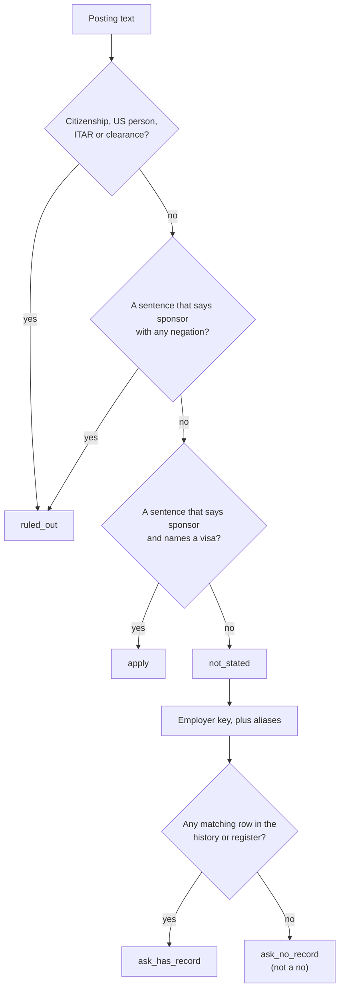

# Visa-aware search: H-1B, OPT and UK sponsors

Which employers on your list have sponsored before, and which postings rule you out in their own words?

## Before you start

- Level 4 (land the job). About 2 hours.
- [07-01 Read job postings like data](../../07-getting-hired/01-read-job-postings-like-data/) builds the sentence rule this lesson reuses: a sentence that says "sponsor" and has any negation is a refusal, and silence is not a yes.
- [11-02 Search smarter: titles and synonyms](../02-titles-and-synonyms/) shows why one company appears under many titles. Here one employer appears under many legal names.
- [01-08 Duplicates and reconciliation](../../01-sql/08-duplicates-and-reconciliation/) normalizes near-duplicate names with the same idea as the matching key below.

## The problem

Tunde is finishing a master's degree in the US on a student visa. He will work first on OPT and will need an H-1B later, and he is also applying in the UK, where he would need a Skilled Worker visa. He has 22 saved postings from 13 companies and a career adviser, Ines, who wants his shortlist on Friday: which roles to apply to now, which to ask about, and which rule him out. Tunde's first idea was to apply only where a posting says "we sponsor". That would leave him 3 roles out of 22. You will build a triage that reads each posting's own words, joins each employer to its sponsorship record across all its filed names, and never turns "not stated" or "not in the data" into a no.

All postings, companies and counts in `data/postings.csv`, `data/uscis_history.csv`, `data/uk_register.csv` and `data/aliases.csv` are synthetic, written by `make_data.py`. The one real example, Amazon, lives in `data/real_snapshot_2026-10-31.json` with its source and dates.

## In plain words

Think of renting a flat. A listing that says "no pets" rules out your dog, whatever the landlord did last year. A listing that says "pets welcome" is worth a call today. A listing that says nothing about pets is not a no: you ask. And if a friend tells you "that landlord let a tenant keep a cat in 2024", that is a good reason to ask, not a promise for this flat.

Job postings work the same way. The posting's own words decide first. The employer's history is only a hint for the postings that say nothing.

Words used in this lesson:

- **Visa sponsorship**: the employer files the paperwork for the work visa a foreign candidate needs.
- **H-1B**: a US work visa for specialty jobs, filed by the employer. The employer files a **petition** (an application to the US immigration service, USCIS) for each worker.
- **USCIS H-1B Employer Data Hub**: a public USCIS dataset of approved and denied H-1B petitions, by employer name as filed and by **fiscal year** (the US government year, which runs from October to September). Roughly, **new** approvals are for new employment and **continuing** approvals keep someone already employed, for example an extension. For a job seeker, new approvals are the closer signal.
- **OPT** (Optional Practical Training): permission tied to a US student visa that lets many graduates work in their field for a limited time. It is not an H-1B. A posting can welcome OPT and still refuse to sponsor an H-1B later, which can mean the job ends when the OPT period does. Some graduates can extend OPT (the STEM OPT extension), and that depends on the employer too, for example on whether it uses E-Verify, the US system for checking work eligibility. Confirm STEM OPT eligibility with the employer. The rules change, so check the official USCIS page before you rely on them.
- **UK register of licensed sponsors**: the UK government publishes the [register of licensed sponsors: workers](https://www.gov.uk/government/publications/register-of-licensed-sponsors-workers), a list of organisations licensed to sponsor workers, including on the Skilled Worker route. An employer needs a licence to sponsor. The list changes often, so check the official page, it changes.
- **ITAR and security clearance**: ITAR is a set of US export control rules for defence items. Roles that touch that data are often limited to "US persons", usually citizens or permanent residents. A **security clearance** (in the UK, levels such as SC and DV) is government vetting that often comes with nationality or residence rules. Sponsorship does not help with either, so these postings rule out most visa holders.
- **Matching key**: a cleaned version of a name, so that different spellings of one employer compare equal.

## What you will build from scratch

- `employer_key`: one key for every spelling of one employer, without merging different employers.
- `classify_posting`: what the posting says in its own words: `sponsors`, `will_not_sponsor`, `citizen_or_clearance` or `not_stated`.
- `us_record` and `on_register`: the employer's record in the H-1B style history (summed over all its filed names) or on the UK style register.
- `verdict`, `triage` and `summary`: one verdict per posting, `apply`, `ask_has_record`, `ask_no_record` or `ruled_out`, and the counts.

## The idea



**The posting's words come first.** A restriction (citizenship, US person, ITAR, a clearance) is checked before anything else, because "visa sponsorship available. Requires US citizenship." still rules out a visa holder. Next, any sentence that says "sponsor" and contains a negation ("not", "no", "unable", "without", "n't") is a refusal. Only then does a sentence that says "sponsor" and names a visa count as a yes. This order makes the rule wrong only in the cheap direction: a rare offer phrased with a "not" becomes a refusal, which costs a question; a refusal read as a yes would cost weeks of interviews.

**Silence is not a no.** "Candidates must be authorized to work in the US" does not say "without sponsorship". "We proudly sponsor the city marathon" is not about visas, and "clearance sale" is not a security clearance. All three are `not_stated`.

**One employer, many names.** Employers file under their legal names, and the same company can appear under several spellings, punctuation, suffixes and former names. The real evidence shows Amazon under three USCIS names. The matching key:

1. lower case, and cut off anything after `fka` (formerly known as), `dba` (doing business as), `formerly` or `aka`;
2. turn `&` into `and` and `national association` into `na`;
3. turn every character that is not a letter or digit into a space;
4. drop trailing legal suffixes (`llc`, `inc`, `corp`, `ltd`, `limited`, `plc`, `llp`, `na` and a few more).

The key compares whole keys, never substrings. "ORRIN HEALTHCARE STAFFING INC" contains "ORRIN HEALTH", and it is a different employer. Some companies file under a name the key cannot guess (Orrin Health files as ORRIN SERVICES CORP). Those go in `aliases.csv`, written by a person who checked.

**History is a hint, not a promise.** The counts are employer-wide, for every occupation, and they describe the past. They tell you an employer knows how to sponsor. They do not tell you this role will. So the record only splits the silent postings into two "ask" groups, and never overrides what a posting says.

## Walk through

Run these from the lesson folder.

Step 1. The real example: Amazon under three names. The snapshot holds Real Analyst Jobs data, retrieved 31 October 2026 through its MCP server (tool `h1b_sponsor_check`), which names the USCIS H-1B Employer Data Hub as its source with data as of 30 June 2026.

```python
import json
import sys
sys.path.insert(0, "solution")
import solution as s

real = json.load(open("data/real_snapshot_2026-10-31.json"))
for name in real["uscis_employer_names"]:
    print(repr(s.employer_key(name)), "<-", name)
for y in real["fiscal_years"]:
    print(y["fiscal_year"], y["new"], y["continuing"], y["denied"], y["period"])
```

`sys.path.insert(0, "solution")` lets Python find the worked answer. The loop prints the key for each filed name, then new approvals, continuing approvals and denials for each fiscal year:

```
'amazon com services' <- AMAZON COM SERVICES LLC
'amazon com services' <- AMAZON.COM SERVICES LLC
'amazon com services' <- AMAZON.COM SERVICES LLC FKA AMAZON.COM SERVICES INC
2023 3769 7554 265 full year
2024 3821 6769 198 full year
2025 4999 8267 190 full year
2026 3801 5536 82 partial, October 2025 to June 2026
```

All three names collapse to one key. Note fiscal year 2026: it covers nine months, so 3,801 new approvals is not a fall from 4,999. The same snapshot says that of Amazon's 285 US analyst postings, 0 say they sponsor, 11 say no sponsorship and the other 274 do not say. Thousands of past approvals, and not one posting that promises sponsorship: this is exactly why the record and the posting are two different questions.

Step 2. Classify the synthetic postings.

```python
import sys
sys.path.insert(0, "solution")
import solution as s

postings, history, register, aliases = s.load()
counts = {}
for p in postings:
    says = s.classify_posting(p["text"])
    counts[says] = counts.get(says, 0) + 1
print(counts)
for pid in ["V03", "V09", "V15", "V12"]:
    p = [x for x in postings if x["posting_id"] == pid][0]
    print(pid, s.classify_posting(p["text"]), "|", p["text"])
```

```
{'not_stated': 12, 'sponsors': 3, 'will_not_sponsor': 4, 'citizen_or_clearance': 3}
V03 not_stated | About the role: map finance processes. Candidates must be authorized to work in the U.S.
V09 not_stated | We proudly sponsor the city marathon every spring. About the role: measure campaign lift with SQL.
V15 will_not_sponsor | About the role: track claim cycle times. OPT candidates are welcome, but we do not sponsor H-1B visas.
V12 citizen_or_clearance | About the role: analyse test flight telemetry. This role requires U.S. citizenship because of ITAR export rules.
```

V03 asks for work authorization but does not refuse sponsorship, so it is a question for the recruiter. V09's "sponsor" is a marathon. V15 welcomes OPT and refuses the H-1B, so for Tunde it is a role with an end date. `sentences` turns "U.S." into "us" first, so its full stops do not split "U.S. citizenship" into two sentences.

Step 3. Join employers to their record.

```python
import sys
sys.path.insert(0, "solution")
import solution as s

postings, history, register, aliases = s.load()
exact = [r["employer_name"] for r in history if r["employer_name"] == "KESTREL LEDGER INC"]
print("exact name only:", len(exact), "rows")
rec = s.us_record("Kestrel Ledger", history, aliases)
print(rec["names"])
print(rec["by_year"])
sub = sorted({r["employer_name"] for r in history if "ORRIN" in r["employer_name"]})
print("substring ORRIN:", sub)
print("key + alias:", s.us_record("Orrin Health", history, aliases)["names"])
print("Saltmarsh Retail:", s.us_record("Saltmarsh Retail", history, aliases))
print("Wrenfield Retail on register:", s.on_register("Wrenfield Retail", register, aliases))
```

```
exact name only: 2 rows
['KESTREL LEDGER INC', 'KESTREL LEDGER INC FKA KESTREL BOOKS LLC', 'KESTREL LEDGER, INC.']
{2023: {'new': 4, 'continuing': 6, 'denials': 0}, 2024: {'new': 5, 'continuing': 7, 'denials': 1}, 2025: {'new': 5, 'continuing': 9, 'denials': 0}}
substring ORRIN: ['ORRIN HEALTHCARE STAFFING INC', 'ORRIN SERVICES CORP']
key + alias: ['ORRIN SERVICES CORP']
Saltmarsh Retail: {'names': [], 'by_year': {}}
Wrenfield Retail on register: []
```

An exact name match finds Kestrel Ledger only in 2023 and 2024, as if it stopped sponsoring in 2025; the key finds all three names and 5 new approvals in 2025. A substring match would credit Orrin Health with a staffing firm's 40 new approvals. Saltmarsh Retail is not in the data, and Wrenfield Retail is not on this copy of the register (a Wrenfield Holdings Ltd is, which may or may not be the same group). Both mean "find out", not "no".

Step 4. Triage.

```python
import sys
sys.path.insert(0, "solution")
import solution as s

postings, history, register, aliases = s.load()
rows = s.triage(postings, history, register, aliases)
print(s.summary(rows))
naive_out = sum(1 for r in rows if r["says"] != "sponsors")
print("naive: 'only apply where it says yes' rules out", naive_out, "of", len(rows))
for r in rows:
    if r["company"] in ("Tamsin Bank", "Brindlecombe Aerospace"):
        print(r["posting_id"], r["company"], r["says"], r["has_record"], r["verdict"])
```

```
{'apply': 3, 'ask_has_record': 9, 'ask_no_record': 3, 'ruled_out': 7}
naive: 'only apply where it says yes' rules out 19 of 22
V10 Tamsin Bank will_not_sponsor True ruled_out
V11 Tamsin Bank not_stated True ask_has_record
V12 Brindlecombe Aerospace citizen_or_clearance True ruled_out
V13 Brindlecombe Aerospace citizen_or_clearance True ruled_out
```

Only 7 postings rule Tunde out in their own words. The naive rule throws away 19, including 12 that never said no. Tamsin Bank had 18 new approvals in fiscal year 2025, and V10 still says it will not sponsor for that role, while V11 at the same bank is worth asking about. Brindlecombe Aerospace has a record too, and both its postings need citizenship or a clearance.

## Common mistakes

- **Treating "not stated" as "does not sponsor".** It turns 12 open questions into 12 rejections here. In the real Amazon snapshot it would turn 274 of 285 US analyst postings into rejections at an employer with 4,999 new approvals in fiscal year 2025.
- **Treating "not in the data" as "does not sponsor".** Saltmarsh Retail and Quarry Lane Analytics have no rows; Quarry Lane's posting says it sponsors. A small or new employer, a name you did not match, or a filing under a parent company all look like "not in the data". The provider's own rule is to report such a company as not in its data, never as one that does not sponsor.
- **Treating employer-wide history as a promise for one role.** The counts cover every occupation and the past. Tamsin Bank has a record and V10 still refuses. The posting's words win.
- **Matching names exactly, or by substring.** Exact matching loses Kestrel Ledger's 2025 rows; substring matching gives Orrin Health a staffing firm's approvals. Use a key and a checked alias list.
- **Comparing a partial fiscal year to a full one.** Amazon's fiscal year 2026 figures cover October 2025 to June 2026 only.
- **Forgetting restrictions.** "Visa sponsorship available. Requires US citizenship." is a no for a visa holder. Check restrictions first.

## Your turn

Open `exercise.py` and fill in `RESTRICTED`, `employer_key`, `classify_posting`, `company_keys`, `us_record`, `on_register`, `verdict`, `triage` and `summary`. You decide the order of the checks in `classify_posting`. Then run, from this folder:

```
python3 test_lesson.py
```

The test checks the committed postings and records, the three real Amazon names, traps such as "clearance sale" and "We don't sponsor visas", empty tables, a record with zero new approvals, and three generated datasets with other names, aliases and decoy employers. To see the reference solution pass: `CHECK_SOLUTION=1 python3 test_lesson.py`.

Stretch: add ten postings you saved yourself to `data/postings.csv`, and for each employer look up its filed names in the USCIS H-1B Employer Data Hub (https://www.uscis.gov/tools/reports-and-studies/h-1b-employer-data-hub) or in the [UK register](https://www.gov.uk/government/publications/register-of-licensed-sponsors-workers), then add rows to the history, register or aliases file. Which of your "ask" postings would you email about first, and why?

## Check yourself

1. A posting says nothing about visas and the employer is not in the H-1B data. What do you conclude?
2. An employer had thousands of new H-1B approvals last year. Its posting says "we are unable to sponsor". Apply or not?
3. Why does the matching key compare whole keys instead of checking whether one name contains the other?
4. Why is the restriction check done before the "sponsors" check?

<details>
<summary>Answers</summary>

1. Nothing about sponsorship yet. It is an "ask" posting. The employer may be small, new, filed under another name or a parent company, or never have needed to sponsor. Ask the recruiter, and check the official data under other names.
2. Not for sponsorship. The history is employer-wide and in the past; the posting is about this role now, and its words win. You might still ask whether other teams sponsor.
3. Containment merges different employers: "ORRIN HEALTHCARE STAFFING" contains "ORRIN HEALTH". A key removes only what does not identify the company (case, punctuation, legal suffixes, former names), and anything else goes in a checked alias list.
4. Because a restriction ends the question even when the posting also offers sponsorship. "Visa sponsorship available. Requires US citizenship." helps no visa holder.

</details>

## What to tell the stakeholder

"Ines, of my 22 saved postings, 3 say they sponsor and I am applying to those now. 7 rule me out in their own words: 4 refuse sponsorship (one welcomes OPT but refuses the H-1B) and 3 need citizenship or a clearance. The other 12 say nothing: 9 are at employers with a sponsorship record, so I will ask those recruiters first, and 3 have no record I could match, which means I need to ask, not that they refuse. Past approvals cover the whole employer and the past, so they are a reason to ask, not a promise for any one role."

## In real job postings

Real Analyst Jobs data, retrieved 31 October 2026 through its MCP server (tool `h1b_sponsor_check`): of Amazon's 285 US analyst postings, 0 say they sponsor, 11 say no sponsorship and 274 do not say, while USCIS counts for its three filed names show 4,999 new approvals in fiscal year 2025 (USCIS data as of 30 June 2026). The provider says these counts are employer-wide and history, not a promise for a role. Its [ranked H-1B record lists for data analyst employers](https://realanalystjobs.com/h1b-sponsors/data-analyst) and [data analyst jobs with visa sponsorship](https://realanalystjobs.com/jobs/data-analyst-jobs-with-visa-sponsorship) are a place to start; browsing is free, while its visa sponsorship and H-1B record filters are part of a paid pass ([pricing](https://realanalystjobs.com/pricing), read 31 October 2026 from https://realanalystjobs.com/llms.txt). It has no E-Verify data, so confirm STEM OPT eligibility with the employer. For any role you are serious about, read the posting on the company's own careers page, which is the primary source.

## Next

[11-04 Remote, really: where can you be hired from?](../04-remote-where-you-can-be-hired/)
