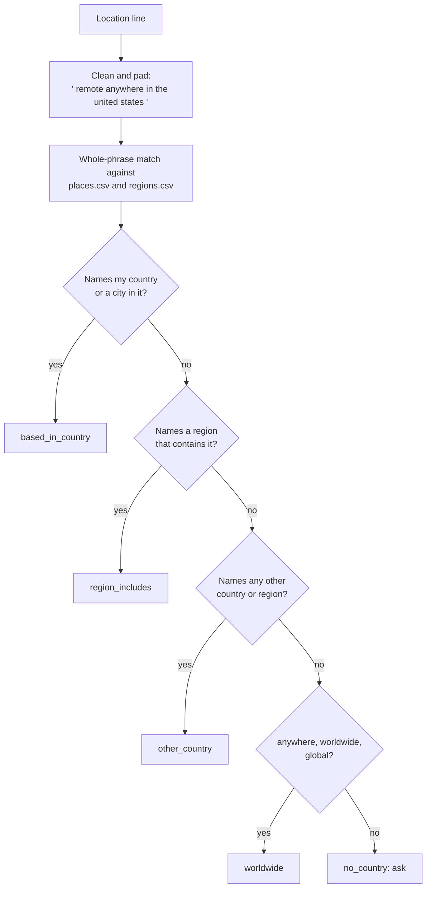

# Remote, really: where can you be hired from?

Of the remote roles you found, which ones can actually hire someone where you live?

## Before you start

- Level 4 (land the job). About 2 hours.
- [11-03 Visa-aware search](../03-visa-aware-search/) reads each posting in its own words and never turns silence into a no. This lesson does the same for location lines.
- [07-04 Match your resume to a posting](../../07-getting-hired/04-match-your-resume-to-a-posting/) matches whole tokens instead of substrings, with a padded string. The same trick keeps "India" from matching "Indianapolis".

## The problem

Ananya is a data analyst in Pune looking for a remote role. She filtered a job board for "remote" and saved 22 analyst postings from 11 companies, and she plans to apply to all of them this weekend. Her mentor, Rohan, asks one question before she starts: "Which of these can hire someone in India?" A remote job still has an employer that must pay, insure and register its staff somewhere, and many employers do that only in one country. You will build a classifier that reads each posting's location line and puts it in one of five groups, so that Ananya applies first where the posting includes India and asks before she spends time on the rest.

The postings in `data/remote_postings.csv` are synthetic, written by `make_data.py`; every company is invented. `data/places.csv` and `data/regions.csv` are the lesson's own map from place names and region names to countries. The real example for India lives in `data/real_snapshot_2026-10-31.json` with its source and date.

## In plain words

Think of a food delivery app. "We deliver" on a restaurant's page does not mean it delivers to your street. One restaurant says "Koregaon Park only", one says "all of Pune", one says "anywhere in the city", and one just says "delivery available". You order first from the ones that name your area, you check before ordering from the one that names nothing, and you do not order from the one that serves a different city, however good its menu looks.

A remote posting's location line is that delivery area. "Remote" says the work is done away from an office. It does not say which countries the employer can hire in.

Words used in this lesson:

- **Location line**: the short text a posting gives for where the job is, such as "Remote - India" or "Remote (EMEA)".
- **Home country**: the country you live in and can legally work in.
- **Region**: a group of countries named in one word. **APAC** is Asia-Pacific, **EMEA** is Europe, the Middle East and Africa, **LATAM** is Latin America, **EU** is the European Union. Employers draw regions their own way, so this lesson's map in `data/regions.csv` is a teaching choice, not an official list.
- **Whole-phrase match**: finding " india " with spaces around it in a cleaned string, so a word only matches as a whole word.
- The five groups, for a candidate in a given home country:
  - **based_in_country**: the line names your country or a city in it.
  - **region_includes**: the line names a region that contains your country.
  - **worldwide**: the line says anywhere, worldwide or global, and names no place.
  - **no_country**: the line names no place at all, for example just "Remote". The posting has to tell you, or you ask.
  - **other_country**: the line names countries or regions, and none of them includes yours.

## What you will build from scratch

- `named`: the countries and regions a location line names, as whole phrases.
- `classify_location`: one of the five groups for a given home country.
- `summary`, `open_to_me` and `tied_to`: the counts, the postings worth applying to first, and which countries the rest are tied to.

## The idea



**A named place beats a worldwide word.** "Remote, anywhere in the United States" contains "anywhere", and it is tied to the United States. So the place check runs before the worldwide check.

**Your country beats the others.** "Remote, US or India" names two countries, and one of them is home, so it is `based_in_country`.

**Match whole phrases, not substrings.** Lower case the line, turn every run of characters that are not letters or digits into one space, and pad both ends with a space. Then look for `" india "`. A substring search for "india" finds "Indianapolis", which is in the United States, and misses "Bengaluru", which is in India. Multi-word names such as "united states" and "north america" work the same way.

**The answer depends on where you live.** The same 22 lines give a different list for someone in the United Kingdom or Canada. The home country is an input, not a constant.

**"Open" is three groups, not four.** `based_in_country`, `region_includes` and `worldwide` are the postings whose own words include you. `no_country` is a question for the recruiter. `other_country` is a no for now, unless the posting's text elsewhere says otherwise. Even a line that includes you is not a promise: the provider of the real data puts it this way: "A location line is not a hiring promise, and no role is described as open to the country unless its listing says so."

## Walk through

Run these from the lesson folder.

Step 1. Classify Ananya's 22 postings.

```python
import sys
sys.path.insert(0, "solution")
import solution as s

postings, places, regions = s.load()
print("remote postings:", len(postings))
print(s.summary(postings, "India", places, regions))
print("open:", s.open_to_me(postings, "India", places, regions))
print("tied to:", s.tied_to(postings, "India", places, regions))
```

`sys.path.insert(0, "solution")` lets Python find the worked answer. `s.load()` reads the three CSV files as lists of dictionaries. It prints:

```
remote postings: 22
{'based_in_country': 3, 'region_includes': 1, 'worldwide': 2, 'no_country': 5, 'other_country': 11}
open: ['R01', 'R02', 'R03', 'R04', 'R05', 'R06']
tied to: {'United States': 3, 'Canada': 2, 'United Kingdom': 1, 'Germany': 1}
```

All 22 say remote. 6 include India in their own words, 5 name no place and need a question, and 11 are tied elsewhere. Four of the 11 name only a region (EMEA, EU, LATAM, North America), which is why `tied_to` counts 7 countries, not 11.

Step 2. Why whole phrases.

```python
import sys
sys.path.insert(0, "solution")
import solution as s

postings, places, regions = s.load()
naive = [p["location"] for p in postings if "india" in p["location"].lower()]
print("substring 'india':", naive)
for loc in ["Remote - Indianapolis, IN", "Remote in Canada", "Remote, anywhere in the United States"]:
    print(repr(s.padded(loc)), s.named(loc, places, regions), s.classify_location(loc, "India", places, regions))
```

```
substring 'india': ['Remote - India', 'Remote, US or India', 'Remote - Indianapolis, IN']
' remote indianapolis in ' ({'United States'}, set()) other_country
' remote in canada ' ({'Canada'}, set()) other_country
' remote anywhere in the united states ' ({'United States'}, set()) other_country
```

The substring search keeps a role in Indianapolis and drops Bengaluru (R02). The padded match finds "indianapolis" as a United States city, reads "in" as a word and not as India, and lets "united states" win over "anywhere".

Step 3. The real example: India, 31 October 2026. Real Analyst Jobs data, retrieved 31 October 2026 through its MCP server (tool `remote_jobs_from_country`, country India), sorts remote analyst-titled roles into the same five groups.

```python
import json

real = json.load(open("data/real_snapshot_2026-10-31.json"))
r = real["remote_analyst_titled_roles"]
total = r["based_in_country"] + r["region_includes"] + r["worldwide"] + r["no_country"] + r["other_country"]
open_ = r["based_in_country"] + r["region_includes"] + r["worldwide"]
print("remote roles:", total)
print("open to India: %d (%.1f%%)" % (open_, 100 * open_ / total))
print("ask first: %d (%.1f%%)" % (r["no_country"], 100 * r["no_country"] / total))
print("tied elsewhere: %d (%.1f%%)" % (r["other_country"], 100 * r["other_country"] / total))
print("United States alone: %d (%.1f%%)" % (real["other_country_named"]["United States"],
                                            100 * real["other_country_named"]["United States"] / total))
```

```
remote roles: 461
open to India: 20 (4.3%)
ask first: 136 (29.5%)
tied elsewhere: 305 (66.2%)
United States alone: 204 (44.3%)
```

The groups are 18 based in India, 1 naming APAC, 1 worldwide, 136 with no country and 305 tied to other places. If you count every remote role as open to you, you count 461 when the listings themselves include India in 20. The 136 are not a no: the provider's advice is to "check the posting for where the employer hires". The provider's own method, not this lesson's map, decided these groups, so read them as its counts.

Step 4. Same postings, another home.

```python
import sys
sys.path.insert(0, "solution")
import solution as s

postings, places, regions = s.load()
for home in ["India", "United Kingdom", "Canada"]:
    print(home, s.open_to_me(postings, home, places, regions))
```

```
India ['R01', 'R02', 'R03', 'R04', 'R05', 'R06']
United Kingdom ['R05', 'R06', 'R16', 'R17']
Canada ['R05', 'R06', 'R15', 'R20', 'R22']
```

Only the two worldwide postings are open to all three. "Remote, EU only" (R18) is not open to the United Kingdom, because the UK is not in the EU, while "Remote (EMEA)" (R16) is.

## Common mistakes

- **Counting "remote" as "open to me".** Here it turns 6 postings into 22. In the real India data it turns 20 into 461.
- **Counting "no country stated" as a no, or as a yes.** It is neither. The 5 here, and 136 in the real data, need one question to the recruiter or a careful read of the full posting, which sometimes says where the employer hires further down.
- **Substring matching.** "india" is inside "Indianapolis" and "Indiana"; "Bengaluru" contains no "india" at all. Match whole phrases and map cities to countries.
- **Letting "anywhere" win.** "Anywhere in the United States" is tied to one country.
- **Short forms are risky.** This map treats "us" and "uk" as countries because location lines are short. In a longer text, "join us" would match the United States. Keep the classifier on the location line only.
- **Trusting a region name as a contract.** One employer's EMEA can leave out countries another includes. Region matches are a reason to apply and ask, and the posting text decides.

## Your turn

Open `exercise.py` and fill in `named`, `classify_location`, `summary`, `open_to_me` and `tied_to`. You decide the order of the checks. Then run, from this folder:

```
python3 test_lesson.py
```

The test checks the 22 committed postings for someone in India, the same postings for someone in the United Kingdom, traps such as Indianapolis, "Remote in Canada" and "anywhere in the United States", empty inputs, and three generated datasets with other home countries. To see the reference solution pass: `CHECK_SOLUTION=1 python3 test_lesson.py`.

Stretch: save 20 remote postings you would apply to, put their location lines in `data/remote_postings.csv`, and add any city or region your postings use to the two map files. For each `no_country` posting, read the full text: how many say where they hire further down?

## Check yourself

1. A posting says "Remote". You live in India. Can you apply?
2. Why is "Remote, anywhere in the United States" not a worldwide role?
3. Why does the classifier take the home country as an input?
4. Of 461 real remote analyst-titled roles, 20 include India in their listing. Why is 20 out of 461 not the same as "4.3% of remote employers hire in India"?

<details>
<summary>Answers</summary>

1. You do not know yet. The line names no country. Read the whole posting for where the employer hires, and if it still does not say, ask the recruiter before you invest an afternoon in the application.
2. Because it names a country. "Anywhere" there means anywhere inside the United States. A named place is checked before the worldwide words.
3. Because the answer depends on where you live. "Remote (EMEA)" is open to someone in the United Kingdom and closed to someone in India.
4. It counts roles, not employers, and only what the listings say. Some of the 136 roles with no country stated may hire in India, and an employer with many roles counts many times. 20 is the number that say so in their own words on that date.

</details>

## What to tell the stakeholder

"Rohan, of my 22 remote postings, 6 include India in their own words: 3 name India or Bengaluru, 1 names APAC and 2 are worldwide. I am applying to those first. 5 just say remote, so I will read each one in full and ask the recruiter where they can hire before applying. The other 11 are tied to the US, Canada, the UK, Germany or a region without India, so I am setting them aside. A location line is not a promise either way, so I will confirm with each employer."

## In real job postings

Real Analyst Jobs data, retrieved 31 October 2026 through its MCP server (tool `remote_jobs_from_country`): of 461 remote analyst-titled roles, 18 are based in India, 1 names a region that includes India, 1 is worldwide, 136 state no country and 305 are tied to other places, 204 of them to the US. Across all 8,952 live analyst roles that day, 544 (6%) were remote (tool `analyst_market_stats`); the provider reports only the remote share it can detect from the location, not a hybrid or on-site split. Real Analyst Jobs labels remote roles with the country the listing names (read 31 October 2026 from https://realanalystjobs.com/llms.txt); see its [remote data analyst jobs worldwide](https://realanalystjobs.com/jobs/remote-data-analyst-jobs-worldwide) and the [analyst job market report](https://realanalystjobs.com/analyst-job-market). The employer's own careers page is still the primary source for where it hires.

## Next

[11-05 Apply where it counts](../05-apply-where-it-counts/)
