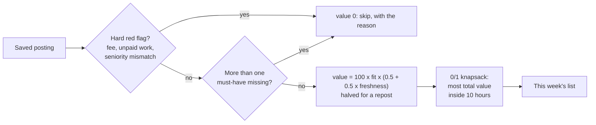

# Apply where it counts

With 40 postings in front of you and 10 hours this week, which ones are worth an application?

## Before you start

- Level 4 (land the job). About 2 hours.
- You can read a short Python function and run a file: [00-06 Python for spreadsheet people](../../00-start-here/06-python-for-spreadsheet-people/).
- [07-04 Match your resume to a posting](../../07-getting-hired/04-match-your-resume-to-a-posting/) compares a resume with a posting's skills, and [07-01 Read job postings like data](../../07-getting-hired/01-read-job-postings-like-data/) separates required from nice to have. This lesson turns both into one score per posting.
- [11-01 Build a target list](../01-build-a-target-list/) and [11-04 Remote, really](../04-remote-where-you-can-be-hired/) decide which postings get saved at all. This lesson decides which saved postings get your hours.

## The problem

Ama is a learner at Lanternway Courses, a fictional online course platform, and is applying for entry-level analyst jobs. Over the week she saved 40 postings. She has 10 hours left for applications, and a tailored application takes her between half an hour and three hours. Her coach, Nikhil, reviews her plan every Sunday evening and asked for a list with a reason for every posting she skips. The postings and her skills profile are synthetic: the companies are fictional and every number in them is invented, so you can practise the method on known answers.

## In plain words

Think of a supermarket sale with a basket that holds only so much. You skip anything past its date, anything that charges you just to enter the shop, and anything with a label that does not match what is inside. Then, from what is left, you fill the basket so it holds the most value, not just the single most valuable item, because one huge item can leave no room for three good ones.

Postings work the same way. Each one gets a score for how fresh it is and how well you fit it, red flags remove the ones that are not real opportunities, and a small search picks the set that gives the most value inside your hours.

Words used in this lesson:

- **Freshness**: how recently the posting first appeared. A posting first seen today scores 1, one first seen 30 or more days ago scores 0, and the score falls in a straight line in between.
- **First seen**: the date a job board first saw the posting. It is the board's date, not always the employer's.
- **Must-have and nice-to-have**: skills the posting requires against skills it only prefers.
- **Fit**: 0.75 times the share of must-haves you have plus 0.25 times the share of nice-to-haves you have, so a missing must-have costs three times as much.
- **Red flag**: something in the posting that means it is not a normal job offer, or not the job its label says.
- **Repost**: a listing copied from somewhere else by a reposting site (an aggregator). The original is usually on the company's careers page.
- **Budget**: the hours you have this week.
- **Knapsack problem**: choosing items, each with a value and a size, to get the most total value without going over a size limit. "0/1" means each item is taken once or not at all.
- **Greedy**: a shortcut that takes the best-looking item first and keeps going while things fit. Fast, and sometimes wrong.

## What you will build from scratch

- `freshness`: days since first seen turned into a score from 1 to 0, with blank dates treated as stale.
- `fit`: must-have and nice-to-have shares from a skills profile, plus the list of missing must-haves.
- `red_flags`: a fee to apply, unpaid trial work, a seniority label that disagrees with the title or salary, and a repost.
- `value`: one number per posting, 0 for a posting you should not apply to.
- `choose`: an exact 0/1 knapsack that picks the best set of postings for your hours.

## The idea



**Freshness.** With `days` = as-of date minus first-seen date:

```
freshness = max(0, 1 - days / 30)
```

A blank date gets 0, because "unknown age" should not beat "first seen today". Freshness only scales value between half and full (`0.5 + 0.5 x freshness`), because an older posting that is still live is still a real job, just with more people ahead of you.

**Fit.** With `must` and `nice` the sets of required and preferred skills, compared without case:

```
fit = 0.75 x |must you have| / |must| + 0.25 x |nice you have| / |nice|
```

An empty list counts as a share of 1. One missing must-have is allowed, since many postings list more than they strictly need. Two or more means the value is 0.

**Red flags.**

| Flag | Rule in this lesson | What it does to value |
|---|---|---|
| fee_to_apply | the notes ask you to pay an application, processing or registration fee, in a sentence without "no", "never" or "not" | 0 |
| unpaid_work | the notes ask for an unpaid trial, test or pilot | 0 |
| seniority_mismatch | labelled Entry Level, but the title has a senior word (senior, sr, lead, principal, staff, manager, head, director) or the minimum salary is at or above the profile's entry ceiling | 0 for an entry-level search |
| repost | listed by a reposting site | halved: the date is the reposter's, and the role may be closed. Find the original first |

A short take-home exercise is normal in analyst hiring, which is why "paid take-home" is not a flag. A whole unpaid week of live client work is a different thing.

**Choosing.** Sorting by value and taking the top postings until the hours run out is not the best plan, because a three-hour posting can crowd out three one-hour postings that are worth more together. The knapsack finds the best set exactly. With hours in half-hour steps and a 10-hour budget there are only 21 possible hour totals, so a table with one cell per (posting, hours used) is small:

```
best[c] = most value using at most c half-hours, over the postings seen so far
for each posting with value v and w half-hours, for c from the budget down to w:
    best[c] = max(best[c], best[c - w] + v)
```

Going from the budget downwards makes sure each posting is used at most once. Keeping a note of which cells took the posting lets you walk back and list the chosen ids.

The weights here (0.75 for must-haves, 30 days to stale, half value for a repost) are choices, not facts about hiring. Choose yours, write them down, and keep them fixed for the week so the plan is comparable from week to week.

## Walk through

Run these from the lesson folder.

Step 1. Freshness and fit. `sys.path.insert(0, "solution")` lets Python find the worked answer, and `import solution as s` loads it.

```python
import sys
sys.path.insert(0, "solution")
import solution as s

P, prof = s.load_postings(), s.load_profile()
print(prof["skills"], prof["weekly_hours"])
for p in P[:3]:
    score, missing = s.fit(p, prof["skills"])
    print(p["posting_id"], p["first_seen"], round(s.freshness(p["first_seen"], prof["as_of"]), 2),
          p["must_have"], "|", p["nice_to_have"], "->", round(score, 3), missing)
```

```
['SQL', 'Excel', 'Tableau', 'Python', 'statistics'] 10
J01 2026-10-30 0.97 Power BI | Python;Excel -> 0.25 ['power bi']
J02 2026-10-21 0.67 sql;Tableau | Python;Excel -> 1.0 []
J03 2026-09-20 0.0 Looker;Power BI;Tableau | Python -> 0.5 ['looker', 'power bi']
```

J01 was first seen yesterday (freshness 0.97) but its only must-have is Power BI, which Ama does not list, so fit is 0.25. J02 asks for "sql" in lower case; comparing without case counts it. J03 is 41 days old and misses two must-haves.

Step 2. Red flags.

```python
import json
import sys
from collections import Counter
sys.path.insert(0, "solution")
import solution as s

P, prof = s.load_postings(), s.load_profile()
flags = {p["posting_id"]: s.red_flags(p, prof) for p in P}
print(Counter(f for fl in flags.values() for f in fl))
for p in P:
    if "seniority_mismatch" in flags[p["posting_id"]]:
        print(p["posting_id"], p["title"], p["seniority_label"], p["salary_min_usd"] or "no salary")
real = json.load(open("data/real_snapshot_2026-10-31.json"))["entry_level_search"]["first_result"]
p = {"title": real["title"], "seniority_label": "Entry Level", "salary_min_usd": str(real["salary_min_usd"]),
     "notes": "", "source": "job_board"}
print(real["title"], s.red_flags(p, prof))
```

```
Counter({'repost': 5, 'seniority_mismatch': 3, 'unpaid_work': 2, 'fee_to_apply': 2})
J12 BI Analyst Entry Level 156000
J24 Principal Analyst Entry Level 70000
J39 Senior Manager, Analytics Entry Level 64000
Senior Manager, Advanced Analytics ['seniority_mismatch']
```

Twelve of the 40 postings carry a flag. J12 has an ordinary title but a minimum salary of 156,000, far above an entry-level range, so its label is the suspect part. J24 and J39 are senior titles under an Entry Level label. The last line is real: on 31 October 2026, a Real Analyst Jobs search for entry-level roles posted in the last 7 days returned 347 matches, and the first one was titled "Senior Manager, Advanced Analytics" with a salary of $156,915-180,000 a year (Real Analyst Jobs data, retrieved 31 October 2026 through its MCP server, tool `search_analyst_jobs`; copied in `data/real_snapshot_2026-10-31.json`). Seniority labels are parsed from text by every board, so read the title and the pay, not only the filter.

Step 3. Value per posting.

```python
import sys
sys.path.insert(0, "solution")
import solution as s

P, prof = s.load_postings(), s.load_profile()
rows = sorted(P, key=lambda p: -s.value(p, prof))
for p in rows[:6]:
    print(p["posting_id"], "%-28s" % p["title"][:28], round(s.value(p, prof), 1), p["est_hours"])
print("worth 0:", sum(1 for p in P if s.value(p, prof) == 0), "of", len(P))
```

```
J13 Product Analyst              98.3 3.0
J06 Associate Analyst, Insights  96.7 1.0
J16 Data Analyst I               96.7 3.0
J22 Reporting Analyst            96.7 2.0
J04 Reporting Analyst            91.7 3.0
J17 Business Analyst             86.7 1.0
worth 0: 11 of 40
```

The five highest-value postings take 12 hours between them, already over budget. Eleven postings are worth 0: seven for a hard flag and four for missing two or more must-haves. Each of those has a reason Ama can give Nikhil.

Step 4. The best set inside 10 hours.

```python
import sys
sys.path.insert(0, "solution")
import solution as s

P, prof = s.load_postings(), s.load_profile()
items = [(p["posting_id"], s.value(p, prof), float(p["est_hours"])) for p in P]
ids, total, hours = s.choose(items, prof["weekly_hours"])
print(ids, round(total, 1), hours)
gi, gt, gh = s.greedy(items, prof["weekly_hours"])
print(gi, round(gt, 1), gh)
print(s.choose([("a", 60.0, 5.0), ("b", 60.0, 5.0), ("c", 70.0, 5.5)], 10))
print(s.greedy([("a", 60.0, 5.0), ("b", 60.0, 5.0), ("c", 70.0, 5.5)], 10))
```

```
['J02', 'J06', 'J10', 'J17', 'J18', 'J20', 'J22', 'J28', 'J30', 'J31', 'J34'] 764.6 10.0
['J02', 'J06', 'J08', 'J10', 'J17', 'J18', 'J20', 'J25', 'J28', 'J30', 'J31'] 763.3 10.0
(['a', 'b'], 120.0, 10.0)
(['c'], 70.0, 5.5)
```

The knapsack picks 11 postings worth 764.6 points in exactly 10 hours. Greedy by value per hour gets close on this data (763.3), but the small case below it shows the shortcut can lose badly: posting c has the best value per hour, takes 5.5 hours, and leaves no room for a or b, which together are worth more. The knapsack is exact on any data; greedy is close only when you are lucky.

Two postings in the plan need a second look before Ama applies. J34 is a repost: she should find the role on the company's own careers page and apply there, since that is the primary source. J31 has no first-seen date: if the careers page shows it closed, she drops it and the next run of `choose` fills the gap.

## Common mistakes

1. **Ranking by fit alone.** It feels like the honest measure of "can I get this job":

    ```python
    import sys
    sys.path.insert(0, "solution")
    import solution as s

    P, prof = s.load_postings(), s.load_profile()
    by_fit = sorted(P, key=lambda p: (-s.fit(p, prof["skills"])[0], p["posting_id"]))
    left, picked = prof["weekly_hours"], []
    for p in by_fit:
        if float(p["est_hours"]) <= left:
            picked.append(p)
            left -= float(p["est_hours"])
    print([p["posting_id"] for p in picked])
    print([(p["posting_id"], s.red_flags(p, prof)) for p in picked if s.red_flags(p, prof)])
    print(sum(1 for p in picked if s.freshness(p["first_seen"], prof["as_of"]) == 0))
    ```

    ```
    ['J02', 'J04', 'J06', 'J10', 'J13', 'J17', 'J12']
    [('J12', ['seniority_mismatch'])]
    1
    ```

    Seven applications instead of eleven, and one of them, J12, is a job whose salary says it is not entry level. The senior pay looks like good news, which is exactly why it gets through: check flags before you rank.
2. **Taking the highest values until the hours run out.**

    ```python
    import sys
    sys.path.insert(0, "solution")
    import solution as s

    P, prof = s.load_postings(), s.load_profile()
    items = sorted([(p["posting_id"], s.value(p, prof), float(p["est_hours"])) for p in P], key=lambda x: (-x[1], x[0]))
    left, picked = prof["weekly_hours"], []
    for i, v, h in items:
        if v > 0 and h <= left:
            picked.append((i, v, h))
            left -= h
    print([i for i, _, _ in picked], round(sum(v for _, v, _ in picked), 1), len(picked))
    ```

    ```
    ['J13', 'J06', 'J16', 'J22', 'J17'] 475.0 5
    ```

    Five applications worth 475.0 points, against eleven worth 764.6 from the knapsack. Two three-hour postings at the top use most of the week.
3. **Treating a blank date as new.** If a missing first-seen date is read as "today", every posting a board failed to date jumps to the top. Unknown is not fresh; this lesson scores it as stale and asks you to check the careers page.
4. **Applying to the repost and the original.** A reposting site copies listings that exist elsewhere, often with its own date. The data drop in this course removes two reposting sites for the same reason (see [data/job-market](../../../data/job-market/)). Apply once, at the source.
5. **Trusting a filter's seniority label.** A filter can only be as good as the label behind it, as the real "Senior Manager" result above shows. Read the title, the years of experience asked for, and the pay.

## Your turn

Open `exercise.py`. Write the three patterns `FEE`, `UNPAID` and `SENIOR_WORDS`, then fill in `freshness`, `fit`, `red_flags`, `value` and `choose`. `plan` is written for you. Then run, from this folder:

```
python3 test_lesson.py
```

The test checks freshness on today, halfway, stale, a blank date and a future date; fit on mixed case, empty lists and a profile with no skills; red flags on hand-written notes including "We never charge an application fee", a salary just under and at the ceiling, and "Management Trainee"; the real "Senior Manager, Advanced Analytics" result; and `choose` on an empty list, a zero budget, zero-value postings, the greedy trap, and 60 random small cases checked against every possible subset. Then it checks every flag and value on the committed postings and on a second set built with another seed, and that your plan is the best set inside the budget.

Stretch: add a `referral` column (yes or no) and give a posting with a referral a higher value. Then write down how much higher and why before you look at whether it changes the plan.

## Check yourself

1. Why does the knapsack go through the hours from the budget down to the posting's own hours, and not upwards?
2. A posting has no first-seen date and a perfect fit. Why does this lesson give it half the value of a fresh posting, and what would you do before applying?
3. Why is a high salary on an "Entry Level" posting a red flag rather than good news?
4. Nikhil says: "Just apply to the top five by score." What do you show him?

<details>
<summary>Answers</summary>

1. Going downwards means `best[c - w]` still holds the value from before this posting was considered, so the posting is added at most once. Going upwards would let it be added again on top of itself, which is the unbounded knapsack, not this one.
2. Unknown age could mean "posted today" or "closed two months ago". Scoring it as fresh would reward missing data. Check the company's careers page: if the role is live there, use that date.
3. A salary far above the entry range, or a senior title, means the label is wrong, not that the job is a lucky find. The employer will hire for the level the title and pay describe, so an entry-level candidate spends hours on an application that is very unlikely to succeed.
4. The top five by score use the whole 10 hours on five postings worth 475.0 points. The knapsack fits eleven worth 764.6 in the same 10 hours, and every skipped posting has a written reason.

</details>

## What to tell the stakeholder

"Of the 40 postings I saved, 11 are not worth an application: 7 have a red flag (2 ask for a fee, 2 for unpaid trial work, 3 are labelled entry level but are senior by title or salary) and 4 miss two or more must-haves. Inside my 10 hours, the best set is 11 applications. Two need a check first: one is a repost, so I will apply on the company's own page, and one has no posting date. The scores use weights I chose, so I will keep them fixed for a month before I change them."

## In real job postings

Real Analyst Jobs data, retrieved 31 October 2026 through its MCP server (tool `analyst_market_stats`), counted 8,952 live analyst roles, of which 2,458 (27%) were posted in the last 7 days and 5,813 (65%) in the last 30, so about a third of what is live is more than a month old; 3,706 (41%) had no seniority stated at all. The provider says it reads roles daily from company career pages, removes closed ones every day and does not repost from other job boards (read 31 October 2026 from https://realanalystjobs.com/llms.txt), so a role that is live there was live on the employer's page that day. See the [analyst job market](https://realanalystjobs.com/analyst-job-market) and [entry-level data analyst jobs](https://realanalystjobs.com/jobs/entry-level-data-analyst-jobs), and still confirm a role on the company's own careers page before you spend an hour on it.

## Next

[Track your search as a funnel](../06-track-your-search-as-a-funnel/)
