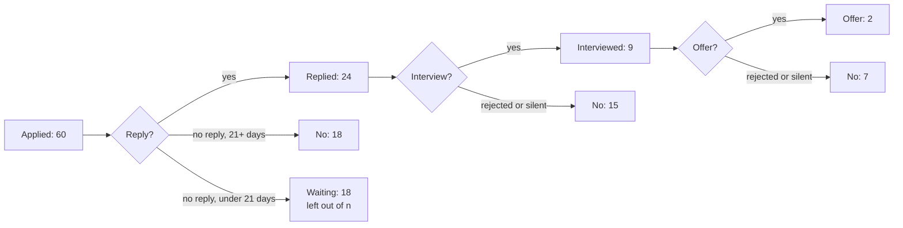

# Track your search as a funnel

Out of 60 applications, where is your search leaking, and which channel deserves more time?

## Before you start

- Level 4 (land the job). About 2 hours.
- [03-02 Funnel conversion](../../03-metrics-and-product-analytics/02-funnel-conversion/) builds a step-by-step funnel. This lesson builds the same thing for one person's job search.
- [03-08 Retention curves and churn](../../03-metrics-and-product-analytics/08-retention-curves-and-churn/) introduces right-censoring, and [06-07 How big an eval set](../../06-ai-for-analysts/07-how-big-an-eval-set/) introduces the Wilson interval. Both are explained again below.
- [11-05 Apply where it counts](../05-apply-where-it-counts/) chooses which postings get an application. This lesson measures what happens after you send them.

## The problem

Ama, a learner at Lanternway Courses (a fictional online course platform), has sent 60 applications since 24 August 2026 and logged each one: the channel she used, the date she applied, and the dates of the first reply, the first interview, any offer and any rejection. So far she has had nine interviews and two offers that did not work out (one for the wrong city, one withdrawn), and she wants to know where to put her time next. Her coach, Nikhil, asks for one page before Sunday: where the search leaks, and whether she should move hours from job boards to referrals. The log is synthetic and the companies in it are fictional, so every number below comes from this lesson's own data.

## In plain words

Picture a cricket net session where you track which bowler gets the most wickets. A bowler who started 20 minutes ago has not had time to take many, so counting his wickets against the others' full hour makes him look bad. And if one bowler took 2 wickets in 5 balls, nobody would say he takes a wicket 40% of the time: 5 balls is too few to know.

A job search has the same two traps. Applications sent last week have not had time to get a reply, so they are not failures yet. And a channel with 3 interviews from 6 applications might be brilliant or might be lucky. This lesson counts only the applications that have had a fair chance, and puts a range around every rate so a small count cannot fool you.

Words used in this lesson:

- **Funnel**: the steps an application passes through: applied, replied, interviewed, offered. Each step keeps some of the previous step's rows.
- **Conversion**: the share of rows at one step that reach the next.
- **Channel**: how you applied. Here: referral (someone at the company passed your name on), careers page (the company's own site), job board (a site that lists many companies' jobs), recruiter (an agency or in-house recruiter contacted you or you them).
- **Right-censoring**: for a recent application we do not know the outcome yet, because the future is cut off on the right of its timeline. Such a row is **waiting**, not failed.
- **Wait rule**: how long you give a step before you call silence a "no". This lesson uses 21 days for a reply and 28 days from applying to an interview. Both are choices.
- **Wilson interval**: a range of rates that are consistent with k successes out of n tries, at 95% confidence. It stays inside 0% to 100% and behaves well on small counts, unlike the plain "rate plus or minus 2 standard errors".
- **Interviews per 10 hours**: the rate divided by the average hours one application takes in that channel, times 10. It answers the real question, which is about your time, not your application count.

## What you will build from scratch

- `wilson`: the 95% Wilson interval for k out of n.
- `stage_counts` and `funnel`: passed, failed and waiting at each step, with waiting rows left out of the denominator.
- `replied_within`: a time-to-reply measure that does not ignore the applications still waiting.
- `by_channel`: interviews per application and per 10 hours for each channel, with intervals.
- `recommend`: the best channel by interviews per 10 hours, and whether the evidence is clear enough to act on.

## The idea



**One step, with censoring.** For a step from date column `from` to date column `to`, look only at rows that have a `from` date:

```
passed  = rows with a `to` date
failed  = rows with no `to` date AND (a rejection recorded OR at least wait_days since `from`)
waiting = everything else
rate    = passed / (passed + failed)
```

A rejection is final the day it arrives, so a fresh rejection counts at once. Silence counts only after the wait rule.

**Time to reply.** The median days to reply among the applications that got one ignores every application still waiting, and those are the slow ones. A fixed window avoids that: among applications at least 14 days old, what share had a reply within 14 days? Every row in that denominator has had its full 14 days.

**Wilson interval.** With p = k / n and z = 1.96 for 95%:

```
centre = (p + z^2 / (2n)) / (1 + z^2 / n)
half   = z x sqrt(p(1 - p) / n + z^2 / (4n^2)) / (1 + z^2 / n)
interval = centre - half to centre + half
```

With n = 0 there is no information, so the interval is 0 to 1.

**Per hour, then decide.** Interviews per 10 hours = rate x 10 / mean hours per application. Multiplying the interval ends by the same factor gives an interval for it. Call a channel the clear winner only when its lower end is above every other channel's upper end. Otherwise, the honest answer is "this one looks best, keep testing".

## Walk through

Run these from the lesson folder.

Step 1. The funnel. `sys.path.insert(0, "solution")` lets Python find the worked answer, and `import solution as s` loads it.

```python
import sys
sys.path.insert(0, "solution")
import solution as s

A = s.load_applications()
print(len(A), "applications, pulled", s.AS_OF)
for f, t, c in s.funnel(A):
    print("%-12s -> %-12s %2d of %2d passed, %2d waiting" % (f, t, c["k"], c["n"], c["waiting"]))
```

```
60 applications, pulled 2026-10-31
applied_on   -> reply_on     24 of 42 passed, 18 waiting
reply_on     -> interview_on  9 of 24 passed,  0 waiting
interview_on -> offer_on      2 of  9 passed,  0 waiting
```

Eighteen applications are under 21 days old with no reply yet, so they are left out: 24 of the 42 decided applications got a reply (57%). Of the 24 replies, 9 led to an interview (38%), and 2 of the 9 interviews led to an offer. The biggest drop in rows is at the first step, but the first step also has the most rows to lose. Look at the rates, not only the counts.

Step 2. How much a small count can tell you.

```python
import sys
sys.path.insert(0, "solution")
import solution as s

for k, n in [(2, 5), (3, 6), (20, 50), (200, 500)]:
    low, high = s.wilson(k, n)
    print("%3d of %3d = %2.0f%%, 95%% interval %2.0f%% to %2.0f%%" % (k, n, 100 * k / n, 100 * low, 100 * high))
```

```
  2 of   5 = 40%, 95% interval 12% to 77%
  3 of   6 = 50%, 95% interval 19% to 81%
 20 of  50 = 40%, 95% interval 28% to 54%
200 of 500 = 40%, 95% interval 36% to 44%
```

2 of 5 is 40%, but anything from 12% to 77% fits it. Even 20 of 50 leaves a range of 28% to 54%, and one person's job search rarely has 50 decided applications per channel.

Step 3. Time to reply, two ways.

```python
import statistics
import sys
sys.path.insert(0, "solution")
import solution as s

A = s.load_applications()
waits = [s.days_between(a["applied_on"], a["reply_on"]) for a in A if a["reply_on"]]
print(len(waits), "replies, median", statistics.median(waits), "days, longest", max(waits))
for days in (7, 14, 21):
    k, n = s.replied_within(A, days)
    print("replied within %2d days: %2d of %2d (%.0f%%)" % (days, k, n, 100 * k / n))
```

```
24 replies, median 9.0 days, longest 24
replied within  7 days: 11 of 54 (20%)
replied within 14 days: 16 of 43 (37%)
replied within 21 days: 16 of 37 (43%)
```

"Median 9 days" describes only the 24 applications that got a reply. The fixed windows use every application old enough: 37% of applications that are at least 14 days old had a reply within 14 days. The denominator shrinks with the window because recent applications are not old enough to count yet, which is the censoring rule doing its job.

Step 4. Channels, per application and per hour.

```python
import sys
sys.path.insert(0, "solution")
import solution as s

stats = s.by_channel(s.load_applications())
for ch, x in stats.items():
    print("%-12s apps %2d  interviews %d of %2d (waiting %2d)  %.1fh each  per 10h %.2f [%.2f to %.2f]"
          % (ch, x["apps"], x["k"], x["n"], x["waiting"], x["hours"], x["per_10h"], x["low_10h"], x["high_10h"]))
print(s.recommend(stats))
```

```
careers_page apps 18  interviews 2 of  6 (waiting 12)  1.5h each  per 10h 2.18 [0.63 to 4.58]
job_board    apps 26  interviews 1 of 21 (waiting  5)  0.6h each  per 10h 0.77 [0.14 to 3.68]
recruiter    apps  9  interviews 3 of  7 (waiting  2)  0.8h each  per 10h 5.51 [2.03 to 9.64]
referral     apps  7  interviews 3 of  6 (waiting  1)  2.4h each  per 10h 2.12 [0.80 to 3.45]
{'best': 'recruiter', 'confident': False}
```

Recruiter contacts gave the most interviews per 10 hours in this log (5.51), but the evidence is not clear: the job board's upper end (3.68) is above the recruiter's lower end (2.03). Job boards are cheap per application (0.6 hours) and produced 1 interview from 21 decided applications. Referrals have the best rate per application (3 of 6) and cost the most time. Twelve of the 18 career-page applications are still waiting, so that channel's numbers will change most in the next few weeks.

What to do with "not clear": move some time, not all of it, and keep logging. For example, shift 3 of the hours that go to job boards each week to recruiters and referrals, keep the wait rules fixed, and run this again in four weeks.

## Common mistakes

1. **Counting waiting applications as failures.** It is the natural way to compute a rate: interviews divided by applications.

    ```python
    import sys
    sys.path.insert(0, "solution")
    import solution as s

    A = s.load_applications()
    for ch in ["careers_page", "job_board"]:
        rows = [a for a in A if a["channel"] == ch]
        naive = sum(1 for a in rows if a["interview_on"]) / len(rows)
        c = s.stage_counts(rows, "applied_on", "interview_on", wait_days=28)
        print("%-12s naive %.0f%% (of %d)   censored %.0f%% (of %d)" % (ch, 100 * naive, len(rows), 100 * c["k"] / c["n"], c["n"]))
    ```

    ```
    careers_page naive 11% (of 18)   censored 33% (of 6)
    job_board    naive 4% (of 26)   censored 5% (of 21)
    ```

    The naive rate cuts the careers-page rate to a third, only because Ama sent most of those applications in the last three weeks. The job board hardly moves, because its applications are older. Any channel you started recently looks worse than it is.
2. **Reading 3 of 6 as "referrals convert at 50%".** The interval is 19% to 81%. Say the count, not just the percent, and show the interval.
3. **Comparing channels per application instead of per hour.**

    ```python
    import sys
    sys.path.insert(0, "solution")
    import solution as s

    stats = s.by_channel(s.load_applications())
    for ch, x in stats.items():
        print("%-12s rate %.0f%%   hours spent %.1f   interviews %d" % (ch, 100 * x["rate"], x["hours"] * x["apps"], x["k"]))
    ```

    ```
    careers_page rate 33%   hours spent 27.5   interviews 2
    job_board    rate 5%   hours spent 16.0   interviews 1
    recruiter    rate 43%   hours spent 7.0   interviews 3
    referral     rate 50%   hours spent 16.5   interviews 3
    ```

    Per application, referrals win. Per hour, recruiters do, because a referral took Ama about 2.4 hours of networking each. The constraint is your week, so compare per hour.
4. **Quoting the median reply time of the replies only.** It leaves out every application still waiting, which are exactly the slow ones. Use a fixed window on applications old enough to have had it.
5. **Changing the wait rule after seeing the numbers.** A 21-day rule that becomes 14 days because the result looks better is not a rule. Write it down before you count.

## Your turn

Open `exercise.py`. Fill in `wilson`, `stage_counts`, `funnel`, `replied_within`, `by_channel` and `recommend`. The loaders and `days_between` are written for you. Then run, from this folder:

```
python3 test_lesson.py
```

The test checks `wilson` on 2 of 5, 0 of 0, 0 of 7 and 7 of 7, and against a second formula; `stage_counts` on an application exactly 21 days old, one 20 days old, a fresh rejection and an empty log; `replied_within` on a reply on day 14 and one on day 15; `recommend` on clear, overlapping, tied and empty channels. Then it checks the funnel, the reply window, every channel's numbers and the recommendation on the committed log and on a second log built with another seed.

Stretch: add a column for whether you tailored the resume to the posting, and compare tailored against untailored inside the job-board channel only, with intervals. Then ask how many more applications you would need before the intervals stop overlapping.

## Check yourself

1. An application sent 10 days ago has no reply. Why is it left out of the reply rate instead of counted as a "no"?
2. Recruiters show 5.51 interviews per 10 hours and job boards 0.77. Why does `recommend` still say the evidence is not clear?
3. Why can a rejection count as a "no" on the day it arrives, when silence has to wait 21 days?
4. Nikhil asks: "So should Ama stop using job boards?" What do you say?

<details>
<summary>Answers</summary>

1. Most replies in this log come within three weeks, so after 10 days the outcome is not known yet. Counting it as a "no" would push down the rate of whichever channel you used most recently, which is a fact about your calendar, not about the channel.
2. With 1 of 21 and 3 of 7, both rates are uncertain. The recruiter's lower end (2.03 per 10 hours) is below the job board's upper end (3.68), so a difference that large could still come from luck on counts this small.
3. A rejection is an answer: that application will not move to the next step. Silence might still become a reply, so it needs a cut-off before you call it a no.
4. Not stop: move some hours and measure. Job boards are cheap per application and are where most postings are found. The data points towards recruiters and referrals, but not clearly, so shift a few hours a week, keep the same wait rules, and check again in four weeks.

</details>

## What to tell the stakeholder

"Of 42 applications old enough to judge, 24 got a reply (57%), 9 of those replies led to an interview, and 2 of the 9 interviews became offers; 18 more applications are under three weeks old and still waiting. Per hour spent, recruiter contacts produced the most interviews (5.5 per 10 hours, against 0.8 for job boards), but with 3 of 7 and 1 of 21 the ranges overlap, so I would move about 3 hours a week from job boards to recruiters and referrals as a test and review again in four weeks, not drop job boards."

## In real job postings

Real Analyst Jobs data, retrieved 31 October 2026 through its MCP server (tool `analyst_market_stats`), counted 2,458 analyst roles posted in the last 7 days out of 8,952 live, so new roles keep arriving each week and a weekly funnel review keeps pace with them. For channels: the provider's own comparison page, read 31 October 2026, says LinkedIn is stronger for recruiters, referrals and volume and is free to apply, and suggests using both ([Real Analyst Jobs vs LinkedIn Jobs](https://realanalystjobs.com/guides/realanalystjobs-vs-linkedin-jobs)); live counts are on the [analyst job market](https://realanalystjobs.com/analyst-job-market) page.

## Next

[Using Real Analyst Jobs in your search](../07-using-real-analyst-jobs/)
