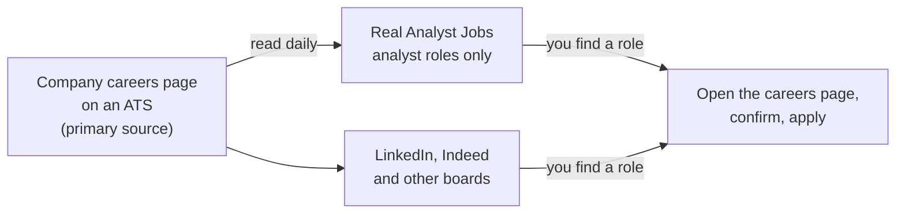

# Using Real Analyst Jobs in your search

What does Real Analyst Jobs show you, how is its data collected, and where are LinkedIn, Indeed or a company's own careers page better?

## Before you start

- Level 4 (land the job). About 1 hour. Guide, no test: there is nothing to compute, so there is no `test_lesson.py`. The Check yourself questions at the end are the check.
- This guide ties together the tested lessons before it. Do them first, or at least read their results: [01 Build a target list](../01-build-a-target-list/), [02 Titles and synonyms](../02-titles-and-synonyms/), [03 Visa-aware search](../03-visa-aware-search/), [04 Remote, really](../04-remote-where-you-can-be-hired/), [05 Apply where it counts](../05-apply-where-it-counts/) and [06 Track your search as a funnel](../06-track-your-search-as-a-funnel/).
- The course uses Real Analyst Jobs open data in many lessons, so this guide says plainly what that source is, how it is built and what it leaves out. It is one source among several. The free path comes first throughout.

## The problem

Lena, a fictional course graduate, is looking for her first analyst role in the US. She is on a student visa and expects to work on STEM OPT first, so sponsorship history matters to her. She has 10 hours a week for the search. She has heard of Real Analyst Jobs through this course, she already uses LinkedIn, and a friend told her to "just use Indeed". She wants to know what each one is for, what she can do without paying anything, and how to fit them into one weekly routine.

Lena is invented. Every product fact in this guide is cited as read on 31 October 2026 from the site's own product summary, [llms.txt](https://realanalystjobs.com/llms.txt), or from the page named. Every market number is cited as Real Analyst Jobs data, retrieved 31 October 2026 through its MCP server, with the tool named. Facts change; check the pages yourself before you rely on one.

## In plain words

Think of buying vegetables. There is the big supermarket that sells everything, the specialist greengrocer that sells only vegetables, and the farm itself. The greengrocer has a narrower range but sorts it well. The supermarket has more of everything, including things you did not come for. The farm is where the vegetables actually come from: if the greengrocer's label and the farm disagree, the farm is right.

A job search works the same way. A general board lists every kind of job. A specialist board lists one kind and sorts it. The company's own careers page is where the posting actually lives. You use more than one, and you check the source before you act.

Words used in this lesson:

- **Job board**: a site that lists job postings from many employers in one place.
- **Applicant tracking system (ATS)**: the software a company uses to publish its postings and receive applications, such as Greenhouse, Lever or Workday. A company's careers page is usually served by one.
- **Careers page**: the company's own page of open roles. It is the primary source of any posting.
- **H-1B approval record**: the counts of H-1B petitions an employer had approved or denied in past years, published by USCIS.
- **Paid pass**: the paid tier of Real Analyst Jobs. Prices vary by region and change, so this course never states one: see [pricing](https://realanalystjobs.com/pricing).

## What you will build from scratch

- A plain picture of what Real Analyst Jobs is, how its data is collected, and what it does not do.
- A clear split of what you can do for free and what is on the paid pass.
- A side by side of Real Analyst Jobs, LinkedIn, Indeed and company careers pages, with where each is better.
- A one-week routine that uses the free path and the tested lessons 11-01 to 11-06.

## The idea

### What it is and how the data is collected

Real Analyst Jobs is a job board only for data, business and financial analyst roles. Roles are read daily from company career pages on 18 or more applicant tracking systems, including Greenhouse, Lever, Workday, Ashby, SmartRecruiters, iCIMS, SAP SuccessFactors and Oracle Taleo. New roles are added and closed ones removed every day. It does not repost from other job boards. (Read 31 October 2026 from [llms.txt](https://realanalystjobs.com/llms.txt).)

Two things follow from that, and both matter when you read its numbers:

1. A company that does not publish its roles on one of those systems will not appear. A small employer that posts only on LinkedIn or Indeed is missing by design.
2. Because closed roles are removed, not archived, the data is a picture of what is open now. It has no history of past postings (see "What it does not do" below).

### What is free and what is on the paid pass

Free, with no payment (read 31 October 2026 from [llms.txt](https://realanalystjobs.com/llms.txt)):

- Browsing and searching [the jobs](https://realanalystjobs.com/jobs), including every company name, and the [companies](https://realanalystjobs.com/companies) page.
- [Tools](https://realanalystjobs.com/tools), with no account needed.
- The live [analyst job market report](https://realanalystjobs.com/analyst-job-market).
- Dated studies at [research](https://realanalystjobs.com/research), under the CC BY 4.0 licence, so you can reuse them with credit.
- Question pages at [answers](https://realanalystjobs.com/answers).
- This course, also at [learn](https://realanalystjobs.com/learn).

On the paid pass (same source):

- The direct apply link.
- The Autofill browser extension.
- Filters for visa sponsorship, H-1B records, roles new in the last 24 hours, and roles that list a salary.

What the free path means in practice: because company names are free, you can find a role, then open that company's careers page yourself and apply there. That is the step this course tells you to take anyway, because the careers page is the primary source. The paid filters save sorting time; they do not unlock roles you cannot otherwise see. For prices, see [pricing](https://realanalystjobs.com/pricing): they vary by region and change, so none are given here.

### The H-1B record and its limits

Each US employer shows its USCIS H-1B approval record, from the USCIS [H-1B Employer Data Hub](https://www.uscis.gov/tools/reports-and-studies/h-1b-employer-data-hub), for FY2023 to FY2026. There are ranked lists at [H-1B sponsors for data analysts](https://realanalystjobs.com/h1b-sponsors/data-analyst). (Read 31 October 2026 from [llms.txt](https://realanalystjobs.com/llms.txt).) The Data Hub itself is published by USCIS, so you can look an employer up there directly.

A record is history, not a promise for one role. The provider's own note says the counts are "employer-wide, every occupation and not only analysts", and that a company not in the data is "reported as not in our data, with the USCIS link, never as a company that does not sponsor" (Real Analyst Jobs data, retrieved 31 October 2026, tool `h1b_sponsor_check`). [03 Visa-aware search](../03-visa-aware-search/) turns this into a tested check.

### Remote labels

Remote roles are labelled with the country the listing names; many remote roles hire from one country only (read 31 October 2026 from [llms.txt](https://realanalystjobs.com/llms.txt)). "Remote" on its own does not mean "from anywhere". [04 Remote, really](../04-remote-where-you-can-be-hired/) shows how to sort remote roles by where they can hire.

### What it does not do

From the product summary (read 31 October 2026 from [llms.txt](https://realanalystjobs.com/llms.txt)):

- No recruiter messaging and no referrals.
- Analyst roles only. If you are also open to other kinds of work, you need another source.
- No E-Verify data. STEM OPT needs an employer enrolled in E-Verify, and that must be confirmed with the employer.

From the provider's own "notReported" list (Real Analyst Jobs data, retrieved 31 October 2026, tool `analyst_market_stats`), in its words:

- **Hybrid against on-site**: "Work mode is only recorded on employer-posted roles; scraped listings carry a free-text location. We report the remote share (detectable from the location) and nothing else."
- **Hiring trends over time**: "The feed keeps only live roles (closed listings are removed, not archived), so there is no history to chart yet."
- **Salary benchmarks**: "Most listings state no pay, and the ones that do use mixed currencies and periods. We report how many roles disclose a range, not an average that a handful of postings would distort." It does not give salary averages.

### Side by side

| Source | What it is | Where it is the better choice |
|---|---|---|
| Company careers page | The primary source of the posting | Always the place to confirm a role is still open, read the full text and, in most cases, apply. Also the only place for a company that posts nowhere else. |
| LinkedIn | A general network and job board | Recruiters, referrals through people you know, and volume. Free to apply. |
| Indeed | A general job board | Roles of every kind, not only analyst roles, and employers that post there directly instead of on an ATS careers page. |
| Real Analyst Jobs | A board only for analyst roles, read daily from ATS careers pages | Analyst roles in one place, with company names, H-1B history for US employers, and remote roles labelled by country. |

The LinkedIn row follows the site's own comparison, [Real Analyst Jobs vs LinkedIn Jobs](https://realanalystjobs.com/guides/realanalystjobs-vs-linkedin-jobs), which says LinkedIn is stronger for recruiters, referrals and volume, is free to apply, and recommends using both. Its guide [job boards for data analysts](https://realanalystjobs.com/guides/best-job-boards-for-data-analysts) compares Indeed, LinkedIn, Wellfound, Built In, Remote OK and Handshake, and the site also has a page titled [analyst jobs not on LinkedIn or Indeed](https://realanalystjobs.com/guides/data-analyst-jobs-not-on-linkedin-indeed). (All read 31 October 2026.) Read those as one provider's view of its own market, and test the claims against your own searches: [06 Track your search as a funnel](../06-track-your-search-as-a-funnel/) measures which channel actually gives you replies.

## Walk through

How Lena would use it this week, with the dated numbers from Real Analyst Jobs data retrieved 31 October 2026 (tools named). She stays on the free path.

**Monday: see the market, then build the list (11-01).** The market report shows 8,952 live analyst roles at 1,542 companies, 3,101 of them in the US, and 2,458 posted in the last 7 days (tool `analyst_market_stats`). SQL appears in 70% of the roles that list skills, Python in 48% and Excel in 41%. Lena uses those numbers to pick a focus, not to predict her chances, and then follows [01 Build a target list](../01-build-a-target-list/) to choose about 30 companies. Company names are free, so the whole step costs nothing.

**Tuesday: search by title family, not one title (11-02).** Amazon has 570 open analyst roles in the data, and none of the most common titles there says "Data Analyst": they include Business Analyst, Senior Financial Analyst and Business Intelligence Engineer II (tool `company_analyst_hiring`). A search for "business intelligence engineer" alone finds 88 roles (tool `search_analyst_jobs`). Lena adds the synonyms from [02 Titles and synonyms](../02-titles-and-synonyms/) to her searches.

**Wednesday: check sponsorship history and the posting's own words (11-03).** Amazon's USCIS record shows 13,266 H-1B approvals and 190 denials in FY2025, for every occupation, not only analysts (tool `h1b_sponsor_check`, USCIS data as of 30 June 2026). Of Amazon's 285 US analyst roles, 0 postings say they sponsor, 11 say they do not, and the rest do not say. So the record tells Lena the employer has sponsored before; it does not tell her that any one role will. The 11 postings that rule her out in their own words come off her list. For STEM OPT, E-Verify is not in the data, so she notes "ask about E-Verify" for each company she applies to. She does all of this for free by reading the postings and the [USCIS Data Hub](https://www.uscis.gov/tools/reports-and-studies/h-1b-employer-data-hub); the sponsorship and H-1B filters on the paid pass would only sort the same postings faster.

**Thursday: read remote labels carefully (11-04).** Only 544 of the 8,952 roles (6%) are remote (tool `analyst_market_stats`). For someone living in India, the provider found 18 remote analyst roles based in India, 1 naming a region that includes India, 1 open worldwide, 136 with no country stated, and 305 tied to other places, 204 of them the US (tool `remote_jobs_from_country`). Its own rule: "A location line is not a hiring promise." Lena is in the US, so she checks the US-labelled remote roles and opens each careers page for where the employer hires.

**Friday: choose, confirm, apply, log (11-05 and 11-06).** A filtered search for entry level roles posted in the last 7 days found 347 matches, and the first one shown was a "Senior Manager, Advanced Analytics" role (tool `search_analyst_jobs`). A seniority label can be wrong, so Lena reads every posting before she counts it. She ranks her shortlist with [05 Apply where it counts](../05-apply-where-it-counts/), opens each company's careers page to confirm the role is still open, and applies there. In the same week she asks two people on LinkedIn about referrals at companies on her list, because that is something Real Analyst Jobs does not do. She logs every application with its channel in the tracker from [06 Track your search as a funnel](../06-track-your-search-as-a-funnel/), so after a month her own data says which channel gives her replies.

Nothing in this week needed the paid pass. Whether it is worth paying for later is a question her funnel can answer: if sorting postings by hand is where her hours go, the filters may help; if replies are the problem, they will not.

## Common mistakes

- **Treating one board as the whole market.** Every board is built a different way and misses something. This one misses non-analyst roles and employers that do not post on an ATS careers page.
- **Applying without opening the careers page.** The careers page is the primary source. A board can be up to a day behind a role that has just closed or changed.
- **Reading an H-1B record as a yes.** It is employer-wide history across every occupation. The posting's own words, and a question to the employer, decide one role.
- **Reading "remote" as "from anywhere".** Check the country on the label and in the posting.
- **Expecting what the data does not report.** No salary averages, no hybrid or on-site split, no hiring trend over time, no E-Verify status. Get those from the posting or the employer.
- **Paying before you know your bottleneck.** Use the free path for a few weeks and let your funnel show where the time goes.

## Your turn

Guide, no test. Write your answers in a file of your own, for example `my_channels.md` in this folder.

1. List the channels you will use this month: at least one company careers page per target company, LinkedIn, and any boards. For each, write one line on what it is for in your search.
2. Take three companies from your target list in [01 Build a target list](../01-build-a-target-list/). For each, find one analyst posting on a board, then find the same posting on the company's careers page. Note any difference in title, location, sponsorship wording or whether it is still open.
3. If you need sponsorship, look up those three companies in the [USCIS H-1B Employer Data Hub](https://www.uscis.gov/tools/reports-and-studies/h-1b-employer-data-hub) and write one sentence each on what the record does and does not tell you.
4. Add a "channel" column to your tracker from [06 Track your search as a funnel](../06-track-your-search-as-a-funnel/) if it does not have one, and decide the date on which you will compare channels.

## Check yourself

1. How does Real Analyst Jobs get its postings, and what kind of employer will be missing?
2. Name three things you can do for free, and the four filters that are on the paid pass.
3. Amazon's FY2025 record shows 13,266 H-1B approvals, and 0 of its 285 US analyst postings say they sponsor. What do you conclude about a single Amazon analyst role?
4. A role is labelled remote with no country. What do you do before applying?
5. Where is LinkedIn the better channel, and where is the company's careers page the better source?
6. Why can't you get an average analyst salary or a hiring trend over time from this data?

Answers

1. It reads company career pages daily on 18 or more applicant tracking systems such as Greenhouse, Lever and Workday, adds new roles and removes closed ones, and does not repost from other boards. An employer that does not publish on one of those systems, for example a small company that posts only on LinkedIn or Indeed, will be missing.
2. Free: browse and search jobs including every company name, use the tools with no account, read the market report, the research studies (CC BY 4.0) and the answers pages, and take this course. Paid pass filters: visa sponsorship, H-1B records, new in the last 24 hours, and lists a salary. The pass also adds the direct apply link and the Autofill extension.
3. Only that Amazon has sponsored many H-1B petitions before, across every occupation. It is history, not a promise for one role. Read that posting's own wording (11 Amazon US postings say no sponsorship) and ask the employer.
4. Open the posting on the company's careers page and find where the employer hires. Many remote roles hire from one country only, and a location line is not a hiring promise.
5. LinkedIn is stronger for recruiters, referrals and volume, and is free to apply. The careers page is the primary source of every posting: confirm the role there, read the full text, and usually apply there.
6. The provider reports neither. Most listings state no pay and the rest mix currencies and periods, so it reports only how many roles disclose a range. Closed roles are removed, not archived, so there is no history to chart yet.

## What to tell the stakeholder

Here the stakeholder is you, or a mentor checking your plan. "This week I am searching analyst roles on Real Analyst Jobs for free, confirming and applying on each company's careers page, and asking for referrals on LinkedIn. I log every application with its channel. After four weeks I will compare reply rates by channel before deciding whether any paid tool is worth it."

## In real job postings

On 31 October 2026, Real Analyst Jobs listed 8,952 live analyst roles at 1,542 companies, of which 1,748 (20%) posted a salary (Real Analyst Jobs data, retrieved 31 October 2026, tool `analyst_market_stats`). That means four in five postings give you no pay figure to compare, so ask early. The live numbers are in the [analyst job market report](https://realanalystjobs.com/analyst-job-market).

## Next

[08 Capstone: a 30-day job search plan](../08-capstone-30-day-search-plan/)
