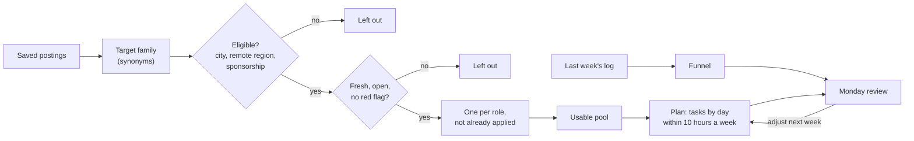

# Capstone: a 30-day job search plan

Business question: can you turn your targets, filters and funnel into a 30-day plan that a checker can verify?

## Before you start

- **Level:** 4 (land the job). A capstone: a messy brief, two messy files, and a deliverable you can run on your own search.
- **Time:** about 6 hours.
- **Builds on:** every lesson in this phase: [Build a target list from real postings](../01-build-a-target-list/), [Search smarter: titles and synonyms](../02-titles-and-synonyms/), [Visa-aware search](../03-visa-aware-search/), [Remote, really](../04-remote-where-you-can-be-hired/), [Apply where it counts](../05-apply-where-it-counts/), [Track your search as a funnel](../06-track-your-search-as-a-funnel/) and the guide [Using Real Analyst Jobs in your search](../07-using-real-analyst-jobs/). Also [Funnel conversion](../../03-metrics-and-product-analytics/02-funnel-conversion/) and [Read job postings like data](../../07-getting-hired/01-read-job-postings-like-data/).
- **You need:** Python 3.9 or later. Nothing to install.
- **How this capstone is built:** like the [phase 10 capstones](../../10-capstone-projects/README.md). [BRIEF.md](BRIEF.md) is the request, [DELIVERABLES.md](DELIVERABLES.md) says what to hand in and every rule the checker uses, [RUBRIC.md](RUBRIC.md) scores the parts with no single right answer, and `solution/` is the worked answer to read after you finish.

## The problem

Kavya Menon, a fictional MIS executive in Pune, India, spent last week applying to everything that looked right and got a few recruiter calls, one interview and a lot of silence. She has 10 hours a week, no visa for any other country, and a spreadsheet of 246 saved postings, some stale, some reposted, some "remote" for the US only, one asking for a registration fee. Nikhil, her career coach at the fictional Lanternway Courses, asked you to build her a plan for 2 November to 1 December 2026 that a script can check, by Monday morning. Read her message and Nikhil's notes in [BRIEF.md](BRIEF.md).

The files in `data/` are synthetic, generated by `make_data.py` with a fixed seed, and every company in them is fictional: `postings.csv` (246 rows), `app_log.csv` (29 rows, her first week) and `profile.json` (her situation). The real numbers quoted below are in `data/real_snapshot_2026-10-31.json` with their source.

## In plain words

Think of a month of meal planning on a budget. You do not start by cooking. You check what is in the fridge (what you saved), throw out what has gone off (stale postings), skip what you are allergic to (roles you cannot be hired for), and only then write a menu that fits the money you have (hours per week). Every Sunday you look at what got eaten and adjust next week's menu. A job search plan is the same, with postings instead of food and hours instead of rupees.

Terms used in this capstone:

- **Posting:** one job advert as saved. **Role:** the job behind it, here a company, a title and a city. One role can be saved as two postings (a **repost**, or the same advert from a job board and from the company's careers page).
- **Eligible:** you can be hired for it on the posting's own words: right country or a city you will work in, a remote posting that names your country or region, or a posting abroad that says it sponsors visas.
- **Sponsorship:** an employer applying for the work visa you need. "Not stated" means the posting does not say; it is not a yes.
- **Stale:** posted more than 30 days ago, or already closed.
- **Red flag:** a phrase that marks a posting to skip, such as a fee to apply.
- **Synonym family:** titles that mean the same kind of job, such as "insights analyst" and "reporting analyst" in the data family.
- **Usable posting:** one that passes every filter and is not a role you already applied to.
- **Funnel:** the stages an application goes through (applied, screen, interview, offer) and the share that reaches each.
- **Screen:** a first call with a recruiter. **Screen rate:** applications that reached a screen, divided by applications.
- **Time card:** the minimum hours each kind of task takes, so a plan cannot pretend an application takes 15 minutes.
- **Plan week:** days 1 to 7 of the plan are week 1, days 8 to 14 week 2, and so on.

## What you will build from scratch

- `sponsorship_stated`, `red_flags`, `is_eligible`, `is_stale`, `title_family` and `role_key`: the filters, one rule each.
- `usable_postings`: the pool to apply from, one per role, without last week's roles.
- `funnel`: last week's numbers, with the duplicates and the renamed stage handled.
- `weekly_hours` and `build_plan`: a 30-day plan as a dict, saved as `plan.json`.
- `plan_problems`: your own checker, which names every rule a plan breaks.
- A calendar, a weekly review template and a one-page note to Kavya ([DELIVERABLES.md](DELIVERABLES.md)).

## The idea

A plan is a set of promises you can check. Filter first, so every hour goes to a posting that could say yes. Then fit the work into the hours. Then decide, in advance, what you will look at every week and what you will change.



The rules are written once, in [DELIVERABLES.md](DELIVERABLES.md). The ones with arithmetic in them:

- week = (date - 2 November) in days // 7 + 1, so 30 November and 1 December are week 5.
- budget(week) = 10 x (days of the plan in that week) / 7: 10 hours for weeks 1 to 4, 10 x 2 / 7 = 2.86 hours for week 5.
- applications that fit in a full week = (10 - review 1 - search 0.5 - networking 2 x 0.5) / 1.5 = 5.
- screen rate = applications that reached a screen or later / applications. An application counts once however many rows it has, and `phone_screen` and `screen` are one stage.

Why the synonym families matter: titles vary more than you think. In Real Analyst Jobs data retrieved 31 October 2026 (tool `company_analyst_hiring`), none of the eight most common titles in Amazon's analyst-related roles said "Data Analyst"; they included Senior Financial Analyst, Business Analyst, Operations Analyst and Business Intelligence Engineer II. A search for one phrase finds one family.

## Walk through

This walk through measures the mess and shows what each filter does. It stops before the plan, which is yours to build. Run the blocks in order in one Python session started in this folder (`python3`).

Step 1. Load the files and look at where the postings are.

```python
import csv, json
from collections import Counter

def read(name):
    with open("data/" + name + ".csv", newline="") as f:
        return list(csv.DictReader(f))

postings, log = read("postings"), read("app_log")
profile = json.load(open("data/profile.json"))
print(len(postings), "postings,", len(log), "log rows")
print(Counter(p["work_mode"] for p in postings))
print(Counter((p["country"] if p["work_mode"] != "remote" else "remote:" + (p["remote_regions"] or "not stated"))
              for p in postings).most_common())
```

```
246 postings, 29 log rows
Counter({'hybrid': 91, 'onsite': 85, 'remote': 70})
[('IN', 129), ('remote:IN', 18), ('remote:not stated', 16), ('remote:US', 16), ('SG', 16), ('US', 13), ('DE', 9), ('GB', 9), ('remote:GB;IE', 7), ('remote:APAC', 5), ('remote:IN;SG', 4), ('remote:WORLDWIDE', 4)]
```

70 postings say remote. Only the ones that name India, APAC or worldwide (18 + 5 + 4 + 4 = 31) are open to Kavya on their own words.

Step 2. Sort every posting by the rule that decides whether she can be hired.

```python
def where_rule(p):
    text = p["description"].lower()
    if p["work_mode"] == "remote":
        named = set(p["remote_regions"].split(";")) & {"IN", "APAC", "WORLDWIDE"}
        return "remote, open to India" if named else ("remote, no country named" if not p["remote_regions"]
                                                      else "remote, other countries only")
    if p["country"] == "IN":
        return "India, her cities" if p["city"] in profile["onsite_cities"] else "India, other cities"
    if any(w in text for w in ("no visa sponsorship", "unable to sponsor", "must have the right to work")):
        return "abroad, says no sponsorship"
    if any(w in text for w in ("visa sponsorship available", "we sponsor visas")):
        return "abroad, says it sponsors"
    return "abroad, sponsorship not stated"

for rule, n in Counter(where_rule(p) for p in postings).most_common():
    print("%-32s %3d" % (rule, n))
```

```
India, her cities                 81
India, other cities               48
remote, open to India             31
remote, other countries only      23
abroad, sponsorship not stated    20
remote, no country named          16
abroad, says no sponsorship       14
abroad, says it sponsors          13
```

The "no" check runs before the "yes" check, so a posting that says both ("we sponsor visas ... must have the right to work") lands in "says no". Only three of these eight lines are eligible: her cities, remote open to India, and abroad with a stated yes.

Step 3. Stale, closed, red-flagged and repeated.

```python
import datetime
start = datetime.date.fromisoformat(profile["plan_start"])
def age(p):
    return (start - datetime.date.fromisoformat(p["posted_date"])).days
flags = ("registration fee", "pay for your training", "guaranteed job", "whatsapp only", "security deposit")
print("older than 30 days:", sum(1 for p in postings if age(p) > 30))
print("closed before 2 Nov:", sum(1 for p in postings if p["closes_on"] and p["closes_on"] < "2026-11-02"))
print("closing during the plan:", sum(1 for p in postings if p["closes_on"] >= "2026-11-02"))
print("red-flagged:", sum(1 for p in postings if any(f in p["description"].lower() for f in flags)))
roles = Counter((p["company"].lower(), p["title"].lower(), p["city"].lower()) for p in postings)
print("roles saved more than once:", sum(1 for n in roles.values() if n > 1))
by_id = {p["posting_id"]: p for p in postings}
done = {(by_id[r["posting_id"]]["company"].lower(), by_id[r["posting_id"]]["title"].lower(),
         by_id[r["posting_id"]]["city"].lower()) for r in log}
print("of them, roles she applied to last week:", sum(1 for k, n in roles.items() if n > 1 and k in done))
```

```
older than 30 days: 45
closed before 2 Nov: 24
closing during the plan: 60
red-flagged: 23
roles saved more than once: 19
of them, roles she applied to last week: 4
```

60 postings close during the plan, so the date of each application matters, not only the posting. Four roles she already applied to are in the list again under another id; applying again would be a second application to the same job.

Step 4. One search term against the synonym families.

```python
families = {"bi": ["business intelligence", "bi analyst", "bi developer"],
            "product": ["product analyst", "growth analyst"],
            "business": ["business analyst", "operations analyst"],
            "data": ["data analyst", "insights analyst", "reporting analyst", "analytics analyst"]}
every_term = [t for ts in families.values() for t in ts]
targets = [p for p in postings if any(t in p["title"].lower() for t in every_term)]
for terms in (["data analyst"], ["data analyst", "business analyst"], every_term):
    found = sum(1 for p in targets if any(t in p["title"].lower() for t in terms))
    print("%2d terms find %3d of %d target-family postings" % (len(terms), found, len(targets)))
```

```
 1 terms find  35 of 189 target-family postings
 2 terms find  74 of 189 target-family postings
11 terms find 189 of 189 target-family postings
```

Kavya's one search found fewer than one in five of the roles she wants. The checker asks that your search terms find every usable posting.

Step 5. Last week's funnel, the naive way and the right way.

```python
print(Counter(r["event"] for r in log))
naive_screens = sum(1 for r in log if r["event"] == "screen")
naive_apps = sum(1 for r in log if r["event"] == "applied")
print("naive: %d screens / %d applied rows = %.1f%%" % (naive_screens, naive_apps, 100 * naive_screens / naive_apps))
apps = {r["application_id"] for r in log}
screened = {r["application_id"] for r in log if r["event"] in ("phone_screen", "screen", "interview", "offer")}
print("clean: %d screened / %d applications = %.1f%%" % (len(screened), len(apps), 100 * len(screened) / len(apps)))
```

```
Counter({'applied': 18, 'screen': 4, 'phone_screen': 3, 'rejected': 3, 'interview': 1})
naive: 4 screens / 18 applied rows = 22.2%
clean: 5 screened / 17 applications = 29.4%
```

There are 18 `applied` rows but 17 applications: one was typed twice. The naive count misses the three `phone_screen` rows from before the template change. Five distinct applications reached a screen; counting distinct applications also stops a screen typed twice from counting twice.

Step 6. How much fits in a week.

```python
card = {"apply": 1.5, "network": 0.5, "search": 0.5, "review": 1.0}
fixed = card["review"] + card["search"] + 2 * card["network"]
print("fixed hours per week:", fixed, "-> applications that fit:", int((profile["hours_per_week"] - fixed) // card["apply"]))
print("last week: days", 30 - 28, "budget %.2f hours" % (profile["hours_per_week"] * 2 / 7))
```

```
fixed hours per week: 2.5 -> applications that fit: 5
last week: days 2 budget 2.86 hours
```

Five tailored applications a week plus the review, a search refresh and two referral asks fill 10 hours exactly. Over four full weeks and the two extra days that is about 21 applications, which is why the checker asks for at least 16. Now build the rest: the functions in `exercise.py`, then the plan.

## Common mistakes

**1. Counting log rows instead of applications (the trap).** Step 5 shows it: 22.2% instead of 29.4%. The duplicate row inflates the denominator, and the rename hides three screens. Any rate from a hand-kept log needs the same two checks: one row per application and stage, and one name per stage.

**2. Treating "remote" as "open to me".** 70 postings say remote; 39 of them name only other countries (23) or no country at all (16). Real data says the same thing at a larger scale (see the last section). Until the listing says it hires from your country, it is a question for the recruiter, not an application.

**3. Treating "not stated" as a yes.** 20 postings abroad say nothing about sponsorship. For someone who needs a visa, each of them is 1.5 hours that is likely wasted. Apply abroad only where the posting says it sponsors, and if a posting says both, believe the no.

**4. Re-applying to a repost.** Four roles Kavya applied to last week are in her list again under new ids. A filter on `posting_id` lets them through; a filter on the role (company, title, city) does not.

**5. A plan that only fits on paper.** Thirty applications a week "at 20 minutes each" passes a weekly-hours check and fails in real life. The time card sets a floor per task, and the checker enforces it.

**6. Reading a rate from 4 applications.** Referrals gave 2 screens out of 4. That is a reason to keep a small, measured bet on referrals, not proof that referrals work half the time. Put the counts next to every rate in the review.

## Your turn

Open [DELIVERABLES.md](DELIVERABLES.md). It lists everything to hand in and the exact rules. Fill in every function in `exercise.py`, then run, from this folder:

    python3 test_lesson.py

The test runs your functions on the committed data, on a second dataset built from another seed, and on hand-made cases: a posting that says both yes and no to sponsorship, a posting exactly 30 days old, a remote posting with no country, a repost of a role in the log, an empty log, a log with no screens, and a small valid plan broken one rule at a time, which your `plan_problems` must name. Then `python3 exercise.py` writes `plan.json`, and the test checks the file as well. To check the reference answer: `CHECK_SOLUTION=1 python3 test_lesson.py`.

Then build the calendar, the weekly review template and the note to Kavya, and score them with [RUBRIC.md](RUBRIC.md). Read `solution/` only after that: [solution/WRITEUP.md](solution/WRITEUP.md) is a two-point answer on every rubric row, with the reasoning.

Stretch: run your plan on your own search. Save 50 postings you found this week into the same columns, write your own `profile.json`, and let `plan_problems` check the plan you would have made by hand.

## Check yourself

1. A posting in London says "We sponsor visas for this role. You must have the right to work in this country." Is it on Kavya's list?
2. Kavya's log has 18 `applied` rows. Why is her screen rate not "screens / 18"?
3. Why does the checker test the rules of a plan but not the order of its applications?
4. After week 2, referrals show 3 screens from 6 applications and job boards 2 from 14. What do you change, and what do you say about it?

<details>
<summary>Answers</summary>

1. No. The posting contradicts itself, and the second sentence rules her out in its own words. When a posting says both, believe the no, and if the role matters, ask the recruiter before spending 1.5 hours on it.
2. One application was typed twice, so there are 17 applications. And the screens are under two names because she changed templates on 29 October. Count distinct applications that reached a screen or later: 5 of 17, 29.4%.
3. The rules (eligible, fresh, within hours, inside the dates) have one right answer and the plan is useless if any is broken. The order is a judgement: level first, tool match first, or closing date first are all defensible, so the rubric scores the reasoning instead.
4. Move one application slot a week to two more referral asks, and keep measuring. Say it with the counts: 3 of 6 against 2 of 14 is a big gap, but 6 referral applications is still a small sample, so this is a bet you review next Monday, not a proven rate.

</details>

## What to tell the stakeholder

To Kavya: "Here is a 30-day plan with 21 applications, 5 a week, only to roles you can be hired for on the posting's own words; of the 246 you saved, 52 pass every filter, and the rest are outside your four role families (57), roles you cannot be hired for (94), stale or closed (29), red-flagged (3), or roles you already applied to or saved twice (11). Every Monday, spend an hour on the funnel: last week was 17 applications and 5 screens (29.4%), with 2 of the 5 from just 4 referrals, which is too small to bank on but enough to keep two referral asks a week and watch. This plan cannot promise a reply or a job; it makes sure your 10 hours go to roles that could say yes."

## In real job postings

In the Real Analyst Jobs open data drop of 25 October 2026, India had 1,174 live analyst postings from 385 companies ([data/job-market/2026-10](../../../data/job-market/2026-10/)). Of the remote analyst-titled roles in Real Analyst Jobs data retrieved 31 October 2026 (tool `remote_jobs_from_country`, India), 18 were based in India and 136 named no country, which is why this plan asks the posting before it counts a remote role; compare [remote data analyst jobs worldwide](https://realanalystjobs.com/jobs/remote-data-analyst-jobs-worldwide) and the [analyst job market report](https://realanalystjobs.com/analyst-job-market).

## Next

[Back to the phase overview](../README.md)
